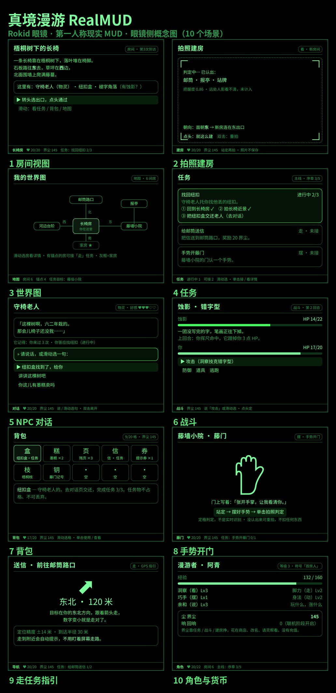

# 真境漫游 RealMUD — 项目总台账

真境漫游 RealMUD 是一个运行在 Rokid 眼镜上的第一人称现实 MUD：玩家真实地走在世界里，用拍照把眼前的场景变成游戏房间（AI 判定生成房间、物灵与任务），靠转头、点头、静态手势与真实步行推进游戏。本文件夹是这个项目的**全部材料与工程的唯一存放处**——架构、规划、概念图、探针与后续游戏本体都放这里，协作者只看这一个文件夹就齐。



> 本 README 是项目总台账：路线图状态表在此维护，状态以此表为准。

## 文档索引

| 文档 | 说明 | 状态 |
|---|---|---|
| [ARCHITECTURE.md](ARCHITECTURE.md) | 技术架构 v0.1：六层架构、统一判定管线、存档设计、阶段划分与硬验收 | 已交付，待 GO 点头 |
| [GAME-DESIGN.md](GAME-DESIGN.md) | 游戏规划 v0.1：世界观（字界 / 物灵 / 蚀影 / 补字）、主线六章、20 个系统、五维与双货币、数值初版 | 已交付，待 GO 审阅（待拍板：P1 基调 / P2 货币名 / P3 五维名） |
| [concepts/](concepts/) | 10 张眼镜侧概念图（房间、建房、地图、任务、NPC 对话、战斗、背包、手势开门、步行引导、角色）+ 合辑长图。概念稿，非实现截图 | 已交付 |

## 目录结构

```
MUD/
  README.md            本台账
  ARCHITECTURE.md      架构 v0.1
  GAME-DESIGN.md       游戏规划 v0.1
  concepts/            概念图 10 张 + 合辑（png/jpg）
  real-mud-probe/      探针工程本体（真境探针）
  screenshots/real-mud-probe/   探针全页预览截图（7 张）
  aix/real-mud-probe.aix        探针打包产物
```

## 路线图与状态

| 阶段 | 内容 | 状态 | 日期 |
|---|---|---|---|
| 阶段 0 | 架构与规划（ARCHITECTURE v0.1 + GAME-DESIGN v0.1 + 概念图） | 已交付，待 GO 点头 | 2026-10-29 |
| 探针 | real-mud-probe：存储 / 手势认对率 / 朝向误差与头稳 / 判定分段耗时 四站 + 结果单 | 已建成（commit 见成员表；AIX 31,785 B；截图 7 张）；真机状态：待 GO 真机一轮 | 2026-10-29 |
| 阶段 1 | 单机测试版：最小闭环上真机，GO 玩一轮只盯操作，收尾冻结《操作定义 v1》 | 未开工（等架构点头；探针数据是开工输入） | — |
| 阶段 2 | 单机完整版 | 未开工 | — |
| 阶段 3 | 联机版（自建后端，复用 rokidpost 的 Cloudflare 模式） | 未开工 | — |
| 阶段 4 | 提审与发布 | 未开工 | — |

## 成员与导入

| 成员 | slug | 分支 | Studio 导入地址 | 状态 |
|---|---|---|---|---|
| 真境探针（探针，不占正式游戏本体） | `real-mud-probe` | `agent-real-mud-probe` | `https://github.com/sakai55/rokid/tree/agent-real-mud-probe` | 已建成，待 GO 真机一轮；不提审 |

正式游戏本体建成后在同表登记（同放本文件夹，分支与导入地址照此例）。

## 真机测试与反馈

- 导入打包：在 Global AIUI Studio 用上表地址导入探针 →（可选）按探针 README「打包前必做」填 `config.js` → 打包 → 手机 Rokid AI App 更新眼镜资源包 → 眼镜上打开「真境探针」。
- 反馈三路（任选其一）：① 日志回传——打包前在 Studio 里给探针的 `config.js` 填好前门地址与钥匙，四站结果自动上报；② 拍结果单——打开结果单页拍一张发回，四站关键数都在；③ 报裸码——哪站出错就报眼镜上显示的 E 码。

## 更新纪律

本 README 随每个里程碑在同一次提交里更新，项目状态以此表为准。
