# 真境探针 Real MUD Probe

**Studio 导入地址**（复制到 Global AIUI Studio 的 Import Project 输入框）：

```
https://github.com/sakai55/rokid/tree/agent-real-mud-probe
```

真境漫游（RealMUD，第一人称现实 MUD）阶段 1 的前置合并探针：正式版开工前，先把四组说不准的数在真机上测出来。四站 + 结果单 + 设置自检，共 7 页。本探针不占正式游戏本体、不进根 README 清单、**不提审**，只做内部真机验证。项目总台账见 [MUD/README.md](../README.md)。

## 四站测什么

| 站 | 测什么 | 关键产出 |
|---|---|---|
| 存储探针 | localStorage 与 wx 存储各测：单值 1/10/50/100KB 写读校验、累计堆到失败或 500KB、样本房间块 JSON 往返、时间戳标记跨进程 | 各档 PASS/FAIL、累计成功 KB、标记在/不在 → 定阶段 1 存档载体 |
| 手势探针 | 开掌静态手势拍照判定（拍照→data URL→LLM 结构化 JSON），共 10 次，每次由测试者标真值 | 认对 x/10、每次把握度 → 决定手势开门走机器判定还是降级自评（认对 <5/10 降级） |
| 朝向探针 | 校准后依次朝东南西北转头，进 ±10° 停稳 0.8 秒记到达；点头单独计数 | 4 次到达误差（度）、头稳耗时、点头计数 → 定转头选出口的可行性与阈值 |
| 判定耗时 | default 拍照建房判定全程分段计时 3 次，附带非阻塞定位 | 拍照/编码/LLM/总 ms、把握度、认出物数、定位精度 → 定玩家体感等待与管线优化点 |

结果单共 5 屏（第 1 屏四站大字汇总 + 存储逐项 / 手势逐次 / 朝向逐向 / 判定逐次四段明细），持久保存、可翻回看，就是主反馈面。

## 信号诊断（v1.0.3 自动探测序列，首页）

为什么有这一节：v1.0.0 / v1.0.1 两版都没解决真机上「滑动选择有问题」，而选择通道本身就是坏掉待测的部分——诊断不能再依赖用户去操作菜单逐个试。v1.0.3 起首页内置一条自动探测序列（取代 v1.0.2 的手动逐个试）：

**流程**：打开探针停在首页 → 点一次头开始（不点头也行，进页约 5 秒自动开始，连 nod 通道坏没坏都测得到）→ 屏幕逐项出大字提示，按提示做 5 个动作即可（① 点头 ② 下滑 ③ 上滑 ④ 单击 ⑤ 双击），每项窗口 6 秒、项间约 1 秒过渡屏 → 五项完自动停在汇总屏（约 10 秒）→ 自动进入「结果图」逐帧循环播放（点头暂停/继续当前帧方便截屏，双击退出）。全程用户不做任何选择操作；汇总同时落盘（results 的 `diag` 字段），重开首页时待机屏有一行「上次信号探测：点头✓ 下滑✗ …」可重看。序列进行中菜单选择停用，输入全归序列记录；KEY / GES 原始行（v1.0.2 探头）在全程继续实时更新，屏显与回传同源。

**执行纪律（GO 定，全探针适用；信号序列已按此实现）**：

1. **单独跑（隔离）**：每一项开始前清空该项的捕获缓冲与计时，上一项的计时停干净、捕获闸门关掉才开下一项；一项只测一个原子功能，不混测；结果逐项独立落盘，一项崩坏不污染其他项。
2. **按顺序跑**：严格 1→5 串行，任何时刻只有一个测试在跑，绝不并发；回传 flush 也等当前项窗口结束后再发，不与捕获抢跑道（`log()` 只入本地队列、不发送，发送只在每项结束与汇总时由 `flushLog()` 触发）。
3. **屏显跑的状态**：探测进行中屏幕固定有状态区——当前第几项/共几项、当前项名称、状态（等待中 / 记录中·剩余秒数 / 已完成✓ / 无信号✗ / 出错+裸码），以及已完成项的逐项结果列表（随跑随长）。跑到哪、跑成什么样，一眼可见。
4. **一步步**：上一项未结束（完成 / 超时 / 出错跳过）绝不启动下一项；每项之间留约 1 秒过渡屏（显示「下一项：……」）让节奏可辨。

四站内部本来就是逐项串行（存储逐档、存储双后端分开、朝向逐向、判定逐次），与此纪律一致，本版未动四站代码。

**全程自动原则**：序列每一步都有硬超时，全局另有一只看门狗（总时长 + 余量内没走到汇总就强制收尾、缺项记未完成）；任何一步内部出错记裸码（E9001）跳下一项，序列永远能走到汇总屏与结果图，任何环节不停下来等用户确认或选择。用户只在整机卡死时才需要干涉（退出重开，已落盘结果可重看）。

**探测完了三件输出**：

1. **屏显结果单**：序列走完自动停在汇总屏，五项逐项 ✓/✗ + 每项第一条事件原文，不用用户翻找；汇总同时落盘，首页待机行与结果单都可重看。
2. **通道全量回传（日志）**：配了钥匙时（见下「打包前必做」），窗口内捕获的**每一个**事件都逐条上报（步名 `diag-ev`，内容 = 项号 + 窗口内相对时刻 + 事件类型 + code/key/kc 三字段原文），另有逐项判定 `diag-1`…`diag-5` 与最终汇总 `diag-summary`；条数多就多发几条（logq 单批 ≤50 的既有机制照用），每项结束与序列结束各 flush 一次。不只报第一条。
3. **结果图截屏入相册（本地图片）**：汇总屏之后自动进入结果图逐帧展示——每一项一帧（该项全部事件逐条小字列全，一帧装不下拆多帧），每帧带帧标 `结果图 N/M · 第X项 名称 · v1.0.3`，每帧停约 10 秒自动下一帧、循环播放，点头暂停/继续，双击退出。诚实注：媒体库写入只有权限名、没有官方文档化的保存 API（能力注册表 §5 第 12 条未明），Agent 不能自己把图写进相册；结果图的用途就是摆满屏让用户截屏，截屏图经手机 App 落相册——这是既定的截屏出货通道。

## 打包前必做（日志回传配置）

日志回传是可选件，不配不影响探针任何功能。配的步骤（照大表哥 channel.js 成例，配置只在 `config.js` 一处）：

1. 导入 Studio 后，打开 `config.js`：`BASE_URL` 是前门地址——用默认前门（rokidpost，值已在文件里）可以不改；换前门才改它（完整 URL：带 `https://`、末尾不带斜杠、不带路径）。
2. 把 `CHANNEL_KEY` 的占位符 `PASTE_CHANNEL_KEY_HERE` 换成真钥，再打包。

两件齐了才发，缺任一件完全静默。**每次重新导入工程都要重填**（仓库里永远只有占位符）；真钥只在 Studio 里填，永不回推仓库，Muse 不持有真钥。

## 反馈三路（真机测完怎么把数传回来）

1. **日志回传**：按上节配好 config，四站结果与结果单汇总自动上报，在项目聊里由 Muse 拉取呈现。
2. **拍结果单（本地图片路）**：不依赖网络与钥匙——结果单共 5 屏（汇总 + 四段明细：存储逐项 / 手势逐次 / 朝向逐向 / 判定逐次），在结果单页用「明细下一屏」逐屏翻，逐屏截屏或拍照发回，即带回四站全部原始数（每档 ✓/✗ 与累计、逐次判定与把握、逐向误差与头稳、逐次四段耗时与定位）。
3. **报裸码**：哪一站出问题，把眼镜上显示的错误码（如 E7008）报回来即可对表定位；最近一次错误也存在设置页的 lastError 里。

## 手势映射

| 操作 | 行为 |
|---|---|
| 滑动（ArrowUp/Down） | 切换焦点 |
| 单击（Enter） | 执行焦点项 |
| 双击（Backspace） | 返回上一页 |
| 点头（onHeadGesture 'nod'） | 执行焦点项；朝向页例外——只计数，单测点头通道 |

首页例外（v1.0.3 起）：首页点头 = 开始信号自动探测序列，不再执行菜单焦点项（进站靠滑动 + 单击，或点按按钮）；序列汇总态点头 = 再跑一轮，结果图态点头 = 暂停/继续当前帧。

每页自行接 `onKeyDown`，不依赖屏幕按钮点按（真机上 bindtap-only 按钮不可触发）。

## 权限

- `CAMERA`：手势站、耗时站的定格拍照判定。
- `GEOLOCATION`：耗时站的非阻塞定位读取（记精度米数）。
- 不使用语音识别，不声明 `RECORD_AUDIO`。

## 图标

自绘绿色线条图标在 `assets/icon.svg`（房间节点图：中心点 + 四向出口线），导入 Studio 后在图标处上传它，不要用默认图标。

## 命令

```bash
# 打包（产物按项目口径放 MUD/aix/）
~/tools/bin/aix pack . -o ../aix/real-mud-probe.aix
# 预览 HTML（截图走本地管线，见 rokid-preview-screenshots skill）
~/tools/bin/aix preview . --html-out artifacts/preview.html
```

AIX：`../aix/real-mud-probe.aix`，54,465 B（v1.0.3）。

## 错误码

本台遵循全局错误码表（仓库根 `ERROR-CODES.md` v1.14.0，裸码 E####）。出错时屏显码 + 一行说明，最近一次错误保存在 `lastError`（码 + slug + 版本 + 原文截断），回报时报码即可。
本台可出：E1001、E1002、E1003、E1007、E1009、E2013、E5001、E5002、E6001、E6002、E6003、E6005、E6009、E6011、E7001、E7002、E7003、E7006、E7008、E8001、E9001。

## 预览截图

Web 预览无真相机/LLM/传感器：手势、耗时两站与朝向的传感器部分在预览里会如实以裸码失败，截图是初始界面；存储站在预览里可真跑（浏览器存储宽松，只证明逻辑）。真机行为以真机一轮为准。

信号诊断四态截图说明：预览无真输入，自动序列靠自身计时走完——探测态/汇总态五项均为 ✗ 无信号、结果图帧内事件列为「（窗口内零事件）」，这是预览的诚实状态；真机上有信号后同一批屏会逐项列全真实事件。

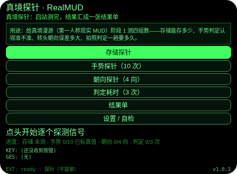
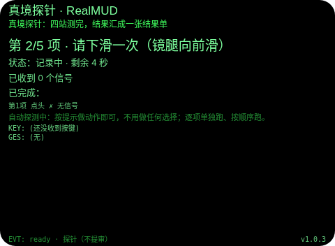
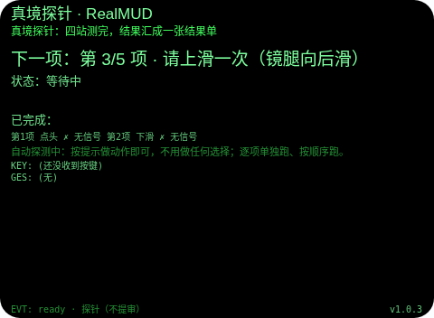
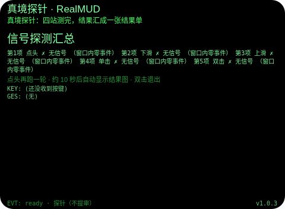
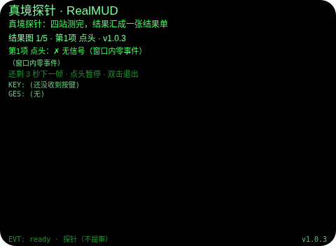
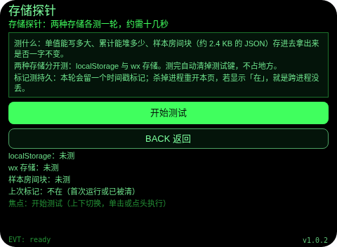
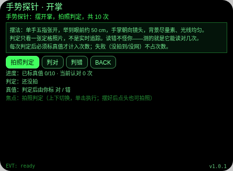
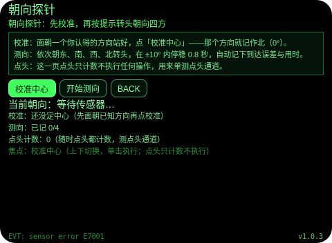
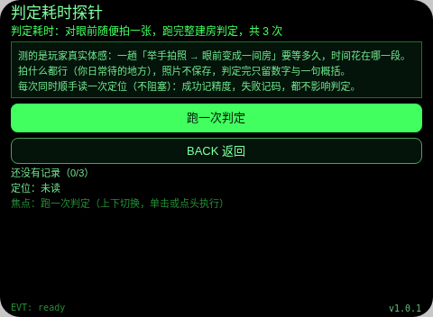
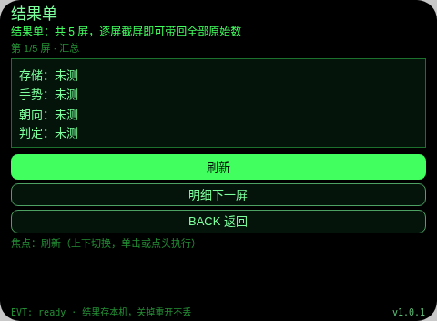


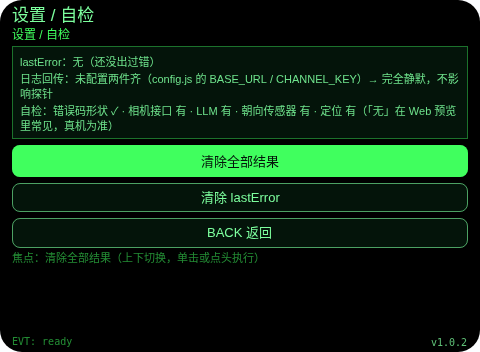
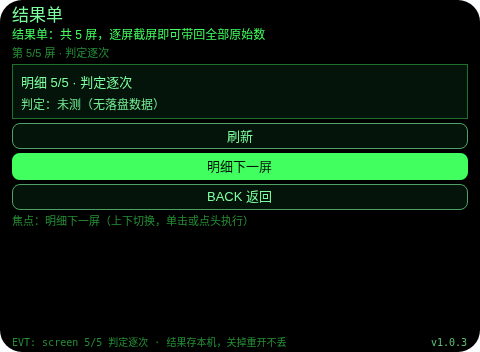


## 设备测试信息

| 项 | 值 |
|---|---|
| Studio 名 | 真境探针（Real MUD Probe） |
| Version / Build | 1.0.3 / —（未导入） |
| App Category | —（探针不提审，导入时按 Studio 要求选工具类） |
| Intent Description | 四站真机探针：存储/手势判定/朝向/判定耗时 |
| Agent ID | —（未导入） |
| 状态 | v1.0.3 已建成，待 GO 导入真机一轮（首页信号自动探测序列）；不提审 |

## 提审资料 (Review Submission)

本探针**不提审**（内部验证用，定位同描红系列探针）。以下字段仅为结构完整而保留，均为不适用：

- Feature Description：不适用（不提审）。
- Opening Message：不适用（不提审）。
- Preview Media：预览截图 15 张见上（内部用）；无提审视频。
- Change Log：见下。

## Change Log

### 1.0.3（信号自动探测版）
- 信号诊断改自动序列（GO 指令「不用用户操作，进去后，用户点头，直接逐个探测」，取代 1.0.2 的手动逐个试）：首页待机点一次头开始（触发的那次 nod 本身即第 1 项证据），进页约 5 秒无 nod 也自动开始；五项（点头 / 下滑 / 上滑 / 单击 / 双击）逐项开 6 秒窗全量记录（每事件的类型 + code/key/kc 三字段原文 + 窗口内相对时刻，收到期望信号不提前结束、重复投递记全），项间约 1 秒过渡屏；走完自动停在汇总屏（约 10 秒），再自动进入结果图逐帧循环。序列中菜单停用；首页点头语义改为开始探测（见手势映射首页例外）。汇总落盘 results.diag（逐项 ok / 首事件 / 全部事件 / 时间），重开首页待机行显示上次逐项 ✓/✗。
- 探测完了三件输出：① 屏显结果单（自动停汇总屏，逐项判定 + 首事件原文）；② 通道全量回传——每个事件逐条以 diag-ev 上报，逐项 diag-1…diag-5、汇总 diag-summary，flush 只在每项窗口结束与序列结束时发（log() 只入本地队列）；③ 结果图逐帧截屏入相册——每项一帧列全该项全部事件（装不下拆帧），帧标「结果图 N/M · 第X项 名称 · v1.0.3」，每帧约 10 秒循环，点头暂停/继续、双击退出；Agent 不能自己写相册（媒体库保存无官方文档化 API，注册表 §5 第 12 条未明），走既定截屏出货通道。
- 全程自动与看门狗：每项硬超时 6 秒、全局看门狗兜底收尾，内部出错记裸码 E9001 跳下一项，序列永远走到汇总与结果图，不停下等用户确认；用户只在整机卡死时干涉。
- 执行纪律入册（GO 本轮指令）：原子功能测试单独跑（隔离清缓冲、逐项独立落盘）、按顺序跑（严格串行绝不并发，flush 等窗口结束）、屏显跑的状态（状态区实时显示项序/名称/状态 + 已完成列表随跑随长）、一步步（上一项未结束绝不启动下一项、项间过渡屏）。信号序列已按此实现；四站内部逐项串行与此一致，未动四站代码。

### 1.0.2（诊断版）
- 目的：v1.0.0（先读 `event.key`）与 v1.0.1（`event.code` 优先）两版在真机上都没解决「选择还是有问题」，说明真机按键事件的真实形状与文档/预览的假设仍有出入。这一版不再猜修法，只在首页加一个原始事件探头，把真机信号抓回来；除此之外与 v1.0.1 完全一致（选择/导航逻辑零改动）。
- 抓什么：首页进度行下两行诊断显示——`KEY` 行：收到的每一个 keydown / keyup 事件，把 `event.code` / `event.key` / `event.keyCode`（或 `which`）原样拼成一行（如 `KEY down code=ArrowDown key=ArrowDown kc=40`，缺失字段印 `-`），初始为 `KEY: (还没收到按键)`；`GES` 行：`onHeadGesture` 收到任何事件时把 gesture / type 字段原样印出，初始为 `GES: (无)`。两行同时经 logq 以 `key` / `ges` 步名上报同一字符串（没配钥匙时静默、屏显照常）。探头只记录：不做任何匹配判断、不拦截、不 preventDefault，与原有选择处理并存。
- 怎么读：导入打包后打开探针、停在首页，滑动 / 单击 / 双击 / 点头各做几次，看首页 KEY / GES 两行最后显示什么（或把这两行经日志回传/拍屏带回）——拿到真机事件的真实字段值之后，下一版才对症修选择逻辑。

### 1.0.1
- Fixes：真机上滑动/单击选不了任何功能。根因——7 页 `onKeyDown`/`onKeyUp` 都先读 `event.key`（`event.key || event.code`），真机运行时 `event.key` 的值不可靠且会遮蔽 `event.code`，ArrowUp/Down/Enter 全部匹配不上；Web 预览里 Chromium 的 `event.key` 恰好是标准值，所以预览测不出。改法（照大表哥、glasses-benchmark 修复版的真机成例）：按键一律以 `event.code` 为准、缺失才回退 `event.key`；Enter 与 GlobalHook 执行焦点、ArrowDown/ArrowUp 切焦点、Backspace 返回；`onKeyUp` 同样按 code 判断并 preventDefault 挡宿主默认动作。另修首页焦点表与按钮不一致：MENU 去掉没有按钮的「BACK 退出」项（7 项 → 6 项，与 6 个按钮对齐），退出靠双击 Backspace（与手势映射一致）；其余 6 页动作表与按钮数逐页核对一致。
- Improvements：焦点高亮改为 data 的 cls 驱动——当前焦点项按钮实心、其余描边，与底部 focusLine 文字双保险（v1.0.0 时焦点只写在文字里、按钮高亮固定在第一项，看不出选了谁）。每页页脚改 flex row：左侧 EVT 等原文，右下角固定单独显示版本号（照大表哥 foot-row + .ver 成例）。结果单由一屏扩为 5 屏（汇总 + 存储逐项 / 手势逐次 / 朝向逐向 / 判定逐次四段明细，新增焦点动作「明细下一屏」逐屏翻），每段逐项列全落盘原始数——网络日志回传不可用时，逐屏截屏/拍照即可独立带回全部结果。

### 1.0.0
- Features added：四站探针（存储双后端四项、手势开掌判定 10 次真值标注、朝向校准 + 四向误差与头稳、判定分段计时 3 次 + 非阻塞定位）、结果单大字汇总、设置/自检（lastError 显示、清除结果）、可选日志回传（config.js 双配置，照 AV11 logq 形态）。
- Improvements：无（首版）。
- Fixes：无（首版）。
