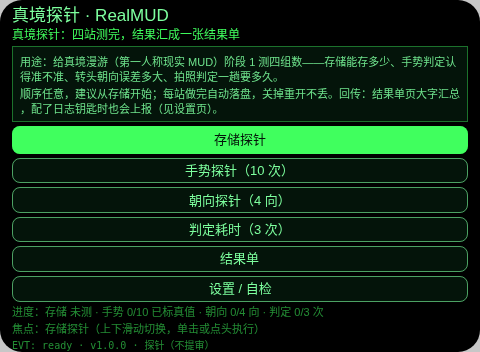
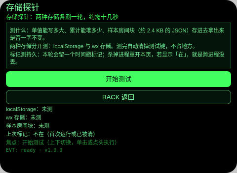
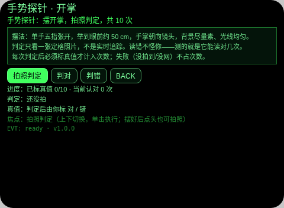
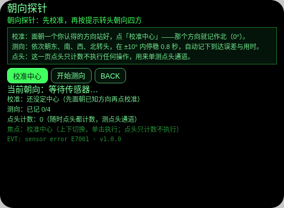
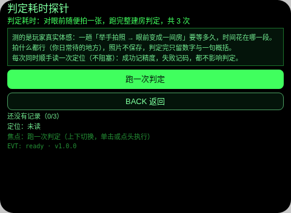
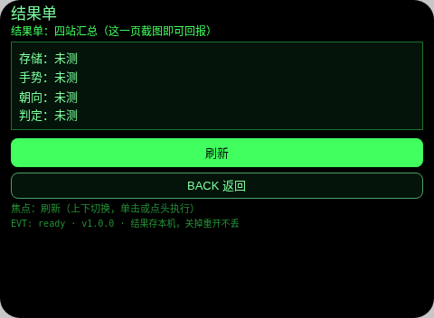
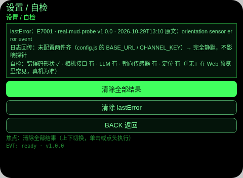

# 真境探针 Real MUD Probe

**Studio 导入地址**（复制到 Global AIUI Studio 的 Import Project 输入框）：

```
https://github.com/sakai55/rokid/tree/agent-real-mud-probe
```

真境漫游（RealMUD，第一人称现实 MUD）阶段 1 的前置合并探针：正式版开工前，先把四组说不准的数在真机上测出来。四站 + 结果单 + 设置自检，共 7 页。本探针不占正式游戏本体、不进根 README 清单、**不提审**，只做内部真机验证。项目总台账见 [MUD/README.md](../README.md)。

## 四站测什么

| 站 | 测什么 | 关键产出 |
|---|---|---|
| 存储探针 | localStorage 与 wx 存储各测：单值 1/10/50/100KB 写读校验、累计堆到失败或 500KB、样本房间块 JSON 往返、时间戳标记跨进程 | 各档 PASS/FAIL、累计成功 KB、标记在/不在 → 定阶段 1 存档载体 |
| 手势探针 | 开掌静态手势拍照判定（拍照→data URL→LLM 结构化 JSON），共 10 次，每次由测试者标真值 | 认对 x/10、每次把握度 → 决定手势开门走机器判定还是降级自评（认对 <5/10 降级） |
| 朝向探针 | 校准后依次朝东南西北转头，进 ±10° 停稳 0.8 秒记到达；点头单独计数 | 4 次到达误差（度）、头稳耗时、点头计数 → 定转头选出口的可行性与阈值 |
| 判定耗时 | default 拍照建房判定全程分段计时 3 次，附带非阻塞定位 | 拍照/编码/LLM/总 ms、把握度、认出物数、定位精度 → 定玩家体感等待与管线优化点 |

结果单页汇总四站大字数字，持久保存、可翻回看，就是主反馈面。

## 打包前必做（日志回传配置）

日志回传是可选件，不配不影响探针任何功能。配的步骤（照大表哥 channel.js 成例，配置只在 `config.js` 一处）：

1. 导入 Studio 后，打开 `config.js`：`BASE_URL` 是前门地址——用默认前门（rokidpost，值已在文件里）可以不改；换前门才改它（完整 URL：带 `https://`、末尾不带斜杠、不带路径）。
2. 把 `CHANNEL_KEY` 的占位符 `PASTE_CHANNEL_KEY_HERE` 换成真钥，再打包。

两件齐了才发，缺任一件完全静默。**每次重新导入工程都要重填**（仓库里永远只有占位符）；真钥只在 Studio 里填，永不回推仓库，Muse 不持有真钥。

## 反馈三路（真机测完怎么把数传回来）

1. **日志回传**：按上节配好 config，四站结果与结果单汇总自动上报，在项目聊里由 Muse 拉取呈现。
2. **拍结果单**：不配钥匙就打开结果单页，拍一张发回来，四站关键数都在上面。
3. **报裸码**：哪一站出问题，把眼镜上显示的错误码（如 E7008）报回来即可对表定位；最近一次错误也存在设置页的 lastError 里。

## 手势映射

| 操作 | 行为 |
|---|---|
| 滑动（ArrowUp/Down） | 切换焦点 |
| 单击（Enter） | 执行焦点项 |
| 双击（Backspace） | 返回上一页 |
| 点头（onHeadGesture 'nod'） | 执行焦点项；朝向页例外——只计数，单测点头通道 |

每页自行接 `onKeyDown`，不依赖屏幕按钮点按（真机上 bindtap-only 按钮不可触发）。

## 权限

- `CAMERA`：手势站、耗时站的定格拍照判定。
- `GEOLOCATION`：耗时站的非阻塞定位读取（记精度米数）。
- 不使用语音识别，不声明 `RECORD_AUDIO`。

## 图标

自绘绿色线条图标在 `assets/icon.svg`（房间节点图：中心点 + 四向出口线），导入 Studio 后在图标处上传它，不要用默认图标。

## 命令

```bash
# 打包（产物按项目口径放 MUD/aix/）
~/tools/bin/aix pack . -o ../aix/real-mud-probe.aix
# 预览 HTML（截图走本地管线，见 rokid-preview-screenshots skill）
~/tools/bin/aix preview . --html-out artifacts/preview.html
```

AIX：`../aix/real-mud-probe.aix`，31,785 B（v1.0.0）。

## 错误码

本台遵循全局错误码表（仓库根 `ERROR-CODES.md` v1.14.0，裸码 E####）。出错时屏显码 + 一行说明，最近一次错误保存在 `lastError`（码 + slug + 版本 + 原文截断），回报时报码即可。
本台可出：E1001、E1002、E1003、E1007、E1009、E2013、E5001、E5002、E6001、E6002、E6003、E6005、E6009、E6011、E7001、E7002、E7003、E7006、E7008、E8001、E9001。

## 预览截图

Web 预览无真相机/LLM/传感器：手势、耗时两站与朝向的传感器部分在预览里会如实以裸码失败，截图是初始界面；存储站在预览里可真跑（浏览器存储宽松，只证明逻辑）。真机行为以真机一轮为准。









## 设备测试信息

| 项 | 值 |
|---|---|
| Studio 名 | 真境探针（Real MUD Probe） |
| Version / Build | 1.0.0 / —（未导入） |
| App Category | —（探针不提审，导入时按 Studio 要求选工具类） |
| Intent Description | 四站真机探针：存储/手势判定/朝向/判定耗时 |
| Agent ID | —（未导入） |
| 状态 | 已建成待 GO 导入真机一轮；不提审 |

## 提审资料 (Review Submission)

本探针**不提审**（内部验证用，定位同描红系列探针）。以下字段仅为结构完整而保留，均为不适用：

- Feature Description：不适用（不提审）。
- Opening Message：不适用（不提审）。
- Preview Media：预览截图 7 张见上（内部用）；无提审视频。
- Change Log：见下。

## Change Log

### 1.0.0
- Features added：四站探针（存储双后端四项、手势开掌判定 10 次真值标注、朝向校准 + 四向误差与头稳、判定分段计时 3 次 + 非阻塞定位）、结果单大字汇总、设置/自检（lastError 显示、清除结果）、可选日志回传（config.js 双配置，照 AV11 logq 形态）。
- Improvements：无（首版）。
- Fixes：无（首版）。
