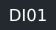

<div align="center">

# `rokid` — Rokid AIUI Agents

[中文](README.md) | English | [日本語](README.ja.md)
Translated from the Chinese version (as of 2026-10-29). In case of conflict, the Chinese version prevails.

**AIUI agent repository for Rokid AI glasses · Global edition**
Agents only, no apps. One repository holds every agent, and each one is imported into Studio through its own **branch**.


</div>

> [!IMPORTANT]
> **The import rule**: to import a single agent into Global AIUI Studio, use only its dedicated branch URL
> `https://github.com/sakai55/rokid/tree/agent-<slug>`.
> Subdirectory URLs, the repository root URL and blob URLs have all been tested and disproven (see [Studio Import](#studio-导入实测结论)).
> Fallback route: download `<slug>.aix` from the `aix/` directory and go through **Import from AIX**.

## Contents

- [Repository Structure](#仓库结构)
- [Quick Start](#快速开始)
- [Standard Workflow](#标准工作流)
- [Studio Import (Tested Conclusions)](#studio-导入实测结论)
- [Agent List](#agent-清单)
- [Overseas Chain (Global End to End, No Exceptions)](#海外链路全链路海外缺一不可)
- [Real-Device Testing (Cloud Delivery)](#真机测试云端下发)
- [Review Submission](#提交审核)
- [Maintenance Conventions](#维护约定)

## Repository Structure

```text
rokid/
├── README.md                  # This file
├── <category>/<slug>/         # Agents stored by numbered category; see the mapping in the list notes at the end
│   └── <slug>/                # One directory per agent (one complete AIUI project)
│       ├── app.json  AGENTS.md  app.js  package.json
│       ├── pages/             # .ink pages
│       └── README.md          # Opens with the Studio import block + real-device info table + review materials (this file governs)
├── aix/<slug>.aix             # Packaged AIX files for all agents, stored centrally, for the alternative import route
├── screenshots/<slug>/        # Preview screenshots stored centrally; agent READMEs embed them directly
├── skills/                    # Project skill library (official aiui-dev + in-house SOP / screenshot pipeline)
├── mcp/                       # MCP registry (servers in use, how they are accessed, where credentials are kept)
├── docs/                      # Docs: capability dossier CAPABILITIES.md (platform capability boundaries)
├── assets/                    # README assets (such as the workflow diagram workflow.svg)
└── branch agent-<slug>        # One branch per agent; the branch root is that agent's project root
```

## Quick Start

```bash
npm install -g @yodaos-pkg/aix-cli          # AIX CLI (pack / preview / show)
npm create @yodaos-pkg/aiui-agent@latest    # Official scaffolding
npx skills add https://github.com/jsar-project/AIUI/tree/main/skills/aiui-dev
                                            # aiui-dev skill (for coding agents)
aix pack . -o <slug>.aix                    # Pack inside the agent directory
aix preview .                               # Local preview (starts a server / --html-out exports HTML)
```

> [!WARNING]
> Before packing, the project root must have a `.aixignore` excluding `.agents/`, `.aix/`, `artifacts/`, `*.aix`,
> `skills-lock.json` and `node_modules/` — otherwise development files end up in the package (measured: 2.3 KB → 107 KB).

## Standard Workflow

<div align="center">


</div>

1. **Local development** — Develop and edit pages in the `<category>/<slug>/` directory.
2. **Preview** — `aix preview` produces preview images of **all pages** of the agent, stored in `screenshots/<slug>/`.
3. **Push to GitHub** — Push the directory to main; repack `<slug>.aix` into the `aix/` directory; sync the same files to the **root** of branch `agent-<slug>`.
4. **Studio import** — Paste the branch URL to import (see the next section); one branch imports one agent.
5. **Real-device testing** — Cloud delivery, see [Real-Device Testing](#真机测试云端下发).
6. **Review submission** — After real-device testing passes and the maintainer confirms, submit on the **Submit** tab (see [Review Submission](#提交审核)).

## Studio Import (Tested Conclusions)

The import dialog (`IMPORT PROJECT` / "GitHub Subdirectory Import") has **only one URL input field**,
with no branch/path picker; Studio treats the whole segment after `/tree/` **as a single ref** and does not split it into "ref + path".
Tested one by one on 2026-10-24:

| URL form | Result |
|---|---|
| ✅ `…/tree/agent-<slug>` | **The only one that works**: imports the branch root = one complete agent, full file tree; tested runnable and packageable |
| ❌ `…/tree/main/<slug>` (subdirectory) | `GitHub ref not found: main/<slug>` (the official repo `JellyFlow/AIUI/tree/main/samples/scanner` fails the same way) |
| ❌ `…/tree/<full commit SHA>/<slug>` | Same ref not found |
| ❌ Repository root URL | Imports, but produces a **hollow agent** (empty Code file tree) |
| ❌ `…/blob/main/<slug>/app.json` | Passes the import check, but Run reports "请先创建Agent的项目文件" |

**Key points of the branch method**

- The branch name must be a **single segment** (`agent-<slug>`), and the branch **root** holds the agent's complete file set.
- The imported Draft is named `sakai55/rokid`; rename it after entering Studio.
- To re-import after code changes: first sync the branch root, then paste the branch URL to import again, then follow the real-device flow.

<details>
<summary><b>Alternative: AIX import (fallback route)</b></summary>

1. In the repository's `aix/` directory, open `<slug>.aix` and download it locally.
2. Global AIUI Studio → New Agent → **Import from AIX**, and upload the file.
3. The import produces a Draft whose file tree is the complete project inside the package; from there follow the same Device Debug packaging → real-device testing flow.

It does not depend on GitHub URL parsing; use it when in a hurry or when the GitHub import misbehaves. The branch method is the everyday first choice.

</details>

## Agent List

All agents at a glance, in reverse order of completion, newest first; a newly finished agent is added at the top of the table.
For each agent's real-device status and review materials, see the README in its own directory.

**How to read the badges: the third column of each row holds the badges, from left to right: the ID badge, the series badge, and the conflict-status badge (one of three: Direct Conflict / High Overlap / Pending).**
An ID is 2 letters + 2 digits: the letters are the first two letters of the category's English name, the digits are the number within the group. **IDs are unique across the whole table: each letter pair belongs to only one series, and each ID appears only once** (the base items `my-agent` / `glasses-benchmark` are unnumbered and badgeless).

**Badge legend**:

<table>
<tr><td width="110"></td><td>A unique ID: the first two letters are the category, the last two digits the number within the group</td></tr>
<tr><td width="110"></td><td>Directional series: solving everyday problems with the gaze-coaxial view and head orientation</td></tr>
<tr><td width="110"></td><td>Attention add-on series: outsourcing the attention you would otherwise keep occupied to the glasses</td></tr>
<tr><td width="110"></td><td>Curb-cut series: solve a hard problem for a specific group first, then let it spill over to everyone else</td></tr>
<tr><td width="110"></td><td>Head-motion mini-games series: minimalist games played with head movements</td></tr>
<tr><td width="110"></td><td>AV series: centered on photo, video and voice interaction, each one pushing against a base audio/video capability boundary</td></tr>
<tr><td width="110"></td><td>Trace series: a model in the center and steps at the side; learn by doing one step and verifying one step</td></tr>
<tr><td width="110"></td><td>In <strong>direct conflict</strong> with the glasses' built-in capabilities: the thing itself is the built-in capability with only a small twist added</td></tr>
<tr><td width="110"></td><td><strong>Highly overlapping</strong> with the glasses' built-in capabilities: the built-in feature can do most of it, leaving only a thin closing loop</td></tr>
<tr><td width="110"></td><td>Neither a direct conflict nor a high overlap; whether it conflicts is to be confirmed by real-device testing</td></tr>
</table>

The base items (`my-agent`, `glasses-benchmark`) have no badges at all.
Reading example: the badges at the end of the `gaze-translate` row —    — mean ID DI01 · Directional series · in direct conflict with the built-in capabilities; the ones on the `drop-search` row —    — mean ID CC01 · Curb-cut series · conflict status pending testing.

- **No letters (`—`)**: base items, belonging to no series — `my-agent` is the official scaffolding sample, `glasses-benchmark` is a full-function self-check tool for the glasses. Directory: `base/`
- **`DI01`–`DI50`**: the **Directional series** (50) — using the glasses' directional abilities such as the gaze-coaxial view and head orientation, one agent solves one everyday problem; the ID takes the first two letters of Directional, and inside there are ten life-scene groups A–J. Directory: `directional/`
- **Two letters + `01`–`05`**: the **Attention add-on series** (50, 10 groups × 5) — outsourcing to the glasses the attention you would otherwise have to keep occupied; the letters are the first two letters of each outsourcing type's English name:
  - `WA` = **WATCH**: keeps watching one signal for you (a pot, a called number, a doorbell), directory `watch/`
  - `HO` = **HOLD**: remembers for you the numbers, passphrases, lists and routes you would otherwise keep repeating to yourself, directory `hold/`
  - `CO` = **COVER**: proves for you that "everything has been looked at", guarding against missed checks, missed scans and missed items, directory `cover/`
  - `FI` = **FILTER**: lets through only the kind of information you declared you want and blocks the rest, directory `filter/`
  - `DU` = **DUAL**: you do the main line while it manages the side line for you (children, luggage, queue numbers), directory `dual/`
  - `RE` = **REVIEW**: answers "just now…" for you, reviewing from its records afterwards, directory `review/`
  - `CU` = **CUE**: looking at a certain scene is what triggers the matching reminder, directory `cue/`
  - `SO` = **SOCIAL**: shares the social attention of hosting guests, listening and remembering favors for you, directory `social/`
  - `BO` = **BODY**: watches body signals for you — eyes, drinking water, breathing, sitting too long, directory `body/`
  - `AM` = **AMBIENT**: watches environmental changes for you — light, sky, noise, directory `ambient/`
- **`CC01`–`CC20`**: the **Curb-cut series** (20) — first solve one concrete hard problem for one specific group of people, then let it spill over to ordinary people in situational difficulty; the ID takes the initials **CC** of Curb Cut. Directory: `curb-cut/`
- **`GA01`–`GA20`**: the **Head-motion mini-games series** (20, ID from the first two letters of Game) — minimalist games played with head movements, including voice-guided segmented neck exercises (segments only, always return to center, never circle). Directory: `games/`
- **`JP01`–`JP10` / `KR01`–`KR10`**: the **Japan/Korea localization series** (20) — designed around Japan's and Korea's own local systems and etiquette; the IDs take the common country abbreviations JP / KR. Directories: `japan/`, `korea/`


<table>
<tr><td><a href="trace/trace-sketch/">trace-sketch</a></td><td>Trace simple drawings: stroke-by-stroke model plus whole-picture shape check</td><td>  </td></tr>
<tr><td><a href="trace/trace-origami/">trace-origami</a></td><td>Trace origami: fold-by-fold model, shape checked at every step</td><td>  </td></tr>
<tr><td><a href="trace/trace-brush/">trace-brush</a></td><td>Trace brush calligraphy: stroke-by-stroke models plus a rough photo check</td><td>  </td></tr>
<tr><td><a href="korea/seoul-life-hub/">seoul-life-hub</a></td><td>A week in Seoul: twenty everyday tools in one notebook</td><td>  </td></tr>
<tr><td><a href="korea/hanok-stay/">hanok-stay</a></td><td>First hanok stay: check facilities and etiquette room by room</td><td>   </td></tr>
<tr><td><a href="curb-cut/first-sentence/">first-sentence</a></td><td>Speaking with a stutter: the first sentence shown word by word at a set pace</td><td>  </td></tr>
<tr><td><a href="curb-cut/say-by-looking/">say-by-looking</a></td><td>Speaks for people with aphasia: nod to pick one of four phrases, TTS says it</td><td>  </td></tr>
<tr><td><a href="curb-cut/line-by-line/">line-by-line</a></td><td>Reading support: one large line at a time, nod to move to the next line</td><td>  </td></tr>
<tr><td><a href="japan/matsuri-game-shuu/">matsuri-game-shuu</a></td><td>Waiting at the summer festival: twenty stall games in one collection</td><td>    </td></tr>
<tr><td><a href="japan/ekiben-erabi/">ekiben-erabi</a></td><td>Station bento: an allergy check plus a bento-picking Q&A</td><td>   </td></tr>
<tr><td><a href="japan/hanabi-kaeri/">hanabi-kaeri</a></td><td>After the fireworks: GPS bearing and distance back to the meeting point</td><td>   </td></tr>
<tr><td><a href="japan/gakkou-oshirase/">gakkou-oshirase</a></td><td>School notice deadlines: keep all six submission items on track</td><td>   </td></tr>
<tr><td><a href="japan/teiki-mamori/">teiki-mamori</a></td><td>Before the ticket gate: pass expiry plus a forgotten-items check</td><td>   </td></tr>
<tr><td><a href="av/stop-motion-studio/">stop-motion-studio</a></td><td>Shoot frame by frame, composite and play back, verify the readings</td><td>  </td></tr>
<tr><td><a href="av/system-audio-capture/">system-audio-capture</a></td><td>Records only the audio the device plays, then transcribes and archives it</td><td>  </td></tr>
<tr><td><a href="av/av-sync-check/">av-sync-check</a></td><td>Checks audio and video tracks together; a clap measures the sync offset</td><td>  </td></tr>
<tr><td><a href="av/dual-shot-verify/">dual-shot-verify</a></td><td>Two paired shots are cross-verified before anything is recorded</td><td>  </td></tr>
<tr><td><a href="av/barcode-rally/">barcode-rally</a></td><td>Scan barcodes in sequence and check them off a list for settlement</td><td>  </td></tr>
<tr><td><a href="av/voice-subtitle-lab/">voice-subtitle-lab</a></td><td>Word-level subtitles with voice options; compare and save favorites</td><td>  </td></tr>
<tr><td><a href="av/hotword-forge/">hotword-forge</a></td><td>Probe recognition capability first, then forge hotwords and test real hits</td><td>  </td></tr>
<tr><td><a href="av/mic-mode-arena/">mic-mode-arena</a></td><td>Four mic modes recorded side by side; pick the best for the environment</td><td>  </td></tr>
<tr><td><a href="av/chunk-rec-studio/">chunk-rec-studio</a></td><td>Probe recording-format limits first, then record in chunks</td><td>  </td></tr>
<tr><td><a href="av/motion-frame-watch/">motion-frame-watch</a></td><td>Frame-difference watch points: changes are saved as evidence and called out</td><td>  </td></tr>
<tr><td><a href="av/tri-shot-lab/">tri-shot-lab</a></td><td>Three lenses shoot the same scene; test which lens can actually read</td><td>  </td></tr>
<tr><td><a href="korea/yutnori-game/">yutnori-game</a></td><td>Korean family yutnori: throw the sticks, move pieces, keep score</td><td>   </td></tr>
<tr><td><a href="korea/seoul-transfer/">seoul-transfer</a></td><td>Seoul subway transfers: confirm the direction and watch for the last train</td><td>   </td></tr>
<tr><td><a href="curb-cut/quiet-corner/">quiet-corner</a></td><td>Sensory overload: a single sentence pointing to the quietest direction</td><td>  </td></tr>
<tr><td><a href="curb-cut/task-anchor/">task-anchor</a></td><td>Attention anchor: one task stays pinned, with light reminders per segment</td><td>  </td></tr>
<tr><td><a href="curb-cut/retrace-steps/">retrace-steps</a></td><td>Forgot how you got here: walk back along your own steps in reverse</td><td>  </td></tr>
<tr><td><a href="japan/shiyakusho-tetsuzuki/">shiyakusho-tetsuzuki</a></td><td>City hall procedures: tick off the documents and time the number wait</td><td>   </td></tr>
<tr><td><a href="japan/tsugaku-mimamori/">tsugaku-mimamori</a></td><td>School-route watch: eight check-ins on the way, arrival home is verifiable</td><td>   </td></tr>
<tr><td><a href="japan/karuta-tori/">karuta-tori</a></td><td>Head-motion karuta: twenty original poems, take the right card to score</td><td>   </td></tr>
<tr><td><a href="japan/home-narabi/">home-narabi</a></td><td>Unfamiliar platform: confirm the queue line and door position with your head</td><td>   </td></tr>
<tr><td><a href="japan/okusuri-techou/">okusuri-techou</a></td><td>Medication notebook for seniors: doses ticked off, stock and clinic visits in one ledger</td><td>   </td></tr>
<tr><td><a href="korea/sijang-shopping/">sijang-shopping</a></td><td>Traditional market: help for high shelves, basket check-off, missing items are not charged</td><td>   </td></tr>
<tr><td><a href="japan/nichijo-set/">nichijo-set</a></td><td>Daily set: leaving-home proof, laundry watch, origami steps</td><td>   </td></tr>
<tr><td><a href="japan/machi-game-set/">machi-game-set</a></td><td>Waiting game set: taiko rhythm plus a proverb quiz, scores saved</td><td>   </td></tr>
<tr><td><a href="japan/eki-dekake/">eki-dekake</a></td><td>Station trips: find the elevator side, borrow an umbrella on a deadline, keep records</td><td>   </td></tr>
<tr><td><a href="japan/origami-steps/">origami-steps</a></td><td>Hands busy folding paper: nod to advance the crane-folding steps</td><td>   </td></tr>
<tr><td><a href="korea/sijang-basket/">sijang-basket</a></td><td>A Korean traditional-market basket checked off stall by stall, item by item</td><td>  </td></tr>
<tr><td><a href="curb-cut/left-home-proof/">left-home-proof</a></td><td>Worried about the gas or locks after leaving: replay the saved proof to end the anxiety</td><td>  </td></tr>
<tr><td><a href="curb-cut/freeze-step-cue/">freeze-step-cue</a></td><td>Freezing at the doorway: one beat per step gets you walking</td><td>  </td></tr>
<tr><td><a href="curb-cut/high-shelf-ask/">high-shelf-ask</a></td><td>Cannot reach a high shelf: lock onto the item and ask staff to fetch it</td><td>  </td></tr>
<tr><td><a href="japan/coin-laundry/">coin-laundry</a></td><td>Cannot hear the finish buzzer: watch the laundry progress visually</td><td>   </td></tr>
<tr><td><a href="japan/kotowaza-quiz/">kotowaza-quiz</a></td><td>While waiting for the train, nod to answer a Japanese proverb quiz</td><td>   </td></tr>
<tr><td><a href="japan/eki-barrier/">eki-barrier</a></td><td>A wheelchair user at an unfamiliar station: which side is the elevator on</td><td>   </td></tr>
<tr><td><a href="japan/matsuri-taiko/">matsuri-taiko</a></td><td>Waiting at the summer festival: nod to beat the taiko drum and clear stages</td><td>   </td></tr>
<tr><td><a href="japan/kasa-share/">kasa-share</a></td><td>Borrow a station umbrella on rainy days; a return-station ledger stops you forgetting</td><td>   </td></tr>
<tr><td><a href="games/memory-six/">memory-six</a></td><td>Listen to a six-direction sequence and copy it; scored over 3 rounds</td><td>  </td></tr>
<tr><td><a href="games/hold-ramp/">hold-ramp</a></td><td>Hold your head down for 2/3/4/5/6 seconds, climbing level by level</td><td>  </td></tr>
<tr><td><a href="games/stop-center/">stop-center</a></td><td>Turn away and return to center; stopping within plus/minus 5 degrees is a hit</td><td>  </td></tr>
<tr><td><a href="curb-cut/curb-ramp-scout/">curb-ramp-scout</a></td><td>Wheelchair users: know before the crossing whether the ramp is on the left or right</td><td>  </td></tr>
<tr><td><a href="curb-cut/last-sentence/">last-sentence</a></td><td>Lost the thread of a group chat: freeze and replay the last sentence</td><td>  </td></tr>
<tr><td><a href="curb-cut/alarm-triage-visual/">alarm-triage-visual</a></td><td>For deaf users: household sounds become visual banners, triaged</td><td>  </td></tr>
<tr><td><a href="korea/cafe-stamp/">cafe-stamp</a></td><td>A cafe stamp card with ten slots; fill all ten for a free drink</td><td> </td></tr>
<tr><td><a href="korea/gye-circle/">gye-circle</a></td><td>A rotating savings circle of four: the pot moves on only when everyone has paid</td><td> </td></tr>
<tr><td><a href="japan/kairanban-relay/">kairanban-relay</a></td><td>Neighborhood circular board: four households stamp and pass it on in order</td><td> </td></tr>
<tr><td><a href="games/snap-diff/">snap-diff</a></td><td>Two shots of the same scene: state the differences first, then get the verdict</td><td>  </td></tr>
<tr><td><a href="games/texture-hunt/">texture-hunt</a></td><td>Given a target texture, photograph a real surface and have its texture judged</td><td>  </td></tr>
<tr><td><a href="games/size-sort/">size-sort</a></td><td>Arrange objects by size first; a photo judges whether the order is right</td><td>  </td></tr>
<tr><td><a href="games/odd-one-out/">odd-one-out</a></td><td>Guess which category is different first; a photo reveals the answer</td><td>  </td></tr>
<tr><td><a href="games/frame-align/">frame-align</a></td><td>Frame and shoot to a composition brief; judged on whether the subject sits in the grid</td><td>  </td></tr>
<tr><td><a href="games/scene-memory/">scene-memory</a></td><td>Photograph a panorama, turn away, then answer three questions from memory</td><td>  </td></tr>
<tr><td><a href="games/barcode-bingo/">barcode-bingo</a></td><td>Collect real-world barcodes into a 3x3 bingo card; completed lines score</td><td>  </td></tr>
<tr><td><a href="games/word-spot/">word-spot</a></td><td>Given a target character, find it on signs and nameplates by photo</td><td>  </td></tr>
<tr><td><a href="games/color-catch/">color-catch</a></td><td>Given a target color, shoot an object whose main color matches to score</td><td>  </td></tr>
<tr><td><a href="games/pace-turn/">pace-turn</a></td><td>Turn your head over 3-5 seconds; too fast or too slow does not count</td><td>  </td></tr>
<tr><td><a href="games/snap-hunt/">snap-hunt</a></td><td>Given a target object, find and photograph it in the real scene to score</td><td>  </td></tr>
<tr><td><a href="games/tilt-match/">tilt-match</a></td><td>Tilt to a small target angle and hold steady; six times, left and right</td><td>  </td></tr>
<tr><td><a href="curb-cut/greet-name-hold/">greet-name-hold</a></td><td>Catches names during small talk and holds them in the corner of your view</td><td>  </td></tr>
<tr><td><a href="korea/hanbok-rental/">hanbok-rental</a></td><td>Hanbok rental: check the four items one by one, plus the time remaining</td><td> </td></tr>
<tr><td><a href="japan/kaiten-tally/">kaiten-tally</a></td><td>Conveyor-belt sushi priced by plate color; the plate count is the bill</td><td> </td></tr>
<tr><td><a href="japan/taxfree-ledger/">taxfree-ledger</a></td><td>Tax-free shopping ledger by store; flags when you reach 5,000 yen</td><td> </td></tr>
<tr><td><a href="games/angle-match/">angle-match</a></td><td>A target angle is called; turn into the plus/minus 5 degree band and hold to score</td><td>  </td></tr>
<tr><td><a href="curb-cut/color-order-check/">color-order-check</a></td><td>Call out wire colors one by one; the order is checked to prevent miswiring</td><td>  </td></tr>
<tr><td><a href="curb-cut/step-count-down/">step-count-down</a></td><td>Count down stairs step by step; spoken countdown starts three steps from the bottom</td><td>  </td></tr>
<tr><td><a href="korea/baedal-code/">baedal-code</a></td><td>Delivery door codes and order numbers revealed digit by digit, forgotten after use</td><td>  </td></tr>
<tr><td><a href="korea/pcbang-session/">pcbang-session</a></td><td>PC cafe seat session ledger: time and food orders in one account</td><td>  </td></tr>
<tr><td><a href="korea/kimjang-batch/">kimjang-batch</a></td><td>Kimchi season: cabbage heads and batches counted in large digits</td><td>  </td></tr>
<tr><td><a href="korea/noraebang-rotation/">noraebang-rotation</a></td><td>Karaoke room rotation: a fair singing order by person and song number</td><td>  </td></tr>
<tr><td><a href="korea/deungsan-pace/">deungsan-pace</a></td><td>Hiking pace ledger: water, rests and descent rhythm all logged</td><td>  </td></tr>
<tr><td><a href="korea/hangang-base/">hangang-base</a></td><td>Han River campsite: holds the password, meal pickup number and trash return</td><td>  </td></tr>
<tr><td><a href="korea/jongnyang-gauge/">jongnyang-gauge</a></td><td>Volume-rated trash bags: capacity marks and a ledger of what was thrown</td><td>  </td></tr>
<tr><td><a href="korea/soju-turn/">soju-turn</a></td><td>Soju etiquette choreography: pour with two hands, turn your head aside to drink</td><td>  </td></tr>
<tr><td><a href="korea/noise-diary/">noise-diary</a></td><td>Logs only your own home's night sounds; replay in the morning to check</td><td>  </td></tr>
<tr><td><a href="korea/samgyeop-flip/">samgyeop-flip</a></td><td>A rhythm for flipping grilled pork belly; it calls out when to flip</td><td>  </td></tr>
<tr><td><a href="japan/jitensha-guard/">jitensha-guard</a></td><td>A pre-ride bicycle check; refuses all interaction while you are riding</td><td>  </td></tr>
<tr><td><a href="japan/omiyage-cover/">omiyage-cover</a></td><td>Souvenir gift list checked off person by person so nobody is missed</td><td>  </td></tr>
<tr><td><a href="japan/nomikai-kanji/">nomikai-kanji</a></td><td>Drinking-party organizer's ledger: headcount, rounds, bill split, last train</td><td>  </td></tr>
<tr><td><a href="japan/yamanote-courtesy/">yamanote-courtesy</a></td><td>Commute courtesy: a reminder one stop before yours, with the polite moves</td><td>  </td></tr>
<tr><td><a href="japan/gomi-sort/">gomi-sort</a></td><td>Sort garbage by your own municipality's rule card</td><td>  </td></tr>
<tr><td><a href="japan/coin-locker/">coin-locker</a></td><td>Station locker ledger; check the contents before you take them back</td><td>  </td></tr>
<tr><td><a href="japan/bosai-kit/">bosai-kit</a></td><td>Disaster kit check: items and expiry dates both registered</td><td>  </td></tr>
<tr><td><a href="japan/konbini-basket/">konbini-basket</a></td><td>Convenience-store basket: barcodes checked off item by item at checkout</td><td>  </td></tr>
<tr><td><a href="japan/jinja-bow/">jinja-bow</a></td><td>A shrine visit completed head-down: two bows, two claps, one bow</td><td>  </td></tr>
<tr><td><a href="japan/shinkansen-quiet/">shinkansen-quiet</a></td><td>Shinkansen quiet watch: monitors only your own voice</td><td>  </td></tr>
<tr><td><a href="games/daily-routine/">daily-routine</a></td><td>Nod, turn, ear to shoulder, look up, look down, chin tuck: one 2-minute set</td><td>  </td></tr>
<tr><td><a href="games/traffic-light/">traffic-light</a></td><td>Green light: turn to the direction called; red light: hold still</td><td>  </td></tr>
<tr><td><a href="games/guess-direction/">guess-direction</a></td><td>Guess the hidden direction; voice hints nearer or farther; turning to it scores</td><td>  </td></tr>
<tr><td><a href="games/breathe-turn/">breathe-turn</a></td><td>Breathe in and turn slowly, breathe out and return; three times on each side</td><td>  </td></tr>
<tr><td><a href="games/nod-quiz/">nod-quiz</a></td><td>True-or-false quiz: nod for yes, turn and hold steady for no, scored</td><td>  </td></tr>
<tr><td><a href="games/slow-scan/">slow-scan</a></td><td>Scan slowly from left to right; voice corrects you if you go too fast</td><td>  </td></tr>
<tr><td><a href="games/level-keep/">level-keep</a></td><td>Keep your head level; the ball drifts when you tilt; hold 10 seconds to win</td><td>  </td></tr>
<tr><td><a href="games/find-target/">find-target</a></td><td>A direction is called by voice; turn to it and hold steady to find it</td><td>  </td></tr>
<tr><td><a href="ambient/tomorrow-stage/">tomorrow-stage</a></td><td>Before bed, register what you need tomorrow morning; check each item off on your way out</td><td>  </td></tr>
<tr><td><a href="games/memory-seq/">memory-seq</a></td><td>A direction sequence is called by voice; memorize it and repeat it in order</td><td>  </td></tr>
<tr><td><a href="ambient/trail-back/">trail-back</a></td><td>Log breadcrumb markers at junctions along the way; they lead you back point by point in reverse</td><td>  </td></tr>
<tr><td><a href="games/rhythm-nod/">rhythm-nod</a></td><td>A fixed 16-beat rhythm; nod on the beat to score</td><td>  </td></tr>
<tr><td><a href="ambient/noise-map/">noise-map</a></td><td>Turn to scan eight directions; it reports the quietest heading</td><td>  </td></tr>
<tr><td><a href="games/follow-dot/">follow-dot</a></td><td>Follow the jumping dot of light wherever it goes; hold steady on it to score</td><td>  </td></tr>
<tr><td><a href="games/turn-dodge/">turn-dodge</a></td><td>Obstacle on the left, dodge right; return to center over 10 rounds, scored</td><td>  </td></tr>
<tr><td><a href="ambient/sky-watch/">sky-watch</a></td><td>Register your laundry area; timed sky checks warn of changing clouds</td><td>  </td></tr>
<tr><td><a href="games/nod-catch/">nod-catch</a></td><td>Ten balls fall; nod on the line to catch them, scored</td><td>  </td></tr>
<tr><td><a href="ambient/light-change/">light-change</a></td><td>The camera meters light on a timer; when it gets dark it reminds you to turn lights on</td><td>  </td></tr>
<tr><td><a href="games/steady-hold/">steady-hold</a></td><td>Hold your head still for a full 10 seconds to win; moving restarts the count</td><td>  </td></tr>
<tr><td><a href="body/snack-aware/">snack-aware</a></td><td>Look at a snack and it first shows how many you have had today; eating is your decision</td><td>  </td></tr>
<tr><td><a href="games/chin-tuck/">chin-tuck</a></td><td>Small chin tucks held for 5 seconds: a set of eight chin-tuck exercises</td><td>  </td></tr>
<tr><td><a href="body/stand-move/">stand-move</a></td><td>Sitting past the threshold triggers a stand-up reminder; look around once to confirm</td><td>  </td></tr>
<tr><td><a href="games/neck-clock/">neck-clock</a></td><td>Turn your head to the clock positions called out; return to center at every point</td><td>  </td></tr>
<tr><td><a href="body/breath-pace/">breath-pace</a></td><td>A breathing-pace dot of light in your view; just follow it with your eyes</td><td>  </td></tr>
<tr><td><a href="games/stretch-hold/">stretch-hold</a></td><td>Alternate looking up and looking down in stretches, holding 5 seconds each, three times each</td><td>  </td></tr>
<tr><td><a href="games/ear-tilt/">ear-tilt</a></td><td>Ear to shoulder three times on each side; a steady 5-second hold counts as one</td><td>  </td></tr>
<tr><td><a href="body/water-watch/">water-watch</a></td><td>Not looked at your water cup for a while: the screen lights up to remind you to drink; a gaze confirms</td><td>  </td></tr>
<tr><td><a href="games/turn-count/">turn-count</a></td><td>Voice-guided alternating head turns, five on each side, ten in total</td><td>  </td></tr>
<tr><td><a href="games/nod-count/">nod-count</a></td><td>Voice-guided ten slow nods; down and back to center counts as one</td><td>  </td></tr>
<tr><td><a href="body/eye-rest/">eye-rest</a></td><td>After 20 minutes gazing at near distance, it reminds you to look far away; raise your head to confirm</td><td>  </td></tr>
<tr><td><a href="social/gift-clue/">gift-clue</a></td><td>Quietly turns overheard 'I want...' lines from everyday chat into clue cards, replayed per person</td><td>  </td></tr>
<tr><td><a href="social/standup-echo/">standup-echo</a></td><td>Listens to stand-ups and lights only the lines relevant to you; the rest is silently summarized to check after</td><td>  </td></tr>
<tr><td><a href="social/elder-ear/">elder-ear</a></td><td>Listens to an older person's chat; their reminders are saved as a list and read back afterwards</td><td>  </td></tr>
<tr><td><a href="social/guest-watch/">guest-watch</a></td><td>Look at each guest to register their seat; timed reminders to glance back at tea levels</td><td>  </td></tr>
<tr><td><a href="curb-cut/my-bus-watch/">my-bus-watch</a></td><td>Watches only your one registered bus route; photographs the front to check the route number and reports whether you boarded</td><td>  </td></tr>
<tr><td><a href="social/chat-catchup/">chat-catchup</a></td><td>Mind wandered mid-conversation: shake your head for help and get a summary of the last 15 seconds in front of you</td><td>  </td></tr>
<tr><td><a href="cue/cue-mirror/">cue-mirror</a></td><td>Look at the mirror and three lines light up; confirm each line read; finish early and it reports the unread ones</td><td>  </td></tr>
<tr><td><a href="cue/cue-bag/">cue-bag</a></td><td>Look at the bag you will carry to trigger its list; look at each compartment to confirm items are in</td><td>  </td></tr>
<tr><td><a href="cue/cue-desk/">cue-desk</a></td><td>Look at your desk and today's three things light up; when you stand, get a resume line for anything unfinished</td><td>  </td></tr>
<tr><td><a href="cue/cue-fridge/">cue-fridge</a></td><td>Look at the fridge to trigger its list; tick items as you take them; closing the door reports anything missed</td><td>  </td></tr>
<tr><td><a href="cue/cue-door/">cue-door</a></td><td>Look at the front door to trigger its list; it lets you through only when every item is confirmed</td><td>  </td></tr>
<tr><td><a href="review/attention-diary/">attention-diary</a></td><td>Who stole your attention today, made clear in a single bill</td><td>  </td></tr>
<tr><td><a href="review/route-replay/">route-replay</a></td><td>Log hazard points along a route; next day's outing previews them in order</td><td>  </td></tr>
<tr><td><a href="review/shop-replay/">shop-replay</a></td><td>Archive products you hesitated over by store facade and heading; replay compares prices and pins the cheapest</td><td>  </td></tr>
<tr><td><a href="review/talk-replay/">talk-replay</a></td><td>Conversation subtitles keyed by the speaker's heading; replay lists only commitments, numbers and deadlines</td><td>  </td></tr>
<tr><td><a href="review/day-lookback/">day-lookback</a></td><td>Daytime gazes laid out as a line by time and heading; follow the line to review your day at night</td><td>  </td></tr>
<tr><td><a href="dual/queue-roam/">queue-roam</a></td><td>A side line listens for your queue number; within five numbers it calls you back to wait</td><td>  </td></tr>
<tr><td><a href="dual/tour-watch/">tour-watch</a></td><td>A tour-group side line fishes out only the meeting calls; near the time it reminds you by heading to rejoin</td><td>  </td></tr>
<tr><td><a href="dual/dog-walk/">dog-walk</a></td><td>A dog-walking side line judges stops on the spot; at your door it checks items one by one before letting you in</td><td>  </td></tr>
<tr><td><a href="dual/bag-watch/">bag-watch</a></td><td>A luggage side line reminds you on a timer to look back; leaving without confirmation gets a stop call</td><td>  </td></tr>
<tr><td><a href="dual/play-watch/">play-watch</a></td><td>A playground side line reminds you on a timer to look back, escalating step by step if unconfirmed</td><td>  </td></tr>
<tr><td><a href="filter/lecture-filter/">lecture-filter</a></td><td>Listens through lectures; when a signal sentence hits, it saves it as a note</td><td>  </td></tr>
<tr><td><a href="filter/meeting-filter/">meeting-filter</a></td><td>Listens through long meetings; the screen lights only when names and keywords hit</td><td>  </td></tr>
<tr><td><a href="filter/buy-filter/">buy-filter</a></td><td>Three conditions - list, budget, dietary limits - and only matching products light up</td><td>  </td></tr>
<tr><td><a href="filter/sign-filter/">sign-filter</a></td><td>Declare your target first; scanning the street lights up only the signs that match</td><td>  </td></tr>
<tr><td><a href="filter/focus-shield/">focus-shield</a></td><td>Lets only whitelisted sounds through; everything else is just logged to a timeline and summarized at break time</td><td>  </td></tr>
<tr><td><a href="cover/shelf-sweep/">shelf-sweep</a></td><td>Shelf scanning logged cell by cell, layer by layer; cells not yet scanned are named as reminders</td><td>  </td></tr>
<tr><td><a href="cover/pack-sweep/">pack-sweep</a></td><td>Look at each item on the list to register it packed; before leaving it names the ones not packed</td><td>  </td></tr>
<tr><td><a href="cover/proof-sweep/">proof-sweep</a></td><td>Finger-read line by line with progress logged; skipped lines and missed sections flagged on the spot, with a coverage rate</td><td>  </td></tr>
<tr><td><a href="cover/room-sweep/">room-sweep</a></td><td>A bedtime room sweep: confirm and tick items one by one; misses are reminded by direction</td><td>  </td></tr>
<tr><td><a href="cover/last-glance/">last-glance</a></td><td>Before leaving, look around and archive the last view; replay it by zone when anxiety strikes</td><td>  </td></tr>
<tr><td><a href="curb-cut/drop-search/">drop-search</a></td><td>A small dropped item: feel through the six zones around your feet one by one; it reports not found only after checking them all</td><td>  </td></tr>
<tr><td><a href="hold/seat-catch/">seat-catch</a></td><td>Photograph the ticket stub to save the seat number; row by row and seat by seat it reports only the relative difference</td><td>  </td></tr>
<tr><td><a href="hold/route-hold/">route-hold</a></td><td>Repeat the directions back to save the steps; while walking it shows only the current step, nod to advance</td><td>  </td></tr>
<tr><td><a href="hold/voice-list/">voice-list</a></td><td>Repeat items into a list that hangs in your view; look at shelves and nod items off one by one</td><td>  </td></tr>
<tr><td><a href="hold/code-hold/">code-hold</a></td><td>Repeat a temporary code to store it; shown segment by segment when you need to enter it</td><td>  </td></tr>
<tr><td><a href="hold/number-catch/">number-catch</a></td><td>Photograph a number, magnified for checking; it stays in your view so there is no need to memorize it</td><td>  </td></tr>
<tr><td><a href="watch/door-watch/">door-watch</a></td><td>In a meeting in the inner room with earphones on: it listens for the doorbell, knocks and couriers and calls you to look back</td><td>  </td></tr>
<tr><td><a href="watch/signal-watch/">signal-watch</a></td><td>Hospital, bank and food-pickup numbers: screen-rhythm reminders to look back, and a call to get ready when three numbers away</td><td>  </td></tr>
<tr><td><a href="watch/laundry-watch/">laundry-watch</a></td><td>Listens for the laundry finish buzzer and calls you to hang the clothes the moment it sounds</td><td>  </td></tr>
<tr><td><a href="watch/bath-watch/">bath-watch</a></td><td>Register the filling bathtub and listen; it calls you to shut the water off before it is full</td><td>  </td></tr>
<tr><td><a href="watch/stove-watch/">stove-watch</a></td><td>Look at each pot to register a timer; boiling and spilling call you back to look</td><td>  </td></tr>
<tr><td><a href="directional/elder-day/">elder-day</a></td><td>A daily checklist for an older person living alone: medication, drinking water and going out confirmed item by item</td><td>  </td></tr>
<tr><td><a href="directional/site-patrol/">site-patrol</a></td><td>Site and warehouse patrols need item-by-item looking and logging, both hands holding tools</td><td>  </td></tr>
<tr><td><a href="directional/teleprompter-gaze/">teleprompter-gaze</a></td><td>For speeches and videos: forgetting your lines and looking down at the script looks unnatural</td><td>  </td></tr>
<tr><td><a href="directional/badge-reader/">badge-reader</a></td><td>Cannot read a name badge, or forgot the name? A telephoto shot reads the badge and quietly tells you</td><td>  </td></tr>
<tr><td><a href="directional/speaker-focus/">speaker-focus</a></td><td>In multi-person meetings you cannot keep up with who is speaking; the minutes label speakers by heading</td><td>  </td></tr>
<tr><td><a href="directional/queue-sense/">queue-sense</a></td><td>Count heads with your eyes and measure queue speed through the lens; estimate which line is fastest</td><td>  </td></tr>
<tr><td><a href="directional/photo-level/">photo-level</a></td><td>A framing overlay with rule of thirds plus a bubble level; nod for the shutter</td><td>  </td></tr>
<tr><td><a href="directional/hotel-checkin/">hotel-checkin</a></td><td>Look over the eight check-in points one by one and tick them off; missed ones lead you back by direction</td><td>  </td></tr>
<tr><td><a href="directional/transit-direction/">transit-direction</a></td><td>Out of the subway station, turn your head to calibrate direction; voice corrects you when you drift</td><td>  </td></tr>
<tr><td><a href="directional/sign-reader/">sign-reader</a></td><td>Station signs, boarding gates and menu boards too far away or too small to read</td><td>  </td></tr>
<tr><td><a href="directional/homework-lens/">homework-lens</a></td><td>A child stuck on a problem, and a parent who cannot explain the steps clearly</td><td>  </td></tr>
<tr><td><a href="directional/board-capture/">board-capture</a></td><td>Blackboard and whiteboard writing in class and meetings: far away and erased quickly</td><td>  </td></tr>
<tr><td><a href="directional/memory-anchor/">memory-anchor</a></td><td>That idea or to-do from a moment ago, forgotten the moment you turn your head</td><td>  </td></tr>
<tr><td><a href="directional/story-look/">story-look</a></td><td>Photograph a picture-book page to generate narration and questions; turn the page to continue the story</td><td>  </td></tr>
<tr><td><a href="directional/word-look/">word-look</a></td><td>Look at a new word and say it aloud; its meaning and pronunciation go into your vocabulary book</td><td>  </td></tr>
<tr><td><a href="directional/food-safe/">food-safe</a></td><td>Judge leftovers by appearance plus their registered date, with a graded risk warning</td><td>  </td></tr>
<tr><td><a href="directional/cross-street/">cross-street</a></td><td>Before crossing, turn left and right and hold steady; it reports safe to cross only after a double confirmation</td><td>  </td></tr>
<tr><td><a href="directional/fall-guard/">fall-guard</a></td><td>If you fall and do not respond, it contacts your preset emergency contact</td><td>  </td></tr>
<tr><td><a href="directional/posture-guard/">posture-guard</a></td><td>Measures how long your head stays down; a light voice reminder after too long</td><td>  </td></tr>
<tr><td><a href="directional/med-look/">med-look</a></td><td>Read the medicine bottle label against the medication schedule; report the dose and log it as taken</td><td>  </td></tr>
<tr><td><a href="directional/clean-check/">clean-check</a></td><td>Look around to register cleaning coverage; it reminds you of corners you missed</td><td>  </td></tr>
<tr><td><a href="directional/parcel-sort/">parcel-sort</a></td><td>Scan parcel waybill barcodes and sort them into piles by urgency, by voice</td><td>  </td></tr>
<tr><td><a href="directional/home-patrol/">home-patrol</a></td><td>A leaving-home patrol of doors, windows and gas: every item looked at before you may go</td><td>  </td></tr>
<tr><td><a href="directional/meter-reader/">meter-reader</a></td><td>Read water and electricity meters by telephoto; records automatically and compares for anomalies</td><td>  </td></tr>
<tr><td><a href="directional/home-find/">home-find</a></td><td>Register locations when you put things away; when searching, it reports direction clues</td><td>  </td></tr>
<tr><td><a href="directional/receipt-keeper/">receipt-keeper</a></td><td>One glance at a receipt books it into the accounts; monthly summaries are read out by voice</td><td>  </td></tr>
<tr><td><a href="directional/outfit-check/">outfit-check</a></td><td>Photograph and rate how an outfit matches itself and the occasion; then rate it on you in the mirror</td><td>  </td></tr>
<tr><td><a href="directional/fresh-pick/">fresh-pick</a></td><td>Photograph fruit and vegetables to judge ripeness and freshness, with someone guiding your picking</td><td>  </td></tr>
<tr><td><a href="directional/allergen-guard/">allergen-guard</a></td><td>Read ingredient lists to check for ingredients you avoid; an immediate warning on a hit</td><td>  </td></tr>
<tr><td><a href="directional/market-radar/">market-radar</a></td><td>Register stall prices by heading; turn your head to light up prices and compare</td><td>  </td></tr>
<tr><td><a href="directional/ambient-captions/">ambient-captions</a></td><td>Omnidirectional pickup with live captions; whoever you face is enhanced</td><td>  </td></tr>
<tr><td><a href="directional/name-call/">name-call</a></td><td>Hear clearly who is calling you; report the content and the direction together</td><td>  </td></tr>
<tr><td><a href="directional/cry-watch/">cry-watch</a></td><td>Listen over the baby's room; a cry triggers an immediate voice reminder</td><td>  </td></tr>
<tr><td><a href="directional/far-ear/">far-ear</a></td><td>Far-field pickup turned into live captions, so distant voices come through clearly</td><td>  </td></tr>
<tr><td><a href="directional/sound-compass/">sound-compass</a></td><td>Turn your head to scan for the direction of a sound and report which side it is on</td><td>  </td></tr>
<tr><td><a href="directional/baby-care-hands/">baby-care-hands</a></td><td>Holding a baby, hands-free voice Q&A; photograph the baby to ask about their state</td><td>  </td></tr>
<tr><td><a href="directional/garden-hands/">garden-hands</a></td><td>Look at a plant for pruning and watering instructions, all hands-free</td><td>  </td></tr>
<tr><td><a href="directional/assemble-guide/">assemble-guide</a></td><td>Match drawings against parts and get step-by-step assembly guidance with error correction</td><td>  </td></tr>
<tr><td><a href="directional/repair-buddy/">repair-buddy</a></td><td>Photograph the faulty part for step-by-step repair guidance; nod to confirm each step</td><td>  </td></tr>
<tr><td><a href="directional/cook-along/">cook-along</a></td><td>The recipe floats in front of you; nod to advance steps; in the cooking fumes it listens only to you</td><td>  </td></tr>
<tr><td><a href="directional/exit-radar/">exit-radar</a></td><td>Look around to register exit directions; in an emergency it announces the nearest exit</td><td>  </td></tr>
<tr><td><a href="directional/parking-return/">parking-return</a></td><td>Save the parking spot's location and heading; on the way back it guides you to your car</td><td>  </td></tr>
<tr><td><a href="directional/meet-point/">meet-point</a></td><td>Shared location: just turn your head to face the friend you got separated from</td><td>  </td></tr>
<tr><td><a href="directional/find-my-thing/">find-my-thing</a></td><td>Look at an object and register it by voice; recall its location and heading later</td><td>  </td></tr>
<tr><td><a href="directional/head-nav/">head-nav</a></td><td>The navigation arrow turns with your head; you walk only when it is aligned with the direction</td><td>  </td></tr>
<tr><td><a href="directional/manual-lens/">manual-lens</a></td><td>Read nameplate fault codes and get next-step operating instructions</td><td>  </td></tr>
<tr><td><a href="directional/plant-doctor/">plant-doctor</a></td><td>Photograph a plant to identify its condition; care steps are led by voice</td><td>  </td></tr>
<tr><td><a href="directional/expiry-check/">expiry-check</a></td><td>Read the date on packaging and compute the days left; a voice warning when expiry is near</td><td>  </td></tr>
<tr><td><a href="directional/shelf-compare/">shelf-compare</a></td><td>Scan shelf barcodes into a comparison table; nod to add items to your list</td><td>  </td></tr>
<tr><td><a href="directional/gaze-translate/">gaze-translate</a></td><td>Look at foreign text and hold your head steady; a telephoto shot translates it and reads it aloud</td><td>  </td></tr>
<tr><td><a href="base/dabiaoge/">dabiaoge</a></td><td>The glasses client for a general-purpose message tunnel: ask by voice, answers appear on screen</td><td></td></tr>
<tr><td><a href="base/glasses-benchmark/">glasses-benchmark</a></td><td>A full-function self-check of the glasses: 21 items run in one tap, with results</td><td></td></tr>
<tr><td><a href="base/my-agent/">my-agent</a></td><td>The official scaffolding sample: tap to switch greetings between Chinese and English</td><td></td></tr>
</table>

## Overseas Chain (Global End to End, No Exceptions)

> [!CAUTION]
> Only when all four points below are in place does it count as overseas-edition development; if any link uses the domestic edition, the chain breaks.
> Accounts and projects on the domestic site (aiui.rokid.com) and the Global site are **not interchangeable**.

| Link | Must use | Must not use |
|---|---|---|
| Account | Register on the **English edition** of [account-web.rokid.com](https://account-web.rokid.com/) (this project's region: Japan) | An account registered on the domestic edition |
| Studio | [aiui-global.rokid.com/?lang=en-US](https://aiui-global.rokid.com/?lang=en-US) | aiui.rokid.com |
| Delivery | Studio package & save → **cloud delivery** to the glasses | ADB / direct install over a data cable |
| Phone app | **Hi Rokid** (package name `com.rokid.sprite.global.aiapp`) | The domestic Rokid Ai app |

## Real-Device Testing (Cloud Delivery)

<details>
<summary><b>Expand the full steps</b></summary>

1. Go to the **Device Debug** tab and fill in **Basic Information**:
   - Agent Icon (1:1 recommended), **Agent Name** (required)
   - **App Category** (required): Life / Work / Entertainment / Learning
   - **Intent Description** (required, ≤500 characters): state clearly in what scenario, under what preconditions, and by what kind of user request it is invoked
   - Version / Agent ID are generated by the system; **Version is the Build number and increments automatically on every Repackage and Save**
2. In the **AIX Packaging** area, click **Repackage and Save** and wait for packaging to finish.
3. **Success sign**: the green status at the top, **● Debug version ready — Ready for device debugging**.
   If it does not appear, the save did not succeed and the app side cannot pull anything — do not wait in vain.
4. On the phone, open **Hi Rokid** (overseas edition) → confirm the glasses are connected → "Settings → Developer Options → AIUI" →
   "更新眼镜资源包" (Update glasses resource pack) → wait for "智能体资源包下载成功" (agent resource pack downloaded successfully).
5. Open the agent by voice on the glasses (such as "乐奇，打开 xxx" — "Rokid, open xxx") and start testing.
6. Iteration loop: change code → push to GitHub / sync the branch → re-import in Studio → Repackage and Save
   → update the resource pack in Hi Rokid → test again. **If you only change code without repackaging and saving, the app still pulls the old version.**

</details>

## Review Submission

After all real-device testing passes and the maintainer confirms "real-device testing complete":

1. On the **Submit** tab, fill in **Review Information**: Feature Description, Opening Message,
   Preview Media, Change Log. **All four are drafted in the "提审资料
   (Review Submission)" section of each agent's own README, written in segments and ready to copy as a whole**: Feature Description ≤500 characters,
   Opening Message ≤500 characters with Markdown support, Preview Media 3–5 files with ≥1 image and ≥1 video.
2. Permission declarations must match the code; the only available permissions are `GEOLOCATION`, `CAMERA` and `RECORD_AUDIO`.
3. **Submit for Review** to submit; if rejected, fix according to the stated reason, then repackage and save, and submit again.

## Maintenance Conventions

- **One agent, one directory**: on main, agents are placed by ID into English-named category directories; **one agent, one branch**: `agent-<slug>`, and the branch root is the project root.
- Every agent's README must be complete: features, permissions, packaging/preview commands, the real-device info table, review materials and preview screenshots, with screenshots embedded via the path `../../screenshots/<slug>/…`.
- Screenshots go only in `screenshots/<slug>/`; packaged `.aix` files go only in the repository's `aix/` directory and are kept in sync with the code.
- GitHub operations go through the terminal `gh` / `git`, including binaries and branch maintenance.
