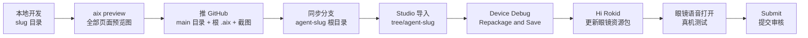

<div align="center">

# `rokid` — Rokid AIUI Agents

**Rokid AI 眼镜的 AIUI 智能体仓库 · 海外版 / Global**
只做 **Agent**，不做 App。一个仓库装下所有 Agent，靠**分支**逐个导入 Studio。


</div>

> [!IMPORTANT]
> **导入铁律**：往 Global AIUI Studio 导单个 Agent，只用它的专属分支地址
> `https://github.com/sakai55/rokid/tree/agent-<slug>`。
> 子目录地址、根地址、blob 地址都已实测证伪（见 [Studio 导入](#studio-导入实测结论)）。
> 保底路线：根目录的 `<slug>.aix` 下载后走 **Import from AIX**。

## 目录

- [仓库结构](#仓库结构)
- [Agents](#agents)
- [快速开始](#快速开始)
- [标准工作流](#标准工作流)
- [Studio 导入（实测结论）](#studio-导入实测结论)
- [海外链路（全链路海外，缺一不可）](#海外链路全链路海外缺一不可)
- [真机测试（云端下发）](#真机测试云端下发)
- [提交审核](#提交审核)
- [维护约定](#维护约定)

## 仓库结构

```text
rokid/
├── README.md                  # 本文件
├── <slug>/                    # 一个 Agent 一个目录（一套完整 AIUI 工程）
│   ├── app.json  AGENTS.md  app.js  package.json
│   ├── pages/                 # .ink 页面
│   └── README.md              # 该 Agent 的真机信息表 + 提审资料（以它为准）
├── <slug>.aix                 # 每个 Agent 打包好的 AIX（根目录，备选导入用）
├── screenshots/<slug>/        # 预览截图集中存放，Agent 的 README 直接嵌入
└── 分支 agent-<slug>          # 每个 Agent 一个分支，分支根目录 = 该 Agent 工程根
```

## Agents

### 基础与工具

| 目录 | 说明 | 导入分支 | 状态 |
|---|---|---|---|
| `my-agent/` | 官方脚手架示例（Hello AIUI），验证全流程用 | `agent-my-agent` | 分支导入已实测成功 |
| `glasses-benchmark/` | 眼镜全功能 Benchmark，21 项一键跑完 | `agent-glasses-benchmark` | Studio 名 `12345` · Build `1.0.19` · Debug version ready |
| `gaze-translate/` | 指向性 Agent #01 凝视翻译：看文字 → 稳头 → 长焦拍 → 翻译朗读 | `agent-gaze-translate` | 本地全流程完成，待 Studio 导入 |

### 指向性 Agent（50 个计划 · #01–#33 已落地）

每个 slug 对应：目录 `<slug>/` · 根目录包 `<slug>.aix` · 分支 `agent-<slug>` · 截图 `screenshots/<slug>/`。
功能与状态看各自目录里的 README。

|  |  |  |  |
|---|---|---|---|
| `gaze-translate` | `shelf-compare` | `expiry-check` | `plant-doctor` |
| `manual-lens` | `head-nav` | `find-my-thing` | `meet-point` |
| `parking-return` | `sound-compass` | `far-ear` | `ambient-captions` |
| `name-call` | `cook-along` | `assemble-guide` | `baby-care-hands` |
| `med-look` | `home-find` | `meter-reader` | `home-patrol` |
| `parcel-sort` | `clean-check` | `fresh-pick` | `outfit-check` |
| `receipt-keeper` | `market-radar` | `allergen-guard` | `garden-hands` |
| `repair-buddy` | `exit-radar` | `cry-watch` | `posture-guard` |
| `fall-guard` |  |  |  |

> 每个 Agent 的真机测试信息（Studio 名称 / Build / 分类 / 描述 / Agent ID / 状态）
> 完整记录在**该 Agent 自己目录的 README** 里，以那里为准。

## 快速开始

```bash
npm install -g @yodaos-pkg/aix-cli          # AIX CLI（pack / preview / show）
npm create @yodaos-pkg/aiui-agent@latest    # 官方脚手架
npx skills add https://github.com/jsar-project/AIUI/tree/main/skills/aiui-dev
                                            # aiui-dev Skill（给 Coding Agent 用）
aix pack . -o <slug>.aix                    # 在 Agent 目录内打包
aix preview .                               # 本地预览（起服务 / --html-out 导出 HTML）
```

> [!WARNING]
> 打包前项目根必须有 `.aixignore`，排除 `.agents/`、`.aix/`、`artifacts/`、`*.aix`、
> `skills-lock.json`、`node_modules/`——否则开发文件会进包（实测 2.3 KB → 107 KB）。

## 标准工作流



1. **本地开发** — 在 `<slug>/` 目录里开发、改页面。
2. **预览** — `aix preview` 出该 Agent **所有页面**的预览图，存 `screenshots/<slug>/`。
3. **推 GitHub** — 目录推 main；重打 `<slug>.aix` 放根目录；同一套文件同步到分支 `agent-<slug>` 的**根目录**。
4. **Studio 导入** — 粘贴分支地址导入（见下节），一个分支导一个 Agent。
5. **真机测试** — 云端下发，见 [真机测试](#真机测试云端下发)。
6. **提交审核** — 真机测试通过并经维护者确认后，在 **Submit** 页签提交（见 [提交审核](#提交审核)）。

## Studio 导入（实测结论）

导入对话框（`IMPORT PROJECT` / "GitHub Subdirectory Import"）**只有 URL 一个输入框**，
没有分支/路径选择；Studio 把 `/tree/` 后的**整段当作一个 ref**，不拆「ref + 路径」。
2026-10-24 逐条实测：

| 地址形式 | 结果 |
|---|---|
| ✅ `…/tree/agent-<slug>`（专属分支） | **唯一可用**：导入该分支根目录 = 一个完整 Agent，文件树完整；已实测可运行、可打包 |
| ❌ `…/tree/main/<slug>`（子目录） | `GitHub ref not found: main/<slug>`（官方仓库 `JellyFlow/AIUI/tree/main/samples/scanner` 同样失败） |
| ❌ `…/tree/<完整 commit SHA>/<slug>` | 同样 ref not found |
| ❌ 仓库根地址 | 能导入，但是**空心 Agent**（Code 文件树为空） |
| ❌ `…/blob/main/<slug>/app.json` | 能过导入，Run 报「请先创建Agent的项目文件」 |

**分支法要点**

- 分支名必须是**单段**（`agent-<slug>`），分支**根目录**放该 Agent 的全套文件。
- 导入后生成的 Draft 名为 `sakai55/rokid`，进 Studio 后改名。
- 改代码后重新导入：先同步分支根目录，再重新粘贴分支地址导入，然后走真机流程。

<details>
<summary><b>备选：AIX 导入（保底路线）</b></summary>

1. 在仓库根目录点开 `<slug>.aix`，下载到本地。
2. Global AIUI Studio → New Agent → **Import from AIX**，上传该文件。
3. 导入后生成 Draft，文件树即包内完整工程；后续同样走 Device Debug 打包 → 真机测试。

不依赖 GitHub 地址解析，赶时间或 GitHub 导入异常时用它；日常首选分支法（直接对应最新代码）。

</details>

## 海外链路（全链路海外，缺一不可）

> [!CAUTION]
> 以下四点齐全才算海外版开发；任何一环用了国内版，链路就不通。
> 国内站（aiui.rokid.com）与 Global 站账号、项目**不互通**。

| 环节 | 必须用 | 不能用 |
|---|---|---|
| 账号 | [account-web.rokid.com](https://account-web.rokid.com/) **英文版**注册（本项目地区：Japan） | 国内版注册的账号 |
| Studio | [aiui-global.rokid.com/?lang=en-US](https://aiui-global.rokid.com/?lang=en-US) | aiui.rokid.com |
| 下发 | Studio 打包保存 → **云端下发**到眼镜 | ADB / 数据线直装 |
| 手机 App | **Hi Rokid**（Google Play，包名 `com.rokid.sprite.global.aiapp`，Rokid International） | 国内版 Rokid Ai App |

## 真机测试（云端下发）

<details>
<summary><b>展开完整步骤</b>（在 Global AIUI Studio 里打开该 Agent 后）</summary>

1. 进 **Device Debug** 页签，填 **Basic Information**：
   - Agent Icon（建议 1:1）、**Agent Name**（必填）
   - **App Category**（必填）：Life / Work / Entertainment / Learning
   - **Intent Description**（必填，≤500 字）：写清什么场景、什么前提下、被什么样的用户请求唤起
   - Version / Agent ID 由系统生成；**Version 是 Build 号，每次 Repackage and Save 自动递增**
2. **AIX Packaging** 区点 **Repackage and Save**，等打包完成。
3. **成功标志**：顶部绿色状态 **● Debug version ready — Ready for device debugging**。
   没出现就说明没保存成功，App 端拉不到，不要白等。
4. 手机打开 **Hi Rokid**（海外版）→ 确认眼镜已连接 →「设置 → 开发者选项 → AIUI」→
   「更新眼镜资源包」→ 等「智能体资源包下载成功」。
5. 对眼镜语音打开 Agent（如「乐奇，打开 xxx」）开始测试。
6. 迭代循环：改代码 → 推 GitHub / 同步分支 → Studio 重新导入 → Repackage and Save
   → Hi Rokid 更新资源包 → 再测。**只改代码不重新打包保存，App 拉到的还是旧版。**

</details>

## 提交审核

真机测试全部通过后（以维护者确认「真机测试完成」为准）：

1. 在 **Submit** 页签填 **Review Information**：Feature Description、Opening Message、
   Preview Media、Change Log。**四项成稿在各 Agent 自己 README 的「提审资料
   (Review Submission)」章节里，分段写好，整段复制**（Feature Description ≤500 字；
   Opening Message ≤500 字、支持 Markdown；Preview Media 需 3–5 个 JPG/PNG/MP4
   且 ≥1 图 ≥1 视频，每次提交前重新确认）。
2. 权限声明与代码一致：`app.json.permissions` 里声明实际用到的能力
   （如 `GEOLOCATION` / `CAMERA` / `RECORD_AUDIO`）。
3. **Submit for Review** 提交；被拒按原因修改后重新打包保存、重新提交。

## 维护约定

- **一个 Agent 一个目录**（main），**一个 Agent 一个分支**（`agent-<slug>`，分支根 = 工程根）。
- 每个 Agent 的 README 必须写全：功能、权限、打包/预览命令、真机信息表、提审资料、预览截图（嵌入 `../screenshots/<slug>/…`）。
- 截图只放 `screenshots/<slug>/`；打包好的 `.aix` 只放仓库根目录，并与代码同步更新。
- GitHub 操作走终端 `gh` / `git`（已登录 sakai55），含二进制与分支维护。
