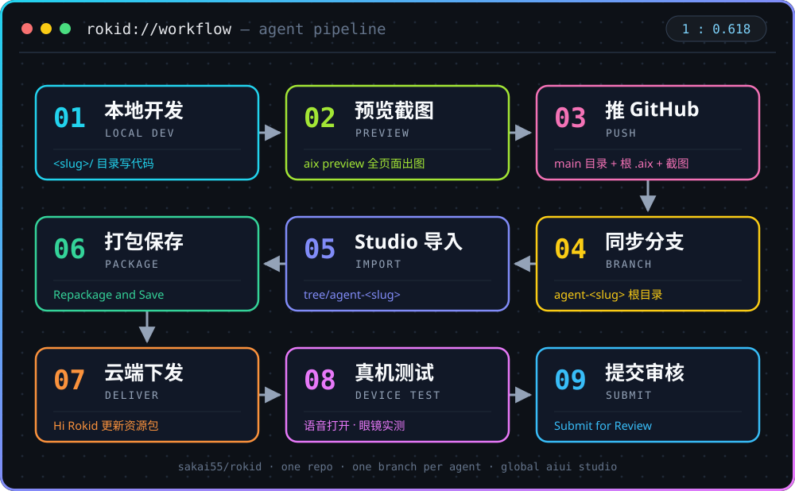

<div align="center">

# `rokid` — Rokid AIUI Agents

**Rokid AI 眼镜的 AIUI 智能体仓库 · 海外版 / Global**
只做 **Agent**，不做 App。一个仓库装下所有 Agent，靠**分支**逐个导入 Studio。


</div>

> [!IMPORTANT]
> **导入铁律**：往 Global AIUI Studio 导单个 Agent，只用它的专属分支地址
> `https://github.com/sakai55/rokid/tree/agent-<slug>`。
> 子目录地址、根地址、blob 地址都已实测证伪（见 [Studio 导入](#studio-导入实测结论)）。
> 保底路线：`aix/` 目录里的 `<slug>.aix` 下载后走 **Import from AIX**。

## 目录

- [仓库结构](#仓库结构)
- [快速开始](#快速开始)
- [标准工作流](#标准工作流)
- [Studio 导入（实测结论）](#studio-导入实测结论)
- [海外链路（全链路海外，缺一不可）](#海外链路全链路海外缺一不可)
- [真机测试（云端下发）](#真机测试云端下发)
- [提交审核](#提交审核)
- [维护约定](#维护约定)
- [Agent 清单](#agent-清单)

## 仓库结构

```text
rokid/
├── README.md                  # 本文件
├── <slug>/                    # 一个 Agent 一个目录（一套完整 AIUI 工程）
│   ├── app.json  AGENTS.md  app.js  package.json
│   ├── pages/                 # .ink 页面
│   └── README.md              # 该 Agent 的真机信息表 + 提审资料（以它为准）
├── aix/<slug>.aix             # 全部 Agent 打包好的 AIX（集中存放，备选导入用）
├── screenshots/<slug>/        # 预览截图集中存放，Agent 的 README 直接嵌入
├── skills/                    # 项目 Skill 库（官方 aiui-dev + 自有 SOP / 截图管线）
├── mcp/                       # MCP 登记处（在用服务器、接入方式、凭据存放位置）
├── assets/                    # README 素材（如工作流图 workflow.svg）
└── 分支 agent-<slug>          # 每个 Agent 一个分支，分支根目录 = 该 Agent 工程根
```

## 快速开始

```bash
npm install -g @yodaos-pkg/aix-cli          # AIX CLI（pack / preview / show）
npm create @yodaos-pkg/aiui-agent@latest    # 官方脚手架
npx skills add https://github.com/jsar-project/AIUI/tree/main/skills/aiui-dev
                                            # aiui-dev Skill（给 Coding Agent 用）
aix pack . -o <slug>.aix                    # 在 Agent 目录内打包
aix preview .                               # 本地预览（起服务 / --html-out 导出 HTML）
```

> [!WARNING]
> 打包前项目根必须有 `.aixignore`，排除 `.agents/`、`.aix/`、`artifacts/`、`*.aix`、
> `skills-lock.json`、`node_modules/`——否则开发文件会进包（实测 2.3 KB → 107 KB）。

## 标准工作流

<div align="center">



</div>

1. **本地开发** — 在 `<slug>/` 目录里开发、改页面。
2. **预览** — `aix preview` 出该 Agent **所有页面**的预览图，存 `screenshots/<slug>/`。
3. **推 GitHub** — 目录推 main；重打 `<slug>.aix` 放 `aix/` 目录；同一套文件同步到分支 `agent-<slug>` 的**根目录**。
4. **Studio 导入** — 粘贴分支地址导入（见下节），一个分支导一个 Agent。
5. **真机测试** — 云端下发，见 [真机测试](#真机测试云端下发)。
6. **提交审核** — 真机测试通过并经维护者确认后，在 **Submit** 页签提交（见 [提交审核](#提交审核)）。

## Studio 导入（实测结论）

导入对话框（`IMPORT PROJECT` / "GitHub Subdirectory Import"）**只有 URL 一个输入框**，
没有分支/路径选择；Studio 把 `/tree/` 后的**整段当作一个 ref**，不拆「ref + 路径」。
2026-10-24 逐条实测：

| 地址形式 | 结果 |
|---|---|
| ✅ `…/tree/agent-<slug>`（专属分支） | **唯一可用**：导入该分支根目录 = 一个完整 Agent，文件树完整；已实测可运行、可打包 |
| ❌ `…/tree/main/<slug>`（子目录） | `GitHub ref not found: main/<slug>`（官方仓库 `JellyFlow/AIUI/tree/main/samples/scanner` 同样失败） |
| ❌ `…/tree/<完整 commit SHA>/<slug>` | 同样 ref not found |
| ❌ 仓库根地址 | 能导入，但是**空心 Agent**（Code 文件树为空） |
| ❌ `…/blob/main/<slug>/app.json` | 能过导入，Run 报「请先创建Agent的项目文件」 |

**分支法要点**

- 分支名必须是**单段**（`agent-<slug>`），分支**根目录**放该 Agent 的全套文件。
- 导入后生成的 Draft 名为 `sakai55/rokid`，进 Studio 后改名。
- 改代码后重新导入：先同步分支根目录，再重新粘贴分支地址导入，然后走真机流程。

<details>
<summary><b>备选：AIX 导入（保底路线）</b></summary>

1. 在仓库 `aix/` 目录里点开 `<slug>.aix`，下载到本地。
2. Global AIUI Studio → New Agent → **Import from AIX**，上传该文件。
3. 导入后生成 Draft，文件树即包内完整工程；后续同样走 Device Debug 打包 → 真机测试。

不依赖 GitHub 地址解析，赶时间或 GitHub 导入异常时用它；日常首选分支法（直接对应最新代码）。

</details>

## 海外链路（全链路海外，缺一不可）

> [!CAUTION]
> 以下四点齐全才算海外版开发；任何一环用了国内版，链路就不通。
> 国内站（aiui.rokid.com）与 Global 站账号、项目**不互通**。

| 环节 | 必须用 | 不能用 |
|---|---|---|
| 账号 | [account-web.rokid.com](https://account-web.rokid.com/) **英文版**注册（本项目地区：Japan） | 国内版注册的账号 |
| Studio | [aiui-global.rokid.com/?lang=en-US](https://aiui-global.rokid.com/?lang=en-US) | aiui.rokid.com |
| 下发 | Studio 打包保存 → **云端下发**到眼镜 | ADB / 数据线直装 |
| 手机 App | **Hi Rokid**（Google Play，包名 `com.rokid.sprite.global.aiapp`，Rokid International） | 国内版 Rokid Ai App |

## 真机测试（云端下发）

<details>
<summary><b>展开完整步骤</b>（在 Global AIUI Studio 里打开该 Agent 后）</summary>

1. 进 **Device Debug** 页签，填 **Basic Information**：
   - Agent Icon（建议 1:1）、**Agent Name**（必填）
   - **App Category**（必填）：Life / Work / Entertainment / Learning
   - **Intent Description**（必填，≤500 字）：写清什么场景、什么前提下、被什么样的用户请求唤起
   - Version / Agent ID 由系统生成；**Version 是 Build 号，每次 Repackage and Save 自动递增**
2. **AIX Packaging** 区点 **Repackage and Save**，等打包完成。
3. **成功标志**：顶部绿色状态 **● Debug version ready — Ready for device debugging**。
   没出现就说明没保存成功，App 端拉不到，不要白等。
4. 手机打开 **Hi Rokid**（海外版）→ 确认眼镜已连接 →「设置 → 开发者选项 → AIUI」→
   「更新眼镜资源包」→ 等「智能体资源包下载成功」。
5. 对眼镜语音打开 Agent（如「乐奇，打开 xxx」）开始测试。
6. 迭代循环：改代码 → 推 GitHub / 同步分支 → Studio 重新导入 → Repackage and Save
   → Hi Rokid 更新资源包 → 再测。**只改代码不重新打包保存，App 拉到的还是旧版。**

</details>

## 提交审核

真机测试全部通过后（以维护者确认「真机测试完成」为准）：

1. 在 **Submit** 页签填 **Review Information**：Feature Description、Opening Message、
   Preview Media、Change Log。**四项成稿在各 Agent 自己 README 的「提审资料
   (Review Submission)」章节里，分段写好，整段复制**（Feature Description ≤500 字；
   Opening Message ≤500 字、支持 Markdown；Preview Media 需 3–5 个 JPG/PNG/MP4
   且 ≥1 图 ≥1 视频，每次提交前重新确认）。
2. 权限声明与代码一致：`app.json.permissions` 里声明实际用到的能力
   （如 `GEOLOCATION` / `CAMERA` / `RECORD_AUDIO`）。
3. **Submit for Review** 提交；被拒按原因修改后重新打包保存、重新提交。

## 维护约定

- **一个 Agent 一个目录**（main），**一个 Agent 一个分支**（`agent-<slug>`，分支根 = 工程根）。
- 每个 Agent 的 README 必须写全：功能、权限、打包/预览命令、真机信息表、提审资料、预览截图（嵌入 `../screenshots/<slug>/…`）。
- 截图只放 `screenshots/<slug>/`；打包好的 `.aix` 只放仓库 `aix/` 目录，并与代码同步更新。
- GitHub 操作走终端 `gh` / `git`（已登录 sakai55），含二进制与分支维护。

## Agent 清单

全部 Agent 一览（持续增长中，新 Agent 完成即追加到表尾）。
每个 Agent 的真机状态、提审资料看它自己目录里的 README。

| # | Agent | 一句话说明 | 导入分支 |
|---|---|---|---|
| — | [my-agent](my-agent/) | 官方脚手架示例，点击切换中英文问候 | `agent-my-agent` |
| — | [glasses-benchmark](glasses-benchmark/) | 眼镜全功能自检，21 项一键跑完出结果 | `agent-glasses-benchmark` |
| 01 | [gaze-translate](gaze-translate/) | 看着外文稳头，长焦拍下翻译并朗读 | `agent-gaze-translate` |
| 02 | [shelf-compare](shelf-compare/) | 扫货架条码入表比价，点头加入清单 | `agent-shelf-compare` |
| 03 | [expiry-check](expiry-check/) | 读包装日期算剩余天数，临期语音警告 | `agent-expiry-check` |
| 04 | [plant-doctor](plant-doctor/) | 拍照识植物状态，养护步骤语音领做 | `agent-plant-doctor` |
| 05 | [manual-lens](manual-lens/) | 读铭牌故障码，给出下一步操作指引 | `agent-manual-lens` |
| 06 | [head-nav](head-nav/) | 导航箭头跟着头转，对准方向才走 | `agent-head-nav` |
| 07 | [find-my-thing](find-my-thing/) | 看向物品语音登记，回忆位置与朝向 | `agent-find-my-thing` |
| 08 | [meet-point](meet-point/) | 共享定位，转头就能对准走散的朋友 | `agent-meet-point` |
| 09 | [parking-return](parking-return/) | 存车位定位朝向，回程引导找车 | `agent-parking-return` |
| 10 | [exit-radar](exit-radar/) | 环视登记出口方向，紧急时播报最近出口 | `agent-exit-radar` |
| 11 | [cook-along](cook-along/) | 菜谱悬在眼前，点头翻步，油烟里只听你 | `agent-cook-along` |
| 12 | [repair-buddy](repair-buddy/) | 拍故障部位分步指导，点头确认每步 | `agent-repair-buddy` |
| 13 | [assemble-guide](assemble-guide/) | 对照图纸零件，按步引导组装纠错 | `agent-assemble-guide` |
| 14 | [garden-hands](garden-hands/) | 看着植物给修剪浇水指示，免手操作 | `agent-garden-hands` |
| 15 | [baby-care-hands](baby-care-hands/) | 抱娃免手语音问答，拍照问宝宝状态 | `agent-baby-care-hands` |
| 16 | [sound-compass](sound-compass/) | 转头扫描声源方向，报出声音在哪边 | `agent-sound-compass` |
| 17 | [far-ear](far-ear/) | 远场收音转实时字幕，听清远处人声 | `agent-far-ear` |
| 18 | [cry-watch](cry-watch/) | 守听婴儿房动静，哭声立刻语音提醒 | `agent-cry-watch` |
| 19 | [name-call](name-call/) | 听清谁在喊你，内容与方向一起报 | `agent-name-call` |
| 20 | [ambient-captions](ambient-captions/) | 全向收音实时字幕，对准谁增强谁 | `agent-ambient-captions` |
| 21 | [market-radar](market-radar/) | 按朝向登记摊位报价，转头亮价比价 | `agent-market-radar` |
| 22 | [allergen-guard](allergen-guard/) | 读配料表查忌口成分，命中立刻警告 | `agent-allergen-guard` |
| 23 | [fresh-pick](fresh-pick/) | 拍照判果蔬成熟新鲜，挑果有人指点 | `agent-fresh-pick` |
| 24 | [outfit-check](outfit-check/) | 拍照评衣物搭配与场合，照镜再评上身 | `agent-outfit-check` |
| 25 | [receipt-keeper](receipt-keeper/) | 看一眼小票入账，月度汇总语音播报 | `agent-receipt-keeper` |
| 26 | [home-find](home-find/) | 收纳时登记位置，找东西报方位线索 | `agent-home-find` |
| 27 | [meter-reader](meter-reader/) | 长焦读水电表数，自动记录比对异常 | `agent-meter-reader` |
| 28 | [home-patrol](home-patrol/) | 出门巡检门窗燃气，逐项看过才放行 | `agent-home-patrol` |
| 29 | [parcel-sort](parcel-sort/) | 扫快递单条码，按急缓语音分类堆放 | `agent-parcel-sort` |
| 30 | [clean-check](clean-check/) | 环视登记打扫覆盖，漏扫角落提醒你 | `agent-clean-check` |
| 31 | [med-look](med-look/) | 读药瓶标签对服药表，报剂量记已服 | `agent-med-look` |
| 32 | [posture-guard](posture-guard/) | 测低头时长，久低头语音轻提醒 | `agent-posture-guard` |
| 33 | [fall-guard](fall-guard/) | 跌倒无回应时，按预设联系紧急联系人 | `agent-fall-guard` |
| 34 | [cross-street](cross-street/) | 过街前左右转头停稳，双确认才报可通行 | `agent-cross-street` |
| 35 | [food-safe](food-safe/) | 看剩菜外观+登记日期给风险分级提示 | `agent-food-safe` |
| 36 | [word-look](word-look/) | 看着生词说出来，释义发音进生词本 | `agent-word-look` |
| 37 | [story-look](story-look/) | 绘本页拍照生成讲解词+提问，翻页续讲 | `agent-story-look` |
| 38 | [memory-anchor](memory-anchor/) | 「刚才那个想法/待办」转头就忘 | `agent-memory-anchor` |
| 39 | [board-capture](board-capture/) | 上课/开会黑板白板字远又擦得快 | `agent-board-capture` |
| 40 | [homework-lens](homework-lens/) | 孩子题目不会，家长讲不清步骤 | `agent-homework-lens` |
| 41 | [sign-reader](sign-reader/) | 站牌/登机口/菜单牌太远太小看不清 | `agent-sign-reader` |
| 42 | [transit-direction](transit-direction/) | 出了地铁站转头校准方向，偏离语音纠正 | `agent-transit-direction` |
| 43 | [hotel-checkin](hotel-checkin/) | 八检查点逐个看过打勾，漏看按方位领回 | `agent-hotel-checkin` |
| 44 | [photo-level](photo-level/) | 取景叠三分法+气泡水平仪，点头快门 | `agent-photo-level` |
| 45 | [queue-sense](queue-sense/) | 眼数人数镜测速度，估哪支队最快 | `agent-queue-sense` |
| 46 | [speaker-focus](speaker-focus/) | 多人会议跟不上谁说话，纪要按朝向标人 | `agent-speaker-focus` |
| 47 | [badge-reader](badge-reader/) | 看不清名牌忘了名字？长焦读牌悄悄报你听 | `agent-badge-reader` |
| 48 | [teleprompter-gaze](teleprompter-gaze/) | 演讲/录视频忘词，低头看稿不自然 | `agent-teleprompter-gaze` |
| 49 | [site-patrol](site-patrol/) | 工地/仓库巡检要逐项看、逐项记，双手拿工具 | `agent-site-patrol` |
| 50 | [elder-day](elder-day/) | 独居老人一日清单：吃药喝水出门逐项确认 | `agent-elder-day` |
| W01 | [stove-watch](stove-watch/) | 多锅看向登记计时，沸腾溢锅叫你回看 | `agent-stove-watch` |
| W02 | [bath-watch](bath-watch/) | 浴缸放水登记守听，水满前叫你关水 | `agent-bath-watch` |
| W03 | [laundry-watch](laundry-watch/) | 洗衣结束蜂鸣守听，第一时间叫你晾衣 | `agent-laundry-watch` |
| W04 | [signal-watch](signal-watch/) | 医院/银行/取餐叫号，大屏节律提醒回看，差3号喊你准备 | `agent-signal-watch` |
