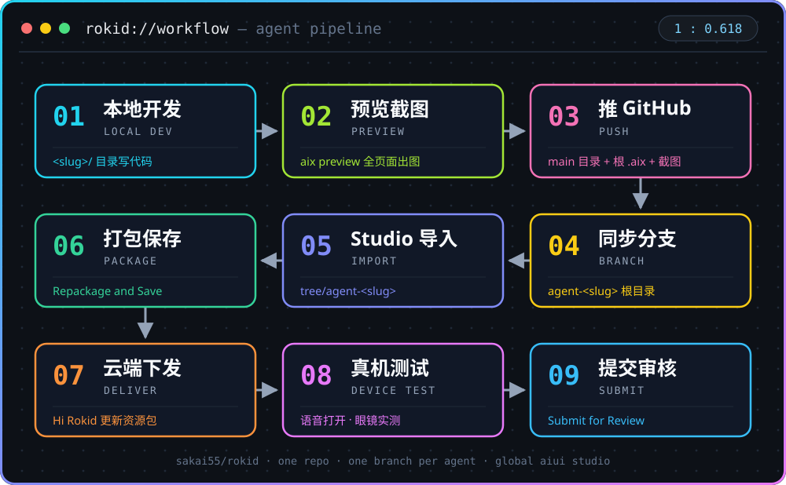
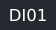

<div align="center">

# `rokid` — Rokid AIUI Agents

中文 | [English](README.en.md) | [日本語](README.ja.md)

**Rokid AI 眼镜的 AIUI 智能体仓库 · 海外版 / Global**
只做 **Agent**，不做 App。一个仓库装下所有 Agent，靠**分支**逐个导入 Studio。


</div>

> [!IMPORTANT]
> **导入铁律**：往 Global AIUI Studio 导单个 Agent，只用它的专属分支地址
> `https://github.com/sakai55/rokid/tree/agent-<slug>`。
> 子目录地址、根地址、blob 地址都已实测证伪（见 [Studio 导入](#studio-导入实测结论)）。
> 保底路线：`aix/` 目录里的 `<slug>.aix` 下载后走 **Import from AIX**。

## 目录

- [仓库结构](#仓库结构)
- [先读：能力边界](#先读能力边界)
- [快速开始](#快速开始)
- [标准工作流](#标准工作流)
- [Studio 导入（实测结论）](#studio-导入实测结论)
- [Agent 清单](#agent-清单)
- [海外链路（全链路海外，缺一不可）](#海外链路全链路海外缺一不可)
- [真机测试（云端下发）](#真机测试云端下发)
- [提交审核](#提交审核)
- [维护约定](#维护约定)

## 仓库结构

```text
rokid/
├── README.md                  # 本文件
├── <分类>/<slug>/             # Agent 按编号分类存放，映射见文末清单说明
│   └── <slug>/                # 一个 Agent 一个目录（一套完整 AIUI 工程）
│       ├── app.json  AGENTS.md  app.js  package.json
│       ├── pages/             # .ink 页面
│       └── README.md          # 开头 Studio 导入块 + 真机信息表 + 提审资料（以它为准）
├── aix/<slug>.aix             # 全部 Agent 打包好的 AIX（集中存放，备选导入用）
├── screenshots/<slug>/        # 预览截图集中存放，Agent 的 README 直接嵌入
├── skills/                    # 项目 Skill 库（官方 aiui-dev + 自有 SOP / 截图管线）
├── mcp/                       # MCP 登记处（在用服务器、接入方式、凭据存放位置）
├── docs/                      # 文档：能力原子注册表 CAPABILITIES.md、本地存储说明 STORAGE.md
├── assets/                    # README 素材（如工作流图 workflow.svg）
└── 分支 agent-<slug>          # 每个 Agent 一个分支，分支根目录 = 该 Agent 工程根
```

## 先读：能力边界

动手写代码之前，先读两份文档，把想做的事对着底座逐项核一遍：

- [能力原子注册表](docs/CAPABILITIES.md)：底座能干什么、不能干什么，一条原语一个编号（C####）。这块底座的能力是清单式的——注册表里没有的 API 和能力就不存在，按浏览器或微信小程序的习惯猜，多半要到真机上才发现是空的。
- [本地存储说明](docs/STORAGE.md)：数据能存哪、四处存放点各自的边界与容量口径。

建议的顺序：先把场景拆成注册表里的原语，逐条对表做可行性判断——哪一步没有原语支撑，哪一步就换设计或砍掉；全过关，再做一个能跑通闭环的最小版本（MVP）上真机验。先堆一大堆功能、临到真机才发现关键能力不存在，是这个仓库里最常见的返工来源。

## 快速开始

```bash
npm install -g @yodaos-pkg/aix-cli          # AIX CLI（pack / preview / show）
npm create @yodaos-pkg/aiui-agent@latest    # 官方脚手架
npx skills add https://github.com/jsar-project/AIUI/tree/main/skills/aiui-dev
                                            # aiui-dev Skill（给 Coding Agent 用）
aix pack . -o <slug>.aix                    # 在 Agent 目录内打包
aix preview .                               # 本地预览（起服务 / --html-out 导出 HTML）
```

> [!WARNING]
> 打包前项目根必须有 `.aixignore`，排除 `.agents/`、`.aix/`、`artifacts/`、`*.aix`、
> `skills-lock.json`、`node_modules/`——否则开发文件会进包（实测 2.3 KB → 107 KB）。

## 标准工作流

<div align="center">



</div>

1. **本地开发** — 在 `<分类>/<slug>/` 目录里开发、改页面。
2. **预览** — `aix preview` 出该 Agent **所有页面**的预览图，存 `screenshots/<slug>/`。
3. **推 GitHub** — 目录推 main；重打 `<slug>.aix` 放 `aix/` 目录；同一套文件同步到分支 `agent-<slug>` 的**根目录**。
4. **Studio 导入** — 粘贴分支地址导入（见下节），一个分支导一个 Agent。
5. **真机测试** — 云端下发，见 [真机测试](#真机测试云端下发)。
6. **提交审核** — 真机测试通过并经维护者确认后，在 **Submit** 页签提交（见 [提交审核](#提交审核)）。

## Studio 导入（实测结论）

导入对话框（`IMPORT PROJECT` / "GitHub Subdirectory Import"）**只有 URL 一个输入框**，
没有分支/路径选择；Studio 把 `/tree/` 后的**整段当作一个 ref**，不拆「ref + 路径」。
2026-10-24 逐条实测：

| 地址形式 | 结果 |
|---|---|
| ✅ `…/tree/agent-<slug>` | **唯一可用**：导入该分支根目录 = 一个完整 Agent，文件树完整；已实测可运行、可打包 |
| ❌ `…/tree/main/<slug>`（子目录） | `GitHub ref not found: main/<slug>`（官方仓库 `JellyFlow/AIUI/tree/main/samples/scanner` 同样失败） |
| ❌ `…/tree/<完整 commit SHA>/<slug>` | 同样 ref not found |
| ❌ 仓库根地址 | 能导入，但是**空心 Agent**（Code 文件树为空） |
| ❌ `…/blob/main/<slug>/app.json` | 能过导入，Run 报「请先创建Agent的项目文件」 |

**分支法要点**

- 分支名必须是**单段**（`agent-<slug>`），分支**根目录**放该 Agent 的全套文件。
- 导入后生成的 Draft 名为 `sakai55/rokid`，进 Studio 后改名。
- 改代码后重新导入：先同步分支根目录，再重新粘贴分支地址导入，然后走真机流程。

<details>
<summary><b>备选：AIX 导入（保底路线）</b></summary>

1. 在仓库 `aix/` 目录里点开 `<slug>.aix`，下载到本地。
2. Global AIUI Studio → New Agent → **Import from AIX**，上传该文件。
3. 导入后生成 Draft，文件树即包内完整工程；后续同样走 Device Debug 打包 → 真机测试。

不依赖 GitHub 地址解析，赶时间或 GitHub 导入异常时用它；日常首选分支法。

</details>

## Agent 清单

全部 Agent 一览，按完成顺序倒序排列，最新完成的在最前面；新 Agent 完成即加到表首。
每个 Agent 的真机状态、提审资料看它自己目录里的 README。

**徽章怎么读：每行第三列是徽章，从左到右依次是编号徽章、系列徽章、冲突状态徽章（冲突状态三选一：直接冲突 / 高度重叠 / 待测试）。**
编号 = 2 个字母 + 2 位数字：字母取分类英文名的前两个字母，数字是组内序号。**全表编号唯一：每个字母只属于一个系列，同一编号只出现一次**（基础项 `my-agent` / `glasses-benchmark` 不编号、无徽章）。

**徽章说明**：

<table>
<tr><td width="110"></td><td>唯一编号：前两个字母是分类，后两位是组内序号</td></tr>
<tr><td width="110"></td><td>指向性系列：用视线同轴、头部朝向解决生活问题</td></tr>
<tr><td width="110"></td><td>注意力外挂系列：把持续占用的注意力外包给眼镜</td></tr>
<tr><td width="110"></td><td>路缘坡系列：先为特殊人群解决难题，再溢出到普通人</td></tr>
<tr><td width="110"></td><td>头部动作小游戏系列：用头部动作玩的极简小游戏</td></tr>
<tr><td width="110"></td><td>影视听系列：围绕拍照、录像与语音交互，逐台顶基座影音能力边界</td></tr>
<tr><td width="110"></td><td>描红系列：中央范本加边上步骤，做一步验一步地学着做</td></tr>
<tr><td width="110"></td><td>与眼镜默认能力<strong>直接冲突</strong>：本体就是默认能力，只加了一层小扭转</td></tr>
<tr><td width="110"></td><td>与眼镜默认能力<strong>高度重叠</strong>：默认功能能完成大半，只剩一层薄闭环</td></tr>
<tr><td width="110"></td><td>既不直接冲突、也不高度重叠，冲突与否等真机测试确认</td></tr>
</table>

基础项（`my-agent`、`glasses-benchmark`）没有任何徽章。
读例：`gaze-translate` 行尾的    = 编号 DI01 · 指向性系列 · 与默认能力直接冲突；`drop-search` 行尾的    = 编号 CC01 · 路缘坡系列 · 冲突与否待测试。

- **无字母（`—`）**：基础项，不属于任何系列——`my-agent` 是官方脚手架示例，`glasses-benchmark` 是眼镜全功能自检工具。目录：`base/`
- **`DI01`–`DI50`**：**指向性系列**（50 个）——利用眼镜的视线同轴、头部朝向等指向性能力，一个 Agent 解决一个生活问题；编号取 Directional 的前两个字母，内部再分 A–J 十组生活场景。目录：`directional/`
- **双字母 + `01`–`05`**：**注意力外挂系列**（50 个，10 组 × 5）——把人原本要持续占用的注意力外包给眼镜，字母取外包类型英文名的前两个字母：
  - `WA` = **守望型 WATCH**：替你持续盯着一个信号（锅、叫号、门铃），目录 `watch/`
  - `HO` = **默念型 HOLD**：替你记住要反复默念的号码、口令、清单、路线，目录 `hold/`
  - `CO` = **覆盖型 COVER**：替你证明「都看过了」，防漏检、漏扫、漏装，目录 `cover/`
  - `FI` = **过滤型 FILTER**：只放行你声明要的那类信息，其余挡住，目录 `filter/`
  - `DU` = **并行型 DUAL**：主线你做，副线（孩子、行李、排队号）它替你管，目录 `dual/`
  - `RE` = **回放型 REVIEW**：替你回答「刚才……」，事后按记录复盘，目录 `review/`
  - `CU` = **提示型 CUE**：看向某个场景才触发对应的提醒，目录 `cue/`
  - `SO` = **社交型 SOCIAL**：替你分担待客、倾听、记人情的社交注意力，目录 `social/`
  - `BO` = **身体型 BODY**：替你留意眼睛、喝水、呼吸、久坐等身体信号，目录 `body/`
  - `AM` = **环境型 AMBIENT**：替你留意光线、天色、噪音等环境变化，目录 `ambient/`
- **`CC01`–`CC20`**：**路缘坡系列**（20 个）——先为一类特殊人群解决一个具体难题，再溢出到处在情境性障碍中的普通人；编号取 Curb Cut 的首字母 **CC**。目录：`curb-cut/`
- **`GA01`–`GA20`**：**头部动作小游戏系列**（20 个，编号取 Game 的前两个字母）——用头部动作玩的极简小游戏，含语音指导的颈部分段活动（只分段、必回正、不转圈）。目录：`games/`
- **`JP01`–`JP10` / `KR01`–`KR10`**：**日韩本地化系列**（20 个）——按日本、韩国各自的在地制度与礼仪设计，编号取国家通行缩写 JP / KR。目录：`japan/`、`korea/`


<table>
<tr><td><a href="directional/china-hutong-photo/">china-hutong-photo</a></td><td>北京胡同参观者：双手拿导览册看向胡同点头拍照核对十二处</td><td>   </td></tr>
<tr><td><a href="watch/china-bbq-watch/">china-bbq-watch</a></td><td>中国家庭烧烤者：双手忙时看向一烤架点头计时到时提醒取下</td><td>   </td></tr>
<tr><td><a href="directional/china-gulangyu-meet/">china-gulangyu-meet</a></td><td>厦门鼓浪屿景区游客：凭GPS方位距离回到登记集合点确认到齐</td><td>   </td></tr>
<tr><td><a href="games/china-kite-game/">china-kite-game</a></td><td>中国家庭放风筝：只用头部方向选风向点头放线十轮结算</td><td>   </td></tr>
<tr><td><a href="watch/uk-pancake-watch/">uk-pancake-watch</a></td><td>英国煎饼日做饼者：双手忙时看向一煎饼点头计时到时出锅</td><td>   </td></tr>
<tr><td><a href="directional/nz-milford-meet/">nz-milford-meet</a></td><td>新西兰米尔福德峡湾徒步者：凭GPS方位距离回到步道口集合点</td><td>   </td></tr>
<tr><td><a href="games/ireland-stpatrick-games/">ireland-stpatrick-games</a></td><td>爱尔兰圣帕特里克节家庭：抬头玩二十个节日游戏通关计分</td><td>    </td></tr>
<tr><td><a href="korea/dongdaemun-guide/">dongdaemun-guide</a></td><td>首尔东大门市场购物者：双手提袋时看向摊位点头核对四项</td><td>   </td></tr>
<tr><td><a href="japan/sakura-game-shuu/">sakura-game-shuu</a></td><td>日本花见等待家庭：抬头玩二十个赏樱游戏通关计分存档</td><td>    </td></tr>
<tr><td><a href="directional/china-panjiayuan-market/">china-panjiayuan-market</a></td><td>潘家园逛旧货摊者：双手提袋时看向摊位点头核对问价成色讲价</td><td>   </td></tr>
<tr><td><a href="watch/china-roastduck-watch/">china-roastduck-watch</a></td><td>中国烤鸭备菜者：双手备菜时看向一种烤物点头计时到时提醒上桌</td><td>   </td></tr>
<tr><td><a href="directional/china-zhangjiajie-meet/">china-zhangjiajie-meet</a></td><td>张家界景区游客：凭GPS方位距离找到六个集合点点头确认到齐</td><td>   </td></tr>
<tr><td><a href="games/china-ice-games/">china-ice-games</a></td><td>中国冰雪节游客：抬头玩二十个冰雪游戏通关计分存档</td><td>    </td></tr>
<tr><td><a href="watch/scotland-shortbread-watch/">scotland-shortbread-watch</a></td><td>苏格兰烤黄油饼干者：双手沾面时看向一种饼干点头计时到时出炉</td><td>   </td></tr>
<tr><td><a href="directional/scotland-highlands-meet/">scotland-highlands-meet</a></td><td>苏格兰高地自驾游客：凭GPS方位距离找到六个集合点点头确认到齐</td><td>   </td></tr>
<tr><td><a href="games/australia-christmas-games/">australia-christmas-games</a></td><td>澳大利亚圣诞假期家庭：抬头玩二十个圣诞游戏通关计分存档</td><td>    </td></tr>
<tr><td><a href="korea/samgyeopsal-watch/">samgyeopsal-watch</a></td><td>韩国烤肉食客：双手翻肉时看向一种肉点头计时到时提醒翻面</td><td>   </td></tr>
<tr><td><a href="japan/depachika-guide/">depachika-guide</a></td><td>百货地下食品卖场购物者：双手提袋时看向摊位点头核对价格保质期</td><td>   </td></tr>
<tr><td><a href="directional/china-panda-photo/">china-panda-photo</a></td><td>成都熊猫基地参观者：双手拿导览册，看向馆区点头拍照核对十二处</td><td>   </td></tr>
<tr><td><a href="watch/china-zongzi-watch/">china-zongzi-watch</a></td><td>中国家庭煮粽者：双手沾米时看向一种粽子点头计时到时出锅</td><td>   </td></tr>
<tr><td><a href="directional/china-jiuzhaigou-meet/">china-jiuzhaigou-meet</a></td><td>九寨沟年长游客：与家人走散后凭GPS方位距离回到集合亭</td><td>   </td></tr>
<tr><td><a href="games/china-laba-games/">china-laba-games</a></td><td>中国腊八家庭：等待时间里点头玩二十个腊八游戏打发时间</td><td>    </td></tr>
<tr><td><a href="watch/us-turkey-watch/">us-turkey-watch</a></td><td>美国感恩节烤火鸡者：双手忙时看向一烤盘点头计时到时出炉</td><td>   </td></tr>
<tr><td><a href="directional/us-canyon-meet/">us-canyon-meet</a></td><td>美国大峡谷徒步者：与同伴走散后凭GPS方位距离回到步道口集合点</td><td>   </td></tr>
<tr><td><a href="games/ireland-st-patricks-games/">ireland-st-patricks-games</a></td><td>爱尔兰圣帕特里克节家庭：等待时间里点头玩二十个节日游戏</td><td>    </td></tr>
<tr><td><a href="korea/noryangjin-guide/">noryangjin-guide</a></td><td>首尔鹭梁津买鱼者：双手提袋时转头选摊点头逐项确认买完记一次</td><td>   </td></tr>
<tr><td><a href="japan/furoshiki-steps/">furoshiki-steps</a></td><td>日本包风吕敷者：双手被布与礼物占满时点头逐项包好记一次</td><td>    </td></tr>
<tr><td><a href="directional/china-tea-market/">china-tea-market</a></td><td>中国茶叶市场买茶者：双手提袋时转头选摊点头逐项确认买完记一次</td><td>   </td></tr>
<tr><td><a href="watch/china-baozi-watch/">china-baozi-watch</a></td><td>中国家庭蒸包子者：双手沾面时看向一种包子点头计时到时出锅</td><td>   </td></tr>
<tr><td><a href="directional/china-terracotta-meet/">china-terracotta-meet</a></td><td>西安兵马俑年长游客：与家人走散后凭GPS方位距离回到集合亭</td><td>   </td></tr>
<tr><td><a href="games/china-qingming-games/">china-qingming-games</a></td><td>中国清明家庭：等待时间里点头玩二十个清明游戏打发时间</td><td>    </td></tr>
<tr><td><a href="watch/singapore-laksa-watch/">singapore-laksa-watch</a></td><td>新加坡小贩中心煮面者：双手忙时看向一种面点头计时到时出锅</td><td>   </td></tr>
<tr><td><a href="directional/canada-rockies-meet/">canada-rockies-meet</a></td><td>加拿大落基山徒步者：与同伴走散后凭GPS方位距离回到集合点</td><td>   </td></tr>
<tr><td><a href="games/us-valentines-games/">us-valentines-games</a></td><td>美国情人节家庭：等待时间里点头玩二十个情人节游戏打发时间</td><td>    </td></tr>
<tr><td><a href="korea/gwangjang-market/">gwangjang-market</a></td><td>首尔广藏市场买小吃者：双手提袋时转头选摊点头逐项确认买完记一次</td><td>   </td></tr>
<tr><td><a href="japan/sakura-hanami-photo/">sakura-hanami-photo</a></td><td>日本花见游客：双手拿便当导览册，看向名所点头拍照核对十二处</td><td>   </td></tr>
<tr><td><a href="directional/china-seafood-market/">china-seafood-market</a></td><td>中国海鲜市场买海鲜者：双手提袋时转头选摊点头逐项确认买完记一次</td><td>   </td></tr>
<tr><td><a href="watch/china-congee-watch/">china-congee-watch</a></td><td>中国家庭煲粥者：双手忙时看向粥锅点头计时多锅不煲过</td><td>   </td></tr>
<tr><td><a href="directional/china-oldtown-photo/">china-oldtown-photo</a></td><td>丽江古城参观者：双手拿导览册时看向古城点头拍照核对十二处</td><td>   </td></tr>
<tr><td><a href="games/china-winter-games/">china-winter-games</a></td><td>中国冬至家庭：等待时间里点头玩二十个冬至游戏打发时间</td><td>    </td></tr>
<tr><td><a href="watch/ireland-stew-watch/">ireland-stew-watch</a></td><td>爱尔兰炖菜做饭者：双手忙时看向炖锅点头计时多锅不煮过</td><td>   </td></tr>
<tr><td><a href="directional/nz-alps-meet/">nz-alps-meet</a></td><td>新西兰南阿尔卑斯山徒步者：与同伴走散后凭GPS方位距离回到集合点</td><td>   </td></tr>
<tr><td><a href="games/uk-bonfire-games/">uk-bonfire-games</a></td><td>英国篝火节家庭：等待时间里点头玩二十个篝火节游戏打发时间</td><td>    </td></tr>
<tr><td><a href="korea/haeundae-meet/">haeundae-meet</a></td><td>釜山海云台年长游客：与家人走散后凭GPS方位距离回到集合点</td><td>   </td></tr>
<tr><td><a href="japan/osechi-steps/">osechi-steps</a></td><td>日本做御节料理者：双手忙时点头推进步骤做完一品记一品</td><td>   </td></tr>
<tr><td><a href="directional/china-flower-market/">china-flower-market</a></td><td>中国昆明花市买花者：双手提袋时转头选摊点头确认四项买完记一次</td><td>   </td></tr>
<tr><td><a href="watch/china-claypot-watch/">china-claypot-watch</a></td><td>中国家庭做煲仔饭者：双手忙时看向砂锅点头计时多锅不煲过</td><td>   </td></tr>
<tr><td><a href="directional/china-summerpalace-meet/">china-summerpalace-meet</a></td><td>中国颐和园年长游客：与家人走散后凭GPS方位距离回到集合亭</td><td>   </td></tr>
<tr><td><a href="games/china-qixi-games/">china-qixi-games</a></td><td>中国七夕家庭：等待时间里点头玩二十个七夕游戏打发时间</td><td>    </td></tr>
<tr><td><a href="watch/nz-hangi-watch/">nz-hangi-watch</a></td><td>新西兰毛利地炉做饭者：双手忙时看向地炉锅点头计时多锅不煮过</td><td>   </td></tr>
<tr><td><a href="directional/ireland-cliff-meet/">ireland-cliff-meet</a></td><td>爱尔兰莫赫悬崖步行者：与同伴走散后凭GPS方位距离回到集合点</td><td>   </td></tr>
<tr><td><a href="games/australia-summer-games/">australia-summer-games</a></td><td>澳大利亚夏季家庭：等待时间里点头玩二十个夏季游戏打发时间</td><td>    </td></tr>
<tr><td><a href="korea/insadong-tea-watch/">insadong-tea-watch</a></td><td>韩国仁寺洞泡茶者：双手拿壶杯时看向茶种点头计时到时出汤</td><td>   </td></tr>
<tr><td><a href="japan/jinja-hatsumode/">jinja-hatsumode</a></td><td>日本初诣参拜者：双手拿供品时转头选参拜所点头确认参拜步骤</td><td>   </td></tr>
<tr><td><a href="directional/china-garden-photo/">china-garden-photo</a></td><td>苏州园林参观者：双手拿导览册时看向园林点头拍照核对十二处</td><td>   </td></tr>
<tr><td><a href="watch/china-mooncake-watch/">china-mooncake-watch</a></td><td>中秋做饼者：双手沾面时看向烤盘点头计时多盘不烤糊</td><td>   </td></tr>
<tr><td><a href="directional/china-mountain-meet/">china-mountain-meet</a></td><td>黄山年长游客：与家人走散后凭 GPS 方位距离回到集合亭</td><td>   </td></tr>
<tr><td><a href="games/china-chongyang-games/">china-chongyang-games</a></td><td>中国重阳家庭：等待时间里点头玩二十个重阳游戏打发时间</td><td>    </td></tr>
<tr><td><a href="directional/uk-lake-meet/">uk-lake-meet</a></td><td>英国湖区徒步者：与同伴走散后凭 GPS 方位距离回到集合点</td><td>   </td></tr>
<tr><td><a href="watch/canada-maple-watch/">canada-maple-watch</a></td><td>加拿大做糖者：双手忙时看向糖锅点头计时多锅不熬糊</td><td>   </td></tr>
<tr><td><a href="games/us-easter-games/">us-easter-games</a></td><td>美国复活节家庭：等待时间里点头玩二十个复活节游戏打发时间</td><td>    </td></tr>
<tr><td><a href="korea/gamcheon-photo/">gamcheon-photo</a></td><td>釜山甘川游客：双手拿导览册时看向景点点头拍照核对十二处</td><td>   </td></tr>
<tr><td><a href="japan/eki-coin-locker/">eki-coin-locker</a></td><td>车站旅客：双手提行李时看向储物柜点头确认存取步骤</td><td>   </td></tr>
<tr><td><a href="watch/china-soup-watch/">china-soup-watch</a></td><td>中国家庭煲汤者：双手忙时看向汤锅点头计时多锅不煲过</td><td>   </td></tr>
<tr><td><a href="directional/china-temple-photo/">china-temple-photo</a></td><td>中国寺庙参观者：双手拿香时看向殿区点头拍照核对十二处</td><td>   </td></tr>
<tr><td><a href="directional/china-greatwall-meet/">china-greatwall-meet</a></td><td>中国长城年长游客：与家人走散后凭 GPS 方位距离回到集合亭</td><td>   </td></tr>
<tr><td><a href="games/china-dragonboat-games/">china-dragonboat-games</a></td><td>中国端午家庭：等待时间里点头玩二十个龙舟游戏打发时间</td><td>    </td></tr>
<tr><td><a href="watch/uk-roast-watch/">uk-roast-watch</a></td><td>英国周日烤肉者：双手忙时看向烤盘点头计时多盘不烤糊</td><td>   </td></tr>
<tr><td><a href="directional/australia-beach-meet/">australia-beach-meet</a></td><td>澳大利亚海滩步行者：与同伴走散后凭 GPS 方位距离回到集合点</td><td>   </td></tr>
<tr><td><a href="games/canada-hockey-games/">canada-hockey-games</a></td><td>加拿大冰球季家庭：等待时间里点头玩二十个冰球游戏打发时间</td><td>    </td></tr>
<tr><td><a href="korea/pojangmacha-guide/">pojangmacha-guide</a></td><td>釜山夜宵摊食客：双手端盘时转头选摊点头确认四项买完留记</td><td>   </td></tr>
<tr><td><a href="japan/kaiten-sushi-order/">kaiten-sushi-order</a></td><td>回转寿司食客：双手拿盘时看向寿司点头确认配料代说点单</td><td>   </td></tr>
<tr><td><a href="directional/china-night-market/">china-night-market</a></td><td>中国夜市双手提袋的买小吃者，头部选摊点头逐项确认 4 项，买完记一次</td><td>   </td></tr>
<tr><td><a href="watch/china-noodle-watch/">china-noodle-watch</a></td><td>中国拉面店双手沾面的做面者，看向一口锅点头登记计时，多锅不煮过</td><td>   </td></tr>
<tr><td><a href="directional/china-subway-meet/">china-subway-meet</a></td><td>中国地铁站内与家人走散的年长旅客，凭 GPS 方位距离回到登记的集合点</td><td>   </td></tr>
<tr><td><a href="games/china-midautumn-games/">china-midautumn-games</a></td><td>中秋家庭等待时，全家用眼镜一本玩 20 个中秋游戏，点头计分</td><td>    </td></tr>
<tr><td><a href="watch/nz-ferry-photo/">nz-ferry-photo</a></td><td>惠灵顿渡轮双手拿行李的游客，看向景点点头拍照核对 12 处，差一处不走完</td><td>   </td></tr>
<tr><td><a href="directional/uk-coast-meet/">uk-coast-meet</a></td><td>康沃尔海岸与同伴走散的步行者，凭 GPS 方位距离回到登记的集合点</td><td>  </td></tr>
<tr><td><a href="games/us-july4-games/">us-july4-games</a></td><td>美国独立日家庭等待时，全家用眼镜一本玩 20 个独立日游戏，点头计分</td><td>    </td></tr>
<tr><td><a href="korea/namsan-meet/">namsan-meet</a></td><td>首尔南山塔下与家人走散的年长游客，凭 GPS 方位距离回到登记的集合点</td><td>   </td></tr>
<tr><td><a href="japan/ramen-order/">ramen-order</a></td><td>拉面店券卖机前双手拿行李雨伞的食客，靠头部方向选面、点头确认配料，TTS 代说点单</td><td>   </td></tr>
<tr><td><a href="directional/china-park-meet/">china-park-meet</a></td><td>中国公园年长游客：走散后凭GPS方位距离回到集合亭</td><td>   </td></tr>
<tr><td><a href="watch/china-tea-brew-watch/">china-tea-brew-watch</a></td><td>中国功夫茶泡茶者：双手拿壶时看向茶位点头计时不出汤过</td><td>   </td></tr>
<tr><td><a href="directional/china-morning-market/">china-morning-market</a></td><td>中国早市买菜者：双手提袋时转头选摊点头确认四项</td><td>   </td></tr>
<tr><td><a href="games/china-lantern-games/">china-lantern-games</a></td><td>中国元宵灯会一家人：点头与头向玩二十个灯会游戏一本集</td><td>    </td></tr>
<tr><td><a href="directional/ireland-coast-guide/">ireland-coast-guide</a></td><td>爱尔兰海岸步行者：凭GPS方位距离回到登记集合点</td><td>   </td></tr>
<tr><td><a href="watch/canada-aurora-watch/">canada-aurora-watch</a></td><td>加拿大极光观赏者：戴手套时转头选点点头记录目击</td><td>   </td></tr>
<tr><td><a href="games/uk-christmas-games/">uk-christmas-games</a></td><td>英国家庭圣诞等待时：点头与头向玩二十个圣诞游戏一本集</td><td>    </td></tr>
<tr><td><a href="korea/jagalchi-guide/">jagalchi-guide</a></td><td>韩国釜山市场买菜者：双手提袋时转头选摊点头确认四项</td><td>   </td></tr>
<tr><td><a href="japan/nabe-cook-steps/">nabe-cook-steps</a></td><td>日本家庭做锅料理者：双手沾水时点头推进24步做完一锅</td><td>   </td></tr>
<tr><td><a href="directional/china-pickup-photo/">china-pickup-photo</a></td><td>中国社区团购取货者：双手提袋时看向货架点头拍照核对十二件</td><td>   </td></tr>
<tr><td><a href="watch/china-hotpot-watch/">china-hotpot-watch</a></td><td>中国家庭火锅涮菜者：双手拿筷时看向锅位点头计时不涮过</td><td>   </td></tr>
<tr><td><a href="games/china-square-dance/">china-square-dance</a></td><td>中国小区家人：头部方向选舞步点头踩拍玩广场舞十轮</td><td>   </td></tr>
<tr><td><a href="directional/china-westlake-meet/">china-westlake-meet</a></td><td>杭州西湖年长游客：走散后凭GPS方位距离回到登记集合亭</td><td>   </td></tr>
<tr><td><a href="directional/singapore-hawker-guide/">singapore-hawker-guide</a></td><td>新加坡小贩中心食客：双手端托盘时头向选摊点头确认取餐</td><td>    </td></tr>
<tr><td><a href="watch/aussie-bbq-watch/">aussie-bbq-watch</a></td><td>澳大利亚圣诞烧烤：双手拿夹子时看向烤架点头计时不烤糊</td><td>   </td></tr>
<tr><td><a href="games/us-thanksgiving-games/">us-thanksgiving-games</a></td><td>美国感恩节家庭：点头与头向玩二十个感恩节游戏一本集</td><td>    </td></tr>
<tr><td><a href="korea/kimjang-steps/">kimjang-steps</a></td><td>韩国家庭腌泡菜：双手沾调料时点头推进24步做完一坛</td><td>   </td></tr>
<tr><td><a href="japan/aki-matsuri-game-shuu/">aki-matsuri-game-shuu</a></td><td>秋日祭典家庭：点头与头向玩二十个秋日游戏一本集</td><td>    </td></tr>
<tr><td><a href="japan/undoukai-shuugou/">undoukai-shuugou</a></td><td>运动会家长双手拿东西：凭GPS方位距离回集合帐篷</td><td>   </td></tr>
<tr><td><a href="japan/kendama-game/">kendama-game</a></td><td>家庭聚会孩子：头向选落点点头投剑玉十投结算</td><td>   </td></tr>
<tr><td><a href="japan/fuyu-game-shuu/">fuyu-game-shuu</a></td><td>冬季家庭：头部动作玩二十个冬季游戏一本集</td><td>    </td></tr>
<tr><td><a href="korea/seoul-palace-photo/">seoul-palace-photo</a></td><td>景福宫初访游客：看向宫区点头拍照核对十二点</td><td>   </td></tr>
<tr><td><a href="directional/canada-trail-meet/">canada-trail-meet</a></td><td>加拿大班夫徒步者：双手持杖凭GPS方位回步道口</td><td>  </td></tr>
<tr><td><a href="games/ireland-dance-step/">ireland-dance-step</a></td><td>爱尔兰家庭聚会：头向选舞步点头踩拍十轮结算</td><td>   </td></tr>
<tr><td><a href="watch/nz-hut-cook-watch/">nz-hut-cook-watch</a></td><td>新西兰小屋做饭者：看向灶点头计时多灶不糊</td><td>   </td></tr>
<tr><td><a href="directional/china-school-meet/">china-school-meet</a></td><td>中国放学家长：凭GPS方位距离回校门口集合柱</td><td>   </td></tr>
<tr><td><a href="watch/china-dumpling-watch/">china-dumpling-watch</a></td><td>中国包饺子做饭者：看向蒸锅点头计时多锅不蒸过</td><td>   </td></tr>
<tr><td><a href="games/china-tangram-game/">china-tangram-game</a></td><td>中国家庭聚会：头向选位点头落板玩七巧板十二图</td><td>   </td></tr>
<tr><td><a href="games/china-festival-game-shuu/">china-festival-game-shuu</a></td><td>中国春节家庭：头部动作玩二十个春节游戏一本集</td><td>    </td></tr>
<tr><td><a href="watch/china-kitchen-watch/">china-kitchen-watch</a></td><td>厨房做饭者双手忙：看向锅点头计时多锅不糊</td><td>   </td></tr>
<tr><td><a href="games/dengmi-game/">dengmi-game</a></td><td>元宵家庭：头部方向选灯谜答案十二谜结算</td><td>   </td></tr>
<tr><td><a href="directional/china-market-photo/">china-market-photo</a></td><td>菜市场买菜者双手提菜：点头拍照核对菜篮差件不结账</td><td>   </td></tr>
<tr><td><a href="directional/china-rail-meet/">china-rail-meet</a></td><td>高铁站走散的年长旅客：GPS方位距离回集合点</td><td>   </td></tr>
<tr><td><a href="games/us-fair-games/">us-fair-games</a></td><td>美国集市家庭：头部动作玩二十个县集市游戏</td><td>   </td></tr>
<tr><td><a href="directional/aussie-market-photo/">aussie-market-photo</a></td><td>澳洲市场购物者双手提袋：点头拍照核对菜篮不漏买</td><td>   </td></tr>
<tr><td><a href="directional/london-bus-meet/">london-bus-meet</a></td><td>伦敦游客双手提袋：GPS方位距离回巴士站集合点</td><td>  </td></tr>
<tr><td><a href="korea/hangang-cycle/">hangang-cycle</a></td><td>汉江骑行者：双手握把，头向选岔路GPS找休息点</td><td>   </td></tr>
<tr><td><a href="japan/oshogatsu-game-shuu/">oshogatsu-game-shuu</a></td><td>正月家庭：头部动作玩二十个正月游戏一本集</td><td>    </td></tr>
<tr><td><a href="japan/daruma-otoshi/">daruma-otoshi</a></td><td>正月家庭：孩子头部方向点头玩达摩落积木</td><td>   </td></tr>
<tr><td><a href="japan/koen-shuugou/">koen-shuugou</a></td><td>公园散开的高龄者：凭GPS方位距离回到集合长椅</td><td>   </td></tr>
<tr><td><a href="trace/trace-kanji/">trace-kanji</a></td><td>日本語の常用漢字30字を一画ずつなぞる：真輪郭の範字と日本式筆順、書いた字を写真で粗チェック</td><td> </td></tr>
<tr><td><a href="trace/trace-kana/">trace-kana</a></td><td>日语平假名描红：46字教科书体笔形范字逐笔学，写完拍照粗查</td><td> </td></tr>
<tr><td><a href="trace/trace-reality/">trace-reality</a></td><td>现实合影：给真人叠气泡台词，系统截图合成照片</td><td> </td></tr>
<tr><td><a href="korea/gyeongbok-palace/">gyeongbok-palace</a></td><td>景福宫参观：六处逐项确认</td><td>  </td></tr>
<tr><td><a href="korea/ddakji-game/">ddakji-game</a></td><td>家族聚会：头部方向掷拍六张</td><td>   </td></tr>
<tr><td><a href="korea/gyeongju-trip-hub/">gyeongju-trip-hub</a></td><td>庆州旅行：二十工具一本手账</td><td>  </td></tr>
<tr><td><a href="japan/senior-kurashi-hub/">senior-kurashi-hub</a></td><td>高龄暮らし：二十工具一本手账</td><td>   </td></tr>
<tr><td><a href="japan/fukuwarai/">fukuwarai</a></td><td>福笑：头部方向置脸部六件</td><td>   </td></tr>
<tr><td><a href="japan/eki-shuugou/">eki-shuugou</a></td><td>车站集合：GPS方位距离找人</td><td>   </td></tr>
<tr><td><a href="japan/byouin-uketsuke/">byouin-uketsuke</a></td><td>医院受付：受付问诊会計不漏</td><td>   </td></tr>
<tr><td><a href="japan/yuubin-kyoku/">yuubin-kyoku</a></td><td>邮局手续：书类步骤不遗漏</td><td>   </td></tr>
<tr><td><a href="korea/jeju-trip-hub/">jeju-trip-hub</a></td><td>济州旅行：二十工具一本手账</td><td>  </td></tr>
<tr><td><a href="curb-cut/one-hand-open/">one-hand-open</a></td><td>单手开物：单手重构步骤开箱开瓶</td><td>  </td></tr>
<tr><td><a href="curb-cut/change-check/">change-check</a></td><td>找零核对：只报结论不少吃亏</td><td>  </td></tr>
<tr><td><a href="japan/nihon-tabi-hub/">nihon-tabi-hub</a></td><td>日本旅行：二十工具一本手账</td><td>  </td></tr>
<tr><td><a href="japan/ouen-rhythm/">ouen-rhythm</a></td><td>球场应援：头部方向定声援方向</td><td>   </td></tr>
<tr><td><a href="japan/bosai-hinan/">bosai-hinan</a></td><td>灾后避难：GPS方位距离找避难所</td><td>   </td></tr>
<tr><td><a href="japan/narai-okuri/">narai-okuri</a></td><td>兴趣班接送：时间地点一次守齐</td><td>   </td></tr>
<tr><td><a href="japan/gomi-calendar/">gomi-calendar</a></td><td>垃圾分类：收集日不忘倒垃圾</td><td>   </td></tr>
<tr><td><a href="trace/trace-plating/">trace-plating</a></td><td>摆盘描红：八套构图自评对位</td><td>  </td></tr>
<tr><td><a href="trace/trace-knots/">trace-knots</a></td><td>绳结描红：八结四十二步拍照验形</td><td>  </td></tr>
<tr><td><a href="korea/tuho-game/">tuho-game</a></td><td>家族聚会：头部方向投壶十投胜负</td><td>   </td></tr>
<tr><td><a href="korea/busan-trip-hub/">busan-trip-hub</a></td><td>釜山旅行：二十工具加GPS集合点</td><td>   </td></tr>
<tr><td><a href="curb-cut/speak-up-cue/">speak-up-cue</a></td><td>声音过小者：提示跟读听清记录</td><td>  </td></tr>
<tr><td><a href="japan/hikkoshi-hub/">hikkoshi-hub</a></td><td>搬家：二十手续工具一本手账</td><td>   </td></tr>
<tr><td><a href="japan/toshokan-kaeshi/">toshokan-kaeshi</a></td><td>图书馆还书：期限不漏返却延长</td><td>   </td></tr>
<tr><td><a href="japan/kenkou-shindan/">kenkou-shindan</a></td><td>健康诊断：前日准备与当日流程守齐</td><td>   </td></tr>
<tr><td><a href="japan/takkyubin-uketori/">takkyubin-uketori</a></td><td>不在票：再配达与受取方法一次定</td><td>   </td></tr>
<tr><td><a href="japan/touhyou-guide/">touhyou-guide</a></td><td>首次投票者：手续持ち物一次守齐</td><td>   </td></tr>
<tr><td><a href="trace/trace-sketch/">trace-sketch</a></td><td>简笔画描红：逐笔范本加整幅对形</td><td>  </td></tr>
<tr><td><a href="trace/trace-origami/">trace-origami</a></td><td>折纸描红：逐折范本加逐步验形</td><td>  </td></tr>
<tr><td><a href="trace/trace-brush/">trace-brush</a></td><td>毛笔字描红：逐笔范字加拍照粗查</td><td>  </td></tr>
<tr><td><a href="korea/seoul-life-hub/">seoul-life-hub</a></td><td>首尔一周：二十日常工具一本手账</td><td>  </td></tr>
<tr><td><a href="korea/hanok-stay/">hanok-stay</a></td><td>韩屋初住：六房设施礼仪逐项确认</td><td>   </td></tr>
<tr><td><a href="curb-cut/first-sentence/">first-sentence</a></td><td>口吃开口：第一句逐词定速显示</td><td>  </td></tr>
<tr><td><a href="curb-cut/say-by-looking/">say-by-looking</a></td><td>失语代说：四句候选点头TTS代说</td><td>  </td></tr>
<tr><td><a href="curb-cut/line-by-line/">line-by-line</a></td><td>读障碍扶行：一行大字点头进下一行</td><td>  </td></tr>
<tr><td><a href="japan/matsuri-game-shuu/">matsuri-game-shuu</a></td><td>夏祭等待：二十屋台游戏一本集</td><td>    </td></tr>
<tr><td><a href="japan/ekiben-erabi/">ekiben-erabi</a></td><td>车站便当：过敏核对加选弁问答</td><td>   </td></tr>
<tr><td><a href="japan/hanabi-kaeri/">hanabi-kaeri</a></td><td>花火散场：GPS方位距离回集合点</td><td>   </td></tr>
<tr><td><a href="japan/gakkou-oshirase/">gakkou-oshirase</a></td><td>学校通知期限：六件提出物守齐</td><td>   </td></tr>
<tr><td><a href="japan/teiki-mamori/">teiki-mamori</a></td><td>通勤改札前：定期期限加忘物核对</td><td>   </td></tr>
<tr><td><a href="av/stop-motion-studio/">stop-motion-studio</a></td><td>定格逐帧拍，合成播放验读数</td><td>  </td></tr>
<tr><td><a href="av/system-audio-capture/">system-audio-capture</a></td><td>只录设备播放声，转写归档</td><td>  </td></tr>
<tr><td><a href="av/av-sync-check/">av-sync-check</a></td><td>音画双轨同检，拍手算同步差</td><td>  </td></tr>
<tr><td><a href="av/dual-shot-verify/">dual-shot-verify</a></td><td>双拍配对交叉核验才落账</td><td>  </td></tr>
<tr><td><a href="av/barcode-rally/">barcode-rally</a></td><td>连续扫码按清单核销结算</td><td>  </td></tr>
<tr><td><a href="av/voice-subtitle-lab/">voice-subtitle-lab</a></td><td>词级字幕选音色，对照收藏</td><td>  </td></tr>
<tr><td><a href="av/hotword-forge/">hotword-forge</a></td><td>先查识别能力，锻热词实测命中</td><td>  </td></tr>
<tr><td><a href="av/mic-mode-arena/">mic-mode-arena</a></td><td>四麦同台录测，按环境选最佳</td><td>  </td></tr>
<tr><td><a href="av/chunk-rec-studio/">chunk-rec-studio</a></td><td>先探录制格式上限，再分片录</td><td>  </td></tr>
<tr><td><a href="av/motion-frame-watch/">motion-frame-watch</a></td><td>帧差守望点位，变化存证喊话</td><td>  </td></tr>
<tr><td><a href="av/tri-shot-lab/">tri-shot-lab</a></td><td>三镜同场连拍，实测判读哪镜可用</td><td>  </td></tr>
<tr><td><a href="korea/yutnori-game/">yutnori-game</a></td><td>韩国家庭掷柶游戏：掷棒移子计分</td><td>   </td></tr>
<tr><td><a href="korea/seoul-transfer/">seoul-transfer</a></td><td>首尔地铁换乘方向确认加末班车守候</td><td>   </td></tr>
<tr><td><a href="curb-cut/quiet-corner/">quiet-corner</a></td><td>感官过载时只给最安静方向一句话</td><td>  </td></tr>
<tr><td><a href="curb-cut/task-anchor/">task-anchor</a></td><td>注意力锚：唯一任务常驻、分段轻提醒</td><td>  </td></tr>
<tr><td><a href="curb-cut/retrace-steps/">retrace-steps</a></td><td>忘了来路：按自己脚印逆序走回去</td><td>  </td></tr>
<tr><td><a href="japan/shiyakusho-tetsuzuki/">shiyakusho-tetsuzuki</a></td><td>市役所手续：书类勾齐、番号等待计时</td><td>   </td></tr>
<tr><td><a href="japan/tsugaku-mimamori/">tsugaku-mimamori</a></td><td>小学生通学路八点打卡回家可查</td><td>   </td></tr>
<tr><td><a href="japan/karuta-tori/">karuta-tori</a></td><td>头动取歌牌：自创二十首取对计分</td><td>   </td></tr>
<tr><td><a href="japan/home-narabi/">home-narabi</a></td><td>陌生站台：头确认排队列与车门位置</td><td>   </td></tr>
<tr><td><a href="japan/okusuri-techou/">okusuri-techou</a></td><td>高龄者药手册：服药打勾、残量受诊一本账</td><td>   </td></tr>
<tr><td><a href="korea/sijang-shopping/">sijang-shopping</a></td><td>传统市场：高处求助加篮子核销差件不结账</td><td>   </td></tr>
<tr><td><a href="japan/nichijo-set/">nichijo-set</a></td><td>日常集合：出门存证、洗衣守候、折纸步骤</td><td>   </td></tr>
<tr><td><a href="japan/machi-game-set/">machi-game-set</a></td><td>等候游戏集：太鼓节奏加谚语问答存分数</td><td>   </td></tr>
<tr><td><a href="japan/eki-dekake/">eki-dekake</a></td><td>车站出行：找电梯侧、借伞守期限、留记录</td><td>   </td></tr>
<tr><td><a href="japan/origami-steps/">origami-steps</a></td><td>双手折纸时点头推进折鹤步骤</td><td>   </td></tr>
<tr><td><a href="korea/sijang-basket/">sijang-basket</a></td><td>韩国传统市场按摊位逐件核销菜篮</td><td>  </td></tr>
<tr><td><a href="curb-cut/left-home-proof/">left-home-proof</a></td><td>出门后疑燃气门锁，用存证回放断焦虑</td><td>  </td></tr>
<tr><td><a href="curb-cut/freeze-step-cue/">freeze-step-cue</a></td><td>门口迈不开步，节拍一步一拍走起来</td><td>  </td></tr>
<tr><td><a href="curb-cut/high-shelf-ask/">high-shelf-ask</a></td><td>够不着高货架，锁定商品请店员取</td><td>  </td></tr>
<tr><td><a href="japan/coin-laundry/">coin-laundry</a></td><td>听不见结束铃，视觉看洗衣进度</td><td>   </td></tr>
<tr><td><a href="japan/kotowaza-quiz/">kotowaza-quiz</a></td><td>等车时点头答日本谚语测验</td><td>   </td></tr>
<tr><td><a href="japan/eki-barrier/">eki-barrier</a></td><td>陌生车站轮椅者找电梯在哪侧</td><td>   </td></tr>
<tr><td><a href="japan/matsuri-taiko/">matsuri-taiko</a></td><td>夏祭等待时，点头打太鼓过关</td><td>   </td></tr>
<tr><td><a href="japan/kasa-share/">kasa-share</a></td><td>雨天车站借伞，返还站账本防遗忘</td><td>   </td></tr>
<tr><td><a href="games/memory-six/">memory-six</a></td><td>听六向顺序照做，3轮复现计分</td><td>  </td></tr>
<tr><td><a href="games/hold-ramp/">hold-ramp</a></td><td>低头保持2/3/4/5/6秒，逐级爬升</td><td>  </td></tr>
<tr><td><a href="games/stop-center/">stop-center</a></td><td>转过去再回正，停在±5°内算中</td><td>  </td></tr>
<tr><td><a href="curb-cut/curb-ramp-scout/">curb-ramp-scout</a></td><td>轮椅者路口先知坡在左还是右</td><td>  </td></tr>
<tr><td><a href="curb-cut/last-sentence/">last-sentence</a></td><td>群聊没跟上时上一句定格回放</td><td>  </td></tr>
<tr><td><a href="curb-cut/alarm-triage-visual/">alarm-triage-visual</a></td><td>听障者家中响声变视觉横幅分诊</td><td>  </td></tr>
<tr><td><a href="korea/cafe-stamp/">cafe-stamp</a></td><td>咖啡店印章卡十格，满十换一杯</td><td> </td></tr>
<tr><td><a href="korea/gye-circle/">gye-circle</a></td><td>四人轮流收款，交齐才转盘</td><td> </td></tr>
<tr><td><a href="japan/kairanban-relay/">kairanban-relay</a></td><td>町内回覧板四家顺序押印接力一圈</td><td> </td></tr>
<tr><td><a href="games/snap-diff/">snap-diff</a></td><td>两拍同一场景，先说差异再判定</td><td>  </td></tr>
<tr><td><a href="games/texture-hunt/">texture-hunt</a></td><td>出目标质地，拍实物表面判质地</td><td>  </td></tr>
<tr><td><a href="games/size-sort/">size-sort</a></td><td>先排大小顺序，拍照判定序对否</td><td>  </td></tr>
<tr><td><a href="games/odd-one-out/">odd-one-out</a></td><td>先猜哪类不同，拍照判定揭晓</td><td>  </td></tr>
<tr><td><a href="games/frame-align/">frame-align</a></td><td>按构图要求取景拍照，判物在格</td><td>  </td></tr>
<tr><td><a href="games/scene-memory/">scene-memory</a></td><td>拍全景照转头凭记忆答三题</td><td>  </td></tr>
<tr><td><a href="games/barcode-bingo/">barcode-bingo</a></td><td>实物条码凑码制，九格宾果连线计分</td><td>  </td></tr>
<tr><td><a href="games/word-spot/">word-spot</a></td><td>出目标字符，招牌门牌拍照找字</td><td>  </td></tr>
<tr><td><a href="games/color-catch/">color-catch</a></td><td>出目标色，拍主色相符实物命中计分</td><td>  </td></tr>
<tr><td><a href="games/pace-turn/">pace-turn</a></td><td>转头用时3–5秒，太快太慢都不算</td><td>  </td></tr>
<tr><td><a href="games/snap-hunt/">snap-hunt</a></td><td>出目标物，实景拍照找物命中计分</td><td>  </td></tr>
<tr><td><a href="games/tilt-match/">tilt-match</a></td><td>侧屈对小目标角停稳，左右共六次</td><td>  </td></tr>
<tr><td><a href="curb-cut/greet-name-hold/">greet-name-hold</a></td><td>寒暄中抓取姓名，视线角落替你拿住</td><td>  </td></tr>
<tr><td><a href="korea/hanbok-rental/">hanbok-rental</a></td><td>韩服租赁四件逐件核对加剩余时间</td><td> </td></tr>
<tr><td><a href="japan/kaiten-tally/">kaiten-tally</a></td><td>回转寿司按盘色计价，盘数即账单</td><td> </td></tr>
<tr><td><a href="japan/taxfree-ledger/">taxfree-ledger</a></td><td>免税购物分店账，满五千日元达标</td><td> </td></tr>
<tr><td><a href="games/angle-match/">angle-match</a></td><td>报目标角，转入±5°带停稳算中</td><td>  </td></tr>
<tr><td><a href="curb-cut/color-order-check/">color-order-check</a></td><td>逐根报线材颜色名，顺序核对防接错</td><td>  </td></tr>
<tr><td><a href="curb-cut/step-count-down/">step-count-down</a></td><td>下楼梯逐级倒数，剩三级起播报</td><td>  </td></tr>
<tr><td><a href="korea/baedal-code/">baedal-code</a></td><td>外卖玄关码订单号逐字揭示用完即忘</td><td>  </td></tr>
<tr><td><a href="korea/pcbang-session/">pcbang-session</a></td><td>网吧座席会话账，时间点餐一本账</td><td>  </td></tr>
<tr><td><a href="korea/kimjang-batch/">kimjang-batch</a></td><td>泡菜季白菜棵数批次大字计数</td><td>  </td></tr>
<tr><td><a href="korea/noraebang-rotation/">noraebang-rotation</a></td><td>练歌房人序点歌号公平轮唱</td><td>  </td></tr>
<tr><td><a href="korea/deungsan-pace/">deungsan-pace</a></td><td>登山补水休息下山节奏登记账本</td><td>  </td></tr>
<tr><td><a href="korea/hangang-base/">hangang-base</a></td><td>汉江营地暗号取餐号归还垃圾全持有</td><td>  </td></tr>
<tr><td><a href="korea/jongnyang-gauge/">jongnyang-gauge</a></td><td>计量袋容量刻度与投放量账本</td><td>  </td></tr>
<tr><td><a href="korea/soju-turn/">soju-turn</a></td><td>烧酒礼仪双手斟酒侧头饮酒编排</td><td>  </td></tr>
<tr><td><a href="korea/noise-diary/">noise-diary</a></td><td>只记自家夜间声响，晨起回放自查</td><td>  </td></tr>
<tr><td><a href="korea/samgyeop-flip/">samgyeop-flip</a></td><td>烤五花肉翻面节律，到点喊翻面</td><td>  </td></tr>
<tr><td><a href="japan/jitensha-guard/">jitensha-guard</a></td><td>骑行前点检，骑行中拒绝一切交互</td><td>  </td></tr>
<tr><td><a href="japan/omiyage-cover/">omiyage-cover</a></td><td>土产送礼名单逐人核销不漏人</td><td>  </td></tr>
<tr><td><a href="japan/nomikai-kanji/">nomikai-kanji</a></td><td>饮会干事账本：人数轮次均摊终电</td><td>  </td></tr>
<tr><td><a href="japan/yamanote-courtesy/">yamanote-courtesy</a></td><td>通勤到站前一站提醒礼仪动作</td><td>  </td></tr>
<tr><td><a href="japan/gomi-sort/">gomi-sort</a></td><td>按自家市区町村规则卡分垃圾</td><td>  </td></tr>
<tr><td><a href="japan/coin-locker/">coin-locker</a></td><td>车站储物柜寄存账，取回先核对中身</td><td>  </td></tr>
<tr><td><a href="japan/bosai-kit/">bosai-kit</a></td><td>防灾包物品与有效期双登记点检</td><td>  </td></tr>
<tr><td><a href="japan/konbini-basket/">konbini-basket</a></td><td>便利店购物篮条码逐件核销结账</td><td>  </td></tr>
<tr><td><a href="japan/jinja-bow/">jinja-bow</a></td><td>神社参拜全程低头完成，二拝二拍手一拝</td><td>  </td></tr>
<tr><td><a href="japan/shinkansen-quiet/">shinkansen-quiet</a></td><td>新干线静音守候，只监测自己的发声</td><td>  </td></tr>
<tr><td><a href="games/daily-routine/">daily-routine</a></td><td>点头转头贴耳仰低收下巴，一套2分钟走完</td><td>  </td></tr>
<tr><td><a href="games/traffic-light/">traffic-light</a></td><td>绿灯转向报出的方向，红灯稳住不动</td><td>  </td></tr>
<tr><td><a href="games/guess-direction/">guess-direction</a></td><td>猜保密方向，语音报近了远了，转到算中</td><td>  </td></tr>
<tr><td><a href="games/breathe-turn/">breathe-turn</a></td><td>吸气慢慢转头，呼气慢慢回正，左右各3次</td><td>  </td></tr>
<tr><td><a href="games/nod-quiz/">nod-quiz</a></td><td>是非题点头答是，侧转停稳答否计分</td><td>  </td></tr>
<tr><td><a href="games/slow-scan/">slow-scan</a></td><td>从左到右慢速扫一遍，太快语音纠偏</td><td>  </td></tr>
<tr><td><a href="games/level-keep/">level-keep</a></td><td>头端平保持水平，歪了小球偏，满10秒胜</td><td>  </td></tr>
<tr><td><a href="games/find-target/">find-target</a></td><td>语音报方向，转过去停稳算找到</td><td>  </td></tr>
<tr><td><a href="ambient/tomorrow-stage/">tomorrow-stage</a></td><td>睡前登记明早要用的物品，出门逐项确认带齐</td><td>  </td></tr>
<tr><td><a href="games/memory-seq/">memory-seq</a></td><td>语音报出方向序列，记住并依次复现</td><td>  </td></tr>
<tr><td><a href="ambient/trail-back/">trail-back</a></td><td>沿途登记路口面包屑，返程反向逐点领回</td><td>  </td></tr>
<tr><td><a href="games/rhythm-nod/">rhythm-nod</a></td><td>16 拍固定节拍，拍点点头打中计分</td><td>  </td></tr>
<tr><td><a href="ambient/noise-map/">noise-map</a></td><td>转头扫 8 方向，报最安静的朝向</td><td>  </td></tr>
<tr><td><a href="games/follow-dot/">follow-dot</a></td><td>光点跳到哪就跟到哪，停稳算中</td><td>  </td></tr>
<tr><td><a href="games/turn-dodge/">turn-dodge</a></td><td>障碍在左向右躲，10 回合回正计分</td><td>  </td></tr>
<tr><td><a href="ambient/sky-watch/">sky-watch</a></td><td>登记晾晒区，定时回看天空云变预警</td><td>  </td></tr>
<tr><td><a href="games/nod-catch/">nod-catch</a></td><td>10 个球下落，点头踩线接住计分</td><td>  </td></tr>
<tr><td><a href="ambient/light-change/">light-change</a></td><td>相机定时测光，光线暗了提醒开灯</td><td>  </td></tr>
<tr><td><a href="games/steady-hold/">steady-hold</a></td><td>头稳住不动满10秒胜，动了重计</td><td>  </td></tr>
<tr><td><a href="body/snack-aware/">snack-aware</a></td><td>看向零食先亮今天第几次，吃不吃你决定</td><td>  </td></tr>
<tr><td><a href="games/chin-tuck/">chin-tuck</a></td><td>下巴小幅后收保持5秒，8次收下巴操</td><td>  </td></tr>
<tr><td><a href="body/stand-move/">stand-move</a></td><td>久坐超阈值提醒起身，环视一圈作确认</td><td>  </td></tr>
<tr><td><a href="games/neck-clock/">neck-clock</a></td><td>按报出的时钟点位转头，每点必回正</td><td>  </td></tr>
<tr><td><a href="body/breath-pace/">breath-pace</a></td><td>视线内呼吸节拍光点，跟着看就行</td><td>  </td></tr>
<tr><td><a href="games/stretch-hold/">stretch-hold</a></td><td>仰头低头交替拉伸，各保持5秒各3次</td><td>  </td></tr>
<tr><td><a href="games/ear-tilt/">ear-tilt</a></td><td>左右贴耳各3次，稳住5秒才算一次</td><td>  </td></tr>
<tr><td><a href="body/water-watch/">water-watch</a></td><td>久未看向水杯亮屏提醒喝水，凝视确认</td><td>  </td></tr>
<tr><td><a href="games/turn-count/">turn-count</a></td><td>语音指导左右转头交替，各5次满10次</td><td>  </td></tr>
<tr><td><a href="games/nod-count/">nod-count</a></td><td>语音指导10次慢速点头，低头回正算一次</td><td>  </td></tr>
<tr><td><a href="body/eye-rest/">eye-rest</a></td><td>头稳凝视近处满20分钟提醒远眺，抬头确认</td><td>  </td></tr>
<tr><td><a href="social/gift-clue/">gift-clue</a></td><td>日常聊天默记想要句成线索卡，按人回放</td><td>  </td></tr>
<tr><td><a href="social/standup-echo/">standup-echo</a></td><td>守听站会只亮关联句，未命中默记摘要会后查</td><td>  </td></tr>
<tr><td><a href="social/elder-ear/">elder-ear</a></td><td>守听老人聊天，叮嘱句存清单聊完复述</td><td>  </td></tr>
<tr><td><a href="social/guest-watch/">guest-watch</a></td><td>客人逐位看向登记座位，定时提醒回看茶水位</td><td>  </td></tr>
<tr><td><a href="curb-cut/my-bus-watch/">my-bus-watch</a></td><td>只守登记的一路公交，拍车头核线路号报上车与否</td><td>  </td></tr>
<tr><td><a href="social/chat-catchup/">chat-catchup</a></td><td>谈话走神摇头求助，眼前给最近15秒要点摘要</td><td>  </td></tr>
<tr><td><a href="cue/cue-mirror/">cue-mirror</a></td><td>看向镜子亮三行，逐行确认已读，提前结束报未读</td><td>  </td></tr>
<tr><td><a href="cue/cue-bag/">cue-bag</a></td><td>看向要背的包触发清单，逐项看向格层确认装入</td><td>  </td></tr>
<tr><td><a href="cue/cue-desk/">cue-desk</a></td><td>看向书桌亮今日三件事，起身按未完成给续接句</td><td>  </td></tr>
<tr><td><a href="cue/cue-fridge/">cue-fridge</a></td><td>看向冰箱触发清单，拿一样勾一样关门报漏拿</td><td>  </td></tr>
<tr><td><a href="cue/cue-door/">cue-door</a></td><td>看向大门触发清单，逐项确认全过才放行</td><td>  </td></tr>
<tr><td><a href="review/attention-diary/">attention-diary</a></td><td>一天注意力被谁偷走，一张账单说清</td><td>  </td></tr>
<tr><td><a href="review/route-replay/">route-replay</a></td><td>路上登记危险点，次日出门按序预告</td><td>  </td></tr>
<tr><td><a href="review/shop-replay/">shop-replay</a></td><td>犹豫商品按店面朝向存档，回放比价钉最便宜</td><td>  </td></tr>
<tr><td><a href="review/talk-replay/">talk-replay</a></td><td>谈话字幕按说话方朝向，回放只列承诺数字期限</td><td>  </td></tr>
<tr><td><a href="review/day-lookback/">day-lookback</a></td><td>白天凝视按时间朝向排线，晚上顺线复盘</td><td>  </td></tr>
<tr><td><a href="dual/queue-roam/">queue-roam</a></td><td>取号副线守听叫号，距5号内叫你回去等着</td><td>  </td></tr>
<tr><td><a href="dual/tour-watch/">tour-watch</a></td><td>跟团副线只捞集合句，快到点按朝向提醒归队</td><td>  </td></tr>
<tr><td><a href="dual/dog-walk/">dog-walk</a></td><td>遛狗副线狗停当场定性，回家门逐项核对才放行</td><td>  </td></tr>
<tr><td><a href="dual/bag-watch/">bag-watch</a></td><td>行李副线定时提醒回看，离开门未确认喊停</td><td>  </td></tr>
<tr><td><a href="dual/play-watch/">play-watch</a></td><td>游乐场副线定时提醒回看，未确认逐级升级</td><td>  </td></tr>
<tr><td><a href="filter/lecture-filter/">lecture-filter</a></td><td>守听课堂，信号句命中即存笔记</td><td>  </td></tr>
<tr><td><a href="filter/meeting-filter/">meeting-filter</a></td><td>守听长会，命中名字关键词才亮屏</td><td>  </td></tr>
<tr><td><a href="filter/buy-filter/">buy-filter</a></td><td>清单预算忌口三条件，只亮符合商品</td><td>  </td></tr>
<tr><td><a href="filter/sign-filter/">sign-filter</a></td><td>先声明目标，扫街只亮匹配的牌</td><td>  </td></tr>
<tr><td><a href="filter/focus-shield/">focus-shield</a></td><td>只放行白名单声音，其余只记时间线休息时摘要</td><td>  </td></tr>
<tr><td><a href="cover/shelf-sweep/">shelf-sweep</a></td><td>货架分层分段记已扫格，没扫的格点名提醒</td><td>  </td></tr>
<tr><td><a href="cover/pack-sweep/">pack-sweep</a></td><td>清单逐件看向登记，出门前点名没装的那几件</td><td>  </td></tr>
<tr><td><a href="cover/proof-sweep/">proof-sweep</a></td><td>逐行指读记进度，跳行漏段当场提醒给覆盖率</td><td>  </td></tr>
<tr><td><a href="cover/room-sweep/">room-sweep</a></td><td>睡前逐项巡房确认打勾，漏项按方位提醒补看</td><td>  </td></tr>
<tr><td><a href="cover/last-glance/">last-glance</a></td><td>离开前环视存档最后画面，焦虑时按区回放</td><td>  </td></tr>
<tr><td><a href="curb-cut/drop-search/">drop-search</a></td><td>掉落小物脚边 6 区逐区手摸，查完才报没找到</td><td>  </td></tr>
<tr><td><a href="hold/seat-catch/">seat-catch</a></td><td>拍票根存座位号，逐排逐座只报相对差</td><td>  </td></tr>
<tr><td><a href="hold/route-hold/">route-hold</a></td><td>复述问路线路存步骤，走时只显示当前一步点头前进</td><td>  </td></tr>
<tr><td><a href="hold/voice-list/">voice-list</a></td><td>复述成清单挂在视线里，看向货架逐项点头勾掉</td><td>  </td></tr>
<tr><td><a href="hold/code-hold/">code-hold</a></td><td>临时码复述存住，要输入时逐段显示</td><td>  </td></tr>
<tr><td><a href="hold/number-catch/">number-catch</a></td><td>号码拍下放大核对，常驻视线内不用默念</td><td>  </td></tr>
<tr><td><a href="watch/door-watch/">door-watch</a></td><td>里屋开会戴耳机，守听门铃敲门快递叫你回看</td><td>  </td></tr>
<tr><td><a href="watch/signal-watch/">signal-watch</a></td><td>医院/银行/取餐叫号，大屏节律提醒回看，差3号喊你准备</td><td>  </td></tr>
<tr><td><a href="watch/laundry-watch/">laundry-watch</a></td><td>洗衣结束蜂鸣守听，第一时间叫你晾衣</td><td>  </td></tr>
<tr><td><a href="watch/bath-watch/">bath-watch</a></td><td>浴缸放水登记守听，水满前叫你关水</td><td>  </td></tr>
<tr><td><a href="watch/stove-watch/">stove-watch</a></td><td>多锅看向登记计时，沸腾溢锅叫你回看</td><td>  </td></tr>
<tr><td><a href="directional/elder-day/">elder-day</a></td><td>独居老人一日清单：吃药喝水出门逐项确认</td><td>  </td></tr>
<tr><td><a href="directional/site-patrol/">site-patrol</a></td><td>工地/仓库巡检要逐项看、逐项记，双手拿工具</td><td>  </td></tr>
<tr><td><a href="directional/teleprompter-gaze/">teleprompter-gaze</a></td><td>演讲/录视频忘词，低头看稿不自然</td><td>  </td></tr>
<tr><td><a href="directional/badge-reader/">badge-reader</a></td><td>看不清名牌忘了名字？长焦读牌悄悄报你听</td><td>  </td></tr>
<tr><td><a href="directional/speaker-focus/">speaker-focus</a></td><td>多人会议跟不上谁说话，纪要按朝向标人</td><td>  </td></tr>
<tr><td><a href="directional/queue-sense/">queue-sense</a></td><td>眼数人数镜测速度，估哪支队最快</td><td>  </td></tr>
<tr><td><a href="directional/photo-level/">photo-level</a></td><td>取景叠三分法+气泡水平仪，点头快门</td><td>  </td></tr>
<tr><td><a href="directional/hotel-checkin/">hotel-checkin</a></td><td>八检查点逐个看过打勾，漏看按方位领回</td><td>  </td></tr>
<tr><td><a href="directional/transit-direction/">transit-direction</a></td><td>出了地铁站转头校准方向，偏离语音纠正</td><td>  </td></tr>
<tr><td><a href="directional/sign-reader/">sign-reader</a></td><td>站牌/登机口/菜单牌太远太小看不清</td><td>  </td></tr>
<tr><td><a href="directional/homework-lens/">homework-lens</a></td><td>孩子题目不会，家长讲不清步骤</td><td>  </td></tr>
<tr><td><a href="directional/board-capture/">board-capture</a></td><td>上课/开会黑板白板字远又擦得快</td><td>  </td></tr>
<tr><td><a href="directional/memory-anchor/">memory-anchor</a></td><td>「刚才那个想法/待办」转头就忘</td><td>  </td></tr>
<tr><td><a href="directional/story-look/">story-look</a></td><td>绘本页拍照生成讲解词+提问，翻页续讲</td><td>  </td></tr>
<tr><td><a href="directional/word-look/">word-look</a></td><td>看着生词说出来，释义发音进生词本</td><td>  </td></tr>
<tr><td><a href="directional/food-safe/">food-safe</a></td><td>看剩菜外观+登记日期给风险分级提示</td><td>  </td></tr>
<tr><td><a href="directional/cross-street/">cross-street</a></td><td>过街前左右转头停稳，双确认才报可通行</td><td>  </td></tr>
<tr><td><a href="directional/fall-guard/">fall-guard</a></td><td>跌倒无回应时，按预设联系紧急联系人</td><td>  </td></tr>
<tr><td><a href="directional/posture-guard/">posture-guard</a></td><td>测低头时长，久低头语音轻提醒</td><td>  </td></tr>
<tr><td><a href="directional/med-look/">med-look</a></td><td>读药瓶标签对服药表，报剂量记已服</td><td>  </td></tr>
<tr><td><a href="directional/clean-check/">clean-check</a></td><td>环视登记打扫覆盖，漏扫角落提醒你</td><td>  </td></tr>
<tr><td><a href="directional/parcel-sort/">parcel-sort</a></td><td>扫快递单条码，按急缓语音分类堆放</td><td>  </td></tr>
<tr><td><a href="directional/home-patrol/">home-patrol</a></td><td>出门巡检门窗燃气，逐项看过才放行</td><td>  </td></tr>
<tr><td><a href="directional/meter-reader/">meter-reader</a></td><td>长焦读水电表数，自动记录比对异常</td><td>  </td></tr>
<tr><td><a href="directional/home-find/">home-find</a></td><td>收纳时登记位置，找东西报方位线索</td><td>  </td></tr>
<tr><td><a href="directional/receipt-keeper/">receipt-keeper</a></td><td>看一眼小票入账，月度汇总语音播报</td><td>  </td></tr>
<tr><td><a href="directional/outfit-check/">outfit-check</a></td><td>拍照评衣物搭配与场合，照镜再评上身</td><td>  </td></tr>
<tr><td><a href="directional/fresh-pick/">fresh-pick</a></td><td>拍照判果蔬成熟新鲜，挑果有人指点</td><td>  </td></tr>
<tr><td><a href="directional/allergen-guard/">allergen-guard</a></td><td>读配料表查忌口成分，命中立刻警告</td><td>  </td></tr>
<tr><td><a href="directional/market-radar/">market-radar</a></td><td>按朝向登记摊位报价，转头亮价比价</td><td>  </td></tr>
<tr><td><a href="directional/ambient-captions/">ambient-captions</a></td><td>全向收音实时字幕，对准谁增强谁</td><td>  </td></tr>
<tr><td><a href="directional/name-call/">name-call</a></td><td>听清谁在喊你，内容与方向一起报</td><td>  </td></tr>
<tr><td><a href="directional/cry-watch/">cry-watch</a></td><td>守听婴儿房动静，哭声立刻语音提醒</td><td>  </td></tr>
<tr><td><a href="directional/far-ear/">far-ear</a></td><td>远场收音转实时字幕，听清远处人声</td><td>  </td></tr>
<tr><td><a href="directional/sound-compass/">sound-compass</a></td><td>转头扫描声源方向，报出声音在哪边</td><td>  </td></tr>
<tr><td><a href="directional/baby-care-hands/">baby-care-hands</a></td><td>抱娃免手语音问答，拍照问宝宝状态</td><td>  </td></tr>
<tr><td><a href="directional/garden-hands/">garden-hands</a></td><td>看着植物给修剪浇水指示，免手操作</td><td>  </td></tr>
<tr><td><a href="directional/assemble-guide/">assemble-guide</a></td><td>对照图纸零件，按步引导组装纠错</td><td>  </td></tr>
<tr><td><a href="directional/repair-buddy/">repair-buddy</a></td><td>拍故障部位分步指导，点头确认每步</td><td>  </td></tr>
<tr><td><a href="directional/cook-along/">cook-along</a></td><td>菜谱悬在眼前，点头翻步，油烟里只听你</td><td>  </td></tr>
<tr><td><a href="directional/exit-radar/">exit-radar</a></td><td>环视登记出口方向，紧急时播报最近出口</td><td>  </td></tr>
<tr><td><a href="directional/parking-return/">parking-return</a></td><td>存车位定位朝向，回程引导找车</td><td>  </td></tr>
<tr><td><a href="directional/meet-point/">meet-point</a></td><td>共享定位，转头就能对准走散的朋友</td><td>  </td></tr>
<tr><td><a href="directional/find-my-thing/">find-my-thing</a></td><td>看向物品语音登记，回忆位置与朝向</td><td>  </td></tr>
<tr><td><a href="directional/head-nav/">head-nav</a></td><td>导航箭头跟着头转，对准方向才走</td><td>  </td></tr>
<tr><td><a href="directional/manual-lens/">manual-lens</a></td><td>读铭牌故障码，给出下一步操作指引</td><td>  </td></tr>
<tr><td><a href="directional/plant-doctor/">plant-doctor</a></td><td>拍照识植物状态，养护步骤语音领做</td><td>  </td></tr>
<tr><td><a href="directional/expiry-check/">expiry-check</a></td><td>读包装日期算剩余天数，临期语音警告</td><td>  </td></tr>
<tr><td><a href="directional/shelf-compare/">shelf-compare</a></td><td>扫货架条码入表比价，点头加入清单</td><td>  </td></tr>
<tr><td><a href="directional/gaze-translate/">gaze-translate</a></td><td>看着外文稳头，长焦拍下翻译并朗读</td><td>  </td></tr>
<tr><td><a href="base/dabiaoge/">dabiaoge</a></td><td>通用消息隧道的眼镜客户端，说话提问屏上答</td><td></td></tr>
<tr><td><a href="base/glasses-benchmark/">glasses-benchmark</a></td><td>眼镜全功能自检，21 项一键跑完出结果</td><td></td></tr>
<tr><td><a href="base/my-agent/">my-agent</a></td><td>官方脚手架示例，点击切换中英文问候</td><td></td></tr>
</table>


## 海外链路（全链路海外，缺一不可）

> [!CAUTION]
> 以下四点齐全才算海外版开发；任何一环用了国内版，链路就不通。
> 国内站（aiui.rokid.com）与 Global 站账号、项目**不互通**。

| 环节 | 必须用 | 不能用 |
|---|---|---|
| 账号 | [account-web.rokid.com](https://account-web.rokid.com/) **英文版**注册（本项目地区：Japan） | 国内版注册的账号 |
| Studio | [aiui-global.rokid.com/?lang=en-US](https://aiui-global.rokid.com/?lang=en-US) | aiui.rokid.com |
| 下发 | Studio 打包保存 → **云端下发**到眼镜 | ADB / 数据线直装 |
| 手机 App | **Hi Rokid**（包名 `com.rokid.sprite.global.aiapp`） | 国内版 Rokid Ai App |

## 真机测试（云端下发）

<details>
<summary><b>展开完整步骤</b></summary>

1. 进 **Device Debug** 页签，填 **Basic Information**：
   - Agent Icon（建议 1:1）、**Agent Name**（必填）
   - **App Category**（必填）：Life / Work / Entertainment / Learning
   - **Intent Description**（必填，≤500 字）：写清什么场景、什么前提下、被什么样的用户请求唤起
   - Version / Agent ID 由系统生成；**Version 是 Build 号，每次 Repackage and Save 自动递增**
2. **AIX Packaging** 区点 **Repackage and Save**，等打包完成。
3. **成功标志**：顶部绿色状态 **● Debug version ready — Ready for device debugging**。
   没出现就说明没保存成功，App 端拉不到，不要白等。
4. 手机打开 **Hi Rokid**（海外版）→ 确认眼镜已连接 →「设置 → 开发者选项 → AIUI」→
   「更新眼镜资源包」→ 等「智能体资源包下载成功」。
5. 对眼镜语音打开 Agent（如「乐奇，打开 xxx」）开始测试。
6. 迭代循环：改代码 → 推 GitHub / 同步分支 → Studio 重新导入 → Repackage and Save
   → Hi Rokid 更新资源包 → 再测。**只改代码不重新打包保存，App 拉到的还是旧版。**

</details>

## 提交审核

真机测试全部通过、维护者确认「真机测试完成」后：

1. 在 **Submit** 页签填 **Review Information**：Feature Description、Opening Message、
   Preview Media、Change Log。**四项成稿在各 Agent 自己 README 的「提审资料
   (Review Submission)」章节里，分段写好，整段复制**：Feature Description ≤500 字，
   Opening Message ≤500 字、支持 Markdown，Preview Media 3–5 个文件、≥1 图 ≥1 视频。
   **视频是硬性必备**：每台在生产时就备好 1 个 15 秒视频，在提审资料里写成可点按的
   直接下载链接，不许等到真机阶段再回填。
2. **Agent Icon 必须用自定义图标**（在 **Basic Information** 里上传，1:1，建议
   512×512 的 PNG），用默认图标不许提交。图标样式是 DNA 线条：Agent 属于几个
   系列就几条线互相缠绕，某个系列成分多、那条线就长；图标文件存 `icons/<slug>.png`。
3. 权限声明与代码一致；可用权限只有 `GEOLOCATION`、`CAMERA`、`RECORD_AUDIO` 三种。
4. **Submit for Review** 提交；被拒按原因修改后重新打包保存、重新提交。

## 维护约定

- **一个 Agent 一个目录**：main 上按编号放进英文分类目录；**一个 Agent 一个分支**：`agent-<slug>`，分支根 = 工程根。
- 每个 Agent 的 README 必须写全：功能、权限、打包/预览命令、真机信息表、提审资料、预览截图，截图嵌入路径 `../../screenshots/<slug>/…`。
- 截图只放 `screenshots/<slug>/`；图标只放 `icons/<slug>.png`；打包好的 `.aix` 只放仓库 `aix/` 目录，并与代码同步更新。
- GitHub 操作走终端 `gh` / `git`，含二进制与分支维护。

