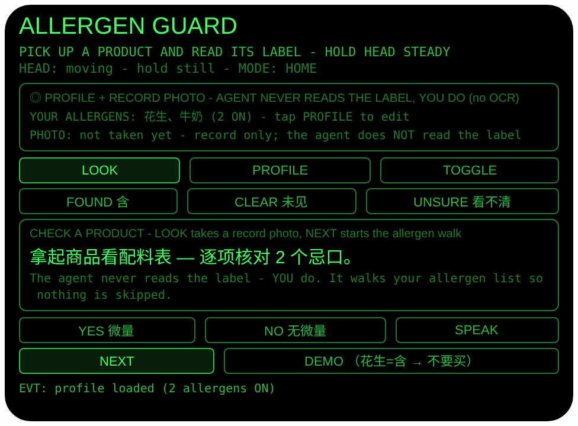
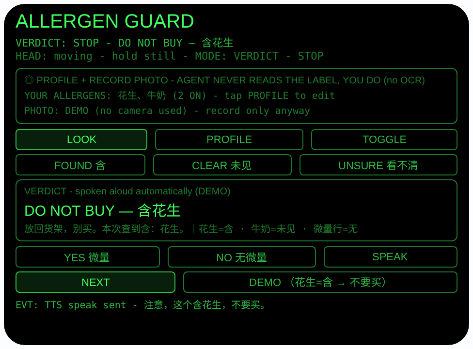

# allergen-guard — 过敏守卫（Rokid 眼镜 AIUI Agent）

**Studio 导入地址**（复制到 Global AIUI Studio 的 Import Project 输入框）：

```
https://github.com/sakai55/rokid/tree/agent-allergen-guard
```


50 个「指向性生活问题」Agent 的第 22 个。过敏/忌口的人每买一样
东西都要眯眼读配料表，漏看一个词就可能进医院。本 Agent 不替
你读标签——它把你的忌口清单逐项摆在眼前，一项一项问你
「含这个吗？」，你亲眼看着配料表回答；有一项答「含」，它
立刻大声警告「不要买」；全部走完、全部答「未见」、也没有
微量提示，它才放行。

## 预览截图

截图统一存放于仓库根目录 `screenshots/allergen-guard/`。





## 解决的问题

过敏人群在超市里的真实姿势：一手拿商品、一手放大手机拍配料
表，或者干脆眯着眼逐字啃那行小字，啃到第三样就开始跳行、
漏项。本 Agent 把「查」变成一个不能跳步的流程挂在视线上：
你看着哪件商品的配料表，就核对哪件；你的忌口一项都不会被
跳过，命中立刻出声警告，手不用腾出来翻任何东西。

## 指向性设计（为什么必须用眼镜）

- **凝视即指向（GAZE）+ 长焦（telephoto）**：看着配料表面板
  点 LOOK，用 `ImageCapture.takePhoto({mode:'telephoto'})`
  拍一张当场的记录提示照——照片本身不保存（只显示字节数，
  Blob 拍完即丢弃），日后无法翻看；它只帮你确认「正在核对
  的就是你看着的这一件」，不用报商品名。真正留下的记录
  只有忌口档案（本机持久化）；本次结论与逐项答案只在
  结论页当场显示并朗读，不存档。
- **头部稳定 = 凝视确认，点头只确认不作答**：
  `enableWorldAwareness()` 后 `onOrientationStabilityChange`
  报告头部稳定（HEAD STEADY）；点头（`onHeadGesture` 的
  `nod`）在核对中只「确认你已经选好的答案」——绝不替你
  作答、更绝不等于 CLEAR（未见）。没选答案时点头会被忽略
  并提示先选。安全语义优先于手势便利。
- **标签由你亲眼读（诚实边界）**：AIUI 运行时没有可用的
  OCR 链路，拍下的照片也没有任何链路变成成分结论，且本
  界面不能把照片放大回看。所以读标签的是佩戴者本人，
  Agent 只负责把流程走全：你的每个忌口都问到、微量提示行
  也问到，答案全部来自你的眼睛。界面全程标注
  「the agent does NOT read the label, YOU do (no OCR)」。
- **命中即出声（PLAN 的语音警告）**：任一忌口被答「含」，
  走完后结论页大字「DO NOT BUY — 含X」并自动 TTS 朗读
  「注意，这个含X，不要买。」——不用等你低头看完屏幕，
  警告先进耳朵。

## 功能流程

1. 设置忌口档案（只需一次）：PROFILE 在 8 种常见过敏原间
   切换（花生 / 牛奶 / 鸡蛋 / 麸质小麦 / 大豆 / 坚果 /
   海鲜甲壳类 / 芝麻），TOGGLE 开关，NEXT 保存退出；档案
   存本机 wx 存储 `allergenProfile`，下次自动载入。出厂
   默认花生 + 牛奶为 ON（界面标注 default），请按自己
   情况修改
2. 拿起一件商品，看着配料表面板稳住头 → 点头，或点 LOOK，
   或按 Enter → telephoto 拍照（只作当场记录提示，照片
   本身不保存），显示字节数
3. 点 NEXT 开始核对：只走你打开的忌口，一次一个，大字
   问「含『花生』吗？看配料表再答」；先用
   FOUND（含）/ CLEAR（未见）/ UNSURE（看不清）选答案，
   再 NEXT / Enter / 点头确认记入这一项（方向键可在核对
   中轮换已选答案）
4. 全部忌口答完后多问一句微量行：「有『可能含微量 /
   同生产线』提示吗？」点 YES / NO 直接出结论
5. 结论（自动朗读）：
   - 任一含 → **DO NOT BUY — 含X**，TTS 警告「不要买」
   - 任一 看不清 → **CAUTION — 有看不清的成分**，附指引
     「重度过敏：看不清就按含有处理，不要买」
   - 仅微量行 YES → **CAUTION**（逐项全未见也被微量
     提示降级）
   - 全部未见且无微量提示 → **OK — 你的忌口都不在
     配料表里**（OK 只能逐项走完到达，没有捷径按钮）
6. SPEAK 重读当前问题或结论；结论页点 NEXT / 点头进入
   下一件商品（档案保留，答案与照片行重置）
7. DEMO 按钮：载入演示档案（花生 + 牛奶，仅内存不覆盖
   你存的档案），模拟花生=含、牛奶=未见、无微量行，
   直接到 DO NOT BUY 结论页

> 安全说明：本 Agent 不是医疗建议，不判断「吃下去会不会
> 过敏」——它只机械汇总你亲眼确认的答案。你读错了配料表，
> 它抓不到你。重度过敏时，UNSURE（看不清）的正确处理是
> 按含有对待、不要买；无法确认成分的商品宁可不买，并
> 咨询医生/药师。

## 权限

| 权限 | 用途 |
|---|---|
| CAMERA | 取流并以 telephoto 模式拍摄所看商品的配料表面板（只作影像记录，不参与识别，成分由用户亲眼读后逐项回答） |

相机只在用户触发时启动：拍完立即停掉全部媒体轨道。唯一
持久化的是忌口档案（过敏原开关列表），存本机 wx 存储。

## 打包与预览

```bash
cd ~/workspace/rokid/allergen-guard
~/tools/bin/aix pack . -o ../dist/allergen-guard.aix
~/tools/bin/aix preview . --html-out artifacts/preview.html
```

本地预览截图走 `~/workspace/preview-tools/` 的本地 Ink + puppeteer 路线
（`shot-allergen.js`；结论截图的点击序列为 canvas 内 DEMO (326, 301)，
坐标经视觉定位确认）。

## 真机测试（海外版 · 云端下发 · Path 1）

1. 推到 GitHub 后，Global AIUI Studio（aiui-global.rokid.com，en-US）用
   分支导入：`https://github.com/sakai55/rokid/tree/agent-allergen-guard`
   （该分支根目录即本 Agent 文件）
2. Studio 的 **Device Debug** 页签填 Basic Information，在 AIX Packaging
   点 **Repackage and Save**，确认顶部出现绿色
   **● Debug version ready — Ready for device debugging**
3. **Hi Rokid**（海外版 `com.rokid.sprite.global.aiapp`，不是国内版
   Rokid Ai App）→ 设置 → 开发者选项 → AIUI → 更新眼镜资源包，
   等「智能体资源包下载成功」
4. 对眼镜说「乐奇，打开 allergen-guard」，先按自己的过敏情况改好
   档案，再拿三件真实商品：一件含你的忌口、一件带「可能含微量」
   提示、一件干净的，逐件走完核对，核对结论页与 TTS 警告是否正确、
   及时；再试一件字迹模糊的，答 UNSURE 看 CAUTION 与指引

## 真机测试信息（Global AIUI Studio · Device Debug）

| 项目 | 值 |
|---|---|
| Agent Name（Studio） | 待导入后回填 |
| Version（Build） | 1.0.1（待导入后回填） |
| App Category | 待导入后回填 |
| Intent Description | 待导入后回填 |
| Agent ID | 待导入后回填 |
| AIX Package Size | 约 18.6 KB（本地打包 `dist/allergen-guard.aix`） |
| 状态 | 本地完成，待导入 Studio |
| Studio | aiui-global.rokid.com（en-US） |
| 下发方式 | 云端下发 → Hi Rokid（海外版）更新眼镜资源包 |

## 验证情况

**已验证**

- 静态检查：app.json / package.json JSON 解析通过；`<script def>` JSON
  解析通过；`<script setup>` 与 app.js 提取后 `node --check` 语法通过；
  全目录 grep 无 `Page(` / `App(` / `Widget(` / `workers:` 残留。
- 结论聚合逻辑（Node 实测）：把页面对象以 wx 打桩加载进 Node，
  对答案组合 × 微量行做了穷举断言（全 CLEAR ± 微量行、
  单/多 FOUND、FOUND 与 UNSURE/微量行共存时 FOUND 优先、
  UNSURE ± 微量行、空答案表），并断言 STOP 结论的标题列全
  所有命中项、TTS 文案、UNSURE 的重度过敏指引行，共 42 条
  断言全过（含完整流程：档案默认/持久化、先选后确认、
  点头未选不作答、微量行降级、DEMO 不覆盖已存档案、
  空档案拒绝开始核对）。
- 打包：`aix pack` 成功；`aix list` 核对包内含 README.md、AGENTS.md、
  app.js、app.json、package.json、pages/index/index.ink
  （artifacts/ 已被 .aixignore 排除）。
- Build 1.0.1（2026-10-24 能力边界审计修正后复验）：照片留存
  文案已按代码事实订正——README / AGENTS.md / 界面状态行
  不再声称照片留档可日后翻看（只显示字节数，图像不保存）；
  静态检查（JSON 解析、node --check、grep）与预览双截图
  重新生成均通过，代码逻辑未改动。
- 预览渲染：aix preview + 本地 Ink + puppeteer 截图两张（见下方
  Preview Media）：首页初始态完整渲染（档案行显示默认
  花生、牛奶 + 照片行、LOOK/PROFILE/TOGGLE、
  FOUND/CLEAR/UNSURE、YES/NO/SPEAK、NEXT/DEMO 按钮与
  核对提示框）；点 DEMO 后直接到结论态：大字
  「DO NOT BUY — 含花生」，答案汇总行与「微量行=无」可见，
  来源标注 DEMO。

**未验证**

- 真机相机取流与 telephoto 模式拍配料表的记录效果（预览主机无
  相机，LOOK 的 FAIL 路径已如实写明原因，真机待测）。
- 真机头部稳定检测、点头确认答案、结论页自动 TTS 警告的
  及时性与音量（超市环境噪声下待测）。
- 真机 wx 存储中忌口档案的持久化（重启眼镜后是否保留，
  待测）。
- **识别方式的产品边界**：本 Agent 不做 OCR、不读标签——
  成分由用户亲眼读配料表后逐项回答，照片只作当场记录提示、
  本身不保存（只显示字节数），不能回看；这是已知边界，
  不是待补的验证项。
- **档案覆盖边界**：内置过敏原表只有 8 种常见项；不在表内
  的忌口（如特定添加剂）暂无法逐项核对，只能靠佩戴者
  自行留意。

---

## 提审资料（Review Submission）

> Global AIUI Studio → Submit 页签的 Review Information 逐项对应下面四段，
> 提交时整段复制。每次提交前重新确认 Preview Media。

### Feature Description

Allergen Guard turns label-checking into a routine you cannot skip. Set your allergen profile once - peanut, milk, egg, gluten, soy, nuts, shellfish, sesame. For each product, take a telephoto record photo of the ingredient panel, then the agent walks your allergens one by one while you read the label yourself: found, not seen, or unsure. One found triggers a DO NOT BUY warning spoken aloud. An unsure answer or a may-contain line means caution instead.

### Opening Message

Hi, I'm **Allergen Guard** - I walk your allergen list so no ingredient gets skipped.

Set your profile once with **PROFILE** / **TOGGLE**. For each product: **LOOK** for a telephoto record photo, then **NEXT** and answer each allergen from the label - **FOUND**, **CLEAR** or **UNSURE** - plus the may-contain line. One FOUND and I warn you out loud: do not buy. I never read the label; your eyes do. I just make the check complete.

### Preview Media

提交要求：3–5 个 JPG/PNG 图片或 MP4 视频，至少含 1 张图和 1 个视频，每次提交前重新确认。

- Image 1：`artifacts/preview-allergen-guard-index.png`（aix preview 首页：ALLERGEN GUARD 初始态，含档案/照片行、LOOK/PROFILE/TOGGLE 与 FOUND/CLEAR/UNSURE 等按钮及核对提示框，本地文件，提交时从本地上传）
- Image 2：`artifacts/preview-allergen-guard-verdict.png`（DEMO 走完核对后的结论态：大字「DO NOT BUY — 含花生」+ 答案汇总行（花生=含 · 牛奶=未见 · 微量行=无）+ DEMO 标注，本地文件）
- Video：待真机补 — 真机录制「看配料表 → 点头拍照 → 逐项回答 → 命中忌口语音警告 / 全部未见放行」全过程（MP4），录好后放 `artifacts/` 并更新此处
- 状态：未齐（已有 2 张图；还需至少 1 个视频，总数补到 3–5 个后才可提交）

### Change Log

#### Build 1.0.1

**Features added**

- None.

**Improvements**

- None.

**Fixes**

- Corrected photo-retention wording (README, AGENTS.md and the on-screen status line): the LOOK photo is a moment-of-use record cue only — only its byte size is shown, the image itself is not saved and cannot be reviewed later; the earlier "kept for later reference" phrasing overstated what the agent stores. The only data persisted on-device remains the allergen profile; a check's verdict and per-allergen answers are shown on the verdict screen for that check only and are not archived. (Capability-boundary audit, 2026-10-24.)

#### Build 1.0.0

**Features added**

- Gaze-directed allergen checking: head-stability gaze confirmation (HEAD STEADY), nod or LOOK to photograph the ingredient panel in telephoto mode (record only), and a per-allergen walk driven by the wearer's own eyes - FOUND / CLEAR / UNSURE per allergen, picked first and confirmed with NEXT, Enter or a nod; a nod never answers for you and never means CLEAR.
- Personal allergen profile: 8 common allergens (peanut, milk, egg, gluten/wheat, soy, tree nuts, shellfish, sesame) toggled once in PROFILE mode and persisted on-device (wx storage key allergenProfile, peanut + milk ON as the labeled default); the check only walks the allergens switched ON.
- Verdict with spoken warning: any FOUND gives a big DO NOT BUY headline naming every found allergen plus an automatic TTS warning; any UNSURE gives CAUTION with severe-allergy guidance (treat unsure as contains); a may-contain / same-line trace answer downgrades an all-clear to CAUTION; OK is reachable only by walking every ON allergen - there is no shortcut.
- DEMO loads a demo profile (peanut + milk, in memory only, never overwriting the saved profile) with peanut FOUND, landing directly on the DO NOT BUY verdict so the warning state is visible without a camera.

**Improvements**

- None (initial release).

**Fixes**

- None (initial release).
