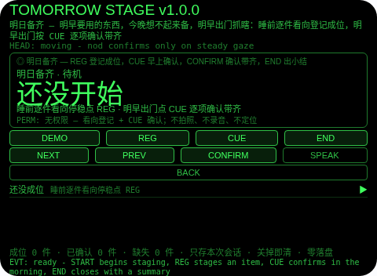
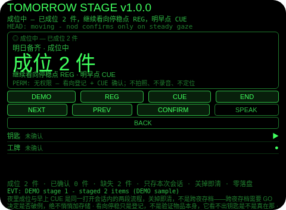
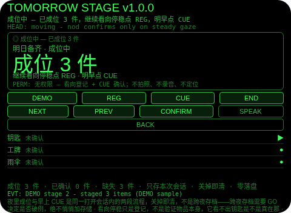
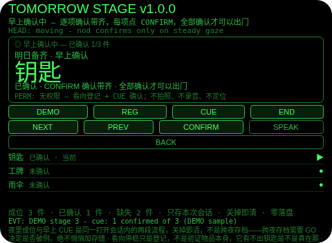
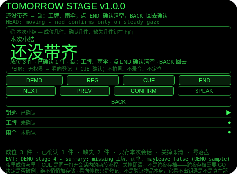
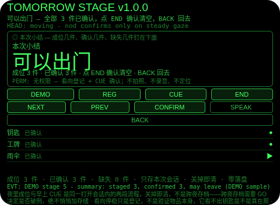

# Tomorrow Stage（明日备齐）

**Studio 导入地址**（复制到 Global AIUI Studio 的 Import Project 输入框）：

```
https://github.com/sakai55/rokid/tree/agent-tomorrow-stage
```

注意力外挂系列 AM05（AMBIENT 环境型，本组第五个，系列第 50 个——系列收官）。明早要用的东西，今晚想不起来备，明早出门抓瞎。本 Agent 把「明早备齐」外包出去：睡前把明早第一件事要用的物品逐个看向停稳点 REG 登记成位，明早出门点 CUE 逐项确认带齐，有缺失时门不说可以出门并点名缺失项，全部确认后才显示可以出门。

## 解决的问题

明早第一件事要用的东西，今晚全靠脑子记：钥匙、工牌、雨伞、水杯、文件袋，睡前不备位，明早出门前一样一样想起来——想起来一件是一件，想不起来就抓瞎。本 Agent 管四件事：成位（睡前逐件看向停稳点 REG，最多 8 件）、早上确认（明早出门点 CUE，每项点 CONFIRM 确认带齐）、门（有未确认项时 END 不说可以出门，而是警告并点名缺失项；全部确认后才显示可以出门）、小结（成位几件、确认几件、缺失几件，确认后清空）。它不替你找东西——只负责让你出门前每一件都有据可查。

## 注意力外挂设计（AMBIENT 环境型）

- **夜里成位与早上 CUE 是同一打开会话内的两段流程，不是跨夜存档**：舰队零落盘纪律禁止存储调用，所以成位清单在 Agent 关掉时即清。「睡前登记、明早回放」是指在同一次打开内走完两段流程；真正的跨夜存档需要 GO 决定是否破例，本 Agent 绝不悄悄加存储调用，静态校验也断言源码零存储调用。这一点 UI 与本 README 如实写明。
- **门不说可以出门，但不阻止出门**：有未确认项时 END 只警告并点名缺失项，从不显示可以出门；但它没有锁、没有强制流程——最终出不出门由你决定。
- **看向停稳只是登记，不是验证物品本身**：REG 记录的是你看向并停稳、点了登记——它看不出钥匙是不是真在那，只知道你看向了它并点了 REG。
- **纠错便宜，销毁需确认**：成位页或确认页返回键回待机（本轮保留，START 恢复同一轮）；小结页返回键回原态（不删东西，小结重建）；确认（小结页点 END 或头稳点头）才清空本轮；没有 DEL 键。
- **为什么胸前设备做不了**：明日备齐是「头部朝向 × 逐项确认」的配对——胸前设备既不知道你看向哪件物品、也没法把「待确认清单 + 缺失点名」钉在你眼前。成位登记、早上逐项确认、缺失点名三条都只有头戴设备成立。

## 与邻近 Agent 的分工

- 注意力系列 `cue-door`（CU01）：出门行李逐项确认门。本 Agent 复用它的门纪律（缺失时不说可以出门），但清单是睡前看向登记成位的——cue-door 不做睡前成位。
- 注意力系列 `cue-bag`（CU04）：出门包内物品逐项确认。本 Agent 不往包里装东西：它管的是明早第一件事要用的物品，睡前成位、明早出门逐项确认。
- 注意力系列 `trail-back`（AM04）：沿途路口朝向 + 画面面包屑 + 返程反向逐点引导。本 Agent 不记路线、不拍照：它唯一的输入就是你成位时的 REG 和早上确认时的 CONFIRM。

## 功能流程

1. **开始（START）**：待机点 START 开始成位；头稳点头也可开始。
2. **成位（REG）**：睡前逐件看向停稳点 REG，记一件（预设顺序：钥匙、工牌、雨伞、水杯、文件袋，之后为物品 6 起，最多 8 件）；头动时 REG 拒绝。
3. **早上确认（CUE）**：明早出门点 CUE，逐项点 CONFIRM 确认带齐（开始时出声报一次待确认件数）；NEXT/PREV 只移动焦点，不算确认。
4. **门（END）**：成位中或确认中点 END 出小结；有未确认项时小结警告并点名缺失项，不说可以出门；全部确认后小结显示可以出门。返回键回去（不删东西），小结页点 END 或头稳点头确认后清空本轮。

## 权限

- 无权限（`permissions: []`）：看向登记 + CUE 确认不需要任何设备能力。不拍照、不录音、不定位。

## 手势映射

- 点按（Enter）：待机 START、成位中 REG、确认中 CONFIRM、小结页确认清空。
- 双击（Backspace）：返回——成位/确认页回待机（本轮保留），小结页回原态（不删东西）。
- 滑动（ArrowUp/Down）：切换焦点（成位/确认清单内走行，首尾回绕）。
- 头稳 + 点头：待机开始成位、小结页确认清空；成位中与确认中点头忽略（点头不是登记、也不是确认）。
- 长按（单指）：唤醒 AI 语音助手（平台默认）；双指长按：AI 快捷指令（固定文本，零 ASR 固定入口，见能力档案）。

## 打包与预览命令

```bash
cd ~/workspace/rokid/tomorrow-stage
~/tools/bin/aix pack . -o ~/workspace/rokid/dist/tomorrow-stage.aix
~/tools/bin/aix list ~/workspace/rokid/dist/tomorrow-stage.aix
~/tools/bin/aix preview . --html-out artifacts/preview.html
```

## 真机测试信息（待 GO 导入后回填）

| 项目 | 值 |
|---|---|
| Studio 名称 | （待回填） |
| Version / Build | （待回填） |
| App Category | （待回填） |
| Intent Description | （待回填） |
| Agent ID | （待回填） |
| 状态 | 未导入（待 GO 在 Global AIUI Studio 导入 `tree/agent-tomorrow-stage` 后实测） |

## 预览截图








## 提审资料 (Review Submission)

### Feature Description

睡前把明早第一件事要用的物品逐个看向登记成位，明早出门按 CUE 逐项确认带齐：有缺失时门警告并点名缺失项，全部确认后才显示可以出门。成位与确认是同一打开会话内的两段流程，关掉即清，不是跨夜存档。

### Opening Message

明早第一件事要用的东西，今晚就备好位：睡前逐件看向停稳点 REG，明早出门点 CUE 逐项确认——缺了哪件，门会点名告诉你，齐了才说可以出门。

### Preview Media

- 预览图片：见上方「预览截图」节（6 张，480×352）。
- 预览视频：待真机录制后补齐（提审需 3–5 个文件，至少 1 图 + 1 视频）。

### Change Log

- Build 1.0.0：
  - Features added：睡前看向登记成位（预设顺序钥匙/工牌/雨伞/水杯/文件袋，最多 8 件）；早上 CUE 逐项确认（CONFIRM 确认，NEXT/PREV 只移焦点）；缺失门（END 警告并点名缺失项，全部确认才显示可以出门）；结束小结（成位/确认/缺失计数，确认后清空）。
  - Improvements：无（首版）。
  - Fixes：无（首版）。

## 如实说明

- 夜里成位与早上 CUE 是同一打开会话内的两段流程，关掉即清，不是跨夜存档——跨夜存档需要 GO 决定是否破例，绝不悄悄加存储调用；源码零存储调用已由静态校验断言。
- 看向停稳只是登记，不是验证物品本身：它看不出钥匙是不是真在那，只知道你看向了它并点了 REG。
- 门不阻止出门：门只是不说可以出门并点名缺失项，最终决定在你。
- 没有室内定位、没有摄像头：本 Agent 不知道物品在哪，也不对物品拍照。
- 只存本次会话：成位清单、确认结果与门结果在小结确认后与 Agent 关闭时全部清除。
