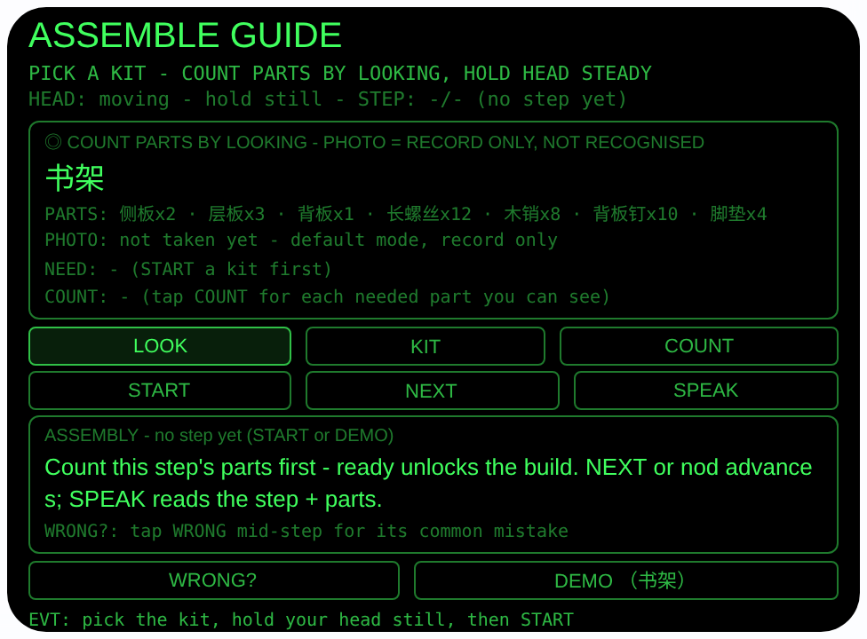
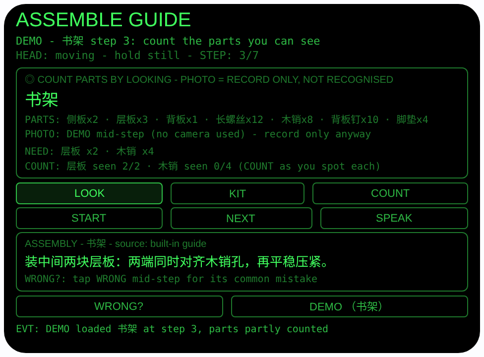

# assemble-guide — 组装向导（Rokid 眼镜 AIUI Agent）

50 个「指向性生活问题」Agent 的第 13 个。组装平板家具时，零件
几十个都长得差不多，纸质说明书放下就找不到读到哪一步，双手
还扶着板子腾不出来。本 Agent 把说明书挂在视线上，还加了一道
「数零件」的门：每一步先报这步需要的零件，你看着零件堆逐个
数，数齐了这步才亮出「parts ready」放行——装到一半才发现少
一颗螺丝、或是方向装反了，就是它要防的事。

## 预览截图

截图统一存放于仓库根目录 `screenshots/assemble-guide/`。





## 解决的问题

组装家具的麻烦不在拧螺丝，在「对零件」和「别丢步」：说明书摊
在地上沾灰、翻页要放下板子，零件又全是银色小件，拿错型号装
到一半才发现。本 Agent 让你装哪步就看哪步：步骤悬在眼前、
念在耳边，每步先把零件数齐再动手，常见装反点每步都提前写
在 WRONG 里。

## 指向性设计（为什么必须用眼镜）

- **步骤在视线内、双手在板子上**：一次只显示一步，大字悬在
  眼前；NEXT 或点头推进，SPEAK 用 `speechSynthesis.speak`
  念出当前步 + 本步所需零件——扶板子的手不用放下。
- **零件计数门 = 看向即清点（核心差异点）**：每一步先报所需
  零件（如「层板 x2 · 木销 x4」），你看着零件堆点 COUNT，
  逐个累加亲眼看到的数量；全部数齐，本步才显示
  「PARTS READY - parts ready, start building」。数没齐就
  NEXT / 点头会被拦下并报还差哪件。计数是你数、眼镜记，
  不是相机识别——所以不会数错型号还理直气壮。
- **头部稳定 = 凝视确认**：`enableWorldAwareness()` 开启世界
  感知后，`onOrientationStabilityChange` 报告头部稳定时才进入
  可用状态（HEAD STEADY）；点头（`onHeadGesture` 的 `nod`）：
  没有计划时触发 LOOK 拍照，组装进行中则尝试推进一步
  （仍受计数门约束）。
- **看图留档 = 说明书图页的视觉书签**：LOOK 用
  `ImageCapture.takePhoto({mode:'default'})` 拍说明书图页或
  手里的零件，界面显示字节数。照片只作记录，不参与任何
  识别——哪一步的图长什么样，你拍下来对照着装。

## 功能流程

1. 选套件：KIT 在 3 个内置家具间切换（书架 7 步 / 抽屉柜
   7 步 / 电脑桌 6 步），每个套件带完整零件清单一行；切换
   即重置进度。ArrowUp / ArrowDown 同样换套件
2. 看着零件堆/说明书稳住头 → 状态变 `HEAD STEADY`；点头或
   点 LOOK → default 模式拍一张留档（只作记录），显示字节数
3. 点 START 载入所选套件的内置步骤（标注 built-in guide），
   从第 1 步开始；每步先显示 NEED 零件行
4. 点 COUNT 逐个登记你看到的零件（焦点自动跳到还没数齐的
   那件）；数齐后出现 PARTS READY，才可以动手装这一步
5. NEXT 或点头进入下一步（计数清零，重新数新步的零件）；
   SPEAK 朗读当前步 + 所需零件；点 WRONG 看本步的常见错误
   （每步一条，如背板「方向装反 → 先对孔再钉」）
6. 最后一步数齐并 NEXT 后显示收尾语（如书架：「轻晃检查，
   晃动多半是某颗长螺丝没复紧」）
7. DEMO 按钮：直接载入「书架」并停在第 3/7 步，零件只数了
   一半（层板 seen 2/2、木销 seen 0/4），预览即可看到计数门
   的运行态（不依赖相机）

> 诚实说明：内置步骤与零件数量按常见平板家具写定，你买的
> 具体家具请以厂家说明书为准。运行时没有把照片变成零件
> 结论的链路：零件由你亲眼数、点 COUNT 登记，照片只作
> 记录，绝不声称相机识别出了零件或数量。

## 权限

| 权限 | 用途 |
|---|---|
| CAMERA | 取流并以 default 模式拍摄说明书图页或手里的零件（只作视觉记录，不参与识别与判断） |

相机只在用户触发时启动：拍完立即停掉全部媒体轨道。

## 打包与预览

```bash
cd ~/workspace/rokid/assemble-guide
~/tools/bin/aix pack . -o ../dist/assemble-guide.aix
~/tools/bin/aix preview . --html-out artifacts/preview.html
```

本地预览截图走 `~/workspace/preview-tools/` 的本地 Ink + puppeteer 路线
（`shot-assemble.js`；步骤截图的点击序列为 canvas 内 DEMO (350, 325)）。

## 真机测试（海外版 · 云端下发 · Path 1）

1. 推到 GitHub 后，Global AIUI Studio（aiui-global.rokid.com，en-US）用
   分支导入：`https://github.com/sakai55/rokid/tree/agent-assemble-guide`
   （该分支根目录即本 Agent 文件）
2. Studio 的 **Device Debug** 页签填 Basic Information，在 AIX Packaging
   点 **Repackage and Save**，确认顶部出现绿色
   **● Debug version ready — Ready for device debugging**
3. **Hi Rokid**（海外版 `com.rokid.sprite.global.aiapp`，不是国内版
   Rokid Ai App）→ 设置 → 开发者选项 → AIUI → 更新眼镜资源包，
   等「智能体资源包下载成功」
4. 对眼镜说「乐奇，打开 assemble-guide」，把零件摊在面前选好
   套件，看着零件堆逐个数齐再动手，跟着语音一步步装完

## 真机测试信息（Global AIUI Studio · Device Debug）

| 项目 | 值 |
|---|---|
| Agent Name（Studio） | 待导入后回填 |
| Version（Build） | 1.0.0（待导入后回填） |
| App Category | 待导入后回填 |
| Intent Description | 待导入后回填 |
| Agent ID | 待导入后回填 |
| AIX Package Size | 15.98 KB（本地打包 `dist/assemble-guide.aix`） |
| 状态 | 本地完成，待导入 Studio |
| Studio | aiui-global.rokid.com（en-US） |
| 下发方式 | 云端下发 → Hi Rokid（海外版）更新眼镜资源包 |

## 验证情况

**已验证**

- 静态检查：app.json / package.json JSON 解析通过；`<script def>` JSON
  解析通过；`<script setup>` 与 app.js 提取后 `node --check` 语法通过；
  全目录 grep 无 `Page(` / `App(` / `Widget(` / `workers:` 残留。
- 预览渲染：aix preview + 本地 Ink + puppeteer 截图两张（见下方
  Preview Media）：首页初始态完整渲染（套件框：套件「书架」大字、
  零件清单行、照片行、NEED 行、COUNT 行，LOOK/KIT/COUNT 与
  START/NEXT/SPEAK 与 WRONG?/DEMO 按钮、空步骤框）；点 DEMO 后
  载入「书架」并停在 STEP 3/7（第 3 步内容 + NEED「层板 x2 ·
  木销 x4」+ COUNT「层板 seen 2/2 · 木销 seen 0/4」半数状态，
  来源标注 built-in guide）。
- 打包：`aix pack` 成功（15.98 KB）；`aix list` 核对包内含 README.md、AGENTS.md、
  app.js、app.json、package.json、pages/index/index.ink
  （artifacts/ 已被 .aixignore 排除）。

**未验证**

- 真机相机取流与 default 模式拍说明书图页/零件留档的效果
  （预览主机无相机，LOOK 的 FAIL 路径已如实写明原因，真机待测）。
- 真机头部稳定检测、点头推进（受计数门约束）、TTS 朗读
  步骤 + 零件的效果。
- **判断方式的产品边界**：零件计数由佩戴者亲眼数、点 COUNT
  登记，照片只作记录、不做识别；步骤与数量是内置通用表，
  与具体厂家图纸的差异需佩戴者对照厂家说明书——这是已知
  边界，不是待补的验证项。

---

## 提审资料（Review Submission）

> Global AIUI Studio → Submit 页签的 Review Information 逐项对应下面四段，
> 提交时整段复制。每次提交前重新确认 Preview Media。

### Feature Description

Assemble Guide walks you through flat-pack furniture while both hands hold the panels. Pick one of three built-in kits - bookshelf, drawer cabinet, desk - and follow its steps in your line of sight. Before each step, count the parts it needs by looking at your pile and tapping COUNT; a step only unlocks its parts-ready line when every part is counted. Nod or tap to advance, hear the step and its parts read aloud, check each step's common mistake, and snap a record photo of the manual diagram.

### Opening Message

Hi, I'm **Assemble Guide** - your hands-free furniture builder.

Tap **KIT** to pick your furniture, then **START**. Each step first names the parts it needs: look at your pile and tap **COUNT** for every part you can see - when all are counted, the step unlocks with **PARTS READY**. **NEXT** or nod to advance, **SPEAK** to hear the step plus its parts, **WRONG?** for that step's common mistake, and **LOOK** to save a record photo of the diagram page.

### Preview Media

提交要求：3–5 个 JPG/PNG 图片或 MP4 视频，至少含 1 张图和 1 个视频，每次提交前重新确认。

- Image 1：`artifacts/preview-assemble-guide-index.png`（aix preview 首页：ASSEMBLE GUIDE 初始态，含套件框（套件「书架」大字、零件清单行、照片行、NEED 行、COUNT 行）、LOOK/KIT/COUNT、START/NEXT/SPEAK、WRONG?/DEMO 按钮及空步骤框，本地文件，提交时从本地上传）
- Image 2：`artifacts/preview-assemble-guide-step.png`（DEMO 载入「书架」停在 STEP 3/7 的计数门运行态：NEED「层板 x2 · 木销 x4」、COUNT「层板 seen 2/2 · 木销 seen 0/4」半数状态 + 第 3 步内容，本地文件）
- Video：待真机补 — 真机录制「选套件 → 看零件堆数齐 PARTS READY → 点头推进 + 朗读装完 → 看 WRONG 防装反」全过程（MP4），录好后放 `artifacts/` 并更新此处
- 状态：未齐（已有 2 张图；还需至少 1 个视频，总数补到 3–5 个后才可提交）

### Change Log

#### Build 1.0.0

**Features added**

- Hands-free guided assembly for 3 built-in flat-pack kits (bookshelf 7 steps, drawer cabinet 7 steps, desk 6 steps), each with a full parts list and concrete steps carried in your line of sight while both hands hold the panels.
- Parts-check gate (the differentiator): every step names the parts it needs; the wearer looks at the pile and taps COUNT for each part spotted (e.g. 长螺丝 seen 2/4), and the step only shows its "PARTS READY - parts ready, start building" line when the count matches the requirement - NEXT and nod are blocked with the shortfall named until then.
- Per-step common-mistake warnings on WRONG (one per step, e.g. back panel reversed -> align the holes before nailing), gaze confirmation via head stability with nod to photograph / advance, default-mode record photo of the manual diagram page or the part in hand (record only, ImageCapture with wx camera fallback), and TTS reading of the step plus its needed parts on SPEAK.
- DEMO loads the bookshelf kit mid-step (step 3 of 7) with its parts only partly counted, so the parts-gate state is visible without a camera.

**Improvements**

- None (initial release).

**Fixes**

- None (initial release).
