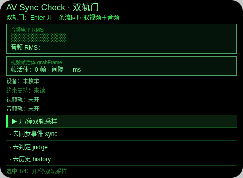
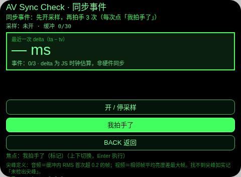
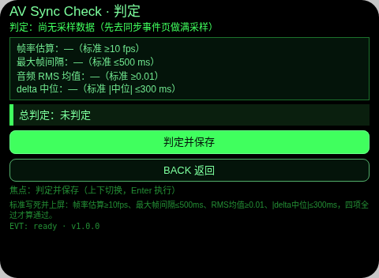
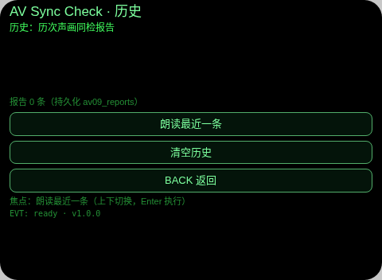

# AV Sync Check（声画同检）

**Studio 导入地址**（复制到 Global AIUI Studio 的 Import Project 输入框）：

```
https://github.com/sakai55/rokid/tree/agent-av-sync-check
```

AV09 · 录制或直播前同开音视频两轨，用 3 次拍手同时标出声音尖峰与画面亮度尖峰，估出声画差值并按写死标准判定，顶边界 B9 音画同采。

## 预览截图






## 结构与功能（闭环）

四页闭环：双轨门 → 同步事件 → 判定 → 历史。

- **双轨门（pages/index）**：中枢菜单。Enter 选「开双轨」走真实双轨链：`getUserMedia({video:true, audio:true})` 一条流同开两轨；`enumerateDevices()` 列设备总数与视频/音频输入数；`getSupportedConstraints()` 列支持字段；两轨各自 `getSettings()` 回读（视频宽高/帧率、音频采样率/声道）逐项上屏。活体指示：`Analyser` 每 300ms 读 RMS 显示电平条，`ImageCapture.grabFrame()` 计帧数与帧间隔。停钮 stop 全部 tracks 并清定时器。
- **同步事件（pages/sync）**：本页自开一条流（每页独立采样，不跨页复用流），约每 100ms 采样一次：`grabFrame` 画到 16×12 canvas 算平均亮度 + Analyser 算 RMS，环形缓冲最近 30 个样本（时刻/亮度/RMS），同时累计帧间隔序列与 RMS 总和，经临时键 `av09_tmp` 交给判定页（页间传参，非持久化）。用户拍手后点「我拍手了」记 JS 时刻 t0，程序在缓冲内找音频尖峰 ta（RMS 首次超阈 0.2 的帧）与视频尖峰 tv（相邻帧亮度差最大帧），`delta = ta − tv` 大字显示；做满 3 次。找不到尖峰如实记「未检出尖峰」。
- **判定（pages/judge）**：汇总 sync 页数据：帧间隔中位数换算帧率估算、最大帧间隔（丢帧指标）、音频 RMS 均值、3 次 delta 中位数。过线标准写死并上屏：帧率估算 ≥10 fps、最大间隔 ≤500 ms、RMS 均值 ≥0.01、|delta 中位| ≤300 ms，逐项 ✓/✗ + 总判定，TTS 播报，并写入持久化 `av09_reports`。无采样数据时拒绝判定。
- **历史（pages/history）**：报告列表（时间/总判定/帧率/最大间隔/RMS/delta 中位），可朗读最近一条，可清空。

## 语音交互流

- 开轨确认：双轨开启成功后 TTS 播报「双轨已开」。
- 采样引导：sync 页开采样后 TTS 提示「采样开始，请拍手」。
- 事件反馈：每次拍手检出 delta 后 TTS 播报差值毫秒数；未检出尖峰播报「未检出尖峰」。
- 判定播报：判定完成 TTS 播报「声画同步判定通过/未通过」。
- 历史朗读：history 页可朗读最近一条报告的关键数。
- 本台以采样与数值为本体，不设 ASR 输入；TTS 用宿主固定音色，不设 `lang`。

## 手势映射

| 手势（镜腿触控板） | 键事件 | 作用 |
|---|---|---|
| 单击 | Enter | 执行选中/焦点动作（开轨、标记拍手、判定保存等主动作） |
| 上滑 / 下滑 | ArrowUp / ArrowDown | 移动菜单选中态 / 切换子页焦点动作 |
| 点头 | `onHeadGesture('nod')` | 与主确认等价（sync 页点头＝标记「我拍手了」） |
| 双击 | Backspace | 系统返回（子页另有 BACK 钮） |

## 权限

- `CAMERA`：视频轨采样与 `grabFrame` 亮度帧差。
- `RECORD_AUDIO`：音频轨采样与 Analyser 电平/尖峰检测（只连 Analyser，不连 destination，不外放）。

## 诚实边界

- delta 是 JS 时钟估算：ta/tv 都取自同一 JS 采样缓冲的时刻，不是硬件时间戳同步，精度受约 100ms 采样间隔限制；UI 与本页均明示这一点。
- 跨页不复用同一条 stream：每页各自开关流（index 与 sync 各开各的），采样口径在各页内自洽，判定只消费 sync 页这一条流的数据。
- 帧率是帧间隔中位数换算的估算值，不是驱动层真实帧率；RMS 是相对电平，不是声压级。
- placeholder 点名：无假数据、无 DEMO 种子；Web 预览无摄像头/麦克风时开流如实失败。真机上 `grabFrame` 亮度链与 Analyser 采样间隔需真机回填验证。

## 设备测试信息

| 项 | 值 |
|---|---|
| Studio name | AV Sync Check（待回填） |
| Version / Build | 1.0.0 |
| App Category | 待回填（导入时确认） |
| Intent Description | 待回填 |
| Agent ID | 待回填 |
| 状态 | 未导入 |

## 提审资料 (Review Submission)

### Feature Description

Before you record or stream, check that sound and picture travel together: one stream opens both tracks with settings read back, three hand-claps are timed against the audio peak and the brightness peak to estimate the AV delta, and a fixed-threshold verdict is filed to history.

### Opening Message

**AV Sync Check.** Open both tracks, clap three times, and I will estimate the gap between the sound peak and the picture peak, then judge it against fixed thresholds shown on screen.

### Preview Media

图片 4 张（见本页预览截图）；视频待真机阶段补（提审要求 3–5 个文件、≥1 图 ≥1 视频）。

### Change Log

#### Build 1.0.0
- Features added: 四页新作（双轨门回读/拍手同步事件/写死标准判定/报告历史）；音画双轨同采与 JS 时钟 delta 估算。
- Improvements: 无（首版）。
- Fixes: 无（首版）。

## 打包与预览

- 打包：`~/tools/bin/aix pack . -o av-sync-check.aix`（仓库副本按规矩放 `aix/av-sync-check.aix`）
- 预览：`~/tools/bin/aix preview .` 后走本地截图管线生成 4 页预览图，存入仓库 `screenshots/av-sync-check/`。
