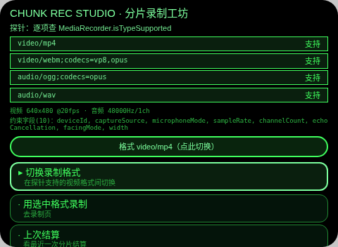
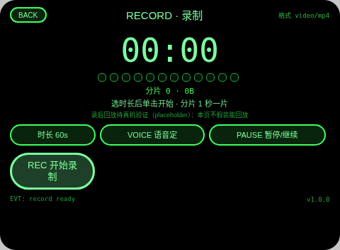
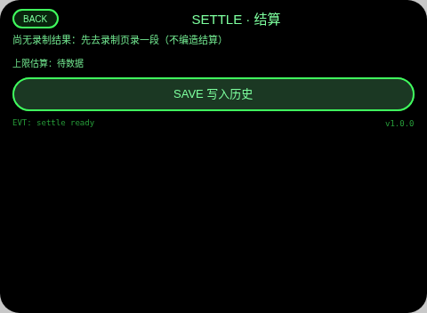
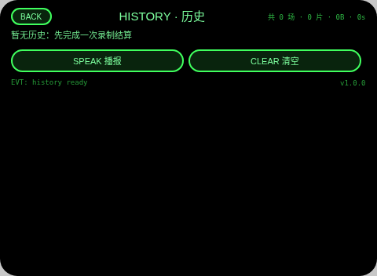

# Chunk Rec Studio（分片录制工坊）

**Studio 导入地址**（复制到 Global AIUI Studio 的 Import Project 输入框）：

```
https://github.com/sakai55/rokid/tree/agent-chunk-rec-studio
```

**AIX 直接下载**（最新版）：[chunk-rec-studio.aix](https://raw.githubusercontent.com/sakai55/rokid/main/aix/chunk-rec-studio.aix)

AV03 · 录一段眼镜视频前，先探明宿主到底支持哪种录制格式，再按 1 秒分片实录、当场结算码率与可录上限。顶边界 B3：MediaRecorder 视频分片（isTypeSupported 探针 + start(1000) 分片 + pause/resume）。

## 预览截图









## 结构与功能（闭环）

- `pages/index` 探针：逐个真实调用 `MediaRecorder.isTypeSupported` 查 `video/mp4`、`video/webm;codecs=vp8,opus`、`audio/ogg;codecs=opus`、`audio/wav` 并列表；`getUserMedia({video:true,audio:true})` 后回读视频/音频 track 的 `getSettings()`（分辨率/帧率/采样率/声道）显示；`getSupportedConstraints()` 列出支持的约束字段；Enter 在菜单首行于「支持的视频格式」间切换选中格式，写入 `av03_pick`。
- `pages/record` 录制：预设时长 4 档口径——30/60/120s 三档点按切换 + 语音自定一档（`SpeechRecognition` 听数字秒数，听错可重说）；真实接 `MediaRecorder(stream, {mimeType: 选定格式})` 的 `start(1000)` 分片，`ondataavailable` 累计分片数/字节（分片刻度点列同步）；`pause()`/`resume()` 可用；每 10s TTS 报已录秒数与 MB/分钟推算（`setInterval` 检查）；到时自动 `stop`，结果写 `av03_last` 跳 settle。
- `pages/settle` 结算：分片数 / 总字节 / 时长 / MB 每分钟，并按此推算时长上限——估算口径明示为「假设可用空间 8GB（假设值，非实测）」；Enter/点头写入 `av03_sessions`，跳 history。
- `pages/history` 历史：读 `av03_sessions` 列表（最近 8 条）+ 总计（场次/总分片/总字节/总时长），可清空。

## 语音交互流

- 语音定时长：record 页点 VOICE 后 `SpeechRecognition` 听「录 90 秒」式数字（5–600 秒钳制）；纠错路径——识别失败如实显示错误码、可重说，也可随时改用点按三档，不互相阻塞。
- TTS 播报节点：录制开始、每 10 秒报时+码率推算、录制结束、结算保存、格式切换、历史选中条播报。
- 宿主 ASR 说明：识别由宿主完成，不吃任何麦克风模式，本页文案不作此暗示。

## 手势映射

| 手势 | 键/事件 | 作用 |
|---|---|---|
| 单击 | Enter | 主动作：确认格式 / 开始或停止录制 / 写入历史 / 播报 |
| 上滑/下滑 | ArrowUp / ArrowDown | 移动菜单/历史选择；record 页下滑切时长档、上滑暂停/继续 |
| 点头 | onHeadGesture nod | 主确认（空闲时点头开始录制；settle 页点头写入历史） |
| 双击 | Backspace | 系统返回（页面不拦截）；子页另有 BACK 按钮 |

## 权限

- CAMERA：录制视频轨道（getUserMedia video + MediaRecorder）、探针页轨道设置回读。
- RECORD_AUDIO：录制音频轨道、语音自定时长的 SpeechRecognition 输入。

## 诚实边界

- placeholder 点名：**录后回放待真机验证（placeholder）**——record 页明示此行；本 Agent 不声称能回放录好的视频，只做分片计数与字节结算。
- 上限估算口径：按实测 MB/分钟 × 假设可用空间 8GB 估算，8GB 是假设值而非设备实测剩余空间，settle 页与本节均明示。
- 探针如实：isTypeSupported 不支持即写「不支持」；宿主无可用视频格式时录制页以宿主默认格式尝试并如实报错，不伪造支持列表。

## 设备测试信息

| 项目 | 值 |
|---|---|
| Studio name | 待导入后回填 |
| Version | 1.0.0 |
| App Category | Work |
| Intent Description | Probe recorder formats, record in one-second chunks and settle bitrate |
| Agent ID | 待回填 |
| 状态 | 未导入、未真机测试、未提审 |

## 提审资料 (Review Submission)

### Feature Description

Chunk Rec Studio answers two questions before and after you record on the glasses: what can this host actually record, and what did that recording cost? It probes MediaRecorder mime support, reads back real track settings, then records in one-second chunks with pause and resume, a spoken progress report every ten seconds, and a settlement of chunk count, total bytes and megabytes per minute, plus a clearly-labelled storage-time estimate. Sessions accumulate in a local history.

### Opening Message

Hi, I'm **Chunk Rec Studio**. First I'll **probe** which recording formats this host really supports and read back the camera and mic settings. Then pick a length — or just **say the seconds** — and I'll record in **one-second chunks**, report progress by voice, and settle the session: chunks, bytes and megabytes per minute.

### Preview Media

图片 4 张见预览截图节；视频待真机阶段补。

### Change Log

#### Build 1.0.0

**Features added**

- MediaRecorder mime probe for four candidate types plus track getSettings and getSupportedConstraints readback.
- Chunked recording with start(1000), pause/resume, preset or voice-set durations and 10-second spoken progress.
- Per-session settlement (chunks, bytes, MB per minute, stated-assumption time cap) and a totals history.

**Improvements**

- None (initial build).

**Fixes**

- None (initial build).

## 打包与预览

打包命令 `~/tools/bin/aix pack . -o chunk-rec-studio.aix`（仓库副本 aix/chunk-rec-studio.aix）；预览命令说明走本地截图管线（aix preview + 本地 puppeteer 截图，见 rokid-preview-screenshots skill）。
