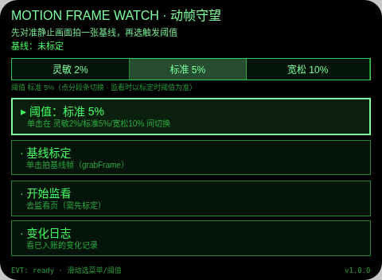
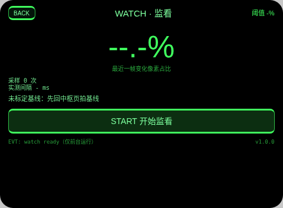
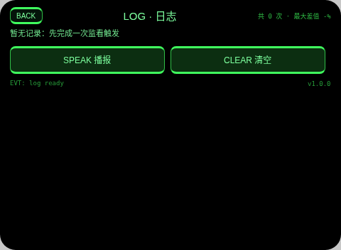

# Motion Frame Watch（动帧守望）

**Studio 导入地址**（复制到 Global AIUI Studio 的 Import Project 输入框）：

```
https://github.com/sakai55/rokid/tree/agent-motion-frame-watch
```

AV02 · 守一个固定点位（门口、工位、货架）时，先标定静止基线、再用帧差守望，变化超阈值自动存证判读并入账。顶边界 B2：grabFrame 帧差（ImageCapture.grabFrame + 64×48 降采样像素差）。

## 预览截图





（proof 存证判定页截图缺：Web 预览宿主无相机/canvas，基线标定被如实拦截「待真机标定」，监看无法启动、也就到不了存证页；该页待真机导入后补拍。index 页截图里即为宿主如实回示的拦截状态。）



## 结构与功能（闭环）

- `pages/index` 基线标定：Enter 拍基线——真实接 `getUserMedia({video:true})` → `ImageCapture.grabFrame()` 得 ImageBitmap → `document.createElement('canvas')` 降采样 64×48 → `getImageData` 取亮度阵列存 `av02_baseline`（页内状态+存储）；阈值三档（灵敏 2% / 标准 5% / 宽松 10%）在菜单首行，滑动选行、单击切换，分段条同步高亮。
- `pages/watch` 监看：开始后 `setInterval` 约 1200ms 一次 `grabFrame` 同法采样，逐像素与基线比（亮度差 >24 计变化），实时显示最近差值 %、采样次数、实测间隔 ms（`Date.now` 差；文案明示「官方未公布帧率上限，此为本机实测」）；只前台运行——`onHide`/`onUnload` 清 interval、停流并在状态行明示；超阈值即停采样、写 `av02_alert` 并跳 proof。
- `pages/proof` 存证判定：真实接 `takePhoto({mode:'default'})` 存证（Blob 字节数显示；照片只存内存不落盘，文案明示），`LanguageModel` 多模态 prompt 回一句变化描述（不可用如实标注），进页即 TTS 喊话「点位有变化」；Enter/点头确认入账写 `av02_log`（时间/差值%/描述），跳 log。
- `pages/log` 日志：读 `av02_log` 列表（最近 8 条）+ 计数结算（总次数、最大差值），滑动选条、单击播报，可清空。

## 语音交互流

- 语音输入点：本台无 ASR 输入（纯帧差守望，语音只出不进）——这是有意设计，变化判定不依赖任何识别结果。
- TTS 播报节点：基线标定完成、阈值切换、开始监看、超阈值喊话「点位有变化」、存证完成、确认入账、日志选中条播报。
- 语音纠错路径：无 ASR 故无识别纠错；误触发（光线突变）可在 log 页清空或不确认入账（proof 页不点确认即不入账）。

## 手势映射

| 手势 | 键/事件 | 作用 |
|---|---|---|
| 单击 | Enter | 主动作：标定 / 切阈值 / 启停监看 / 存证与确认入账 / 播报 |
| 上滑/下滑 | ArrowUp / ArrowDown | 移动菜单/日志选择；监看页为读当前差值 |
| 点头 | onHeadGesture nod | 主确认（未监看时点头开始监看；proof 页点头确认入账） |
| 双击 | Backspace | 系统返回（页面不拦截）；子页另有 BACK 按钮 |

## 权限

- CAMERA：基线抓帧（grabFrame）、监看采样、存证拍照（takePhoto default）。

## 诚实边界

- 无 placeholder 假数据：宿主无相机/canvas 时如实显示「待真机」，不生成假基线、不伪造差值。
- 帧率边界：官方未公布 grabFrame 帧率上限，页面只报本机实测间隔，不承诺帧率。
- 监看只在前台：离开 watch 页立即停采样并明示，不存在后台守望。
- 存证照只在内存：不落盘、不持久化，入账只存时间/差值/文字描述。

## 设备测试信息

| 项目 | 值 |
|---|---|
| Studio name | 待导入后回填 |
| Version | 1.0.0 |
| App Category | Life |
| Intent Description | Watch a fixed spot by frame differencing and log photo-proven changes |
| Agent ID | 待回填 |
| 状态 | 未导入、未真机测试、未提审 |

## 提审资料 (Review Submission)

### Feature Description

Motion Frame Watch guards a fixed spot. Calibrate a still baseline frame, pick a sensitivity (2, 5 or 10 percent), and the watch page samples the scene with grabFrame differencing at 64x48, showing the live changed-pixel share and the measured sampling interval. Crossing the threshold captures a full photo as proof, asks the on-device LLM to describe the change in one sentence, and logs time, difference and description locally.

### Opening Message

Hi, I'm **Motion Frame Watch**. Point me at a doorway, a desk or a shelf, tap once to **calibrate the still baseline**, and I'll keep watch by frame differencing. If the scene changes past your threshold, I **shout, snap a proof photo** and describe what changed — every alert is settled in the local log.

### Preview Media

图片 3 张见预览截图节（proof 页待真机补拍，见截图节注）；视频待真机阶段补。

### Change Log

#### Build 1.0.0

**Features added**

- Baseline calibration via grabFrame downsampled to a 64x48 luminance array, with three sensitivity thresholds.
- Foreground-only frame-difference watching with live difference, sample count and measured interval.
- Threshold proof flow: default-mode photo, one-sentence LLM change description, spoken alert, local log with count settlement.

**Improvements**

- None (initial build).

**Fixes**

- None (initial build).

## 打包与预览

打包命令 `~/tools/bin/aix pack . -o motion-frame-watch.aix`（仓库副本 aix/motion-frame-watch.aix）；预览命令说明走本地截图管线（aix preview + 本地 puppeteer 截图，见 rokid-preview-screenshots skill）。
