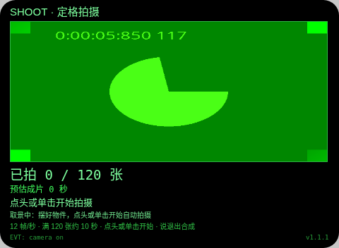
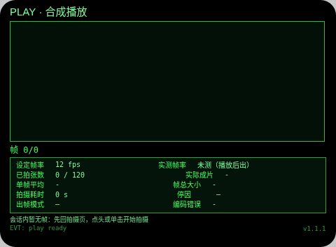

# Stop Motion Studio（定格工场）

**Studio 导入地址**（复制到 Global AIUI Studio 的 Import Project 输入框）：

```
https://github.com/sakai55/rokid/tree/agent-stop-motion-studio
```

AV11 · 桌前摆弄小物件/手作时，在眼镜里逐帧拍定格动画并当场合成播放。**v1.1 是极简验证版**：操作砍到只剩两个——**点头开始、说「退出」结束合成**。参数全部写死，没有任何设置页：12 帧/秒、满 120 张（约 10 秒成片）、每秒拍一张、带洋葱皮。本版只验证「拍照 → 合成播放」核心链路，深度功能仍推迟（见文末「后续」）。

**v1.1.1 是诊断硬化版**（真机首测回报 2026-10-28：点头后开始 TTS 播了、但一帧未拍出）：故障域钉在出帧链——JPEG 编码/FileReader 在真机可能报错、也可能 Promise 永远不回（hang 住后每帧都被忙碌卫哨挡掉、无声无息张数恒 0）。本版给编码链加 600ms 超时熔断、单帧 2.5 秒看门狗、编码死后自动切换的位图直存模式、失败大字计数与首错存档，并加单击备选开始用于区分故障域（见「交互」）。

## 预览截图





截图说明（Web 预览实测，如实）：拍摄页取景真出图（截图中为预览宿主的假相机画面），等开始状态完整渲染（小字行已含单击备选开始）；合成页验证读数面板完整渲染（新增出帧模式/编码错误一行）。预览宿主的 JPEG 编码不可用（拍帧时宿主回示 `Image encoding is not available on the Web host`）——在 v1.1.1 里这会触发编码熔断并切位图模式，但预览无法注入点头/单击开始，整链仍待真机验。帧链、ASR「退出」监听、实测帧率读数待真机回填。

## 交互（两个常规操作 + 一个诊断备选）

1. **点头开始**：打开就是拍摄页取景（已拍上一帧以半透明洋葱皮叠在取景上，第一帧前无叠加）。点头一次即开始自动拍摄：每 1 秒拍一帧，存入会话内存；大字实时显示「已拍 X / 目标 张」与预估成片秒数（张数 ÷ 12）。拍摄开始后取景预览定时器停掉，预览与拍帧不再抢 grabFrame，画面由每帧拍到的画面维持。拍摄中点头不触发任何动作（防说「退出」时头部动作误触，沿用 benchmark 教训）。
2. **说「退出」结束合成**：拍摄中 ASR 持续监听（`SpeechRecognition`，continuous + interim），识别结果里出现「退出」二字（正式或临时结果均可）即停拍、写入作品元数据、自动跳到合成页。合成页进入即按 12 帧/秒自动循环播放；**点头或单击 = 从头重播**，除此外无其他操作。
3. **诊断备选：镜腿单击开始**（v1.1.1 新增，Enter 键，拍摄页等待态与合成页重播各一处）：这是给真机复验定位故障用的——**单击能开始而点头不能 = 手势通道问题；单击开始后张数仍为 0 = 出帧链问题**。哪个通道开的工会记进作品元数据（startVia）。

**出帧分级（v1.1.1）**：每帧先走编码路（缩至 480×352 → JPEG → data URL 存帧、记真实字节）。整条编码链套 **600ms 超时熔断**：报错或超时（Promise 不回）都不再判死这一帧——首个编码错误原文存下，整段拍摄**锁存切换到位图直存模式**：帧改走画布像素（getImageData）或位图本体存内存、再不碰编码 API；屏上大字明示「编码不可用，已切内存帧模式」，目标自动降为 **40 张**（内存安全），合成页字节读数改显「估算 KB（宽×高×4）」。另有单帧 **2.5 秒看门狗**：任何一环 hang 住超时，强制复位忙碌标记并计一次失败，拍摄不会被一帧永久堵死。

**失败可见（v1.1.1）**：拍帧失败在计数旁大字显示「失败 N 次 · 最近：<错误原文 40 字>」，首次失败 TTS 报一句「拍帧失败」；开始后 5 秒仍 0 张时，提示行自动给出区分形态的诊断（编码超时已切内存帧 / grabFrame 失败原文 / 编码失败原文）。

结束条件共 4 个，停因全部如实记录并显示在合成页：说「退出」/ 拍满目标张数（拍够了，位图模式为 40 张）/ 拍摄满 180 秒（满 3 分钟了，安全上限）/ 双击兜底。ASR 启动失败或报错时，拍摄页如实提示「语音退出不可用，请用双击结束」，双击（Backspace）同样走结束合成流程——这是兜底，不是第三个常规操作。

TTS 说话点：开始时「开始拍摄，说退出结束合成」；拍到半程时「已拍一半」；结束时随停因一句（如「好的，共 N 张，开始合成」）；v1.1.1 新增两处一次性通知——切位图模式时「编码不可用，已切内存帧模式」、首次拍帧失败时「拍帧失败」。

## 参数（全部写死，不是设置）

- 帧率 12 帧/秒；目标张数 120 张（= 12 × 10 秒）；预估成片 = 张数 ÷ 12，满额约 10 秒。
- 拍摄间隔 1 秒/张（自动拍摄）；拍摄真实时长安全上限 180 秒（3 分钟）——指拍摄时长，不是成片时长。
- 拍摄页常驻一行小字明示：「12 帧/秒 · 满 120 张约 10 秒 · 点头开始 · 说退出合成」。

## 结构与功能（核心链路闭环）

- `pages/shoot` 拍摄（入口页）：`getUserMedia({video:true})` → `ImageCapture.grabFrame()` 取景画在页面画布上（仅等待态刷新）；**洋葱皮** = 上一帧以 `globalAlpha` 0.45 半透明叠加（真实 drawImage 接线）；点头或单击开始后每秒 `grabFrame` → 先走编码路（画布缩至 480×352 → JPEG `convertToBlob` q0.6 / `createImageBlob` → FileReader data URL + 真实字节），**全链套 600ms Promise.race 超时熔断**；编码报错或超时即锁存位图直存模式（画布 `getImageData` 像素帧，或位图本体帧；目标降为 40 张），帧入**共享内存** `store.js`（帧形态 url/px/bmp、模式、首个编码错误、开始通道都在 store 里）；单帧处理有 2.5 秒看门狗；失败计数与错误原文大字可见；结束时把作品元数据写入 `av11_works`（帧率/张数/目标/出帧模式/编码错误/开始通道/停因/拍摄耗时/单帧平均 KB/总 KB/成片秒数/实测帧率待合成页回填）并跳合成页。离开页面停流、停定时器、停 ASR。
- `pages/play` 合成：进入即按 12 帧/秒逐帧绘制、自动循环播放——这就是「合成播放」；按帧形态分支绘制（data URL 解码 / px 像素经离屏画布 drawImage / 位图直 drawImage）；点头或单击从头重播。**验证读数面板**集中显示 GO 真机要看的数据：设定帧率（12）vs **实测帧率**（按真实绘制时间戳算）、已拍张数 / 目标、实际成片秒数、单帧平均 KB、帧总大小（位图模式标「估算」）、拍摄实际耗时、停因、**出帧模式（dataURL / 内存帧）与首个编码错误**；实测帧率回写进 `av11_works` 对应条目。

## 语音交互流

- 语音输入点：只有拍摄中的「退出」监听（`SpeechRecognition` continuous + interim，final/interim 命中「退出」均触发）。全台再无其他 ASR（设置页与语音起名已删）。
- TTS 播报节点：开始一句、半程一句、结束随停因一句；v1.1.1 另加两处一次性诊断通知（切位图模式、首次拍帧失败），各只说一次。
- 语音纠错路径：ASR 不可用时页面明示并提供双击兜底结束；识别未命中时拍摄继续，不误停。

## 手势映射

| 手势 | 键/事件 | 作用 |
|---|---|---|
| 点头 | onHeadGesture nod | 拍摄页开始拍摄；合成页从头重播；拍摄中无动作（防误触） |
| 单击 | Enter | 诊断备选：拍摄页开始拍摄（与点头同效，用于区分手势通道故障）；合成页从头重播 |
| 说「退出」 | SpeechRecognition result | 结束拍摄并合成（主结束方式） |
| 双击 | Backspace | 仅兜底：ASR 不可用时结束拍摄并合成；等待开始时为系统返回 |

## 权限

- CAMERA：grabFrame 取景、洋葱皮、逐帧拍摄。
- RECORD_AUDIO：拍摄中「退出」监听（ASR 开麦）。

## 诚实边界

- **不导出视频文件**：基座没有把静帧编码成视频的文档化能力（无 canvas.captureStream / WebCodecs，Canvas 只出单帧 PNG/JPEG，MediaRecorder 只录实时流，LLM 只出文字）。「合成」就是眼镜内按 12 帧/秒播放，文案从不写「生成视频」。
- **帧只在会话内存**：帧序列存在共享内存模块里，不写任何存储；关掉本 agent 帧即丢失。持久化只有一条：作品元数据 `av11_works`（v1 的设置存储 `av11_cfg` 已随设置页删除，代码零引用）。
- 宿主无相机/ImageCapture/画布/ASR 时如实回示失败，不生成假帧（Web 预览即如此）。编码不可用或编码 Promise 不回不是死路：600ms 熔断后切位图直存并明示（模式、降额目标、首错原文都入元数据），但位图模式的字节数是宽×高×4 的估算、不是实测编码大小，读数面板照实标注。

## 后续（核心验证通过后再做，本版未写进代码）

- 编码探针页：逐项检测 canvas.captureStream / VideoEncoder / MediaRecorder 格式，存在才真做帧序列导出视频的编码试验，结论以真机实测为准。
- 作品页与帧持久化：作品列表、<1MB 作品帧存档与回放、跨会话管理。
- LLM/ASR 融合扩展：逐帧 AI 判读等深度融合（本版的 ASR 只做「退出」一词监听，不算融合扩展）。
- 以上全部等「拍照 → 合成播放」核心链路真机验证通过后再立项。

## 设备测试信息

| 项目 | 值 |
|---|---|
| Studio name | 待导入后回填 |
| Version | 1.1.1 |
| App Category | Entertainment |
| Intent Description | Capability check of the stop-motion chain: nod to shoot at 12 fps, say the exit word to composite and loop-play with measured readings |
| Agent ID | 待回填 |
| 状态 | 未导入、未真机测试、未提审 |

## 提审资料 (Review Submission)

### Feature Description

Stop Motion Studio is a minimal capability check of one chain: shoot stop-motion frames and composite them. No settings: open it and you are on the shoot page, live view plus an onion-skin overlay of your last frame. Nod once and it shoots one frame per second at a fixed 12 fps, up to 120 frames (about 10 s). Say the exit word and it stops and loop-plays the composite, with readings: set vs measured fps, frame count, average and total KB, shooting time, stop reason.

### Opening Message

Hi, I'm **Stop Motion Studio**. There is nothing to set up: you are already looking through the camera, with an **onion skin** of your last frame over the view. **Nod** and I start shooting one frame per second at **12 fps**, up to 120 frames. When you are done, just say the **exit word** — I stop, composite your frames, and play them back in a loop with the readings that prove the chain works.

### Preview Media

图片 2 张见预览截图节；视频待真机阶段补。

### Change Log

#### Build 1.1.1

**Fixes**

- Real-device first test (GO 2026-10-28): nod started the take and the start TTS played, but zero frames were captured. The frame chain after start is hardened end to end: the whole JPEG encode chain (convertToBlob / createImageBlob / FileReader) now races a 600 ms timeout, so an encoder promise that never settles on device trips the breaker instead of silently blocking every later frame behind the busy flag.
- When the encode path rejects or times out, the take no longer dies: it latches into a bitmap-direct mode (canvas getImageData pixels, or the ImageBitmap itself) for the rest of the take, drops the target to 40 frames for memory safety, and never touches an encoding API again. The first encode error is stored verbatim in the work metadata.
- A 2.5 s per-frame watchdog force-releases the capture busy flag and counts a failure, so no single hung link can block shooting forever.
- Capture failures are visible: a big failure counter with the latest error text sits next to the frame counter (previously a 10 px status line nobody could read), the first failure is spoken, and a 5-seconds-zero-frames diagnosis spells out which link is failing.
- Shooting no longer fights the viewfinder: the preview timer stops when the take starts, and the view is maintained by the captured frames themselves.

**Features added**

- Diagnostic second start channel: a temple single-tap (Enter) also starts the take (and replays on the play page), so a device run can separate a gesture-channel fault (tap works, nod does not) from a frame-chain fault (tap starts, frames still zero). The channel that started the take is recorded in the work metadata.
- The play-page readings panel gains a frame-mode row (dataURL vs memory frames, byte figures labelled as estimates in memory mode) plus the first encode error.

**Improvements**

- Work metadata (av11_works) now carries mode, encodeError and startVia — the three diagnostics a real-device re-test must bring back.

#### Build 1.1.0

**Features added**

- Voice finish: while shooting, continuous speech recognition listens for the exit word; hearing it stops the take and jumps straight to the composite page.
- Double-tap fallback finish, offered on-screen only when speech recognition is unavailable or errors.

**Improvements**

- Interaction cut to two operations (GO 2026-10-28): nod to start, say the exit word to finish and composite. The settings page is gone; frame rate (12 fps), target (120 frames, about 10 s), capture interval (1 s) and the 180 s safety cap are fixed constants, stated in one small line on the shoot page.
- Shooting is fully automatic once started: no per-frame tapping, no menus on either page. The play page now starts looping on entry; nod replays from the first frame.
- TTS reduced to three moments: start, halfway (60 frames), and the finish line with the stop reason.

**Fixes**

- Removed the v1 settings leftovers end to end: speed/length/shoot-mode selectors, voice naming, delete-last-frame and retake, pause/loop switches, and the av11_cfg settings store (zero references in code).

#### Build 1.0.0

**Features added**

- Beginner settings: speed and length word tiers with the frame target computed and shown in plain words; manual or fixed-interval auto shooting; voice naming.
- Frame-by-frame shooting with live viewfinder and onion-skin overlay, spoken frame counts, and spoken stop reasons at the target count or the 3-minute safety cap.
- Composite playback page with a verification panel: set vs measured fps, frame count, average and total KB, actual shooting time and stop reason; work metadata persisted locally.

**Improvements**

- None (initial verification build).

**Fixes**

- None (initial verification build).

## 打包与预览

打包命令 `~/tools/bin/aix pack . -o stop-motion-studio.aix`（仓库副本 aix/stop-motion-studio.aix）；预览走本地截图管线（aix preview + 本地 puppeteer 截图，见 rokid-preview-screenshots skill）。
