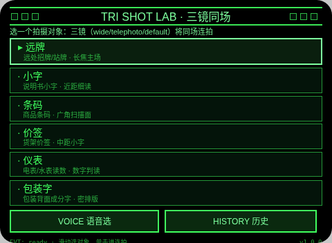
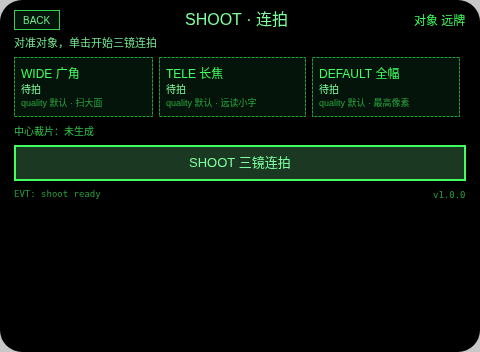
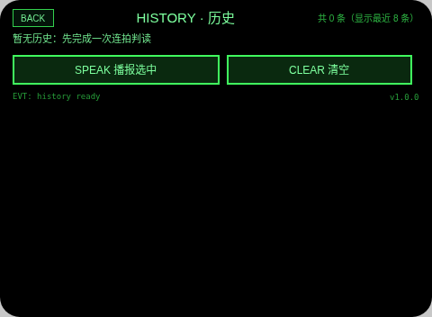

# Tri Shot Lab（三镜同场）

**Studio 导入地址**（复制到 Global AIUI Studio 的 Import Project 输入框）：

```
https://github.com/sakai55/rokid/tree/agent-tri-shot-lab
```

**AIX 直接下载**（最新版）：[tri-shot-lab.aix](https://raw.githubusercontent.com/sakai55/rokid/main/aix/tri-shot-lab.aix)

AV01 · 读不清牌子小字时，一次同场连拍三镜并逐张判读，给出「这类对象该用哪一镜」的结论。顶边界 B1：拍照三模式（wide / telephoto / default）同场对照 + 中心裁片多模态判读。

## 预览截图





（verdict 对照结论页截图缺：Web 预览宿主的 mock 相机不接受 takePhoto 的 mode 参数、连拍无法成功，也就不会自动跳结论页；该页待真机导入后补拍。shoot 页截图里即为宿主如实回示的失败状态。）



## 结构与功能（闭环）

- `pages/index` 对象选择：内容集 6 类拍摄对象常驻可数（远牌 / 小字 / 条码 / 价签 / 仪表 / 包装字）；语音说对象名选对象——真实接 `SpeechRecognition`（interimResults，匹配 6 类名，失败可重说）；Enter/点头定对象并把选择写入 `av01_target`，跳 shoot。
- `pages/shoot` 连拍进行：Enter 开始后依次真实调用 `ImageCapture.takePhoto({mode:'wide'})`、`takePhoto({mode:'telephoto'})`、`takePhoto({mode:'default'})`（流来自 `getUserMedia({video:true})`，用完 stop 全部 track）；每张用 `createImageBitmap` 解码记录真实像素、用 Blob.size 记字节；中心裁片走 `document.createElement('canvas')` 的 `drawImage` 九参裁剪 → `canvas.convertToBlob({type:'image/jpeg',quality:0.7})` → `FileReader.readAsDataURL`（宿主无 canvas 时回退原图 dataURL）；三张结果写入 `av01_current` 后跳 verdict。
- `pages/verdict` 对照结论：真实接 `LanguageModel`（先查 `availability()`，再 `create` session）；回退策略写在代码注释里——不假设多图同发可行，三张裁片逐张串行 `session.prompt` 多模态判读（同一 session 同时只许一个请求），提示词要求回 `READ: <文字或 NONE>` + `LEGIBLE: YES/NO`；汇总以 LEGIBLE 与实测像素为准给出「哪镜可用」，TTS 播报，结论+对象+时间写入 `av01_history`；LLM 不可用时如实写「判读未完成（LLM 不可用），仅像素对照」，不编造。
- `pages/history` 历史：读 `av01_history` 列表（最近 8 条，含 LLM/像素对照标记），滑动选条、单击播报，可清空。

## 语音交互流

- 语音选对象：index 页点 VOICE 或按提示说话，`SpeechRecognition` 实时转写并匹配 6 类对象名；纠错路径——没听清/未命中时状态行明示可重说，也可随时改用滑动+单击手选，两条路等价。
- TTS 播报节点：选对象成功（shoot 页对象确认）、连拍完成、verdict 结论生成（全文播报）、history 选中条播报；`_speak` 统一走 `speechSynthesis.speak(..., 'immediate')`，不设置 utterance.lang。
- 宿主 ASR 说明：识别由宿主完成，与相机/麦克风模式无关，本 Agent 不暗示 ASR 吃任何模式。

## 手势映射

| 手势 | 键/事件 | 作用 |
|---|---|---|
| 单击 | Enter | 主动作：定对象 / 开始连拍 / 开始判读 / 播报选中条 |
| 上滑/下滑 | ArrowUp / ArrowDown | 移动选择（对象、历史条目）；verdict 页为重播结论 |
| 点头 | onHeadGesture nod | 主确认（与 Enter 同效） |
| 双击 | Backspace | 系统返回（页面不拦截）；子页另有 BACK 按钮 |

## 权限

- CAMERA：三镜连拍（getUserMedia + ImageCapture.takePhoto 三模式）与中心裁片生成。
- RECORD_AUDIO：index 页语音说对象名（SpeechRecognition 输入）。

## 诚实边界

- 无 placeholder 假数据：宿主无相机/ImageCapture/LLM 时各页如实显示「待真机/不可用」并拒绝生成假照片、假结论。
- 判读回退：多图同发不可行已按逐张串行实现（代码注释写明）；LLM 不可用只给像素/字节对照。
- 裁片回退：宿主无 document canvas/convertToBlob 时回退原图 dataURL 并在代码注释写明，判读口径不变。
- quality 参数：takePhoto 未传 quality（宿主默认），README 与页内文案均按「quality 默认」如实表述。

## 设备测试信息

| 项目 | 值 |
|---|---|
| Studio name | 待导入后回填 |
| Version | 1.0.1 |
| App Category | Life |
| Intent Description | Compare all three photo modes on one target and learn which lens reads it |
| Agent ID | 待回填 |
| 状态 | 未导入、未真机测试、未提审 |

## 提审资料 (Review Submission)

### Feature Description

Tri Shot Lab shoots one target in all three official photo modes - wide, telephoto and default - then reads the centre crop of each shot with the on-device LLM, one at a time. It reports the real pixel size and bytes of every shot and concludes which lens actually reads targets like distant signs, small print, barcodes, price tags, meters and packaging text. Verdicts are saved to a local history.

### Opening Message

Hi, I'm **Tri Shot Lab**. Pick a target — a distant sign, small print, a barcode, a price tag, a meter or packaging text — say its name or tap to choose, and I'll shoot it with **all three lenses** and read each crop back to you. You'll learn **which lens works** for that kind of target, and every verdict is kept in your history.

### Preview Media

图片 3 张见预览截图节（verdict 页待真机补拍，见截图节注）；视频待真机阶段补。

### Change Log

#### Build 1.0.0

**Features added**

- Three-mode same-target shooting (wide/telephoto/default) with real pixel and byte reporting per shot.
- Serial per-crop LLM reading with READ/LEGIBLE verdicts and a spoken which-lens conclusion.
- Voice target selection over a fixed six-target set, plus a local verdict history.

**Improvements**

- None (initial build).

**Fixes**

- None (initial build).

#### Build 1.0.1

**Features added**

- None.

**Improvements**

- None.

**Fixes**

- Removed FileReader (absent from the Ink runtime; would fail on device): photo/crop Blob→dataURL now uses the documented `blob.arrayBuffer()` + chunked `btoa` path, and the failure surfaces fleet error code E2005.

## 打包与预览

打包命令 `~/tools/bin/aix pack . -o tri-shot-lab.aix`（仓库副本 aix/tri-shot-lab.aix）；预览命令说明走本地截图管线（aix preview + 本地 puppeteer 截图，见 rokid-preview-screenshots skill）。
