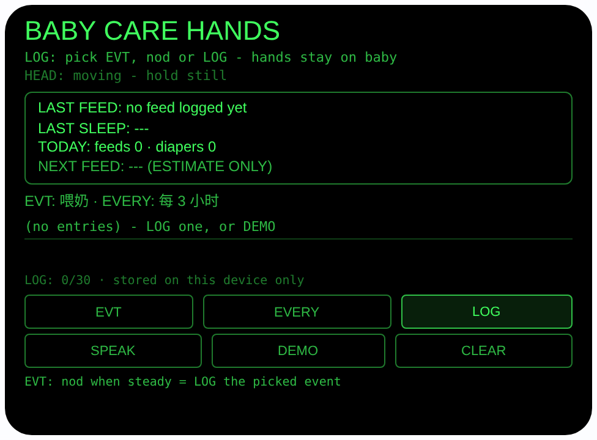
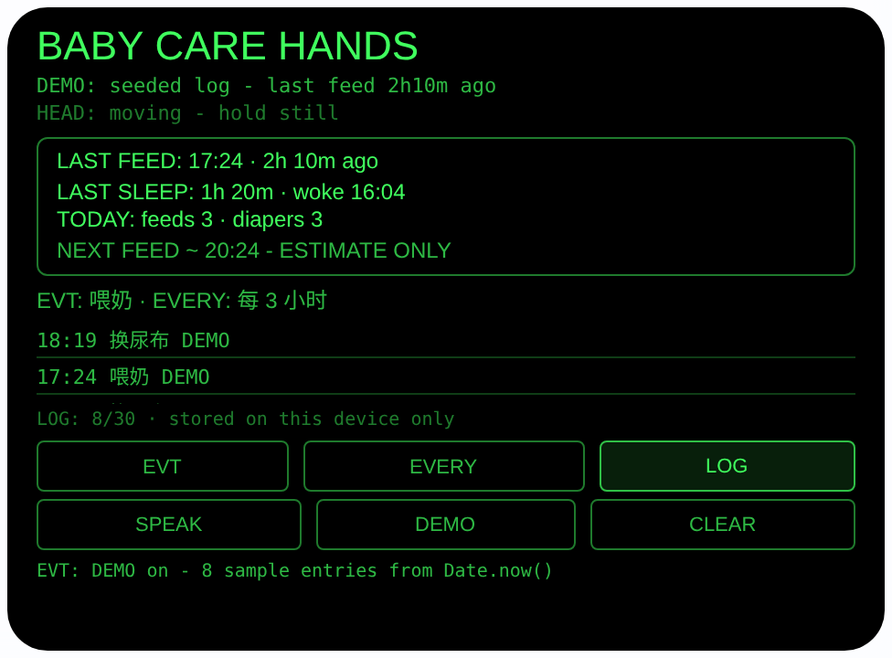

# baby-care-hands — 抱娃手记（Rokid 眼镜 AIUI Agent）

**Studio 导入地址**（复制到 Global AIUI Studio 的 Import Project 输入框）：

```
https://github.com/sakai55/rokid/tree/agent-baby-care-hands
```


50 个「指向性生活问题」Agent 的第 Z15 个（C 组双手忙碌收尾）。
双臂抱着宝宝，腾不出手点手机记录 — 喂过奶、换过尿布没法当场
记，到凌晨三点根本想不起来上次喂奶是几点。本 Agent 把记录
简化成「看着宝宝点一下头」，把回忆换成它用真实时间戳算给你
看：上次喂奶距今多久、上次睡了多久、今天喂了几次换了几次。

## 预览截图

截图统一存放于仓库根目录 `screenshots/baby-care-hands/`。





## 解决的问题

育儿记录的麻烦和园艺一样：事情发生的时刻正是最没法记的
时刻 — 一只手托着头、一只手抱着身子，手机在口袋里也掏不
出来。靠脑子记的结果是半夜喂奶时全家争论「上次到底是
一点喂的还是两点喂的」。本 Agent 不用你腾手：事件提前选好，
做完事点一下头就打上真实时间戳，汇总永远在眼前一格里。

## 免手设计（为什么用眼镜）

- **看着宝宝点头就记（GAZE + HEAD）**：喂奶、换尿布时你
  本来就低头看着宝宝。开启世界感知
  （`enableWorldAwareness()`）后，头部稳定时点头
  （`onHeadGesture` nod）= 给当前选中的事件打戳，时间和
  你自己点 LOG 完全一样；头部没稳住的点头会被忽略并如实
  提示，防止抱着走动时误记。Enter / GlobalHook 也可确认。
- **汇总是一眼格，不是翻出来的**：汇总框常驻四行 —
  上次喂奶几点 + 距今多久（页面开着时每 5 秒刷新）、
  上次睡眠时长（由最近一对「开始睡 → 醒了」的时间戳
  相减）、今天喂奶/换尿布次数（按本机日期从日志里数）、
  下次喂奶估算。凌晨三点不用算数，抬眼就知道。
- **耳朵确认**：SPEAK 用中文朗读汇总，如「上次喂奶是
  2小时10分钟前。上次睡了1小时20分钟。今天喂了4次，
  换了3次尿布。」
- **零权限零打扰**：不用相机、不用麦克风、不用朝向传感器，
  app.json 不声明任何权限（同 #07 find-my-thing）；宝宝的
  记录只存本机，不拍照、不录音、不上传。

## 功能流程

1. 选事件：EVT（或 ArrowUp / ArrowDown）在
   喂奶 / 换尿布 / 开始睡 / 醒了 间轮换
2. 记录：LOG、Enter 或头部稳定时点头 → 把
   {事件， 时间戳} 追加进 wx 同步存储（key `babyLog`，
   最多 30 条，超了丢最旧的；onLoad 读取、onUnload 落盘）
3. 汇总常驻：上次喂奶 + 距今、上次睡眠时长（正在睡则
   显示 SLEEPING NOW 与已睡时长）、今日次数，每 5 秒
   与每次操作后重算；SPEAK 朗读汇总；CLEAR 清空全部
4. 估算：EVERY 轮换喂奶间隔（每 2 / 3 / 4 小时），
   NEXT 行 = 上次喂奶时间 + 间隔，全程标注
   「ESTIMATE ONLY」（见诚实说明）
5. DEMO：用运行时 `Date.now()` 实时播 8 条样例记录
   （上次喂奶在 2 小时 10 分钟前、一段已完成的
   1 小时 20 分钟睡眠、若干次更早的喂奶与换尿布），
   汇总数学在预览里也是真算的 — 预览截图里
   「2h 10m ago / 1h 20m / 今日 3 次 + 3 次 /
   下次 20:24」全部由这批时间戳现场算出；重复点 DEMO
   先清旧样例再重播

> 诚实说明：这是记录工具，不是医疗建议。下次喂奶时间只是
> 「上次时间 + 你选的间隔」的算术估算，每个宝宝的节奏都
> 不一样 — 宝宝饿了就喂，别等时钟，一切以宝宝的实际状态
> 与医嘱为准。本 Agent 不做任何健康判断。时间全部来自
> 本机时钟，设备时钟不对汇总就会跟着不对；「今天」的次数
> 按记录时间戳的本机日期归属，昨晚的记录不算进今天。

## 权限

| 权限 | 用途 |
|---|---|
| （无） | 不声明任何权限：不用相机/麦克风/传感器，只用世界感知的头部稳定与点头事件做免手打戳 |

记录只存本机 wx 同步存储，不上传、不联网。

## 打包与预览

```bash
cd ~/workspace/rokid/baby-care-hands
~/tools/bin/aix pack . -o ../dist/baby-care-hands.aix
~/tools/bin/aix preview . --html-out artifacts/preview.html
```

本地预览截图走 `~/workspace/preview-tools/` 的本地 Ink + puppeteer 路线
（`shot-baby.js`；汇总截图的点击序列为 canvas 内 DEMO (240, 288)
点 1 次：用 Date.now() 播 8 条样例记录；注意 artifacts/preview.html
需先把 importmap 的 jspm 地址换成本地 `/ink/index.js` 再复制到
preview-tools/www/）。

## 真机测试（海外版 · 云端下发 · Path 1）

1. 推到 GitHub 后，Global AIUI Studio（aiui-global.rokid.com，en-US）用
   分支导入：`https://github.com/sakai55/rokid/tree/agent-baby-care-hands`
   （该分支根目录即本 Agent 文件）
2. Studio 的 **Device Debug** 页签填 Basic Information，在 AIX Packaging
   点 **Repackage and Save**，确认顶部出现绿色
   **● Debug version ready — Ready for device debugging**
3. **Hi Rokid**（海外版 `com.rokid.sprite.global.aiapp`，不是国内版
   Rokid Ai App）→ 设置 → 开发者选项 → AIUI → 更新眼镜资源包，
   等「智能体资源包下载成功」
4. 对眼镜说「乐奇，打开 baby-care-hands」，抱着宝宝选好 EVT，
   喂完奶头部稳定点一下头确认打戳，再看汇总行的距今时间与
   今日次数是否更新，SPEAK 听一遍汇总

## 真机测试信息（Global AIUI Studio · Device Debug）

| 项目 | 值 |
|---|---|
| Agent Name（Studio） | 待导入后回填 |
| Version（Build） | 1.0.0（待导入后回填） |
| App Category | 待导入后回填 |
| Intent Description | 待导入后回填 |
| Agent ID | 待导入后回填 |
| AIX Package Size | 13.8 KB（本地打包 `dist/baby-care-hands.aix`） |
| 状态 | 本地完成，待导入 Studio |
| Studio | aiui-global.rokid.com（en-US） |
| 下发方式 | 云端下发 → Hi Rokid（海外版）更新眼镜资源包 |

## 验证情况

**已验证**

- 静态检查：app.json / package.json JSON 解析通过；`<script def>` JSON
  解析通过；`<script setup>` 与 app.js 提取后 `node --check` 语法通过；
  全目录 grep 无 `Page(` / `App(` / `Widget(` / `workers:` 残留；
  6 个 bindtap 处理函数全部有定义。
- 时间算法：把页面对象本体加载进 Node（wx 打桩）用同一份代码
  验算 — `_fmtElapsed` 输出 2h 10m / 45m / 3h 0m、中文版
  1小时20分钟 / 45分钟 / 3小时均正确；`_sleepInfo` 对
  「开始睡 → 醒了」算出精确 80 分钟、未醒时返回 sleeping、
  无记录返回 null；`_todayCounts` 把昨天的记录排除在今天
  之外；下次喂奶 = 上次喂奶 + 间隔。再端到端跑 DEMO 播种：
  汇总行实际渲染出「LAST FEED · 2h 10m ago」、
  「LAST SLEEP: 1h 20m」、下次喂奶估算与 SPEAK 中文句
  「上次喂奶是2小时10分钟前。上次睡了1小时20分钟。」全部
  断言通过。
- 打包：`aix pack` 成功；`aix list` 核对包内含 README.md、AGENTS.md、
  app.js、app.json、package.json、pages/index/index.ink
  （artifacts/ 已被 .aixignore 排除）。
- 预览渲染：aix preview + 本地 Ink + puppeteer 截图两张（见
  Preview Media）：首页初始态完整渲染（无记录、汇总四行
  如实为空、EVT 已选 喂奶 / 每 3 小时）；点 DEMO 后播入
  8 条样例 — 汇总框「上次喂奶 2h 10m 前、上次睡眠
  1h 20m · woke 16:04、今日喂奶 3 次 / 尿布 3 次、
  下次喂奶 ~20:24 ESTIMATE ONLY」全部由真实时间戳现场
  算出，列表最新在前并标 DEMO，页脚如实记录播种事件。

**未验证**

- 真机头部稳定检测与点头打戳的灵敏度（抱着宝宝轻轻点头
  会不会被判成晃动，要真机试了才知道）。
- 真机 TTS 朗读汇总的效果（中文长句的断句与音量）。
- 真机 wx 同步存储在眼镜重启后的持久性（本地按文档使用
  `babyLog` key，未在真机验证重启后是否保留）。
- **估算是算术不是建议**：下次喂奶时刻只是上次时间加间隔，
  不是待补的验证项 — 实际喂养以宝宝状态与医嘱为准，
  已在界面与上文如实说明。

---

## 提审资料（Review Submission）

> Global AIUI Studio → Submit 页签的 Review Information 逐项对应下面四段，
> 提交时整段复制。每次提交前重新确认 Preview Media。

### Feature Description

Baby Care Hands is a hands-free care log for parents whose arms are full. Pick an event - feed, diaper change, sleep start, woke up - then nod while your head is steady, or tap LOG, and the agent stamps it with the real time. The summary is always in view: how long since the last feed, how long the last sleep lasted, and today's feed and diaper counts, all computed from the real timestamps and readable aloud. No camera, no microphone, no permissions needed.

### Opening Message

Hi, I'm **Baby Care Hands** - I keep the baby log so your hands don't have to.

Tap **EVT** to pick what just happened - feed, diaper, sleep start or woke up - then tap **LOG**, or just nod while holding your head steady, and I stamp the real time. The top box always shows the last feed and how long ago it was, the last sleep, and today's counts. **EVERY** sets the rough feed interval for the next-feed estimate, **SPEAK** reads the summary aloud, and **DEMO** fills a sample log to try.

### Preview Media

提交要求：3–5 个 JPG/PNG 图片或 MP4 视频，至少含 1 张图和 1 个视频，每次提交前重新确认。

- Image 1：`artifacts/preview-baby-care-hands-index.png`（aix preview 首页初始态：无记录、汇总四行如实为空、EVT/间隔已选，本地文件，提交时从本地上传）
- Image 2：`artifacts/preview-baby-care-hands-summary.png`（点 DEMO 用 Date.now() 播入 8 条样例后的汇总态：上次喂奶距今、上次睡眠时长、今日次数与下次喂奶估算全部现场算出，本地文件）
- Video：待真机补 — 真机录制「抱娃选事件 → 点头打戳喂奶 → 汇总行更新 → SPEAK 朗读」全过程（MP4），录好后放 `artifacts/` 并更新此处
- 状态：未齐（已有 2 张图；还需至少 1 个视频，总数补到 3–5 个后才可提交）

### Change Log

#### Build 1.0.0

**Features added**

- Hands-free event logging: EVT cycles feed, diaper change, sleep start and woke up; LOG, Enter, or a nod while your head is steady stamps the event with the real timestamp into wx sync storage (key babyLog, up to 30 entries, oldest dropped); unsteady nods are ignored with an honest note so rocking the baby cannot log by accident.
- Always-in-view summary computed from real timestamps: last feed time and how long ago it was (refreshed every 5 seconds while open), last sleep duration from the latest sleep-start/wake pair - or SLEEPING NOW with elapsed time - and today's feed and diaper counts by local date.
- Next-feed estimate: EVERY cycles a 2, 3 or 4 hour interval and the NEXT line shows last feed plus the interval, labeled ESTIMATE ONLY everywhere; the agent gives no feeding advice and makes no health claims.
- Chinese TTS readout of the same summary via SPEAK, and a DEMO that seeds eight sample entries computed from Date.now() (last feed 2h10m ago, one completed 1h20m sleep) so every number on screen is really computed, in preview and on device.
- Zero permissions by design: no camera, no microphone, no sensors - the log lives only in on-device wx storage and nothing is uploaded.

**Improvements**

- None (initial release).

**Fixes**

- None (initial release).
