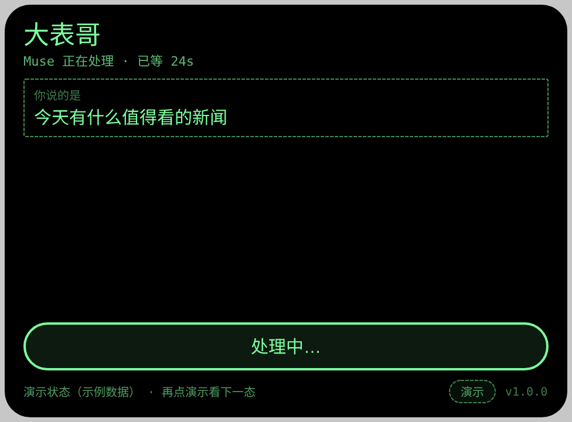
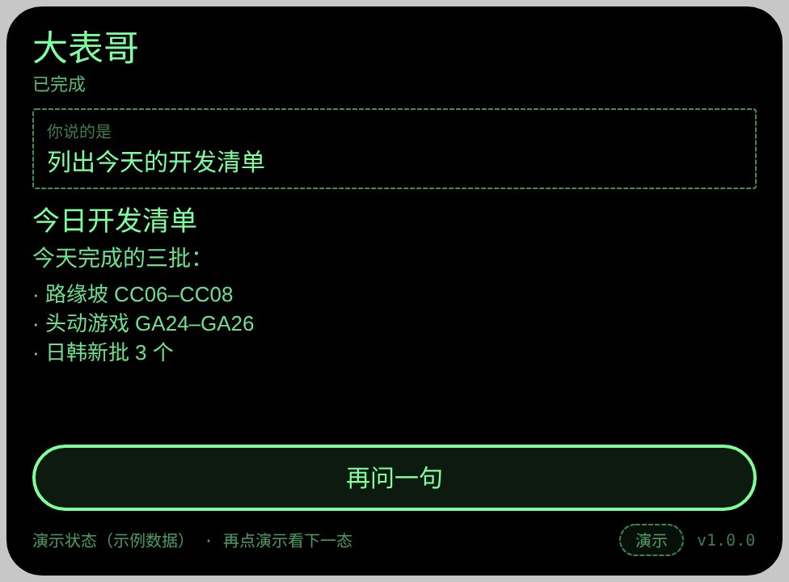

# dabiaoge — 大表哥（Rokid 眼镜 ↔ Muse 通道客户端 · AIUI Agent）

**Studio 导入地址**（复制到 Global AIUI Studio 的 Import Project 输入框）：

```
https://github.com/sakai55/rokid/tree/agent-dabiaoge
```

大表哥是 rokidpost 通道的眼镜侧薄客户端：眼镜只管采集、发送、显示与朗读，推理和办事全在 Muse 侧。你在眼镜上开口提问，宿主先把语音转成文字并**显示在屏上**（听错当场可见），文字投给前门，Muse 处理后回一张给小屏的字幕卡——屏上显示、摘要朗读。v1 只走文字（过通道的永远是文字，没有录音离开眼镜）；拍照提问等文字链打通后再加。

## 打包前必做：填钥匙

投单钥匙（CHANNEL_KEY）只放在工程的一个文件里，仓库中只有占位符。**在 Studio 里打包前**：

1. 打开本工程的 **`channel.js`**；
2. 把 `PASTE_CHANNEL_KEY_HERE` 换成真钥匙（就这一行，别的不用动）；
3. 然后打包。

注意：填了真钥匙的 Studio 工程**不要回传 GitHub**（仓库公开，钥匙会外泄）；每次从 GitHub 重新导入都是快照，必须重填这一行。没填钥匙时大表哥会显示「钥匙未填」而不是崩溃；填没填对不用猜——投一张单，Muse 侧看前门清单里有没有新单即可验证。

## 预览截图

截图统一存放于仓库根目录 `screenshots/dabiaoge/`。预览环境没有真 ASR 与真通道：待命态是真实界面；处理中与结果态由页脚「演示」按钮切换的**示例数据**呈现（屏上标注「演示状态」），真链路以文末真机验收清单为准。






## 真机测试信息（Global AIUI Studio · Device Debug）

| 项目 | 值 |
|---|---|
| Agent Name（Studio） | 待导入后回填（导入名默认为仓库名，Studio 内改「大表哥」） |
| Version（Build） | 待回填（本地 package.json 1.0.0） |
| App Category | 待回填（建议 Work） |
| Intent Description | 待回填 |
| Agent ID | 待回填 |
| AIX Package Size | 约 13 KB（本地 pack；Studio 打包值待回填） |
| 状态 | 本地已打包 · 待 GO 在 Studio 导入、填钥匙并真机运行 |
| Studio | aiui-global.rokid.com（en-US） |
| 下发方式 | 云端下发 → Hi Rokid（海外版）更新眼镜资源包 |

## 工作流程

| 步 | 发生什么 |
|---|---|
| 说话 | 点头 / 单击开始 → 宿主 ASR 识别，文字实时上屏 → 最终文字自动投单 |
| 投单 | POST 前门 `/submit`（`{session, kind:"ask", text}`，session 本地持久化） |
| 等待 | 每 4 秒查一次单，总超时 150 秒；状态行显示已排队 / Muse 正在处理 |
| 结果 | 信封按 type 渲染：text（标题+正文）、list（+逐行条目）、choices（只展示）、card（标题+正文）；speak 与正文不同时朗读 speak |
| 批准 | 回单 needs-approval 时显示「这件事要你在手机上批准，已挂起」，眼镜侧对话当场结束，批准在 Muse App 里做 |
| 补收 | ticket 存本地；关掉眼镜不丢单，下次打开先查未完成单，办完的直接显示 |

## 操作方式（镜腿手势映射）

| 手势 | 键事件 | 作用 |
|---|---|---|
| 单击 | Enter / GlobalHook | 开始说话；说话中单击 = 说完了；结果页单击 = 再问一句（400ms 去重） |
| 点头 | onHeadGesture 'nod' | 与单击同效；处理中忽略 |
| 滑动 | ArrowUp / ArrowDown | 本页未占用 |
| 双击 | Backspace | 交给系统：返回 / 退出（页面不拦截） |
| 页脚「演示」钮 | bindtap | 循环示例三态（处理中 / 列表结果 / 文字结果），供截图与版式对照，永不投单 |

## 权限与边界

- 权限：`RECORD_AUDIO` 一项（宿主 ASR 开麦；平台没有独立的 ASR 权限）。不用 CAMERA、GEOLOCATION。
- 通道只收文字：v1 不传录音、不传图片。识别在眼镜宿主完成，发送的是识别文字。
- 网络：仅 HTTPS 访问 `rokidp.datumoj.com`；提审前该域名需在开发者后台报备白名单。
- 钥匙纪律见上节；本 Agent 不预埋任何动作类能力（发信等按授权章程后续接入）。

## 本地命令

```bash
~/tools/bin/aix pack . -o dabiaoge.aix
~/tools/bin/aix preview . --html-out artifacts/preview.html
```

## 真机验收清单

- [ ] **真机网络链**：填钥匙打包并下发后，眼镜上说一句提问，Muse 侧 `/feed` 立刻出现该单（眼镜 → 手机代理 → 前门全链通）
- [ ] **ASR 文字显示**：识别文字实时出现在「你说的是」框里，听错可见
- [ ] **信封四态显示**：text / list / choices / card 四种回单各显示一次，版式正确不溢出
- [ ] **speak 朗读**：speak 与 body 不同时朗读 speak；两者相同时不重复念正文
- [ ] **needs-approval 提示**：2 级单回来时显示「这件事要你在手机上批准，已挂起」
- [ ] **关后再开补收**：处理中退出大表哥，单子办完后重开，自动显示结果
- [ ] **超时表现**：断网或 150 秒无回时显示超时文案，单子不丢、下次打开续收
- [ ] **钥匙未填**：占位符状态打包打开时显示「钥匙未填」提示，不崩溃

## 提审资料 (Review Submission)

### Feature Description

大表哥是 Rokid 眼镜直连 Muse 的通道客户端：点头或单击镜腿开口提问，眼镜先把语音转成文字并显示在屏上，文字经通道送达 Muse 处理，回单按眼镜小屏的字幕卡格式显示并朗读摘要。关掉眼镜不丢单，下次打开自动补收结果。

### Opening Message

你好，我是大表哥。点头或单击镜腿，把问题说给我听——我先把听到的文字显示在屏上，再送给 Muse 处理；答案回来后，屏上显示、摘要朗读给你。

### Preview Media

- 图片：`screenshots/dabiaoge/preview-dabiaoge-idle.png`、`preview-dabiaoge-working.png`、`preview-dabiaoge-result.png`
- 视频：真机阶段补录（核心流程：说话提问 → 等待 → 结果显示与朗读，≤60 秒）

### Change Log

#### v1.0.0

- Features added：文字通道薄客户端一页三态（待命 / 处理中 / 结果）；宿主 ASR 识别文字上屏后自动投单（POST /submit）；每 4 秒查单轮询（150 秒超时）；信封四种 type 渲染（text / list / choices / card）与 speak 差分朗读；needs-approval / error / 超时专门文案；ticket 本地持久化与冷启动补收；session id 本地持久化；channel.js 单文件钥匙位（仓库占位符）；页脚演示按钮循环示例三态
- Improvements：—
- Fixes：—
