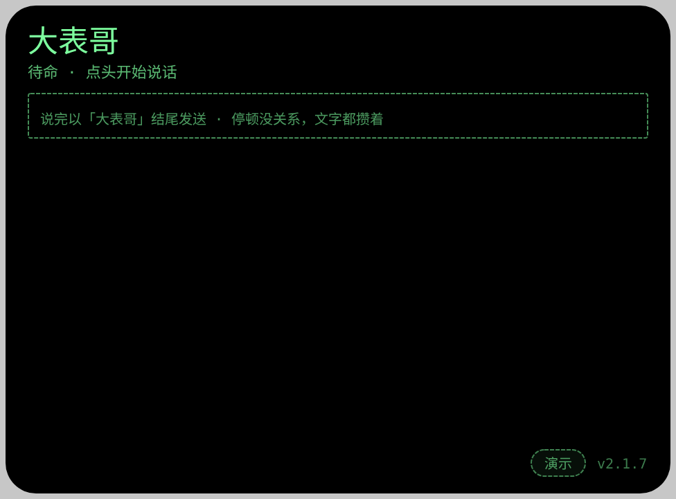
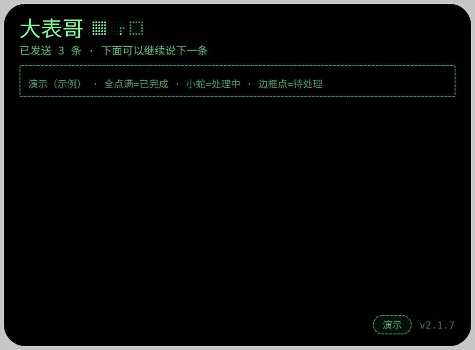
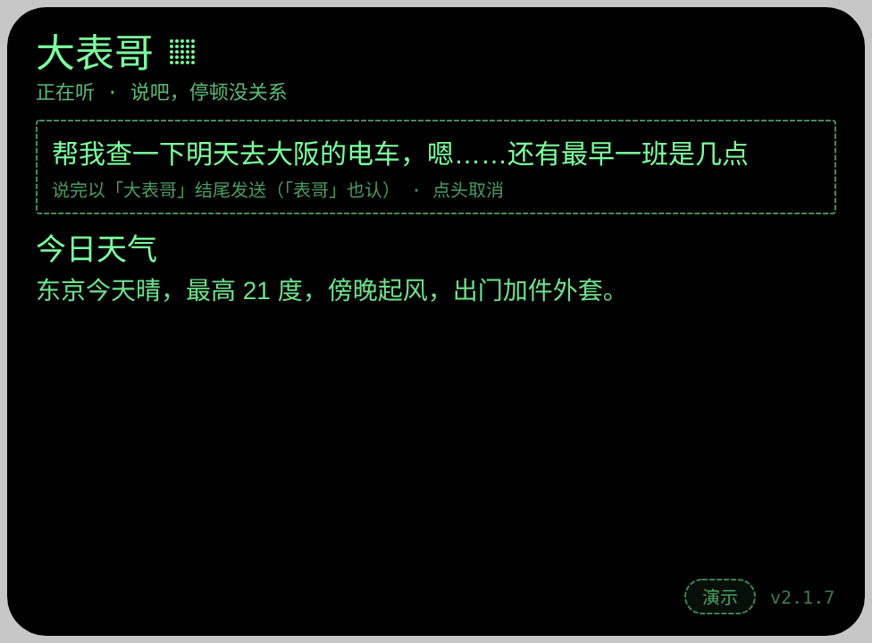
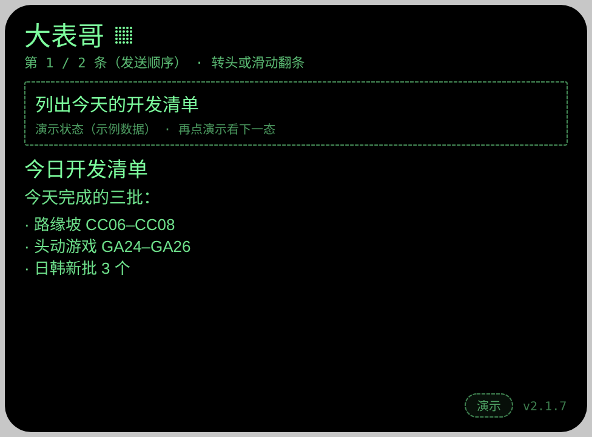
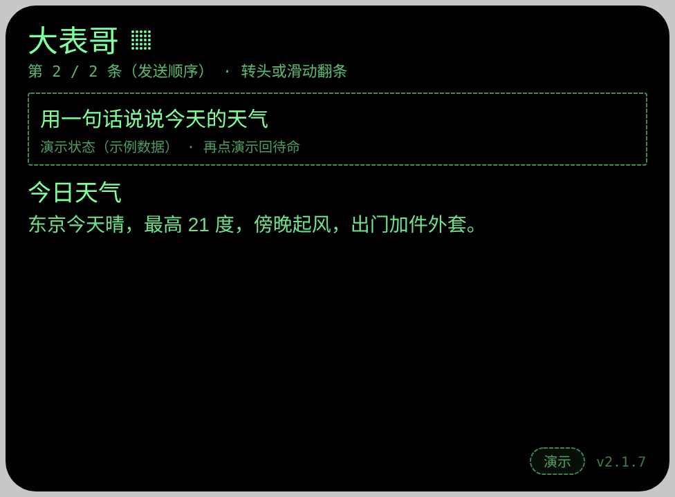

# dabiaoge — 大表哥（通用消息隧道 msg tunnel 的眼镜客户端 · AIUI Agent）

**Studio 导入地址**（复制到 Global AIUI Studio 的 Import Project 输入框）：

```
https://github.com/sakai55/rokid/tree/agent-dabiaoge
```

大表哥是 rokidpost 通道的眼镜侧薄客户端：眼镜只管采集、发送、显示与朗读，推理和办事全在后端的处理服务（可替换，本客户端不绑任何具体后端）。你在眼镜上开口提问，宿主先把语音转成文字并**显示在屏上**（听错当场可见），文字投给前门，处理服务办好后回一张给小屏的字幕卡——屏上显示、摘要朗读。只走文字（过通道的永远是文字，没有录音离开眼镜）；拍照提问等文字链打通后再加。**v2.0.0 起是流水线模式**：发送不等处理，最多 5 条在途连着发，结果进收件箱慢慢看（详见「工作流程」）。

## 打包前必做：填配置（域名 + 钥匙）

全部部署配置只放在工程的一个文件 **`channel.js`** 里，页面代码没有任何写死的域名或钥匙。**在 Studio 里打包前**：

1. 打开本工程的 **`channel.js`**；
2. `BASE_URL`（前门地址）：填**完整 URL**——带 `https://` 协议、末尾不带斜杠、不带路径（代码会自己拼 `/submit`、`/ticket/…`；只填域名会当成相对路径投不出去）。默认值是公共前门 `https://rokidp.datumoj.com`，用它就不用动；**自建前门的人**（按 rokidpost 仓库自部署）把这一行换成自己的 Worker 完整地址；
3. `CHANNEL_KEY`（投单钥匙）：把 `PASTE_CHANNEL_KEY_HERE` 换成你自己前门的钥匙；
4. 然后打包。

注意：填了真钥匙的 Studio 工程**不要回传 GitHub**（钥匙会外泄）；每次从 GitHub 重新导入都是快照，必须重填钥匙。没填钥匙时大表哥会显示「钥匙未填」而不是崩溃；填没填对不用猜——投一张单，处理服务侧看前门清单里有没有新单即可验证。

## 预览截图

截图统一存放于仓库根目录 `screenshots/dabiaoge/`。预览环境没有真 ASR 与真通道：待命态是真实界面；队列与收件箱由页脚「演示」按钮切换的**示例数据**呈现（屏上标注「演示」），真链路以文末真机验收清单为准。











## 真机测试信息（Global AIUI Studio · Device Debug）

| 项目 | 值 |
|---|---|
| Agent Name（Studio） | 待导入后回填（导入名默认为仓库名，Studio 内改「大表哥」） |
| Version（Build） | 待回填（本地 package.json 2.1.7） |
| App Category | 待回填（建议 Work） |
| Intent Description | 待回填 |
| Agent ID | 待回填 |
| AIX Package Size | 约 22 KB（本地 pack；Studio 打包值待回填） |
| 状态 | v1.0.0 / v1.0.2 已真机跑通（2026-10-26）；v2.1.0 待 GO 在 Studio 重新导入、填钥并打包，按文末验收清单真机验（v1.0.3 起的修改随本版一并验证） |
| Studio | aiui-global.rokid.com（en-US） |
| 下发方式 | 云端下发 → Hi Rokid（海外版）更新眼镜资源包 |

## 工作流程

| 步 | 发生什么 |
|---|---|
| 说话 | **点头**开始 → 宿主 ASR 识别，文字分段攒起来实时显示在「你说的是」框里（停顿不截断，操作提示也在框里）→ 以「大表哥」结尾发送（识别成「表哥」也认），结束词剥掉不进正文；聆听中再点头 = 取消（不发送）。**没有单击发送**——单击太容易误触、中断、误发 |
| 投单 | POST 前门 `/submit`（`{session, kind:"ask", text}`，session 本地持久化）；发送后**回到最开始的待命状态**，不等处理、不自动打开收件箱——点头就能继续语音输入下一条 |
| 队列 | 只保留**最新 5 条**（标题点阵槽满格）：第 6 条进来时，最老的一条已完成的自动让位（之前的历史不回看）；5 条全在处理中时才拦下新的一句。整队由一条轮询循环服务（每轮逐条查状态） |
| 生命槽 | 标题「大表哥」右侧的点阵小方块（5×5 点阵绘制，槽高 = 标题字高 ×0.618）：一个方块 = 一条在途，按发送顺序排；**边框点 = 待处理、连点小蛇（带尾巴游走）= 处理中、全点满 = 已完成**；没有在途时标题后什么都不跟 |
| 结果 | 呈现**严格按发送顺序**：后发的先办完也**先压着**，等排在前面的都办完才轮到它显示、朗读（槽上全点满只表示它已回来）。轮到的结果进**收件箱**：空闲时自动顶到主屏并朗读摘要；**说话期间轮到的结果不打断输入**——不切屏、不朗读，安静地出现在下方回复区域，输入照常进行 |
| 翻看 | **左右转头**与**镜腿前后滑动**同效，逐条翻（第几 / 共几显示在状态行），**翻到即朗读**那一条；点头 = 问下一条（开始说话）。看过的条目不单独出队，靠最新 5 条的规则自然新陈代谢 |
| 批准 | 回单 needs-approval 按发送顺序轮到时作为一条收件箱消息显示「需要你批准……到处理服务那边批准」，眼镜侧到此为止 |
| 超时 | 单条等满 300 秒只标这一条（收件箱里显示超时说明），不堵后面的单；它在顺序里占住自己的位置 |
| 补收 | 整个队列（含未读结果）存本地；关掉眼镜不丢单，下次打开恢复整队、未完成的继续查、未读的还在收件箱 |

## 操作方式（镜腿手势映射）

| 手势 | 来源 | 作用 |
|---|---|---|
| 点头 | onHeadGesture 'nod' | **输入开关**：开始说话；聆听中再点头 = 取消（不发送） |
| 说出「大表哥」 | 宿主 ASR 结束词 | **发送**（唯一的发送动作；「表哥」结尾也认） |
| 左右转头 | AbsoluteOrientationSensor 偏航角 | 上一条 / 下一条（与镜腿滑动同效）：回正后超过约 22° 触发一次，翻到即朗读 |
| 前后滑动 | 镜腿触控（ArrowUp / ArrowDown） | 上一条 / 下一条，**镜腿的唯一功能**；待命时滑动打开收件箱，说话中不响应 |
| 单击 | Enter / GlobalHook | **无功能**（刻意禁用：单击容易误触、中断输入、误发） |
| 双击 | Backspace | 交给系统：返回 / 退出（页面不拦截） |
| 页脚「演示」钮 | 预览鼠标点按 | 循环示例四态（队列 / 收件箱列表 / 收件箱文字 / 待命），供截图与版式对照；真机上没有点按入口，不影响使用 |

## 权限与边界

- 权限：`RECORD_AUDIO` 一项（宿主 ASR 开麦；平台没有独立的 ASR 权限）。不用 CAMERA、GEOLOCATION。
- 通道只收文字：v1 不传录音、不传图片。识别在眼镜宿主完成，发送的是识别文字。
- 网络：仅 HTTPS 访问 `channel.js` 中 `BASE_URL` 配置的前门域名（默认 `rokidp.datumoj.com`）；提审前该域名需在开发者后台报备白名单。
- 钥匙纪律见上节；本 Agent 不预埋任何动作类能力（发信等按授权章程后续接入）。

## 版本归档（.aix）

- `aix/dabiaoge.aix`：最新版（当前 v2.1.7）。
- `aix/dabiaoge-v<版本>.aix`：每个历史版本一份，与最新版并排存放在仓库 `aix/` 目录里，可直接下载上传 Studio 回退或对照。

## 本地命令

```bash
~/tools/bin/aix pack . -o dabiaoge.aix
~/tools/bin/aix preview . --html-out artifacts/preview.html
```

## 真机验收清单

- [ ] **真机网络链**：填钥匙打包并下发后，眼镜上说一句提问，前门 `/feed` 立刻出现该单（眼镜 → 手机代理 → 前门全链通）
- [ ] **ASR 文字显示**：识别文字实时出现在「你说的是」框里，听错可见
- [ ] **结束词发送**：说话中途停顿多次不截断、不投单；最后说「大表哥」才投单且正文不含结束词；只说「大表哥」时不投单并提示先说事
- [ ] **结束词容错**（v1.0.3 新增）：结束词被识别成「表哥」（落了「大」）时同样触发发送并剥词
- [ ] **短答案朗读**（v1.0.3 新增）：短回单回来时正文被朗读一遍（不再无声）；长回单只读摘要、不读正文
- [ ] **信封四态显示**：text / list / choices / card 四种回单各显示一次，版式正确不溢出
- [ ] **speak 朗读**：speak 与 body 不同时朗读 speak；两者相同时不重复念正文
- [ ] **needs-approval 提示**：2 级单回来时显示「这件事要你在手机上批准，已挂起」
- [ ] **关后再开补收**：有在途与未读结果时退出大表哥，重开后整队恢复（槽还在、未读还在、未完成的继续等）
- [ ] **超时表现**：某条等满 300 秒时只标该条进收件箱，后面的单照常办、照常回
- [ ] **连发不等**：连着发 3 条，每条发出后立刻能说下一条，不等任何一条办完
- [ ] **没有单击**（v2.1.0 新增）：单击镜腿在任何界面都不触发任何动作；底部没有发送 / 处理中按钮
- [ ] **点头开关输入**（v2.1.0 新增）：点头开始说话；聆听中再点头 = 取消且不发送（屏上文字作废）；发送只能靠说出「大表哥」
- [ ] **转头翻条**（v2.1.0 新增）：左右转头与镜腿滑动效果一致（方向不对就回报，我改映射）；翻到一条即朗读它
- [ ] **呈现保序**（v2.1.0 新增）：连发两条，后发的故意先回（或先发一条慢的）——先回的那条被压着不显示不朗读，前一条回来后才按顺序逐条出现
- [ ] **输入不被打断**（v2.1.0 新增）：正在说下一条时有结果轮到呈现，只安静地出现在下方回复区域，不切屏、不出声；提示文字在「你说的是」框里，不在页脚
- [ ] **只留最新五条**（v2.1.0 新增）：连发到第 6 条时，最老的一条已完成的结果消失（翻不回去），5 个槽对应最新 5 条
- [ ] **生命槽**：标题后的方块与单子一一对应、顺序对得上；处理中的槽里小蛇在游走、看得清；新条目进来挤掉最老已完成条目时，槽随之更新
- [ ] **第 6 条拦截**（v2.0.0 新增）：在途满 5 条时再发被拦下，提示先看结果腾位，文字不丢（屏上可见刚才那句）
- [ ] **说话时不打扰**（v2.0.0 新增）：正在说下一条时有单完成，只在页脚出现「先存着」，不抢屏不朗读；发完当前条后最早一条未读顶出并朗读
- [ ] **收件箱翻看**：滑动 / 转头按发送顺序翻条；翻到即朗读；被压着的条目（前一条没回）翻不到
- [ ] **钥匙未填**：占位符状态打包打开时显示「钥匙未填」提示，不崩溃

## 提审资料 (Review Submission)

### Feature Description

大表哥是通用消息隧道（msg tunnel）的眼镜客户端（流水线版）：点头开口提问，眼镜先把语音转成文字显示在屏上，文字经隧道送达后端的处理服务；发送不等处理，最多 5 条在途连着问，标题旁的点阵小方块实时显示每条的状态，结果按发送顺序进收件箱，滑动镜腿逐条翻看朗读。关掉眼镜不丢单，下次打开整队补收。

### Opening Message

你好，我是大表哥。点一下头，把问题说给我听，说完最后加一句「大表哥」——我把听到的文字攒着显示在屏上，听到结束词再送给处理服务；答案回来后，屏上显示、摘要朗读给你。

### Preview Media

- 图片：`screenshots/dabiaoge/preview-dabiaoge-idle.png`、`preview-dabiaoge-queue.png`、`preview-dabiaoge-listening.png`、`preview-dabiaoge-inbox.png`、`preview-dabiaoge-inbox-text.png`
- 视频：真机阶段补录（核心流程：连发两条 → 标题槽状态变化 → 收件箱翻看与朗读，≤60 秒）

### Change Log

#### v2.1.7

- Improvements：移除虚线框上方的「你说的是」标签行——框里直接是说的话和提示，不再加标题

#### v2.1.6

- Improvements：定位回归通用消息隧道（msg tunnel）——README 与代码（简介、报错/批准/超时文案）不再出现任何具体后端的名字，后端处理服务可替换

#### v2.1.5

- Improvements：待命时虚线框只留一行——删去「待命，点头开始录入」一行，发送提示缩短为单行不再换行（取代 v2.1.2 的框内待命文案）

#### v2.1.4

- Improvements：`channel.js` 与 README 把 `BASE_URL` 的填法写死为完整 URL（带 `https://`、无尾斜杠、无路径），免得自建前门的人填错；功能与 v2.1.3 相同

#### v2.1.3

- Improvements：演示循环补入聆听态（五态齐全：队列 / 聆听 / 收件箱列表 / 收件箱文字 / 待命），预览截图可一次看全所有页面；功能与 v2.1.2 相同

#### v2.1.2

- Improvements：待命时虚线框内第一行改为「待命，点头开始录入」（替代原来的「你说的是」标签）；开始说话后框内恢复「你说的是」加实时识别文字

#### v2.1.1

- Improvements：发送后（以及取消输入、聆听超时）一律回到最开始的待命状态，不再自动打开收件箱；输入期间安静呈现的结果留在下方回复区域，点头即可继续语音

#### v2.1.0

- Features added：转头翻条——左右转头（偏航角）与镜腿滑动同效，翻到即朗读；呈现保序——结果严格按发送顺序呈现，后发先回的压着等前一条；输入时呈现的结果安静显示在下方回复区域
- Improvements：操作提示移入「你说的是」框内；只保留最新 5 条（新条目挤掉最老的已完成条目）；队列满判定改为 5 条全在处理中才拦截
- Fixes（按 GO 真机反馈改）：去掉单击功能（误触、中断、误发送）与底部发送 / 处理中按钮——镜腿只剩滑动翻条一个功能；发送只靠结束词「大表哥」，点头只管输入开关（开始 / 取消）

#### v2.0.0

- Features added：流水线模式——发送与处理彻底解耦，在途上限 5 条连发不等；标题点阵生命槽（5×5 点阵绘制、槽高 = 标题字高 ×0.618：边框点 = 待处理、连点小蛇带尾巴游走 = 处理中、全点满 = 已完成，无在途时不显示）；结果收件箱（按完成顺序排队、滑动翻条、单击朗读、点头看完出队）；整队本地持久化、冷启动全量补收（v1 在途单自动迁移进队列）
- Improvements：说话期间有单完成不抢屏不朗读（页脚一行提示），发完当前条才顶出最早一条未读并朗读；单条 300 秒超时只标该条不堵整队；needs-approval / error / 超时统一作为收件箱条目呈现

#### v1.0.4

- Improvements：配置集中——前门域名从页面代码里的写死值移入 `channel.js`，与钥匙同文件（`BASE_URL` + `CHANNEL_KEY` 两项）；页面代码零硬编码部署值，自建前门的人只改这一个文件即可分发使用

#### v1.0.3

- Improvements：结束词容错——宿主识别把「大表哥」听落成「表哥」时也认作结束词（剥词发送），待命提示已同步注明
- Fixes：修复短回单不朗读——原规则「speak 与 body 不同才朗读」与前门口径冲突（前门把空 speak 回落成 body，短回单必然同文被跳过）；改为 speak 非空即朗读一遍（同文即短答案本身、异文即摘要）

#### v1.0.2

- Features added：结束词发送机制——识别文字先分段攒着上屏（宿主按停顿分段也不截断），攒到的文字以「大表哥」结尾时剥掉结束词投单；说话中单击 / 点头 = 立即发送已攒文字；只说结束词不投单并提示先说事；攒满 500 字自动发送
- Improvements：识别在宿主每次停顿收尾后自动续听，直到发送为止；说话中按钮文案改「发送」；待命与聆听提示写明结束词用法；等待上限 150 → 300 秒（配合哨兵侧延迟调优：退避封顶 60 秒 + 对话保温窗）
- Fixes：修复 v1.0.0「话没说完、稍一停顿就被宿主收尾、半句话被投单」（GO 真机反馈）

#### v1.0.0

- Features added：文字通道薄客户端一页三态（待命 / 处理中 / 结果）；宿主 ASR 识别文字上屏后自动投单（POST /submit）；每 4 秒查单轮询（150 秒超时）；信封四种 type 渲染（text / list / choices / card）与 speak 差分朗读；needs-approval / error / 超时专门文案；ticket 本地持久化与冷启动补收；session id 本地持久化；channel.js 单文件钥匙位（仓库占位符）；页脚演示按钮循环示例三态
- Improvements：—
- Fixes：—
