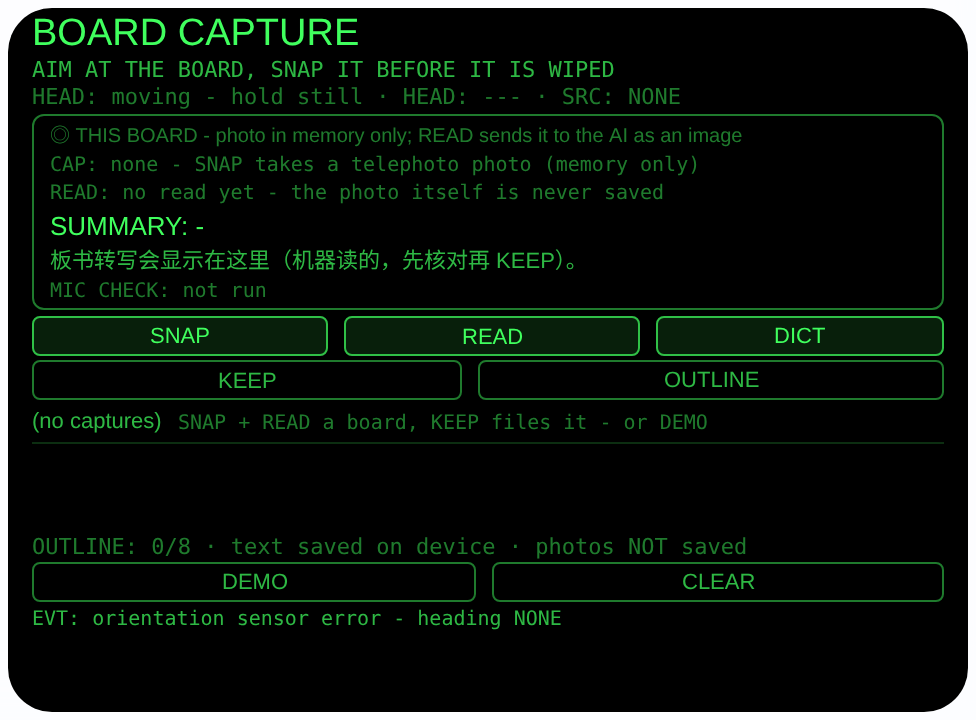
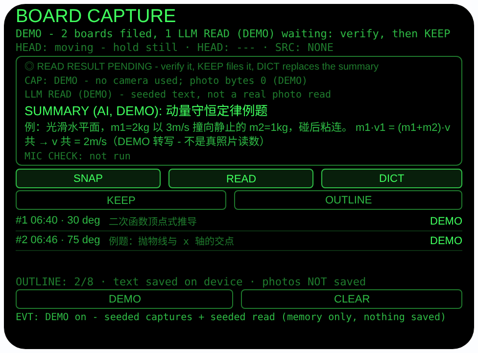
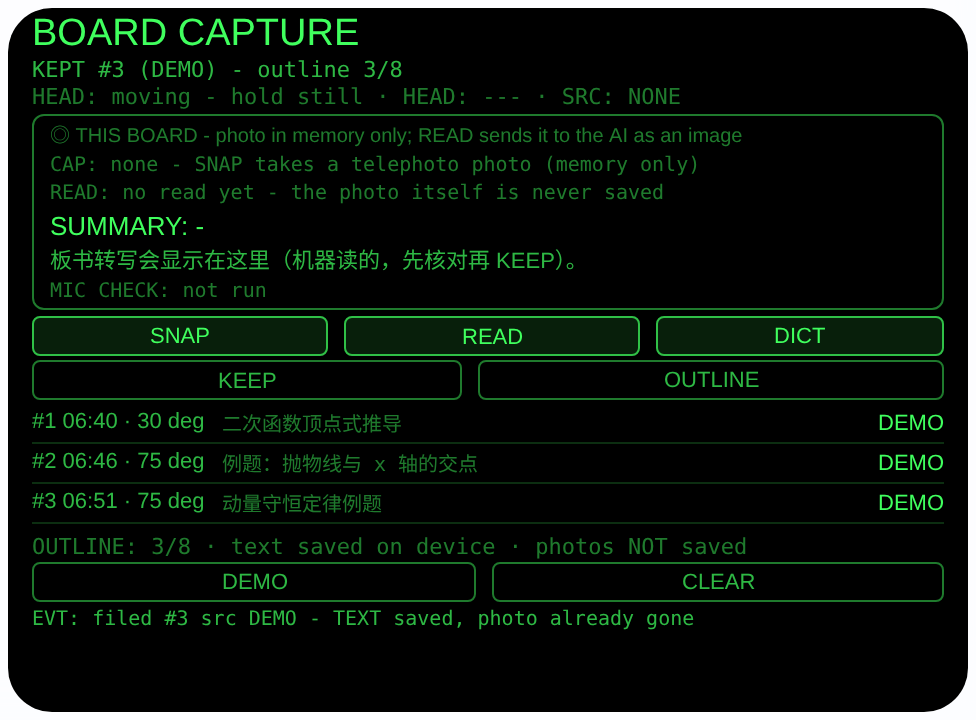

# board-capture — 板书捕获（Rokid 眼镜 AIUI Agent）

**Studio 导入地址**（复制到 Global AIUI Studio 的 Import Project 输入框）：

```
https://github.com/sakai55/rokid/tree/agent-board-capture
```


50 个「指向性生活问题」Agent 的第 Z39 个，H 组（学习记忆）第三个。
上课、开会时，黑板白板上的字又远又多，老师讲完一擦就没，手抄
根本跟不上。本 Agent 让你看向板书拍一张长焦照片，眼镜把照片
作为图片发给主机大模型读出来——转写全文 + 一句提纲——你核对
无误后存进提纲清单，散会时按拍摄顺序把所有提纲朗读一遍。

## 预览截图

截图统一存放于仓库根目录 `screenshots/board-capture/`。







## 解决的问题

板书的价值密度很高、寿命却最短：一黑板推导写完就擦，坐在后排
连看清都难，更别说抄全。手机拍照要举起来对焦、还打断听课，而
且拍完只是一张图，回去还得自己整理。本 Agent 把「拍下 → 读出
→ 成提纲」压成眼镜上的三步：看向板书 SNAP，READ 让大模型把
照片读成文字，你瞄一眼对不对，KEEP 存下；一节课拍几块板，
OUTLINE 按顺序读出来就是一份提纲。

## 指向性设计（为什么必须用眼镜）

- **看向即取景（GAZE 长焦）**：板书远而小，SNAP 用
`ImageCapture.takePhoto({mode:'telephoto'})` 长焦取景——
你看向哪块板，拍的就是哪块，头朝向同时记进这条记录
（`AbsoluteOrientationSensor` 四元数算 yaw；无传感器时
如实记 `---`）。手机举起来拍，视线和课堂就断了。
- **读字走官方路径（telephoto + LLM 图片输入）**：**PLAN 原案
写的是「拍照 → OCR 成笔记」，而运行时根本没有 OCR API**
（档案 §4.3）。审计后的改法：照片 Blob 经
`FileReader.readAsDataURL` 编码为 data: URL，作为 user 消
息的 `{type:'image_url'}` 内容连同文字指令发给主机
`LanguageModel`——这是档案 §2.9 / §4.3 给出的官方读字路
径，本 Agent 是本系列第一个真正落地的照片读字设计。提示词
要求逐行忠实转写、看不清标 `[?]`、不许发明照片里没有的
内容，返回 `SUMMARY:` + `TEXT:` 两段。
- **机器读数先过你的眼睛（核对即产品）**：大模型读板书会读
错——公式、数字、生僻字都是高危区。READ 的结果摆在屏幕上
并标注「LLM READ - may misread, verify against the
board」，**从不自动保存**；你看过、点了 KEEP（或头部稳定
时点头）才进提纲。不信机器的那句提纲？DICT 用你自己的话
替换，KEEP 时你的提纲优先于机器的。
- **照片永不落盘（诚实边界常驻界面）**：照片 Blob 只活在
内存里，wx 存储里只存文字（提纲、转写、时间、朝向、来
源）。界面常驻行写明「photos NOT saved」——这条记录的
「图」在你 KEEP 完就已经不存在了，剩下的是你核对过的
文字。

## 功能流程

1. SNAP：看向板书拍长焦照片（记录朝向 + 时间；照片只在
内存，无相机主机如实 FAIL，并提示改走 DICT）
2. READ：照片 → data: URL → 主机大模型图片输入，返回转写
全文 + 一句中文提纲（标注 LLM READ，提示核对）；模型
不可用 / 转换不可用 / 模型报错 / wx 回退照片无 Blob，
全部如实落到对应状态，照片仍作记录，并转入 DICT 兜底
3. DICT（可选/兜底）：wearer 麦克风可用性检查（结果单独
一行 `MIC CHECK:`）后，用宿主 SpeechRecognition
（zh-CN）在它自己的麦克风上口述你的一句提纲，原样显示；
你口述的提纲在 KEEP 时优先于机器提纲；无识别主机走预置
提纲轮换并标注 SKIP
4. KEEP / 点头：把 {序号， 时间， 朝向， 提纲， 转写，
来源} 存入 `boardCaptures`（按拍摄顺序，最多 8 条，
超限丢最旧一条并明说）；没有任何待存内容时 KEEP 拒绝
5. OUTLINE：按拍摄顺序把全部提纲拼起来朗读一遍——一节课
的提纲就此成型
6. DEMO：内存播入 2 条标注 DEMO 的记录 + 1 条标注
「LLM READ (DEMO)」的待存读数（照片字节 0、标注
DEMO），不写真实存储；CLEAR 退出后恢复真实提纲

> 诚实边界：**没有 OCR**，读字靠「照片 → 大模型图片输入」
> 这条官方路径，而宿主真机是否真的接受 image_url /
> data: URL、FileReader 是否可用，**都未经真机验证**（见
> 「未验证」第一条）——所以每条失败路径都留了一条能用的记
> 录，DICT 口述在任何情况下都能把这一课记下来。大模型的转
> 写是机器读数，可能读错，核对这一步不是礼貌，是防线。

## 权限

| 权限 | 用途 |
|---|---|
| CAMERA | SNAP 长焦拍板书（照片只在内存中转、供 READ 转 data: URL，从不落盘保存） |
| RECORD_AUDIO | DICT 的佩戴者模式麦克风可用性检查（getUserMedia，检查流立即停轨）+ 宿主 SpeechRecognition 口述提纲（zh-CN） |

相机/麦克风只在用户点 SNAP / DICT 时启动，用完立即停掉全部
媒体轨道。不录音；照片不写入任何存储，只随 READ 的那一次请
求经宿主通道发给大模型。

## 打包与预览

```bash
cd ~/workspace/rokid/board-capture
~/tools/bin/aix pack. -o../dist/board-capture.aix
~/tools/bin/aix preview. --html-out artifacts/preview.html
```

本地预览截图走 `~/workspace/preview-tools/` 的本地 Ink + puppeteer 路线
（`shot-board.js`，独立页面副本 `preview-board.html`；点击序列为
canvas 内坐标 DEMO (122, 287) → KEEP (119, 200)，坐标经视觉
定位确认）。

## 真机测试（海外版 · 云端下发 · Path 1）

1. 推到 GitHub 后，Global AIUI Studio（aiui-global.rokid.com，en-US）用
分支导入：`https://github.com/sakai55/rokid/tree/agent-board-capture`
（该分支根目录即本 Agent 文件）
2. Studio 的 **Device Debug** 页签填 Basic Information，在 AIX Packaging
点 **Repackage and Save**，确认顶部出现绿色
**● Debug version ready — Ready for device debugging**
3. **Hi Rokid**（海外版 `com.rokid.sprite.global.aiapp`，不是国内版
Rokid Ai App）→ 设置 → 开发者选项 → AIUI → 更新眼镜资源包，
等「智能体资源包下载成功」
4. 对眼镜说「乐奇，打开 board-capture」，在真实课堂/会议里实测：
**第一优先验证 READ 的图片通路**——SNAP 一块写满公式的板书，
READ 是否真的返回转写（验证宿主接受 image_url / data: URL、
FileReader 可用）、转写对公式/数字的准确率、看不清处是否老实
标 `[?]`；图片通路若不通，READ 是否如实落到失败状态且 DICT
兜底可用；再测长焦在最后一排的取景清晰度、DICT 口述提纲的
识别率、连拍 8 块板后 OUTLINE 朗读顺序

## 真机测试信息（Global AIUI Studio · Device Debug）

| 项目 | 值 |
|---|---|
| Agent Name（Studio） | 待导入后回填 |
| Version（Build） | 1.0.0（待导入后回填） |
| App Category | 待导入后回填 |
| Intent Description | 待导入后回填 |
| Agent ID | 待导入后回填 |
| AIX Package Size | 约 23.6 KB（本地打包 `dist/board-capture.aix`） |
| 状态 | 本地完成，待导入 Studio |
| Studio | aiui-global.rokid.com（en-US） |
| 下发方式 | 云端下发 → Hi Rokid（海外版）更新眼镜资源包 |

## 验证情况

**已验证**

- 静态检查：app.json / package.json JSON 解析通过；`<script def>` JSON
解析通过；`<script setup>` 与 app.js 提取后 `node --check` 语法通过；
全目录 grep 无 `Page(` / `App(` / `Widget(` / `workers:` 残留。
- 板书逻辑（Node 实测）：把页面对象以 wx / LanguageModel /
FileReader / SpeechRecognition / speechSynthesis 全部打桩加载进
Node，共 61 条断言全过——含提示词组装（content 数组恰两段、
text 段含 SUMMARY/TEXT 格式要求、image_url 段携带 data: 前缀
URL、system 只经 initialPrompts 首条、prompt 后 session 被
destroy）；Blob → data: URL 转换成功与 FileReader 缺失时如实
拒绝、转换结果非 data: 时如实拒绝；大模型回复解析（标准两段、
全角冒号、无标签 salvage、仅转写、空回复返回 null）；READ
成功后**不落盘**（KEEP-only 纪律在断言里卡死）、KEEP 后条目
字段完整（序号/时间/朝向/提纲/转写/来源）且写入
`boardCaptures`；失败迁移全覆盖（无大模型 → unavailable 态
且待存记录保留、availability 非 available、FileReader 缺
失 → conversion 态、模型抛错 → 状态提供 DICT 且 KEEP 裸存
为 `(no summary)`/NONE、wx 照片无 Blob → READ 如实 n/a）；
DICT 通路（检查流轨道在识别开始前已全部停掉、检查结果独立
`MIC CHECK:` 行、聆听标注 `(host ASR)`、识别原文 verbatim
成为提纲、口述提纲在 KEEP 时压过大模型提纲）；8 条封顶丢最
旧并在 EVT 明说；OUTLINE 按拍摄顺序拼接朗读、空提纲不发
声、TTS 从不设置 utterance.lang；点头纪律（不稳不动、稳且
有读数才 KEEP、裸照片待存时点头被拒、点头永不触发拍照）；
存储加载校验（垃圾条目丢弃、朝向取模、无朝向记 null、序号
续接）；DEMO 播种（2 条记录 + 1 条待存 DEMO 读数、照片字
节 0 且标注、演示全程不写真实存储、CLEAR 后真实提纲恢
复）；无识别主机时 DICT 走预置轮换并标注 SKIP/预置。
- 打包：`aix pack` 成功；`aix list` 核对包内含 README.md、AGENTS.md、
app.js、app.json、package.json、pages/index/index.ink
（artifacts/ 已被.aixignore 排除）。
- 预览渲染：aix preview + 本地 Ink + puppeteer 截图三张（见下方
Preview Media）：首页初始态完整渲染（当前板书框含 CAP/READ/
SUMMARY/转写/MIC CHECK 五行、SNAP/READ/DICT 与 KEEP/OUTLINE
按钮、空提纲行与常驻诚实行）；点 DEMO 到达播种态：第 1、2
条记录（序号/时间/朝向/提纲/DEMO 标记）与第 3 块板的
「LLM READ (DEMO)」待存读数（提纲 + 转写全文）均正确渲染，
三处时间由一次时钟快照推导（间隔 6 分钟自洽）；再点 KEEP
到达存档态：「KEPT #3 (DEMO) - outline 3/8」、三条记录按序
排列、EVT 明示「TEXT saved, photo already gone」。

**未验证**

- **真机 READ 图片通路**：宿主 `LanguageModel` 是否
真的接受 user 消息里的 `{type:'image_url'}` content、data:
URL 是否被接受、Blob → `FileReader.readAsDataURL` 在眼镜运
行时里是否可用——档案 §2.9 只保证文档层面成立，三者都要真
机实测。若图片通路在真机不通，READ 会如实落到失败状态，
本 Agent 靠 DICT 口述提纲仍可完整使用（这正是兜底存在的
理由），但「拍照读板书」这个核心卖点要等真机结论。
- 真机大模型读板书的质量：公式/上下标/连笔字的转写准确率、
`[?]` 诚实标注的遵从度、两段格式的稳定性；格式跑偏时解析
按行 salvage，提纲与转写可能分错段。
- 真机长焦拍板书的清晰度与成功率（最后一排、反光白板、弱
光教室）；wx 回退照片在真机上的形态（回退照片没有 Blob，
READ 对它是如实 n/a、只能 DICT——真机上回退触发频率待测）。
- 真机 DICT 识别率（课堂环境噪声下宿主识别器听提纲的准确
度，wearer 检查流不参与识别）；头部朝向读数的精度与零点
参考（宿主定义）；点头 KEEP 在听课场景的误触率。
- wx 存储在眼镜重启后 8 条提纲的持久性；OUTLINE 合成语音
朗读长提纲的自然度。

---

## 提审资料（Review Submission）

> Global AIUI Studio → Submit 页签的 Review Information 逐项对应下面四段，
> 提交时整段复制。每次提交前重新确认 Preview Media。

### Feature Description

Board Capture freezes a blackboard before it is wiped. Aim at the board and tap SNAP for a telephoto photo, then READ: the photo goes to the host AI as an image - the official read-text path, there is no OCR - and comes back as a transcription plus a one-line summary, labelled a machine read for you to verify. KEEP files what checks out, DICT lets you dictate your own summary instead, and OUTLINE reads every summary in capture order. Photos are never saved; only the text is kept, on device.

（495 字符）

### Opening Message

Hi, I'm **Board Capture** - boards get wiped, your outline won't.

**SNAP** takes a telephoto photo of the board (memory only, never saved). **READ** sends it to the host AI as an image and shows a transcription plus a one-line summary - a machine read that **may misread**, so check it against the board. **KEEP** files it only when you say so; **DICT** replaces the summary with your own spoken line. **OUTLINE** reads all summaries in order. Up to 8 boards, text only, on device.

（482 字符）

### Preview Media

提交要求：3–5 个 JPG/PNG 图片或 MP4 视频，至少含 1 张图和 1 个视频，每次提交前重新确认。

- Image 1：`artifacts/preview-board-capture-index.png`（aix preview 首页：BOARD CAPTURE 初始态，含当前板书框、SNAP/READ/DICT 与 KEEP/OUTLINE 按钮、空提纲行及「photos NOT saved」常驻诚实行，本地文件，提交时从本地上传）
- Image 2：`artifacts/preview-board-capture-demo.png`（DEMO 播种态：2 条记录已存档，第 3 块板的 LLM READ (DEMO) 读数——提纲 + 转写全文——待核对存档，本地文件）
- Image 3：`artifacts/preview-board-capture-kept.png`（KEEP 后：3 条提纲按拍摄顺序排好，OUTLINE 3/8，EVT 明示文字已存、照片已不存在，本地文件）
- Video：待真机补 — 真机录制「看向板书 SNAP → READ 读出转写与提纲 → 核对后 KEEP → 连拍几块板 → OUTLINE 按顺序朗读提纲」全过程（MP4），录好后放 `artifacts/` 并更新此处
- 状态：未齐（已有 3 张图；还需至少 1 个视频，总数保持在 3–5 个后才可提交）

### Change Log

#### Build 1.0.0

**Features added**

- Telephoto board capture with the official read-text path: SNAP photographs the board with ImageCapture in telephoto mode (wx camera-context fallback), records the head heading and a single-snapshot timestamp, and holds the photo Blob in memory only - photos are never written to any storage. READ encodes the Blob to a data: URL and sends it to the host LanguageModel as an image_url part of one user message (multimodal content in the user role only, system prompt via initialPrompts, availability checked first, session destroyed after), asking for a faithful line-by-line transcription - unreadable spots marked [?], nothing invented - plus a one-line Chinese summary in a two-part SUMMARY/TEXT format, parsed with a line-salvage fallback.
- Verify-then-file discipline: the machine read is shown labelled "LLM READ - may misread, verify against the board" and is never auto-saved; KEEP (or a steady-head nod, only while a read or dictated line is pending - a nod never takes a photo or starts a read) files {sequence, date, time, heading, summary, transcription, source} into on-device wx storage (key boardCaptures, capture order, max 8, oldest dropped with an on-screen note when full).
- DICT fallback everywhere: a wearer-mode microphone availability check first (stream opened, settings read back, tracks stopped at once - the check does not feed or shape recognition), then the host SpeechRecognition (zh-CN) on its own microphone hears your own one-line summary verbatim; your dictated line beats the machine summary at KEEP, DICT works with no photo at all, and an honest preset cycle covers hosts with no recogniser. Every READ failure state (no model, model unavailable, conversion unavailable, model error, wx-fallback photo with no Blob) keeps a usable capture and points at DICT, and a bare KEEP with no line files "(no summary)" honestly.
- OUTLINE readback: SPEAK plays all filed summaries in capture order via system TTS (utterance.lang never set), so a whole lecture becomes a spoken outline. DEMO seeds two labelled captures plus one labelled "LLM READ (DEMO)" pending read (photo bytes 0) entirely in memory, with seed times derived from a single clock snapshot; leaving DEMO restores the real outline untouched.

**Improvements**

- None (initial release).

**Fixes**

- None (initial release).
