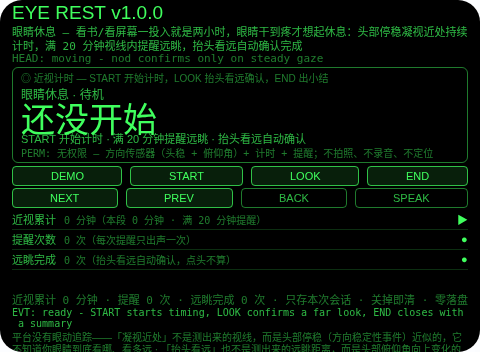
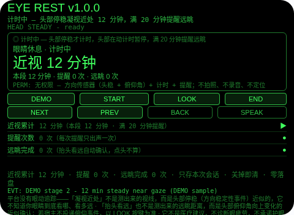
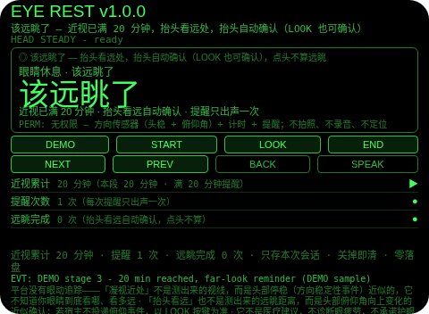
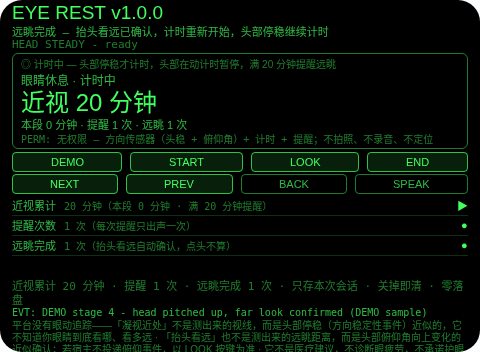
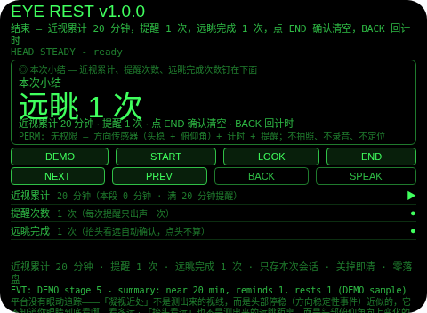

# Eye Rest（眼睛休息）

**Studio 导入地址**（复制到 Global AIUI Studio 的 Import Project 输入框）：

```
https://github.com/sakai55/rokid/tree/agent-eye-rest
```

**AIX 直接下载**（最新版）：[eye-rest.aix](https://raw.githubusercontent.com/sakai55/rokid/main/aix/eye-rest.aix)

注意力外挂系列 BO01（BODY 身体型，本组第一个，系列第 41 个）。看书/看屏幕一投入就是两小时，眼睛干到疼才想起休息。本 Agent 把休息提醒外包出去：头部停稳凝视近处持续计时，满 20 分钟视线内提醒远眺，抬头看远自动确认完成，计时重新开始；结束出小结（本次累计近视时长、提醒几次、远眺完成几次）。

## 解决的问题

眼睛的休息注意力是事后的：投入看书或看屏幕时没人会盯着钟，到眼睛干疼才想起休息已经晚了。本 Agent 管四件事：计时（头部停稳才计时，头部在动计时暂停，满 20 分钟提醒）、提醒（视线内横幅 + 恰好一次语音「该远眺了」，之后不再重复出声）、确认（抬头看远自动确认——头部俯仰角向上变化即确认，LOOK 按键也可确认；点头不算远眺）、小结（近视累计、提醒次数、远眺完成次数，确认后清空）。

## 注意力外挂设计（BODY 身体型）

- **没有眼动追踪，头稳只是近似**：平台没有眼动追踪，「凝视近处」不是测出来的视线，而是头部停稳（方向稳定性事件）近似的——它不知道你眼睛到底看哪、看多远。头部在动时计时暂停，不猜。这一点 UI 与本 README 如实写明。
- **抬头看远是俯仰角近似，不是测出来的距离**：确认来自头部俯仰角向上变化（或 LOOK 按键）——平台没有远眺距离测量，「看远了」在这里的意思是「提醒打开时头抬起来了」。若宿主不投递俯仰事件，以 LOOK 按键为准。
- **点头不算远眺**：点头只在待机起计时、在小结页确认清空；计时中与提醒中的点头一律忽略并说明。把点头算成远眺，等于谎报你做过一次远眺，代码拒绝这样做。
- **提醒只出声一次，不骚扰**：满 20 分钟出声一次，之后在提醒态里不再出声；从提醒页按 BACK 回计时也不会把提醒赖掉——本段分钟保留，下次头稳计时即重提醒。看一眼横幅不等于远眺。
- **纠错便宜，销毁需确认**：提醒页返回键回计时（提醒未完成，本段保留）；计时页返回键回待机（本轮保留，START 恢复同一轮）；小结页返回键回计时（不删东西，小结重建）；确认（小结页点 END 或头稳点头）才清空本轮分钟与计数；没有 DEL 键。
- **只记本次会话，关掉即清**：近视分钟、提醒与远眺计数与小结只存会话内存，关掉 Agent 即清——上一轮的用眼时长对下一轮没有任何意义，存下来才是误导。
- **不是医疗建议**：本 Agent 不诊断眼疲劳、不承诺任何护眼效果、不设定医疗日程——20 分钟只是一个 plain 的计时阈值，提醒你抬头看看远处而已。
- **为什么胸前设备做不了**：用眼时长是「你的头一直稳稳朝向近处」——胸前设备既不知道你的头朝哪，也不知道你的头稳不稳，更没法在你视线里贴一条「该远眺了」；掏手机看提醒等于又看一次近处。计时、提醒、抬头确认三条都只有头戴设备成立。

## 与邻近 Agent 的分工

- 注意力系列 `play-watch`（DU01）：游乐场孩子活动区定时回看——提醒你回看一个地方。本 Agent 不看地方：它计时的是你的身体（头稳近视时长），确认的是你的动作（抬头看远）。
- 注意力系列 `standup-echo`（SO04）：站会模块关键词门——命中成关联笔记，非命中成一行截取摘要，会后 REVIEW。本 Agent 没有关键词、没有笔记：它的唯一输入是头稳加分钟，唯一输出是远眺提醒与计数。
- 注意力系列 `gift-clue`（SO05）：日常聊天喜好句默记成线索卡，按人归档，送礼时按人回放。本 Agent 不听聊天、不存卡：它计时、提醒、数远眺。

## 功能流程

1. **开始计时（START）**：待机时点 START 开始计时，头部停稳才累计分钟，头部在动计时暂停；待机时点 END 会拒绝并说明先 START。
2. **计时中**：每分钟一跳（真机 60 秒一跳，DEMO 用步进演示），本段与累计分钟钉在行里；满 20 分钟前不提醒、不出声。
3. **满 20 分钟提醒**：视线内横幅 + 恰好一次语音「该远眺了，抬头看远处」；提醒态里再计时不再出声。
4. **抬头看远确认（LOOK / 俯仰角）**：提醒打开时抬头（俯仰角 ≥15° 向上）自动确认，或点 LOOK 确认——远眺完成 +1，本段分钟清零，计时重新开始；点头不算远眺，会被忽略并说明。
5. **结束与小结（END）**：计时或提醒中点 END 出小结（近视累计、提醒次数、远眺完成次数）；返回键回计时（不删东西），小结页点 END 或头稳点头确认后清空本轮分钟与计数。

## 权限

- 无权限（`permissions: []`）：方向传感器（头稳 + 俯仰角）+ 计时 + 提醒不需要任何权限。不拍照、不录音、不定位。

## 手势映射

- 点按（tap / Enter）：待机 START 开始计时；提醒中 LOOK 确认远眺；小结页 END 确认清空。
- 双击（double-tap / Backspace）：返回上一态（提醒→计时保留提醒；计时→待机保留本轮；小结→计时不删东西）。
- 滑动（swipe / ArrowUp-Down）：在三行信息（近视累计 / 提醒次数 / 远眺完成）间切换焦点。
- 头稳 + 点头（head-steady + nod）：待机起计时；小结页确认清空；计时中与提醒中的点头一律忽略（点头不是远眺）。
- 抬头（head pitch up）：提醒打开时自动确认远眺；若宿主不投递俯仰事件，以 LOOK 按键为准。
- 单指长按：唤出 AI 语音助手（系统默认）；双指长按：AI 快捷指令（固定文本，零 ASR 启动）。

## 打包与预览命令

```bash
cd ~/workspace/rokid/eye-rest
~/tools/bin/aix pack . -o ~/workspace/rokid/dist/eye-rest.aix
~/tools/bin/aix list ~/workspace/rokid/dist/eye-rest.aix
~/tools/bin/aix preview . --html-out artifacts/preview.html
```

## 真机测试信息（Studio 导入后回填）

| 项目 | 值 |
|---|---|
| Studio 名称 | （待回填） |
| Version / Build | 1.0.0 / （待回填） |
| App Category | （待回填） |
| Intent Description | （待回填） |
| Agent ID | （待回填） |
| 状态 | 未导入（SOP 第 9 步，GO 触发） |

## 预览截图







## 提审资料 (Review Submission)

### Feature Description

头部停稳凝视近处持续计时，满 20 分钟视线内提醒远眺，抬头看远自动确认完成。看书或看屏幕一投入就是两小时，眼睛干到疼才想起休息——本 Agent 把休息提醒外包出去：头稳才计时，头动暂停，提醒只出声一次，抬头确认后计时重新开始，结束出小结。

### Opening Message

眼睛休息已就绪：点 START 开始计时，头部停稳凝视近处满 20 分钟，我会在你视线里提醒你远眺——抬头看远就自动确认，计时重新开始。

### Preview Media

- 图片：5 张（待机 / 计时进行中 / 满 20 分钟提醒 / 抬头确认 / 本次小结），见「预览截图」节。
- 视频：真机录制后补齐（提审需 3–5 个文件，至少 1 图 + 1 视频）。

### Change Log

- Features added：近视持续计时（头稳才计、头动暂停）；满 20 分钟远眺提醒（横幅 + 恰好一次语音）；抬头看远自动确认（俯仰角 ≥15°，LOOK 按键兜底）；本次小结（累计 / 提醒 / 远眺计数，确认后清空）。
- Improvements：无（首版）。
- Fixes：无（首版）。

## 如实说明

- 平台没有眼动追踪：「凝视近处」不是测出来的视线，而是头部停稳（方向稳定性事件）近似的——它不知道你眼睛到底看哪、看多远。
- 「抬头看远」也不是测出来的远眺距离，而是头部俯仰角向上变化的近似确认；若宿主不投递俯仰事件，以 LOOK 按键为准，不假装所有真机上俯仰事件都可用。
- 它不是医疗建议：不诊断眼疲劳，不承诺护眼效果，20 分钟只是一个计时阈值。
- 计时只在本次打开会话内有效：不调用任何存储 API，关掉即清；没有室内定位，没有摄像头。
