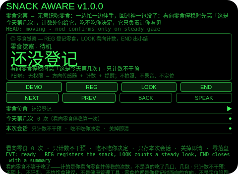
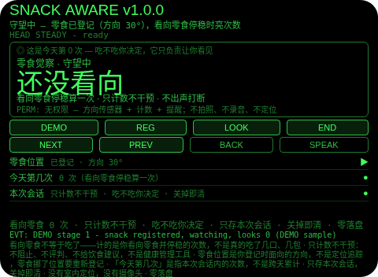
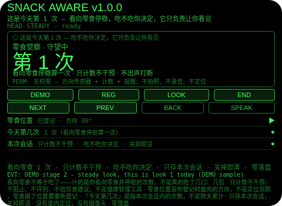
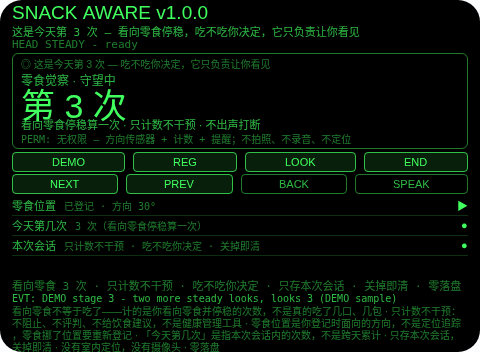
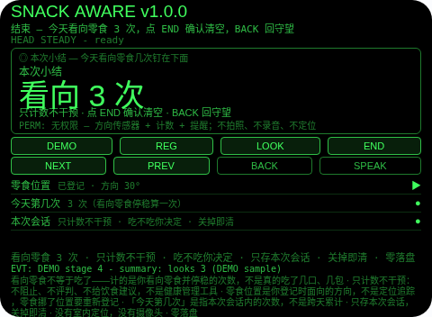

# Snack Aware（零食觉察）

**Studio 导入地址**（复制到 Global AIUI Studio 的 Import Project 输入框）：

```
https://github.com/sakai55/rokid/tree/agent-snack-aware
```

注意力外挂系列 BO05（BODY 身体型，本组第五个，系列第 45 个，B 组收官）。无意识吃零食：一边忙一边伸手，回过神一包没了。本 Agent 把「计数」外包出去：看向零食停稳时先亮「这是今天第几次」，计数外包给它，吃不吃你决定，它只负责让你看见。

## 解决的问题

无意识吃零食的注意力是事后才到的：回过神一包没了，中间伸了几次手全没数。本 Agent 管三件事：登记（看向零食停稳，登记零食方向）、计数（每次看向零食停稳时亮「这是今天第几次」，横幅、不出声打断）、小结（今天看向零食几次，确认后清空）。它不阻止、不评判、不建议——吃不吃你决定。

## 注意力外挂设计（BODY 身体型）

- **看向零食不等于吃了**：本 Agent 计的是你看向零食并停稳的次数，不是真的吃了几口、几包。所谓「今天第几次」的意思是「看向零食停稳了几次」。这一点 UI 与本 README 如实写明。
- **只计数不干预**：它不阻止、不评判、不给饮食建议——不是健康管理工具。横幅只是信息，不是 verdict；页面里没有任何建议文案。
- **零食位置是登记的方向，不是定位追踪**：登记存的是你登记时面向的方向（宿主投递方向事件时记下角度，否则只记「已登记」）。没有室内定位、没有摄像头追踪，零食挪了位置要重新登记。
- **看向确认以停稳为准，不做角度比对**：LOOK 计数只要求头稳，不假装能验证你看的真是零食。点头不算看向——点头在待机登记零食、在小结页确认清空，守望中的点头一律忽略并说明。
- **看向是无声的，绝不打断工作**：每次看向只亮横幅、不出声；SPEAK 主动点才读次数。计数要是每次都出声报数，本身就成了打扰。
- **「今天第几次」是指本次会话内的次数，不是跨天累计**：计数只存会话内存，关掉 Agent 即清——上一轮的看向次数对下一轮没有任何意义，存下来才是误导。
- **纠错便宜，销毁需确认**：守望页返回键回待机（本轮保留，REG 恢复同一轮）；小结页返回键回守望（不删东西，小结重建）；确认（小结页点 END 或头稳点头）才清空本轮计数；没有 DEL 键。
- **不是健康或饮食建议**：本 Agent 不诊断任何问题、不承诺任何健康效果、不设定饮食日程——计数只是一个 plain 的计数器。
- **为什么胸前设备做不了**：零食觉察是「看向方向登记 + 停稳计数 + 视线内横幅」——胸前设备既不知道你头朝哪、也看不到你停稳的视线，更没法把「这是第几次」钉在你眼前。登记、计数、亮数三条都只有头戴设备成立。

## 与邻近 Agent 的分工

- 注意力系列 `water-watch`（BO02）：水杯方向登记 + 距上次喝水墙上时间计时 + 喝完凝视确认。本 Agent 不计时、不提醒：它只登记一个零食方向、数看向它的次数，输出是实时次数与小结。
- 注意力系列 `stand-move`（BO04）：头部活动量 + 静止时长监测 + 久坐超阈值起身提醒 + 环视一圈活动确认。本 Agent 不监测静止、不提醒起身：它只数看向零食的次数，且全程无声。
- 注意力系列 `guest-watch`（SO02）：家中客人座位登记 + 定时回看茶水位 + 门口 SCAN 报方位。本 Agent 不登记客人、不扫描门口：它只登记一个零食方向、数你自己的看向次数。

## 功能流程

1. **登记（REG）**：看向零食停稳，点 REG 登记零食方向；头动时 REG 会拒绝并说明先停稳。
2. **计数（LOOK）**：每次看向零食停稳，点 LOOK（或守望中点 Enter）计数一次，横幅亮「这是今天第 N 次」，不出声；SPEAK 主动点才读次数。
3. **结束与小结（END）**：守望中点 END 出小结（今天看向零食几次）；返回键回守望（不删东西），小结页点 END 或头稳点头确认后清空本轮计数。

## 权限

- 无权限（`permissions: []`）：方向传感器 + 计数 + 提醒不需要任何权限。不拍照、不录音、不定位。

## 手势映射

- 点按（tap / Enter）：待机 REG 登记零食；守望中 Enter 看向计数；小结页 END 确认清空。
- 双击（double-tap / Backspace）：返回上一态（守望→待机保留本轮；小结→守望不删东西）。
- 滑动（swipe / ArrowUp-Down）：在三行信息（零食位置 / 今天第几次 / 本次会话）间切换焦点。
- 头稳 + 点头（head-steady + nod）：待机登记零食；小结页确认清空；守望中的点头一律忽略（点头不是看向零食）。
- 单指长按：唤出 AI 语音助手（系统默认）；双指长按：AI 快捷指令（固定文本，零 ASR 启动）。

## 打包与预览命令

```bash
cd ~/workspace/rokid/snack-aware
~/tools/bin/aix pack . -o ~/workspace/rokid/dist/snack-aware.aix
~/tools/bin/aix list ~/workspace/rokid/dist/snack-aware.aix
~/tools/bin/aix preview . --html-out artifacts/preview.html
```

## 真机测试信息（Studio 导入后回填）

| 项目 | 值 |
|---|---|
| Studio 名称 | （待回填） |
| Version / Build | 1.0.0 / （待回填） |
| App Category | （待回填） |
| Intent Description | （待回填） |
| Agent ID | （待回填） |
| 状态 | 未导入（SOP 第 9 步，GO 触发） |

## 预览截图







## 提审资料 (Review Submission)

### Feature Description

零食觉察外包：看向零食停稳登记方向，每次看向零食停稳时亮「这是今天第几次」，只计数不干预，结束给小结。无意识吃零食——一边忙一边伸手，回过神一包没了：本 Agent 替你数看向零食的次数，吃不吃你决定，它只负责让你看见。

### Opening Message

零食觉察已就绪：看向零食停稳点 REG 登记方向，之后每次看向零食停稳我就亮这是今天第几次——只计数不干预，结束点 END 看你今天看向零食几次。

### Preview Media

- 图片：5 张（待机 / 已登记守望中 / 看向亮第 1 次 / 多次计数后第 3 次 / 本次小结），见「预览截图」节。
- 视频：真机录制后补齐（提审需 3–5 个文件，至少 1 图 + 1 视频）。

### Change Log

- Features added：零食方向登记（看向停稳登记，宿主投递方向事件时记下角度）；看向计数（每次看向零食停稳亮「这是今天第几次」，横幅、不出声打断，SPEAK 主动点才读）；本次小结（今天看向零食几次，确认后清空）。
- Improvements：无（首版）。
- Fixes：无（首版）。

## 如实说明

- 看向零食不等于吃了：计的是你看向零食并停稳的次数，不是真的吃了几口、几包。
- 只计数不干预：不阻止、不评判、不给饮食建议，不是健康管理工具。
- 零食位置是你登记时面向的方向，不是定位追踪，零食挪了位置要重新登记。
- 「今天第几次」是指本次会话内的次数，不是跨天累计；计数只在本次打开会话内有效：不调用任何存储 API，关掉即清；没有室内定位，没有摄像头。
