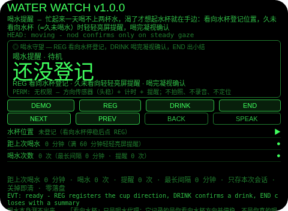
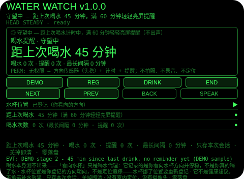
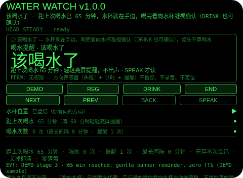
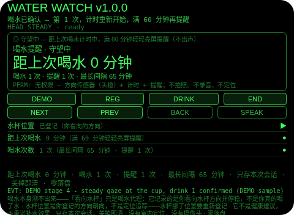
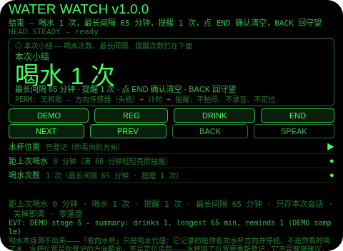

# Water Watch（喝水提醒）

**Studio 导入地址**（复制到 Global AIUI Studio 的 Import Project 输入框）：

```
https://github.com/sakai55/rokid/tree/agent-water-watch
```

**AIX 直接下载**（最新版）：[water-watch.aix](https://raw.githubusercontent.com/sakai55/rokid/main/aix/water-watch.aix)

注意力外挂系列 BO02（BODY 身体型，本组第二个，系列第 42 个）。忙起来一天喝不上两杯水，渴了才想起水杯就在手边。本 Agent 把喝水提醒外包出去：看向水杯登记位置，久未看向水杯（=久未喝水）时轻轻亮屏提醒，喝完凝视确认，计时重新开始；结束出小结（本次喝水几次、最长间隔多久）。

## 解决的问题

喝水的注意力是事后的：忙起来没人会盯着钟，到渴了才想起水杯就在手边已经晚了。本 Agent 管四件事：登记（看向水杯停稳后点 REG 登记方向）、守望（自上次喝水起计时，满 60 分钟轻轻亮屏提醒——横幅，不出声）、确认（喝完后看向水杯凝视确认，DRINK 也可确认；点头不算喝水）、小结（喝水次数、最长间隔、提醒次数，确认后清空）。

## 注意力外挂设计（BODY 身体型）

- **喝水本身测不出来，看向水杯只是代理**：本 Agent 记录的是你看向已登记的水杯方向并停稳，不是你真的喝了水。喝水次数在这里的意思是「你凝视水杯确认过的次数」。这一点 UI 与本 README 如实写明。
- **水杯位置是登记的方向，不是定位追踪**：登记存的是你停稳时看向的方向——没有室内定位、没有摄像头追踪，Agent 不知道水杯挪没挪。水杯挪了位置要重新登记。
- **轻轻提醒 = 横幅，不出声**：满 60 分钟只在视线里亮横幅，一次语音都不出；SPEAK 主动点才会把提醒读出来。轻轻不是「小声一点」，是「不打断你」。
- **点头不算喝水**：点头只在待机登记水杯、在小结页确认清空；守望中与提醒中的点头一律忽略并说明。把点头算成喝水，等于谎报你喝过一次水，代码拒绝这样做。
- **间隔是墙上时间，不是凝视时间**：与 eye-rest 不同（头动暂停计时），距上次喝水的时间不管头动不动都在走；只有登记与喝水确认需要头稳。
- **提醒欠着不赖掉**：从提醒页按 BACK 回守望也不会把提醒清掉——间隔分钟保留，下次计时即重提醒。看一眼横幅不等于喝水。
- **纠错便宜，销毁需确认**：提醒页返回键回守望（提醒未完成，间隔保留）；守望页返回键回待机（本轮保留，REG 恢复同一轮）；小结页返回键回守望（不删东西，小结重建）；确认（小结页点 END 或头稳点头）才清空本轮计数；没有 DEL 键。
- **只记本次会话，关掉即清**：水杯位置、间隔、喝水与提醒计数与小结只存会话内存，关掉 Agent 即清——上一轮的喝水记录对下一轮没有任何意义，存下来才是误导。
- **不是健康建议**：本 Agent 不诊断脱水、不承诺任何补水效果、不设定医疗日程——60 分钟只是一个 plain 的计时阈值，提醒你喝口水而已。
- **为什么胸前设备做不了**：喝水提醒是「你看向水杯的方向 + 距上次喝水的时间」——胸前设备既不知道你的头朝哪，也不知道你看没看过水杯，更没法在你视线里贴一条「该喝水了」；掏手机看提醒等于又多一次分心。登记、计时、凝视确认三条都只有头戴设备成立。

## 与邻近 Agent 的分工

- 注意力系列 `eye-rest`（BO01）：近视持续计时——头稳才计、头动暂停，满 20 分钟远眺提醒，抬头看远自动确认。本 Agent 不计近视：它计的是距上次喝水的时间，确认的是看向水杯的凝视。
- 注意力系列 `guest-watch`（SO02）：家中客人座位登记 + 定时回看茶水位 + 门口 SCAN 报方位。本 Agent 不登记客人、不 SCAN：它只登记一个水杯方向，数你自己的喝水次数。
- 注意力系列 `standup-echo`（SO04）：站会模块关键词门——命中成关联笔记，非命中成一行截取摘要，会后 REVIEW。本 Agent 没有关键词、没有笔记：它的唯一输入是登记方向加分钟，唯一输出是轻轻提醒与计数。

## 功能流程

1. **登记水杯（REG）**：待机时看向水杯停稳后点 REG 登记方向，开始守望；头在动时 REG 会拒绝并说明先停稳。待机时点 END 会拒绝并说明先 REG。
2. **守望中**：自上次喝水起一分钟一跳（真机 60 秒一跳，DEMO 用步进演示），距上次喝水分钟钉在行里；满 60 分钟前不提醒、不出声。
3. **满 60 分钟轻轻提醒**：视线内横幅，不出声；提醒态里再计时不再出声；SPEAK 主动点才会把提醒读出来。
4. **喝完凝视确认（DRINK）**：喝完后看向水杯停稳即确认，或点 DRINK 确认——喝水次数 +1，间隔记入最长间隔，计时重新开始；点头不算喝水，会被忽略并说明。
5. **结束与小结（END）**：守望或提醒中点 END 出小结（喝水次数、最长间隔、提醒次数）；返回键回守望（不删东西），小结页点 END 或头稳点头确认后清空本轮计数。

## 权限

- 无权限（`permissions: []`）：方向传感器（头稳）+ 计时 + 提醒不需要任何权限。不拍照、不录音、不定位。

## 手势映射

- 点按（tap / Enter）：待机 REG 登记水杯；守望中 DRINK 确认喝水；小结页 END 确认清空。
- 双击（double-tap / Backspace）：返回上一态（提醒→守望保留提醒；守望→待机保留本轮；小结→守望不删东西）。
- 滑动（swipe / ArrowUp-Down）：在三行信息（水杯位置 / 距上次喝水 / 喝水次数）间切换焦点。
- 头稳 + 点头（head-steady + nod）：待机登记水杯；小结页确认清空；守望中与提醒中的点头一律忽略（点头不是喝水）。
- 凝视水杯（head-steady toward the cup）：登记水杯方向；喝完凝视确认喝水；若宿主不投递头稳事件，以 REG / DRINK 按键为准。
- 单指长按：唤出 AI 语音助手（系统默认）；双指长按：AI 快捷指令（固定文本，零 ASR 启动）。

## 打包与预览命令

```bash
cd ~/workspace/rokid/water-watch
~/tools/bin/aix pack . -o ~/workspace/rokid/dist/water-watch.aix
~/tools/bin/aix list ~/workspace/rokid/dist/water-watch.aix
~/tools/bin/aix preview . --html-out artifacts/preview.html
```

## 真机测试信息（Studio 导入后回填）

| 项目 | 值 |
|---|---|
| Studio 名称 | （待回填） |
| Version / Build | 1.0.0 / （待回填） |
| App Category | （待回填） |
| Intent Description | （待回填） |
| Agent ID | （待回填） |
| 状态 | 未导入（SOP 第 9 步，GO 触发） |

## 预览截图







## 提审资料 (Review Submission)

### Feature Description

看向水杯登记位置，久未看向水杯（=久未喝水）时轻轻亮屏提醒，喝完凝视确认。忙起来一天喝不上两杯水，渴了才想起水杯就在手边——本 Agent 把喝水提醒外包出去：登记方向、满 60 分钟横幅提醒不出声、凝视确认后计时重新开始，结束出小结。

### Opening Message

喝水提醒已就绪：看向水杯停稳后点 REG 登记，距上次喝水满 60 分钟，我会在你视线里轻轻亮屏提醒——喝完看向水杯凝视一下就确认，计时重新开始。

### Preview Media

- 图片：5 张（待机 / 守望进行中 / 轻轻亮屏提醒 / 喝完凝视确认 / 本次小结），见「预览截图」节。
- 视频：真机录制后补齐（提审需 3–5 个文件，至少 1 图 + 1 视频）。

### Change Log

- Features added：水杯方向登记（看向停稳）；距上次喝水计时（满 60 分钟轻轻亮屏提醒，不出声）；喝完凝视确认（DRINK 按键兜底，点头不算）；本次小结（喝水次数 / 最长间隔 / 提醒次数，确认后清空）。
- Improvements：无（首版）。
- Fixes：无（首版）。

## 如实说明

- 喝水本身测不出来：「看向水杯」只是喝水代理——它记录的是你看向水杯方向并停稳，不是你真的喝了水。
- 水杯位置是你登记的方向朝向，不是定位追踪——水杯挪了位置要重新登记。
- 它不是健康建议：不诊断脱水，不承诺补水效果，60 分钟只是一个计时阈值。
- 计时只在本次打开会话内有效：不调用任何存储 API，关掉即清；没有室内定位，没有摄像头。
