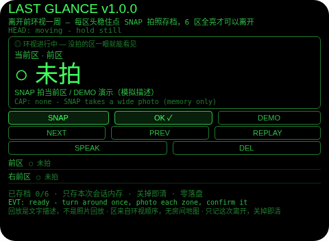
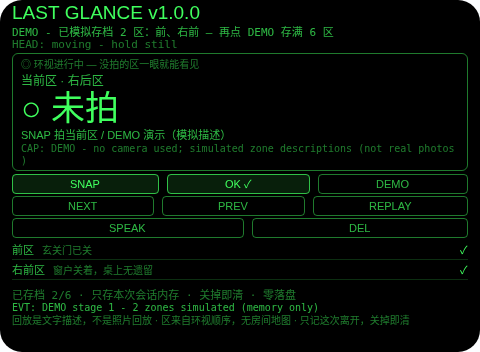
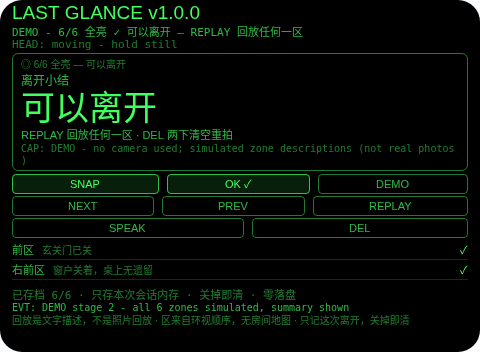
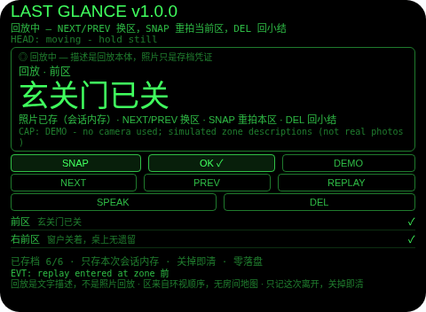

# Last Glance（离开存档）

**Studio 导入地址**（复制到 Global AIUI Studio 的 Import Project 输入框）：

```
https://github.com/sakai55/rokid/tree/agent-last-glance
```

注意力外挂系列 CO01（COVER 覆盖型，本组首位）。离开酒店房间、座位、露营地时最典型的焦虑：东西落没落、窗关没关、水电关没关——走远了才想起来，回去一趟的成本最高。本 Agent 的做法：离开前原地转一圈，6 个朝向区逐区拍照存档，每区一句机器描述、你核对后才算数；没拍的区永远亮着「未拍」，6 区全亮才出「可以离开」小结。路上焦虑再起时，不用折返：按区回放，每区一句描述 +「照片已存」标记，看到那一句就安心。

## 解决的问题

离开焦虑难的不是记性，是「无法证明」：你明明环视过一圈，走到楼下还是不确定是不是都看过了。本 Agent 把「都看过了」变成一张看得见的表——6 个区，拍一个亮一个，漏一个就明明白白空着。它不替你判断东西在不在（那需要它看懂房间），它只替你证明「这一圈我确实走完了」，而焦虑恰恰缺的就是这句证明。

## 注意力外挂设计（COVER 覆盖型）

- **覆盖表就是产品**：6 个朝向区（前 / 右前 / 右后 / 后 / 左后 / 左前）是全部模型。拍完确认一个，列表里亮一个；没拍的区显示「○ 未拍」，不会被别的区推断补上。小结只在 6/6 时出现——「可以离开」这句话的全部含金量，就是这张表没有空行。
- **回放是文字描述，不是照片回放（诚实边界，第一位）**：眼镜是单色绿 480×352 显示，彩色照片回放不出来。所以回放时每区显示的是它的一句描述 +「照片已存（会话内存）」标记：描述是回放本体，照片只是这次会话里 backing 它的存档凭证。界面、朗读、README 都不说「给你看照片」——说得出就必须给得出。
- **没有室内定位、没有房间地图（诚实边界，第二位）**：区的名字只是你开始环视时站立朝向的相对方位（前、右前……），来自你转过的顺序，不是房间平面图上的位置。本 Agent 不申请定位、无地图、无指向任何一区的箭头；它永远不知道「窗户在房间的哪一边」，只知道「右前区你拍过，描述是窗户关着」。
- **存档只活这一次离开（诚实边界，第三位）**：全部内容只存本次会话内存，关掉 Agent 即清——适用窗口是「刚离开、路上焦虑」这段，不是永久档案。好处是零隐私残留（酒店房间的照片不落盘）；代价是中途关掉就得重拍，README 和界面都明说。
- **读描述走官方拍照路径，且过两道门**：SNAP 拍当前区（`wide` 大视场），照片 Blob 转 data: URL 发给主机 `LanguageModel` 读图，回复格式写死（`ZONE: 一句短描述`，看不清回 `NONE`）；解析器只接受干净格式或一句 ≤30 字的抢救，散文式回复一律判读失败——**读不清就是失败，绝不编一句描述出来**。平台没有 OCR，本 Agent 也不声称有。照片只活在内存里，读完即弃。
- **确认门：核对后 OK 才存档**：照片的描述先落待核对视图，大字 +「机器描述，可能看错」的标注；对了 OK 存档，错了 DEL 放弃重拍；头稳的点头在这里只有一个意思——确认待核对的照片，其他状态下的点头一律无效并说明原因。**描述读失败不是死路**：OK 照样把该区存档为「已拍·未读出描述」（如实标注），区永远不会被模型卡住；wx 回退照片（无法转图）走同一条路。
- **回放是正式模式**：小结页（或已存 ≥1 区时的环视页）点 REPLAY 进入逐区回放：NEXT/PREV 换区，SNAP 重拍当前区（确认后覆盖原描述、仍留在回放里），DEL/OK 回到回放的来处——小结来的回小结，环视来的回环视（**半存档回放绝不假装 6/6**，这是断言里专门测的一条）。清空存档是小结页两步 DEL，6 秒武装窗口内任何其他动作都取消武装。
- **为什么胸前设备做不了**：环视一周要求相机与视线同轴（胸口相机转一圈拍到的是自己的身体和别人的腿）；「哪个区没拍」的覆盖表要求头部朝向信号（胸前设备不知道你转到哪了）；回放必须进视线（低头看胸口设备等于又一次离场）。三条都只有头戴设备成立。

## 功能流程

1. **环视（SWEEP）**：离开前原地转一圈；每到一区，头稳住点 SNAP，大视场拍照 → 主机大模型写一句描述 → 落待核对视图。
2. **核对（CONFIRM）**：大字核对描述；对了 OK 存档（焦点自动跳到下一个未拍区），错了 DEL 放弃重拍；头稳点头也可确认。描述读失败时 OK 存档为「已拍·未读出描述」。
3. **小结（DONE）**：6 区全亮时出「可以离开」小结并 TTS 播报；此时 DEL 两下可清空重拍。
4. **回放（REPLAY）**：小结页或环视页（≥1 区已存）点 REPLAY，逐区看描述 +「照片已存」标记；NEXT/PREV 换区，SNAP 重拍当前区，DEL/OK 回到原处。
5. **DEMO**：环视页点 DEMO，分两步模拟存档（先 2 区，再满 6 区），全程标注模拟、不用相机；已有真实存档时 DEMO 拒绝覆盖。

## 手势映射

主流程（环视拍照 → 核对 → 小结 → 回放）靠滑动 + 单击 + 点头即可走完：

| 手势（镜腿触控板） | 键事件 | 在本 Agent 中的作用 |
|---|---|---|
| 单击 | Enter | 情境主操作 OK：待核对 = **确认存档**；小结页 = 进入回放；回放中 = 回到原处 |
| 上滑 | ArrowUp | NEXT：环视时焦点移向下一区；回放时换下一区 |
| 下滑 | ArrowDown | PREV：环视时焦点移回上一区；回放时换上一区 |
| 点头（头稳时） | `onHeadGesture('nod')` | **确认待核对的照片**：只在环视且有待核对照片时有效；头不稳不算；永不拍照、永不换区、永不回放、永不清档 |
| 双击 | Backspace | 系统返回（不拦截） |
| 长按 | — | 唤醒助手（系统级，不拦截） |

屏幕按钮（每个都有保留理由）：

| 按钮 | 理由 |
|---|---|
| SNAP | 拍当前区的主动作（回放中 = 重拍当前区） |
| OK ✓ | Enter 的镜像（确认存档 / 进回放 / 回原处） |
| DEMO | 两步模拟存档（提审/自测用；全程标注模拟，不用相机，拒覆真实存档） |
| NEXT / PREV | 焦点/回放区的前后移动 |
| REPLAY | 进入逐区回放（需 ≥1 区已存） |
| SPEAK | 朗读当前语境：待核对描述 / 焦点区状态 / 回放区描述 / 小结 |
| DEL | 待核对 = 放弃这次拍照；回放中 = 回原处；小结页 = 两步清空存档 |

## 权限

| 权限 | 用途 |
|---|---|
| `CAMERA` | SNAP 的大视场拍照：6 个朝向区各一张（照片 Blob 只在内存中用于一次读图尝试，读完即弃，永不保存） |

只申请 1 项。**刻意不申请 `RECORD_AUDIO`**：全程没有需要麦克风的口述环节（纠错靠确认/放弃/重拍，朗读用宿主 TTS，不需要录音权限）。**刻意不申请 `GEOLOCATION`**：区是环视顺序里的相对朝向，本 Agent 永远不知道你在哪——它只有你确认的 6 区描述。TTS 用宿主固定音色，永不设置 utterance 的 `lang`（官方文档注明该属性不生效）。

## 打包与预览

```bash
cd ~/workspace/rokid/last-glance
~/tools/bin/aix pack . -o ../dist/last-glance.aix
~/tools/bin/aix list ../dist/last-glance.aix
~/tools/bin/aix preview . --html-out artifacts/preview.html
```

本地预览截图走 `~/workspace/preview-tools/` 的本地 Ink + puppeteer 路线（`shot-last.js`，独立页面副本 `preview-last.html`；点击坐标按状态逐个探针标定——小结态的命中带比环视态整体上移约 15 px，REPLAY 在小结态用 (400,205) 而非 (400,195)，见脚本头注）。

## 预览截图






## 真机测试（GO 的 Path 1，无线缆）

1. 将本项目导入 Global AIUI Studio（GitHub 导入分支 `agent-last-glance`）。
2. 在 Studio 中构建并保存新的 AIX 版本（构建与提审）。
3. 手机 Hi Rokid App：设置 → 开发者选项 → AIUI → 更新眼镜资源包，等到「智能体资源包下载成功」。
4. 在眼镜上语音打开：「乐奇，打开 Last Glance 智能体」。
5. 验收点：酒店房间里转一圈拍 6 区的节奏（走一步拍一张是否跟得上、头稳判定在转身时是否过严）；大视场在暗光走廊/阳台的成像与描述质量（门窗开合状态是否读得准、描述是否一句说清）；回放时「描述 + 已存标记」在路上焦虑时是否真能安心（还是会想看照片本身）；关掉重开存档是否确实不存在（设计如此）；DEMO 在无行李时向他人演示是否讲得清。

## 真机测试信息

| 字段 | 值 |
|---|---|
| Studio 名称 | Last Glance（待导入后回填） |
| Version / Build | 1.0.0 / 待导入后回填 |
| App Category | 待导入后回填 |
| Intent Description | Leave-the-room archive: turn around once before leaving, photo each of six heading zones, confirm each short description, and only 6/6 earns the "you may leave" summary. Replay zone by zone on the road - descriptions, not photo playback. Session memory only, wiped on close. No indoor positioning, no room map. |
| Agent ID | 待导入后回填 |
| 状态 | 本地构建完成，待导入 Studio |

## 验证情况

**已验证（本地）**

- 静态校验：app.json / package.json / `<script def>` 三处 JSON 解析通过；抽出的 `<script setup>` 与 app.js 均 `node --check` 通过；无 `Page(`/`App(`/`Widget(` 误用；权限仅 `CAMERA`，页面源码中无任何存储 API、无 `GEOLOCATION`/`RECORD_AUDIO`/ASR 字样；朗读串扫描无导航/定位/到达/照片回放断言；TTS 从不设置 lang。
- Node harness **90 条断言全过**：描述解析电池（ZONE 格式、NONE 形式、散文拒绝、短句抢救、30 字截断）；初始态（6 空区、焦点前区）；导航回绕（NEXT/PREV 循环）；确认门（OK 存档、DEL 丢弃、读失败存为已拍）；点头纪律（头不稳忽略、稳点头只确认待核对照片、小结态点头无效）；DEMO 全程（2 区 → 6 区 → 小结、小结态 DEMO 无效、有真实存档时 DEMO 拒绝）；回放（小结回放、半存档回放回环视而非假 6/6、回放中重拍覆盖原描述）；两步清空（武装、第二下清空、其他动作取消武装）；onUnload 后存档全清；prompt 形态（user 内容里 text + image_url data: URL、system 只走 initialPrompts）；相机 + LLM 正路（断言 wide 模式、字节数上 CAP 行、拍后停轨、session 销毁、存档成功）；LLM 抛错与无相机宿主均落到「存为已拍」路径。
- 预览截图 4 张已生成并逐张目检：环视 0/6 / 演示存档 2/6 / 小结 6/6 / 回放前区（玄关门已关）；点击坐标按状态逐个探针标定（小结态命中带上移约 15 px，见 `shot-last.js` 头注）。

**未验证（如实说明）**

- **回放不是照片（第一位）**：回放给的是描述，不是照片本身——如果描述没写清关键细节（比如「窗户关着」没说是哪扇窗），路上焦虑可能缓解不了。描述质量取决于大模型对房间照片的理解，未经真机验证；区名（前、右前……）只是相对朝向，回到房间对照时需要自己记得转身的起点。
- **描述来自机器读图（第一位并列）**：房间光线、角度、杂物都会影响描述准确度；读错一句就可能把「没关」写成「关着」——核对屏是唯一的把关点，描述成什么样就显示什么样，错了一眼可见、DEL 重拍再读。暗光、逆光、倾斜角度下的读出率未经真机验证；读不到时「已拍」存档是正式路径，不是凑合。
- **零落盘的另一面**：存档只记这次离开是刻意的，但也意味着中途关掉 Agent（或眼镜重启）存档即消失，需要重新环视一圈——离开前请别急着关。
- 真机事项：转身过程中头部稳定性事件的投递节奏（转一圈拍 6 张时头稳判定是否过严或过松）；宿主 TTS 在机场/车站噪声中的可懂度；大视场在暗光走廊的实际成像质量。

## 提审资料 (Review Submission)

### Feature Description

> Last Glance archives your last look before you leave, so the walk-away worry has an answer. Turn around once: each of six heading zones is photographed (wide field) and described in one short line by the host model, and only your confirmation archives it. A zone you never photographed stays visibly missing; only 6/6 earns the "you may leave" summary. On the road, replay zone by zone - descriptions, not photo playback. Session memory only, wiped on close. No indoor positioning, no room map.

### Opening Message

> ## Last Glance
>
> Leaving and already worrying about what you left behind? Turn around once before you go: tap **SNAP** in each of the six heading zones, verify the one-line description, and **OK** archives it. A zone you skipped stays visibly empty - only 6/6 earns "you may leave". On the road, **REPLAY** shows each zone's description so you never have to turn back.

### Preview Media

- `preview-last-glance-sweep.png` — 环视初始态：0/6 + 常驻诚实行（回放是文字描述，不是照片回放 · 区来自环视顺序，无房间地图 · 只记这次离开，关掉即清）
- `preview-last-glance-partial.png` — DEMO 模拟存档 2/6：前、右前已亮，焦点移到右后区
- `preview-last-glance-done.png` — 小结 6/6：可以离开 + REPLAY / 两步清空入口
- `preview-last-glance-replay.png` — 回放前区：玄关门已关 + 照片已存（会话内存）标记

> 正式提审需 3–5 个媒体文件且含 ≥1 段视频（≤60 s），视频待 GO 真机自测时补录。

### Change Log（Build 1.0.0）

**Features added**

- 六区环视存档：前/右前/右后/后/左后/左前逐区大视场拍照，主机大模型写一句描述落待核对视图，OK（或头稳点头）确认存档，焦点自动跳到下一个未拍区；未拍区永远显示「未拍」，6/6 才出「可以离开」小结
- 逐区回放：小结页或半存档环视页进入回放，NEXT/PREV 换区，SNAP 重拍当前区并覆盖原描述，DEL/OK 回到回放的来处（半存档回放回环视，绝不假装 6/6）
- 会话级存档（零落盘）：存档只存运行时内存，小结页两步 DEL 清空、关掉 Agent 同样擦除；全部读失败/无相机/无模型时「存为已拍」路径全程可用
- DEMO：两步模拟存档（先 2 区，再满 6 区），全程标注模拟、不用相机，已有真实存档时拒绝覆盖

**Improvements**

- 无（首个版本）

**Fixes**

- 无（首个版本）
