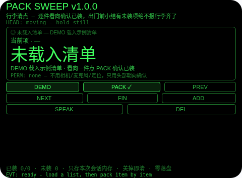
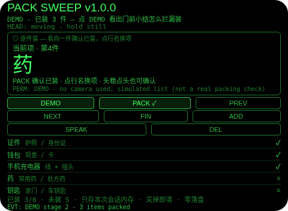
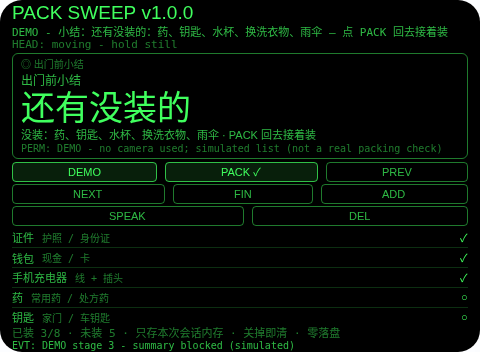
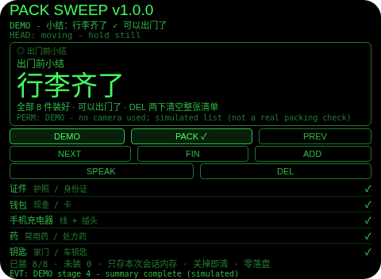

# Pack Sweep（行李清点）

**Studio 导入地址**（复制到 Global AIUI Studio 的 Import Project 输入框）：

```
https://github.com/sakai55/rokid/tree/agent-pack-sweep
```

注意力外挂系列 CO04（COVER 覆盖型，本组第四位）。出门收行李最典型的翻车：凭感觉装，到了目的地才发现证件、充电器、药没带。本 Agent 的做法：先有一张清单（示例 8 件，可加备选件），你看向一件行李、确认已装就勾一件；出门前点 FIN，有未装项时小结直接拒绝并且点名——还有没装的：药、钥匙、水杯……；全部装完，小结才报「行李齐了，可以出门了」。它不替你判断东西在不在包里（它看不见包里），它只替你证明「这张清单上的每一件，我都亲手确认过装了，而且漏的那几件没有被含糊掉」。

## 解决的问题

收行李难的不是列清单，是「无法证明装完了」：装到一半被打断、换个房间拿东西，回来就忘了刚才装到哪；更糟的是出门前凭感觉说一句「应该都装了」，漏的那件恰恰是最不能漏的（证件、药）。本 Agent 把「装完了」变成一张看得见的表：每件只有两种状态——未装、已装；出门前的小结有门：带窟窿的小结进不去，缺的件会被点名；只有全部已装，小结才放行。

## 注意力外挂设计（COVER 覆盖型）

- **覆盖表就是产品，出门小结是门**：清单（示例：证件、钱包、手机充电器、药、钥匙、水杯、换洗衣物、雨伞）是全部模型。看向一件点 PACK（或头稳点头、点中该行）确认已装；FIN 时只要还有未装项，小结直接被拒绝并点名缺失项；全部装完才报「行李齐了」。
- **浏览不等于装**：点中不是当前项的行只换焦点，不勾选。装必须是一次明确确认——在行李这件事上，「我看过清单」不等于「我装进包了」，两者绝不能混。
- **纠错便宜，清空两步**：DEL 点中已装项是取消勾选；点中未装项是从本次清单里删掉它；整张清单清空只能在小结页 DEL 两下完成（6 秒内第二下有效，其他动作取消），和 CO01–CO03 的破坏性操作纪律一致。
- **加项走备选池，演示不覆盖真清单**：ADD 从固定备选池（耳机、充电宝、纸巾、笔记本、墨镜）按顺序加一件，池子空了就明说不再加；加过自己的项后，DEMO 分段演示即退出（清单已不是示例），要重新演示需在小结页两下 DEL 清空。
- **装没装以你的确认为准（诚实边界，第一位）**：本平台没有物品识别，本 Agent 永远不假装扫一眼就知道包里有什么——「已装」的意思是你看了那件东西并确认装了。界面、朗读、README 都明说这一点。
- **只记本次会话，关掉即清（诚实边界，第二位）**：全部内容只存本次会话内存，关掉 Agent 即清——适用窗口就是正在收的这一次行李，零隐私残留；下次出门重新清点，正是正确用法。
- **为什么胸前设备做不了**：逐件确认要求「当前项」与你手头那件东西的对应（胸口设备不知道你正在装哪件）；出门小结必须进视线（低头看胸口设备等于又一次离场）；覆盖表要一眼看全（语音逐件报一遍清单等于重新占用注意力）。三条都只有头戴设备成立。

## 与邻近 Agent 的分工

- CO02 `room-sweep`：同一覆盖表模式用于房间安全项（通过/待处理）——查的是睡前房间，不是行李。
- HO03 `voice-list`：口头购物清单，到店逐项勾——说的是买东西，不是出门装箱；且它是语音输入，本 Agent 全程无语音。
- CO01 `last-glance`：离开时按朝向拍照存档、路上回放——存的是「离开时看到的东西」，不判断行李齐不齐。
- CO03 `proof-sweep`：逐行覆盖 + 跳行检测——行李没有行序可言，故本 Agent 没有跳行检测、没有覆盖率百分比，它的 verdict 是二元的：行李齐了，或点名缺失项。
- 本 Agent：只做出门前行李逐件清点 + 漏装点名拦截，三者都不重叠。

## 功能流程

1. **载入（DEMO）**：DEMO 载入 8 件示例清单（全程标注 DEMO）；已有自己加过项的清单时 DEMO 拒绝，绝不覆盖。
2. **逐件装（PACK）**：看向一件点 PACK（或头稳点头、点中该行）确认已装，焦点移到下一未装项；NEXT/PREV 换项；点中不是当前项的行只换焦点。
3. **加项（ADD）**：从备选池按顺序加一件（耳机、充电宝、纸巾、笔记本、墨镜），池空即停；加项后 DEMO 演示退出。
4. **漏装拦截（FIN）**：点 FIN 时有未装项 → 小结拒绝并点名缺失项，点 PACK 回去接着装；全部装完 → 小结「行李齐了，可以出门了」。
5. **清空（DEL 两下）**：小结页 DEL 两下清空整张清单（6 秒内有效，其他动作取消），重新开始。
6. **演示（DEMO）**：四段演示——清单载入（0/8）→ 已装 3 件 → 漏装小结（点名 5 件未装）→ 全部装完小结；小结页的 DEMO 第三段到第四段在小结屏内完成；第五下 DEMO 报演示完成。

## 手势映射

| 手势/按键 | 动作 |
|---|---|
| 点按（Enter） | 确认当前项已装（小结页：回去接着装） |
| 双击（Backspace） | 回到上一项 |
| 上滑（ArrowUp） | 下一项 |
| 下滑（ArrowDown） | 上一项 |
| 头稳 + 点头 | 确认当前项已装（仅逐件装页；其他状态下点头无效并说明原因） |
| 屏上按钮 | DEMO 演示 / PACK ✓ 确认已装 / PREV 上一项 / NEXT 下一项 / FIN 小结 / ADD 加一件 / SPEAK 朗读 / DEL 取消勾选、删项或两下清空 |

## 权限说明

- 不申请任何权限（app.json 的 `permissions` 为空数组，静态校验明确断言这一点）。
- 不申请 `CAMERA`（没有任何拍照环节）、不申请 `RECORD_AUDIO`（无口述环节，确认全靠点按、行名点选与点头）、不申请 `GEOLOCATION`（行李不需要定位）。

## 打包与预览命令

```bash
~/tools/bin/aix pack . -o ../dist/pack-sweep.aix
~/tools/bin/aix preview . --html-out artifacts/preview.html
```

本地预览截图管线见 `~/workspace/custom-skills/rokid-preview-screenshots/SKILL.md`（本地 Ink + puppeteer，480×352；本 Agent 的探针脚本在 `~/workspace/preview-tools/shot-pack.js`、`probe-pack.js`）。

## 真机测试信息表

| 项目 | 内容 |
|---|---|
| Studio 名称 | （导入后回填） |
| Version / Build | 1.0.0 / （导入后回填） |
| App Category | （导入后回填） |
| Intent Description | （导入后回填） |
| Agent ID | （导入后回填） |
| 状态 | 未导入（本地全流程完成，待 GO 在 Global Studio 导入 + 真机测试） |

## 预览截图






## 提审资料 (Review Submission)

### Feature Description

行李清点外挂：出门收行李凭感觉装，到了目的地才发现证件、充电器、药没带。本 Agent 把装箱变成一张看得见的覆盖表：示例清单 8 件（可加备选件），看向一件点 PACK 确认已装；出门前点 FIN，有未装项时小结拒绝并点名缺失项，全部装完才报「行李齐了」。装没装以你的确认为准（本平台无物品识别，绝不假装看得见包里）；全部数据只存本次会话内存，关掉即清。零权限：不用相机、麦克风、定位。

### Opening Message

**装完，才算装完。**

- DEMO 载入 8 件示例清单（证件、钱包、充电器、药、钥匙、水杯、换洗衣物、雨伞），ADD 从备选池加件
- 看向一件点 PACK（或头稳点头）确认已装，焦点移到下一未装项
- 点中不是当前项的行只换焦点——浏览不等于装
- 点 FIN：有未装项会被点名拒绝；全部装完才报「行李齐了，可以出门了」
- 小结页 DEL 两下清空整张清单，重新开始
- 诚实边界：Agent 没有物品识别，「已装」是你亲手确认的；数据只存本次会话，关掉即清

### Preview Media

- 图片：上述 4 张预览截图（未载入、演示已装 3 件、漏装小结、全装完小结）
- 视频：真机阶段补（需眼镜实拍）

### Change Log

**Build 1.0.0**
- Features added：示例清单载入（DEMO 四段演示）；逐件确认（PACK/点头/行名点选，浏览不勾选）；FIN 漏装点名拦截与全装完小结；ADD 备选池加项（池空即停，加项退出 DEMO）；DEL 取消勾选/删项/小结页两下清空；会话内存零落盘；头稳点头纪律（1.2 秒锁）。
- Improvements：无（首版）。
- Fixes：无（首版）。
