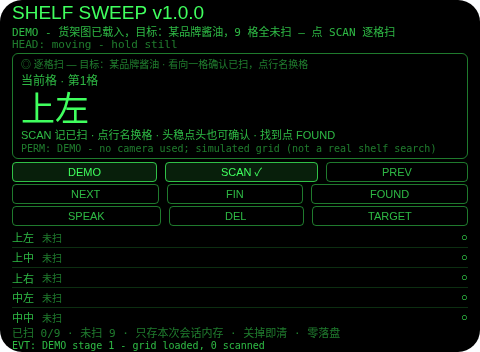
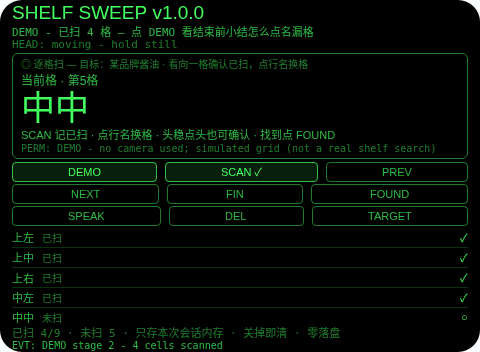
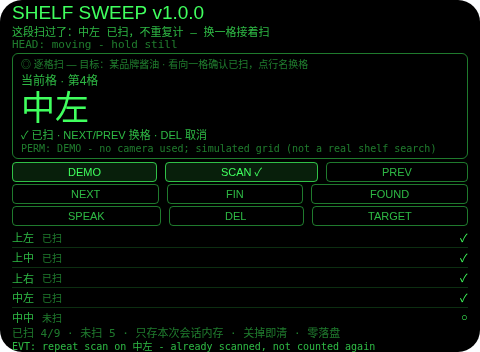
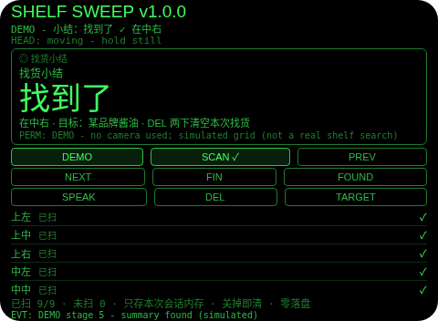
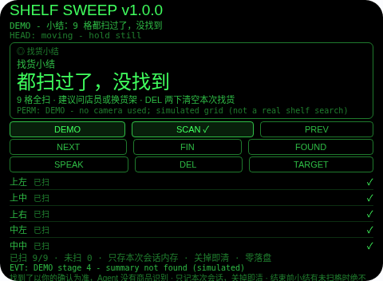

# Shelf Sweep（货架找货覆盖）

**Studio 导入地址**（复制到 Global AIUI Studio 的 Import Project 输入框）：

```
https://github.com/sakai55/rokid/tree/agent-shelf-sweep
```

注意力外挂系列 CO05（COVER 覆盖型，本组第五位）。在大货架找一样指定的东西最典型的翻车：同一排来回扫三遍，要找的明明在眼前却看不见，越找越乱。本 Agent 的做法：把货架变成一张看得见的覆盖图——3 层（上/中/下）× 3 段（左/中/右）共 9 格，你看向一格点 SCAN（或头稳点头、点中该行）记已扫；再扫已扫过的格，它会当场提醒「这段扫过了」且不重复计；结束前点 FIN，有未扫格时小结直接拒绝并且点名——还有没扫的：中中、中右、下左……；9 格全扫完还没找到，小结如实说「9 格都扫过了，没找到，建议问店员或换货架」；你自己看向目标物点 FOUND 确认，才报「找到了，在中右」。它不替你判断东西在不在货架上（它看不见货架上的商品），它只替你证明「这面货架的每一格，我都亲手扫过，而且漏的那几格没有被含糊掉」。

## 解决的问题

货架找货难的不是眼睛，是「无法证明都看过了」：扫到一半被打断、换个角度再看，回来就忘了刚才扫到哪；更糟的是同一格扫了三遍、另一格一次没扫，自己还以为全扫完了。本 Agent 把「都看过了」变成一张看得见的图：每格只有两种状态——未扫、已扫；结束前的小结有门：带窟窿的小结进不去，缺的格会被点名；只有 9 格全扫，小结才给 verdict——找到了（点名在哪格），或者没找到（建议问店员或换货架）。

## 注意力外挂设计（COVER 覆盖型）

- **覆盖图就是产品，结束小结是门**：货架图（9 格）是全部模型。看向一格点 SCAN（或头稳点头、点中该行）记已扫；FIN 时只要还有未扫格，小结直接被拒绝并点名未扫格；全部扫完才给 verdict。
- **浏览不等于扫**：点中不是当前格的行只换焦点，不记已扫。扫必须是一次明确确认——在货架这件事上，「我看过地图」不等于「我看过那段货架」，两者绝不能混。
- **重复扫会警告，绝不重复计**：再扫已扫过的格，当场提醒「这段扫过了」且计数不动。一张把同一格数两遍的图，比没有图更糟——它会认证根本没发生的覆盖。
- **找到了以你的确认为准（诚实边界，第一位）**：本平台没有商品识别，本 Agent 永远不假装扫一眼就知道东西在不在货架上——「找到了」的意思是你看了那件东西并在那格点了 FOUND。界面、朗读、README 都明说这一点。点头只表示「这格已扫」，FOUND（点按）才表示「找到了」，一个手势绝不身兼两义。
- **只记本次会话，关掉即清（诚实边界，第二位）**：全部内容只存本次会话内存，关掉 Agent 即清——适用窗口就是正在找的这次货架，零隐私残留；下个货架重新从空白图开始，正是正确用法。
- **没有货架地图，没有室内定位（诚实边界，第三位）**：格与格的关系只来自你环视时的顺序，Agent 不知道任何一格在店里的位置，也不画店内地图；「找到了，在中右」说的是覆盖图里的格，不是导航指令。
- **为什么胸前设备做不了**：逐格确认要求「当前格」与你眼前那段货架的对应（胸口设备不知道你正在看哪段）；覆盖图必须进视线（低头看胸口设备等于又一次离场）；结束小结要一眼看全（语音逐格报一遍等于重新占用注意力）。三条都只有头戴设备成立。

## 与邻近 Agent 的分工

- 指向性系列 `shelf-compare`：逐个看商品比价——比的是已经看得见的东西；本 Agent 不比价，只证明为找一样东西「每一格都看过了」。
- CO03 `proof-sweep`：同一覆盖表模式用于文档逐行 + 跳行检测——文档有行序，货架没有，故本 Agent 没有跳行检测、没有覆盖率百分比，它的 verdict 是三选一：被拦（点名未扫格）、找到了（点名格）、全扫完没找到。
- CO04 `pack-sweep`：同一模式用于行李（已装/未装 + 出门门）——本 Agent 是货架（已扫/未扫 + 结束门），并多出两样行李不需要的东西：重复扫警告和找到即停。
- CO01 `last-glance`：离开时按朝向拍照存档、路上回放——存的是「离开时看到的东西」，不判断货架扫没扫完。
- 本 Agent：只做大货架单目标找货的覆盖地图 + 漏格点名拦截 + 找到即停 + 全扫完未找到的如实小结，四者都不重叠。

## 功能流程

1. **定目标（TARGET / DEMO）**：TARGET 只在未开始时换示例目标（某品牌酱油 → 某本书 → 折叠雨伞 → 洗发水 → 回到酱油）；DEMO 载入当前目标的货架图（全程标注 DEMO）；已有自己扫过的图时 DEMO 拒绝，绝不覆盖。
2. **逐格扫（SCAN）**：看向一格点 SCAN（或头稳点头、点中该行）记已扫，焦点移到下一未扫格；NEXT/PREV 换格；点中不是当前格的行只换焦点。
3. **重复扫警告**：再扫已扫过的格，当场提醒「这段扫过了」，计数不动。
4. **纠错（DEL）**：点中已扫格按 DEL 取消已扫；点中未扫格会说明没什么可取消。
5. **找到即停（FOUND）**：看向目标物所在格，点 FOUND，显示「找到了，在中右」。
6. **结束拦截（FIN）**：点 FIN 时有未扫格 → 小结拒绝并点名未扫格，点 SCAN 回去接着扫；9 格全扫完 → 小结「9 格都扫过了，没找到，建议问店员或换货架」。
7. **清空（DEL 两下）**：小结页 DEL 两下清空本次找货（6 秒内有效，其他动作取消），重新开始。
8. **演示（DEMO）**：五段演示——货架图载入（0/9）→ 已扫 4 格 → 漏格小结（点名 5 格未扫）→ 全扫完未找到小结 → 找到小结（在中右）；第六下 DEMO 报演示完成。

## 手势映射

| 手势/按键 | 动作 |
|---|---|
| 点按（Enter） | 记当前格已扫（小结页：回去接着扫） |
| 双击（Backspace） | 回到上一格 |
| 上滑（ArrowUp） | 下一格 |
| 下滑（ArrowDown） | 上一格 |
| 头稳 + 点头 | 记当前格已扫（仅逐格扫页；其他状态下点头无效并说明原因；点头绝不表示「找到了」） |
| 屏上按钮 | DEMO 演示 / SCAN ✓ 记已扫 / PREV 上一格 / NEXT 下一格 / FIN 小结 / FOUND 找到了 / SPEAK 朗读 / DEL 取消已扫、两下清空 / TARGET 换示例目标 |

## 权限说明

- 不申请任何权限（app.json 的 `permissions` 为空数组，静态校验明确断言这一点）。
- 不申请 `CAMERA`（没有任何拍照环节）、不申请 `RECORD_AUDIO`（无口述环节，确认全靠点按、行名点选与点头）、不申请 `GEOLOCATION`（货架不需要定位）。

## 打包与预览命令

```bash
~/tools/bin/aix pack . -o ../dist/shelf-sweep.aix
~/tools/bin/aix preview . --html-out artifacts/preview.html
```

本地预览截图管线见 `~/workspace/custom-skills/rokid-preview-screenshots/SKILL.md`（本地 Ink + puppeteer，480×352；本 Agent 的探针脚本在 `~/workspace/preview-tools/shot-shelf.js`、`probe-shelf.js`）。

## 真机测试信息表

| 项目 | 内容 |
|---|---|
| Studio 名称 | （导入后回填） |
| Version / Build | 1.0.0 / （导入后回填） |
| App Category | （导入后回填） |
| Intent Description | （导入后回填） |
| Agent ID | （导入后回填） |
| 状态 | 未导入（本地全流程完成，待 GO 在 Global Studio 导入 + 真机测试） |

## 预览截图







## 提审资料 (Review Submission)

### Feature Description

货架找货覆盖外挂：在大货架找一样东西，同一排扫三遍、要找的在眼前都看不见。本 Agent 把货架变成一张看得见的覆盖图：3 层 × 3 段共 9 格，看向一格点 SCAN 记已扫；重复扫当场警告且不重复计；结束前点 FIN，有未扫格时小结拒绝并点名，9 格全扫完才给 verdict——找到了（点名在哪格）或没找到（建议问店员或换货架）。找到了以你的确认为准（本平台无商品识别，绝不假装看得见货架上的商品）；全部数据只存本次会话内存，关掉即清。零权限：不用相机、麦克风、定位。

### Opening Message

**扫过的格，才算扫过。**

- TARGET 换示例目标（酱油 → 书 → 雨伞 → 洗发水），DEMO 载入 9 格货架图
- 看向一格点 SCAN（或头稳点头）记已扫，焦点移到下一未扫格
- 点中不是当前格的行只换焦点——浏览不等于扫
- 再扫已扫过的格会警告「这段扫过了」，计数不动
- 看向目标物点 FOUND 即停，显示「找到了，在中右」
- 点 FIN：有未扫格会被点名拒绝；9 格全扫完没找到会如实说，建议问店员或换货架
- 小结页 DEL 两下清空本次找货，重新开始
- 诚实边界：Agent 没有商品识别，「找到了」是你亲手确认的；数据只存本次会话，关掉即清

### Preview Media

- 图片：上述 5 张预览截图（定目标、逐格扫、重复扫警告、找到小结、全扫完未找到小结）
- 视频：真机阶段补（需眼镜实拍）

### Change Log

**Build 1.0.0**
- Features added：9 格货架覆盖图（3 层 × 3 段）；逐格确认（SCAN/点头/行名点选，浏览不记扫）；重复扫警告（不重复计）；FIN 漏格点名拦截与全扫完 verdict；FOUND 找到即停（点名格）；TARGET 示例目标轮换；DEMO 五段演示；DEL 取消已扫/小结页两下清空；会话内存零落盘；头稳点头纪律（1.2 秒锁）。
- Improvements：无（首版）。
- Fixes：无（首版）。
