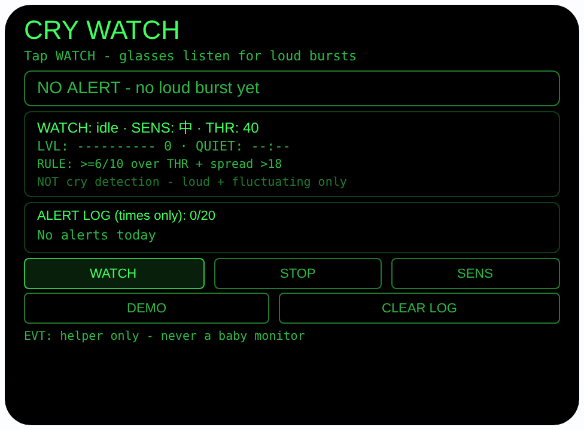
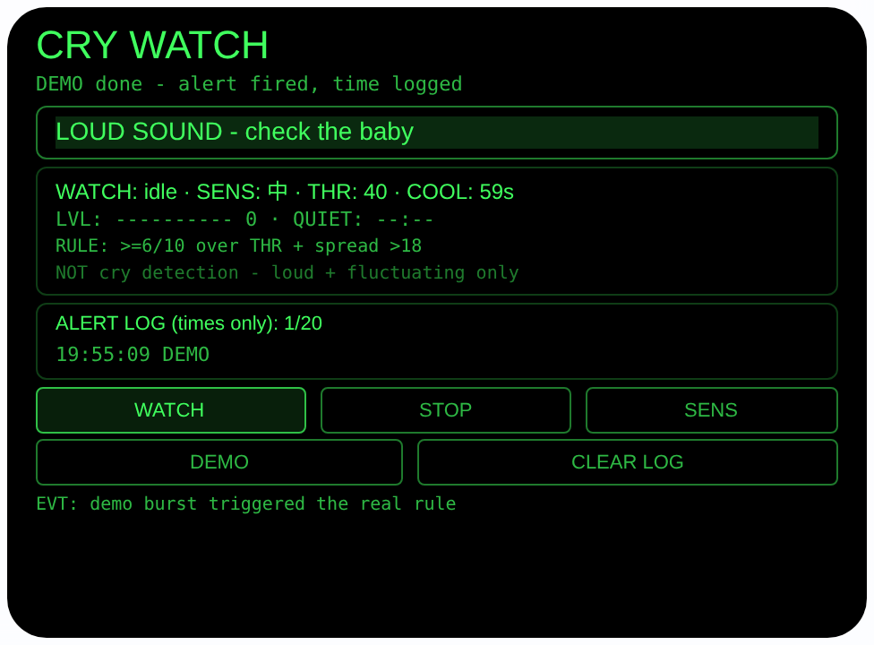

# cry-watch — 哭声守望（Rokid 眼镜 AIUI Agent）

**Studio 导入地址**（复制到 Global AIUI Studio 的 Import Project 输入框）：

```
https://github.com/sakai55/rokid/tree/agent-cry-watch
```


50 个「指向性生活问题」Agent 的第 Z18 个。宝宝在隔壁房间
睡着，你在厨房忙、戴着耳机，或者听力不太好 — 那边闹起来
了，你往往要过好一会儿才察觉。眼镜整天戴在头上，正好
替你听着：出现又响又起伏的声音模式时，报警直接亮在你
眼前，并出声提醒你去看看宝宝。

## 预览截图

截图统一存放于仓库根目录 `screenshots/cry-watch/`。





## 解决的问题

婴儿的动静最怕「没听见」：隔着一堵墙、在厨房抽油烟机
旁边、戴着耳机听东西，哭闹声被环境吃掉大半，等你听见
时已经哭了好一阵。手机放在兜里帮不上忙；正规婴儿监护
器又要专门摆摄像头和接收端。眼镜的麦克风就在你头上、
显示就在你眼前 — 它不需要把声音传多远，它只需要替你
「守着听」，并在该提醒时把提醒放到你不可能错过的地方：
你的视线正中央。

## 指向性设计（为什么必须用眼镜）

- **头戴守望（MIC4 全向模式）**：WATCH 用 `getUserMedia`
  的 `captureSource: 'microphone'` + `microphoneMode:
  'omnidirectional'` 开麦 — 4 麦阵列的全向模式均衡收
  各个方向的声音，不偏向佩戴者自己（你切菜、说话的声音
  不该比隔壁房间更占权重）；流接 Web Audio
  `AnalyserNode`（只接分析器不接输出，防啸叫），每
  200ms 算一次 RMS 电平。模式被设备拒绝
  （OverconstrainedError）时回退默认麦克风并如实提示。
- **眼前报警（HANDS-FREE 显示）**：触发时单色绿显示
  正中央亮起大字「LOUD SOUND - check the baby」并在
  冷却期内交替高亮 — 你在厨房、戴着耳机、听力不佳都
  不影响，报警是「看见」的，不是「听见」的；TTS
  「有较大的声音，去看看宝宝」只是第二通道。
- **安静计时一眼可知**：界面常驻电平条与「QUIET mm:ss」
  （自上次超过阈值的采样起的安静时长）。扫一眼就知道
  「已经安静了 12 分钟」，不用猜那边还在不在闹。

## 触发规则（全部写在界面上）

最近 10 个采样（2 秒）内：

1. 至少 6 个采样超过当前灵敏度阈值，**并且**
2. 这 10 个采样的最高 − 最低 > 0.18（起伏门槛）。

设计意图：持续很响但平稳的声音（电视、空调、抽油烟机）
过不了起伏门槛；一声关门响、东西落地过不了 6/10 计数。
偏向命中的是「一阵一阵、忽大忽小的大声响」— 哭闹声
常见的形态，但绝不是只有哭声才长这样（见下方诚实说明）。
灵敏度 SENS 三档轮换：低 0.55 / 中 0.40 / 高 0.25，
换档清空窗口重新计数。触发后 60 秒冷却，界面显示剩余
秒数，避免同一阵声响反复报警。

## 功能流程

1. 待机：显示灵敏度/阈值、触发规则、诚实说明行与今日
   报警日志（从本机存储载入，只含时间）
2. WATCH：点 WATCH（或 Enter）→ 查麦克风与 Web Audio，
   不可用 FAIL 写明 → 全向模式开麦，每 200ms 采样，
   电平条与安静计时实时更新
3. 报警：满足触发规则 → 大字高亮 + TTS 朗读 → 时间
   （HH:MM:SS）记入日志（wx 存储 `cryWatchLog`，只存
   日期/时间/是否 DEMO，最多 20 条）→ 进入 60 秒冷却
4. STOP 立即停麦；CLEAR LOG 清空日志；页面隐藏/卸载
   同样停麦、关 AudioContext、清定时器
5. DEMO：按真实 200ms 节奏喂合成电平（先安静、后爆发），
   由同一套规则点火，日志条目标注 DEMO — 无麦克风
   也能完整演示

> 诚实说明：本 Agent **检测的不是哭声**。AIUI 运行时没有
> 哭声分类器，它只认「又响又起伏的声音模式」：关门声、
> 东西掉地上、大人突然大声说话都可能触发；很轻的哼唧、
> 被墙挡闷了的哭声可能根本触发不了。它**不是婴儿监护
> 仪**，没有医疗或安全认证，不能成为把宝宝单独留下的
> 理由 — 它只是「也许那边有动静，去看一眼」的提醒助手，
> 报警响起请直接去看宝宝。戴着耳机时 TTS 可能听不清，
> 可靠通道是眼前的大字。

## 权限

| 权限 | 用途 |
|---|---|
| RECORD_AUDIO | WATCH 时开麦测响度：`getUserMedia` 全向模式 + `AnalyserNode` 实时算 RMS；只算电平数值，不录音、不保存、不上传。唯一持久化的是报警的日期与时间（本机 wx 存储） |

## 打包与预览

```bash
cd ~/workspace/rokid/cry-watch
~/tools/bin/aix pack . -o ../dist/cry-watch.aix
~/tools/bin/aix preview . --html-out artifacts/preview.html
```

本地预览截图走 `~/workspace/preview-tools/` 的本地 Ink + puppeteer 路线
（`shot-cry.js`；报警截图的点击序列为 canvas 内 DEMO (120, 252)
点 1 次后等约 7 秒待合成电平走完安静段与爆发段、报警点火：
注意 artifacts/preview.html 需先把 importmap 的 jspm 地址
换成本地 `/ink/index.js` 再复制到 preview-tools/www/）。

## 真机测试（海外版 · 云端下发 · Path 1）

1. 推到 GitHub 后，Global AIUI Studio（aiui-global.rokid.com，en-US）用
   分支导入：`https://github.com/sakai55/rokid/tree/agent-cry-watch`
   （该分支根目录即本 Agent 文件）
2. Studio 的 **Device Debug** 页签填 Basic Information，在 AIX Packaging
   点 **Repackage and Save**，确认顶部出现绿色
   **● Debug version ready — Ready for device debugging**
3. **Hi Rokid**（海外版 `com.rokid.sprite.global.aiapp`，不是国内版
   Rokid Ai App）→ 设置 → 开发者选项 → AIUI → 更新眼镜资源包，
   等「智能体资源包下载成功」
4. 对眼镜说「乐奇，打开 cry-watch」，点 WATCH（SENS 先用中档），
   戴着眼镜去厨房；请家人在隔壁房间用手机外放一段婴儿哭闹
   录音（不要真让宝宝哭给它测），看眼前是否亮起 LOUD SOUND、
   日志是否记下时间；再换成持续平稳的电视声放 1 分钟，
   确认不会误报；最后试一档高、一档低灵敏度对比触发距离

## 真机测试信息（Global AIUI Studio · Device Debug）

| 项目 | 值 |
|---|---|
| Agent Name（Studio） | 待导入后回填 |
| Version（Build） | 1.0.0（待导入后回填） |
| App Category | 待导入后回填 |
| Intent Description | 待导入后回填 |
| Agent ID | 待导入后回填 |
| AIX Package Size | 约 16.0 KB（本地打包 `dist/cry-watch.aix`，分次打包有 ±0.01 KB 级抖动） |
| 状态 | 本地完成，待导入 Studio |
| Studio | aiui-global.rokid.com（en-US） |
| 下发方式 | 云端下发 → Hi Rokid（海外版）更新眼镜资源包 |

## 验证情况

**已验证**

- 静态检查：app.json / package.json JSON 解析通过；`<script def>` JSON
  解析通过；`<script setup>` 与 app.js 提取后 `node --check` 语法通过；
  全目录 grep 无 `Page(` / `App(` / `Widget(` / `workers:` 残留；
  5 个 bindtap 处理函数（watchTap / stopTap / sensTap /
  demoTap / clearTap）全部有定义。
- 触发规则验算：把页面对象以 wx 打桩方式加载进 Node，用
  同一份 `_triggerFromSamples` 实测 — 安静窗口（10×0.06）
  不触发；持续平稳大声（10×0.82）因起伏为 0 不触发；
  起伏爆发序列在低/中/高三档阈值下都触发；单个关门响
  （1 个高采样）不触发；只有 9 个采样时不触发。
- 打包：`aix pack` 成功；`aix list` 核对包内含 README.md、AGENTS.md、
  app.js、app.json、package.json、pages/index/index.ink
  （artifacts/ 已被 .aixignore 排除）。
- 预览渲染：aix preview + 本地 Ink + puppeteer 截图两张（见
  Preview Media）：首页待机态完整渲染（规则行与「NOT cry
  detection」诚实说明常驻，日志为空）；点 DEMO 后合成
  电平走完安静段与爆发段，同一套规则点火：大字
  「LOUD SOUND - check the baby」高亮、冷却显示 59s、
  日志记入带 DEMO 标记的时间。预览主机无可用麦克风，
  WATCH 的 FAIL 路径为代码完备、未在此环境触发截图。

**未验证**

- 真机 4 麦 `omnidirectional` 模式是否被接受、电平动态
  范围与 RMS×3 标定在真实声压下是否合适；模式回退路径
  未在真机触发过。
- 真实婴儿哭声（隔墙、不同距离、不同月龄）对触发规则的
  实际命中率，以及电视/说话/家电声的实际误报率 — 这是
  本 Agent 最大的未知数，只能真机多场景实测后调阈值。
- 真机 TTS 报警在厨房噪声与戴耳机场景下能否听清（视觉
  大字为主要通道，见诚实说明）；wx 存储跨重启持久性。

---

## 提审资料（Review Submission）

> Global AIUI Studio → Submit 页签的 Review Information 逐项对应下面四段，
> 提交时整段复制。每次提交前重新确认 Preview Media。

### Feature Description

Cry Watch listens for the next room while the glasses are on your head. Tap WATCH and it samples room loudness every 200 ms in omnidirectional mic mode, looking for a loud, fluctuating burst pattern: at least 6 of the last 10 samples over the sensitivity threshold, with a wide level spread. A trigger lights a big LOUD SOUND alert, speaks a warning, and logs the time. It detects loudness patterns, not crying, and is not a baby monitor.

### Opening Message

Hi, I'm **Cry Watch** - I listen for loud bursts from the next room and put the alert in front of your eyes.

Tap **WATCH**, pick sensitivity with **SENS** (thresholds on screen), and I sample the room every 200 ms. A loud, fluctuating pattern - not steady noise, not one bang - lights **LOUD SOUND - check the baby**, speaks a warning and logs the time (times only, never audio). At most one alert a minute. No mic? **DEMO** fires a synthetic burst. I detect loudness, not crying - go and look.

### Preview Media

提交要求：3–5 个 JPG/PNG 图片或 MP4 视频，至少含 1 张图和 1 个视频，每次提交前重新确认。

- Image 1：`artifacts/preview-cry-watch-index.png`（aix preview 首页待机态：NO ALERT、阈值与触发规则、诚实说明行、空日志，本地文件，提交时从本地上传）
- Image 2：`artifacts/preview-cry-watch-alert.png`（DEMO 报警态：LOUD SOUND 大字高亮、冷却 59s、DEMO 时间入日志，本地文件）
- Video：待真机补 — 真机录制「厨房点 WATCH → 隔壁外放哭闹录音 → 眼前亮起 LOUD SOUND → 日志记时」全过程（MP4），录好后放 `artifacts/` 并更新此处
- 状态：未齐（已有 2 张图；还需至少 1 个视频，总数补到 3–5 个后才可提交）

### Change Log

#### Build 1.0.0

**Features added**

- Loud-burst watch: WATCH opens the microphone in omnidirectional mode (with a labeled fallback to the default microphone when the device rejects that mode), feeds a Web Audio AnalyserNode, and samples RMS level every 200 ms, with a live level bar and a "quiet for mm:ss" counter.
- A stated, testable trigger rule: at least 6 of the last 10 samples above the sensitivity threshold AND a max-min spread above 0.18 in the same window - so steady loud noise (TV, air conditioning) and single bangs (a door slam) are designed not to fire it. Three sensitivity levels (thresholds 0.55 / 0.40 / 0.25) are shown on screen.
- In-view alerting: a trigger lights a large LOUD SOUND - check the baby line (alternating highlight during the cooldown), speaks a Chinese warning by TTS, logs the alert time, and cools down for 60 seconds before it can fire again.
- Times-only log: alert dates and times persist on-device in wx storage (key cryWatchLog, max 20, today shown); no audio is ever recorded, stored or uploaded.
- DEMO synthetic stream: quiet samples followed by a fluctuating loud burst at the real 200 ms cadence, fired by the same trigger rule and logged with a DEMO tag, so the full flow runs with no microphone.

**Improvements**

- None (initial release).

**Fixes**

- None (initial release).
