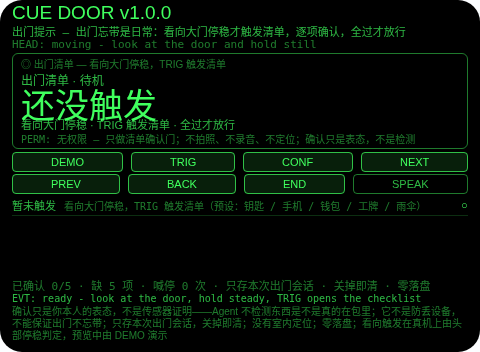
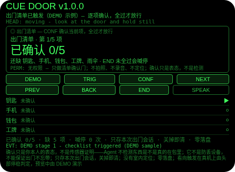
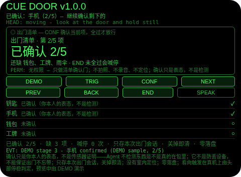
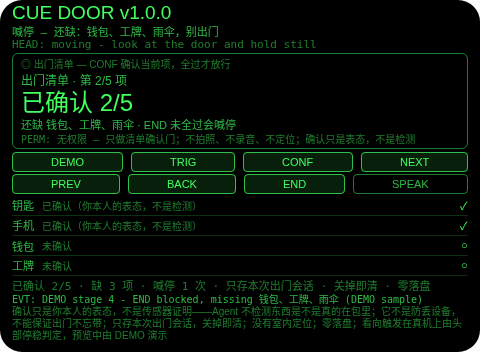
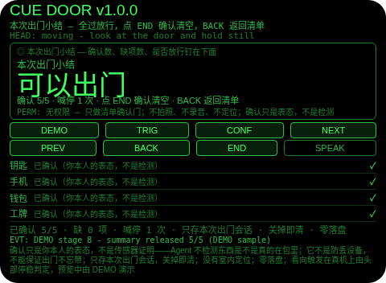

# Cue Door（出门提示）

**Studio 导入地址**（复制到 Global AIUI Studio 的 Import Project 输入框）：

```
https://github.com/sakai55/rokid/tree/agent-cue-door
```

注意力外挂系列 P01（CUE 提示型，本组第一个，系列第 31 个）。出门忘带东西是日常，清单贴门上都懒得看。本 Agent 把出门确认外包出去：看向大门停稳才触发清单——按你预设的出门清单（钥匙 / 手机 / 钱包 / 工牌 / 雨伞）逐项凝视确认，全过才放行「可以出门」；没全过就点结束，当场点名缺项并喊停，绝不报「可以出门」。

## 解决的问题

出门忘带不是没清单，是清单没人看——贴门上的纸走过就忘，手机里的备忘要翻出来才算数，翻的时候人已经出门了。本 Agent 管三件事：看向大门停稳才触发（不是一打开就弹，弹的时机就是你要出门的那一刻），逐项凝视确认（每项都要你本人点一下头、按一下确认，含糊不得），全过才放行（缺一项就点名喊停，不放你带着缺口出门）。

## 注意力外挂设计（CUE 提示型）

- **门是门，不是可划掉的提醒**：TRIG 只在待机态、且头部停稳时触发清单（真机上由头部停稳判定）；CONF 确认当前项；清单里的 END 就是门——缺项时喊停、计喊停次数、横幅与一次 TTS 点名缺项，并留在清单里，绝不报「可以出门」；5/5 的 END 才打开放行小结。
- **确认只是表态，不是检测**：Agent 没有相机、麦克风、定位，也没有任何清点传感器——它不检测东西是不是真的在包里。CONF 记录的是你本人说「带了」。UI 与本 README 如实写明这一点；它不是防丢设备，不能保证出门不忘带。
- **看向触发，不是一打开就弹**：清单只在你看向大门停稳后才出现——触发时机贴在出门动作本身上，而不是靠你记得打开它；预览中触发由 DEMO 演示，真机上由头部停稳判定。
- **纠错便宜，销毁需确认**：小结页返回键回到清单（不删东西，小结重建）；清单页返回键回到待机（确认保留，再触发恢复同一张清单）；确认（小结页点 END 或头稳点头）才清空本轮清单；没有 DEL 键。
- **只记本轮出门，关掉即清**：清单、确认、喊停次数、小结只存会话内存，关掉 Agent 即清——上一轮的确认对下一轮出门没有任何意义，存下来才是误导。
- **为什么胸前设备做不了**：触发的线索是「你正在看向大门」——胸前设备不知道你的视线朝向，也就分不出「要出门了」和「路过门口」；确认也必须贴在视线里一眼走完（低头翻手机等于又一次离场，确认到一半就断了）。两条都只有头戴设备成立。

## 与邻近 Agent 的分工

- 注意力系列 `pack-sweep`（C04）：在家装箱清点——出门前在家里逐项装箱计数。本 Agent 不是装箱：它的触发是看向大门本身，收尾是放行门，不是装箱计数。
- 注意力系列 `bag-watch`（D02）：在途行李副线——行李按朝向登记，坐等时定时提醒回看，离开门拦截。本 Agent 没有朝向登记、没有坐等守望：它的门是门口的出门清单，逐项确认。
- 注意力系列 `attention-diary`（R05）：注意力账单——触发按分类计数，收尾是一句「偷走最多」。本 Agent 没有分类、没有账单：它的单位是五件出门物品，收尾是放行 verdict。

## 功能流程

1. **触发（TRIG）**：看向大门停稳，TRIG 触发清单（待机时头不稳点 TRIG 会拒绝并说明先停稳）；清单打开在第 1 项，5 项全列在下面。
2. **逐项确认（CONF / NEXT / PREV）**：CONF 确认当前项（已确认过的再点会拒绝）；NEXT/PREV 走项，点行也可聚焦；大字显示已确认几项，小字钉住还缺哪几项。
3. **门（END）**：缺项时 END 喊停——横幅与一次 TTS 点名缺项，计喊停 1 次，留在清单里；全过时 END 打开放行小结。
4. **结束与小结（END）**：小结列出确认几项、喊停几次、是否放行；返回键回到清单（不删东西），小结页点 END 或头稳点头确认后清空本轮清单。
5. **演示（DEMO）**：八段演示——触发清单（0/5）→ 确认钥匙 → 确认手机 → END 喊停（缺钱包、工牌、雨伞）→ 确认钱包 → 确认工牌 → 确认雨伞（5/5，可以出门）→ 放行小结；已有用户确认或用户清单进行时 DEMO 拒绝，绝不覆盖。

## 手势映射

| 手势/按键 | 动作 |
|---|---|
| 点按（Enter） | 待机：触发清单（需头稳）；清单：确认当前项；小结页：确认并清空 |
| 双击（Backspace） | 小结页：回到清单；清单页：回到待机（确认保留）；待机页：无动作并说明 |
| 上滑（ArrowUp） | 清单/小结：下一项 |
| 下滑（ArrowDown） | 清单/小结：上一项 |
| 头稳 + 点头 | 待机：触发清单；清单：确认当前项；小结页：确认并清空；不稳的点头不计入 1.2 秒锁；点头从不切换焦点 |
| 屏上按钮 | DEMO 演示 / TRIG 触发清单 / CONF 确认当前项 / NEXT 下一项 / PREV 上一项 / BACK 返回 / END 门与小结（小结页点 END 即确认清空）/ SPEAK 朗读当前状态 |

## 权限说明

- 不申请任何权限（app.json 的 `permissions` 为 `[]`，静态校验明确断言这一点）：看向触发 + 清单确认门不需要相机、麦克风、定位。
- 不申请 `CAMERA`（没有任何拍照环节）、不申请 `RECORD_AUDIO`（没有任何收听环节：没有 ASR 路径，没有 onASRResult 处理）、不申请 `GEOLOCATION`（Agent 从不知道你在哪）。

## 打包与预览命令

```bash
~/tools/bin/aix pack . -o ../dist/cue-door.aix
~/tools/bin/aix preview . --html-out artifacts/preview.html
```

本地预览截图管线见 `~/workspace/custom-skills/rokid-preview-screenshots/SKILL.md`（本地 Ink + puppeteer，480×352；本 Agent 的探针脚本在 `~/workspace/preview-tools/shot-cue-door.js`，核定序列见该脚本头注；逐态探测：DEMO 带在 y=160–170，y=180–190 是 PREV（只变 EVT 行的假命中），首版截图务必逐张目视）。

## 真机测试信息表

| 项目 | 内容 |
|---|---|
| Studio 名称 | （导入后回填） |
| Version / Build | 1.0.0 / （导入后回填） |
| App Category | （导入后回填） |
| Intent Description | （导入后回填） |
| Agent ID | （导入后回填） |
| 状态 | 未导入（本地全流程完成，待 GO 在 Global Studio 导入 + 真机测试） |

## 预览截图







## 提审资料 (Review Submission)

### Feature Description

出门忘带东西是日常，清单贴门上都懒得看。本 Agent 把出门确认外包：看向大门停稳才触发清单，按预设的出门清单（钥匙 / 手机 / 钱包 / 工牌 / 雨伞）逐项凝视确认，全过才放行「可以出门」；没全过就点结束，当场点名缺项并喊停，绝不报「可以出门」。诚实边界：确认只是你本人的表态，不是传感器证明，Agent 不检测东西是不是真的在包里；它不是防丢设备，不能保证出门不忘带；只存本次出门会话，关掉即清；权限为空。

### Opening Message

**出门前，看一眼大门，清单自己弹出来——逐项确认，全过才放行。**

- 触发：看向大门停稳，TRIG 触发清单（头不稳会拒绝）
- 确认：CONF 确认当前项，NEXT/PREV 走项，点行也可聚焦
- 门：缺项时 END 喊停并点名缺项；全过时 END 打开放行小结
- 演示：DEMO 走八段——触发、确认钥匙手机、喊停、确认钱包工牌雨伞、放行小结
- 诚实边界：确认只是表态，不是检测；只存本次会话；权限为空

### Preview Media

- 预览图片 5 张（见上方「预览截图」节，本地 480×352 预览管线逐张目视核对）
- 预览视频：待真机录制后补齐（提审需 3–5 个文件，含至少 1 张图片 + 1 段 ≤60 秒视频）

### Change Log

#### Build 1.0.0

- Features added：看向大门停稳触发清单；逐项凝视确认（5 项预设）；未全过喊停门（点名缺项 + 一次 TTS + 计次）；放行小结（确认数、喊停数、是否放行）；八段 DEMO 演示
- Improvements：无（首个版本）
- Fixes：无（首个版本）
