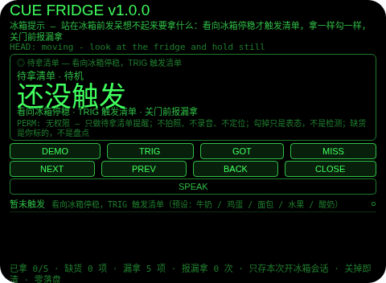
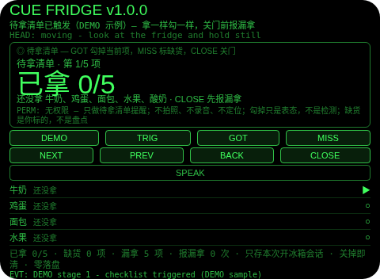
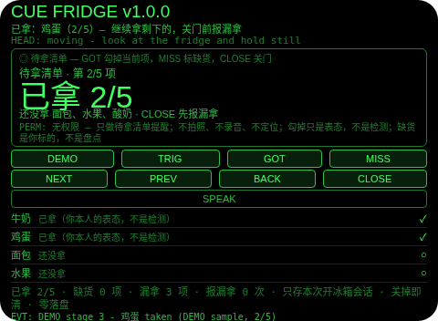
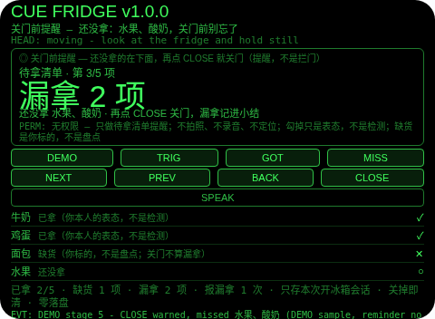
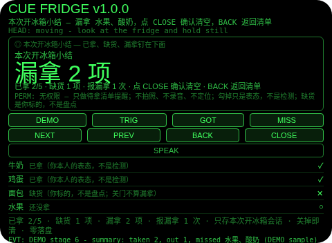

# Cue Fridge（冰箱提示）

**Studio 导入地址**（复制到 Global AIUI Studio 的 Import Project 输入框）：

```
https://github.com/sakai55/rokid/tree/agent-cue-fridge
```

注意力外挂系列 P02（CUE 提示型，本组第二个，系列第 32 个）。站在冰箱前发呆想不起来要拿什么，关上门才想起。本 Agent 把待拿确认外包出去：看向冰箱停稳才触发清单——按你预设的待拿清单（牛奶 / 鸡蛋 / 面包 / 水果 / 酸奶）拿一样勾一样，缺货标缺货（关门不算漏拿），关门前先报漏拿；报完仍可关门，漏拿照实记进小结。

## 解决的问题

站在冰箱前发呆不是没清单，是清单不在眼前——要拿什么全凭临场想起，想起一件拿一件，关上门才想起漏了一件。本 Agent 管三件事：看向冰箱停稳才触发（不是一打开就弹，弹的时机就是你站在冰箱前的那一刻），拿一样勾一样（每项都要你本人点一下，含糊不得），关门前报漏拿（点名还没拿的，报完仍可关门，漏拿不赖账、不拦门）。

## 注意力外挂设计（CUE 提示型）

- **关门前报漏拿是提醒，不是拦门**：TRIG 只在待机态、且头部停稳时触发清单（真机上由头部停稳判定）；GOT 勾掉当前项；MISS 标缺货/取消缺货（缺货项关门时不算漏拿）；清单里的 CLOSE 先报漏拿——横幅与一次 TTS 点名还没拿的项，计报漏拿 1 次，留在清单里；再点 CLOSE 才真正关门，漏拿照实记进小结。这一点和 cue-door 故意相反：冰箱门不能被一张清单劫持，假装拦门才是误导。
- **勾掉只是表态，缺货只是你标的**：Agent 没有相机、麦克风、定位，也没有任何清点传感器——它不检测东西是不是真的拿在手里，缺货也不是它盘点的。GOT 记录的是你本人说「拿了」，MISS 记录的是你本人说「没有」。UI 与本 README 如实写明这一点；它不是库存管理系统。
- **看向触发，不是一打开就弹**：清单只在你看向冰箱停稳后才出现——触发时机贴在拿东西的动作本身上，而不是靠你记得打开它；预览中触发由 DEMO 演示，真机上由头部停稳判定。
- **纠错便宜，销毁需确认**：小结页返回键回到清单（不删东西，小结重建）；清单页返回键回到待机（已拿/缺货保留，再触发恢复同一张清单）；确认（小结页点 CLOSE 或头稳点头）才清空本轮清单；没有 DEL 键。清单一变，报漏拿标记就清零——警告说的是某一刻的待拿集合，集合变了就该重新报，不能拿旧警告当新账。
- **只记本轮开冰箱，关掉即清**：清单、已拿、缺货、报漏拿次数、小结只存会话内存，关掉 Agent 即清——上一轮的勾选对下一轮拿东西没有任何意义，存下来才是误导。
- **为什么胸前设备做不了**：触发的线索是「你正在看向冰箱」——胸前设备不知道你的视线朝向，也就分不出「要拿东西了」和「路过厨房」；勾选也必须贴在视线里一眼走完（低头翻手机等于又一次离场，拿到一半就断了）。两条都只有头戴设备成立。

## 与邻近 Agent 的分工

- 注意力系列 `cue-door`（P01）：看向大门触发的出门清单凝视确认门——未全过不放行，缺项时 END 喊停并拦住。本 Agent 不是门：关门前报漏拿是提醒，报完仍可关门，漏拿记进小结。
- 注意力系列 `pack-sweep`（C04）：在家装箱清点——出门前在家里逐项装箱计数。本 Agent 不是装箱：它的触发是看向冰箱本身，收尾是漏拿报告，不是装箱计数。
- 注意力系列 `attention-diary`（R05）：注意力账单——触发按分类计数，收尾是一句「偷走最多」。本 Agent 没有分类、没有账单：它的单位是五件待拿物品，收尾是已拿/缺货/漏拿 verdict。

## 功能流程

1. **触发（TRIG）**：看向冰箱停稳，TRIG 触发清单（待机时头不稳点 TRIG 会拒绝并说明先停稳）；清单打开在第 1 项，5 项全列在下面。
2. **拿一样勾一样（GOT / MISS / NEXT / PREV）**：GOT 勾掉当前项（已拿过的再点会拒绝，已标缺货的先 MISS 取消缺货再勾）；MISS 标缺货/取消缺货（已拿的不能标缺货）；NEXT/PREV 走项，点行也可聚焦；大字显示已拿几项，小字钉住还没拿哪几项。
3. **关门前报漏拿（CLOSE）**：有待拿未勾项时第一次 CLOSE 报漏拿——横幅与一次 TTS 点名还没拿的项，计报漏拿 1 次，留在清单里；再点 CLOSE 才真正关门，漏拿照实记进小结；全勾完关门直接出「都拿齐了」小结。
4. **结束与小结（CLOSE）**：小结列出已拿几项、缺货几项、漏拿几项（点名）、报漏拿几次；返回键回到清单（不删东西），小结页点 CLOSE 或头稳点头确认后清空本轮清单。
5. **演示（DEMO）**：六段演示——触发清单（0/5）→ 勾掉牛奶 → 勾掉鸡蛋 → 面包标缺货 → CLOSE 报漏拿（缺水果、酸奶）→ 再点 CLOSE 出小结（已拿 2 / 缺货 1 / 漏拿 2）；已有用户勾选或用户清单进行时 DEMO 拒绝，绝不覆盖。

## 手势映射

| 手势/按键 | 动作 |
|---|---|
| 点按（Enter） | 待机：触发清单（需头稳）；清单：勾掉当前项；小结页：确认并清空 |
| 双击（Backspace） | 小结页：回到清单；清单页：回到待机（已拿/缺货保留）；待机页：无动作并说明 |
| 上滑（ArrowUp） | 清单/小结：下一项 |
| 下滑（ArrowDown） | 清单/小结：上一项 |
| 头稳 + 点头 | 待机：触发清单；清单：勾掉当前项；小结页：确认并清空；不稳的点头不计入 1.2 秒锁；点头从不切换焦点 |
| 屏上按钮 | DEMO 演示 / TRIG 触发清单 / GOT 勾掉当前项 / MISS 标缺货 / NEXT 下一项 / PREV 上一项 / BACK 返回 / CLOSE 关门前报漏拿与小结（小结页点 CLOSE 即确认清空）/ SPEAK 朗读当前状态 |

## 权限说明

- 不申请任何权限（app.json 的 `permissions` 为 `[]`，静态校验明确断言这一点）：看向触发 + 清单提醒不需要相机、麦克风、定位。
- 不申请 `CAMERA`（没有任何拍照环节）、不申请 `RECORD_AUDIO`（没有任何收听环节：没有 ASR 路径，没有 onASRResult 处理）、不申请 `GEOLOCATION`（Agent 从不知道你在哪）。

## 打包与预览命令

```bash
~/tools/bin/aix pack . -o ../dist/cue-fridge.aix
~/tools/bin/aix preview . --html-out artifacts/preview.html
```

本地预览截图管线见 `~/workspace/custom-skills/rokid-preview-screenshots/SKILL.md`（本地 Ink + puppeteer，480×352；本 Agent 的探针脚本在 `~/workspace/preview-tools/shot-cue-fridge.js`，核定序列见该脚本头注；逐态探测：DEMO 带在 y=180–190，y=185 配 1200 ms 等待会在首段后打空——核定序列用 y=180 配 2000 ms 等待，首版截图务必逐张目视）。

## 真机测试信息表

| 项目 | 内容 |
|---|---|
| Studio 名称 | （导入后回填） |
| Version / Build | 1.0.0 / （导入后回填） |
| App Category | （导入后回填） |
| Intent Description | （导入后回填） |
| Agent ID | （导入后回填） |
| 状态 | 未导入（本地全流程完成，待 GO 在 Global Studio 导入 + 真机测试） |

## 预览截图







## 提审资料 (Review Submission)

### Feature Description

站在冰箱前发呆想不起来要拿什么，关上门才想起。本 Agent 把待拿确认外包：看向冰箱停稳才触发清单，按预设的待拿清单（牛奶 / 鸡蛋 / 面包 / 水果 / 酸奶）拿一样勾一样，缺货标缺货（关门不算漏拿），关门前先报漏拿；报完仍可关门，漏拿照实记进小结。诚实边界：勾掉只是你本人的表态，不是传感器证明；缺货是你标的，不是 Agent 盘点的；它不是库存管理系统；只存本次开冰箱会话，关掉即清；权限为空。

### Opening Message

**站在冰箱前，看一眼，待拿清单自己弹出来——拿一样勾一样，关门前报漏拿。**

- 触发：看向冰箱停稳，TRIG 触发清单（头不稳会拒绝）
- 勾选：GOT 勾掉当前项，MISS 标缺货，NEXT/PREV 走项，点行也可聚焦
- 关门：有待拿项时第一次 CLOSE 报漏拿并点名；再点 CLOSE 关门，漏拿记进小结；全勾完直接出「都拿齐了」
- 演示：DEMO 走六段——触发、勾掉牛奶鸡蛋、面包标缺货、报漏拿、关门小结
- 诚实边界：勾掉只是表态，缺货只是你标的；只存本次会话；权限为空

### Preview Media

- 预览图片 5 张（见上方「预览截图」节，本地 480×352 预览管线逐张目视核对）
- 预览视频：待真机录制后补齐（提审需 3–5 个文件，含至少 1 张图片 + 1 段 ≤60 秒视频）

### Change Log

#### Build 1.0.0

- Features added：看向冰箱停稳触发清单；拿一样勾一样（5 项预设）；缺货标记（关门不算漏拿）；关门前报漏拿（点名 + 一次 TTS + 计次，提醒不是拦门）；小结（已拿/缺货/漏拿/报漏拿次数）；六段 DEMO 演示
- Improvements：无（首个版本）
- Fixes：无（首个版本）
