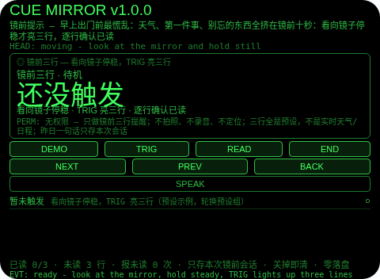
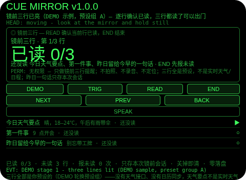
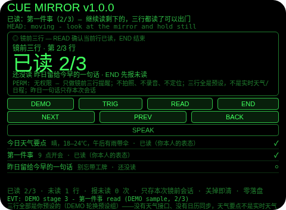
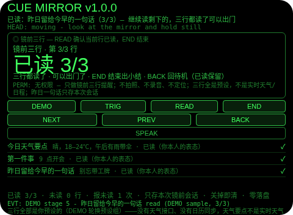
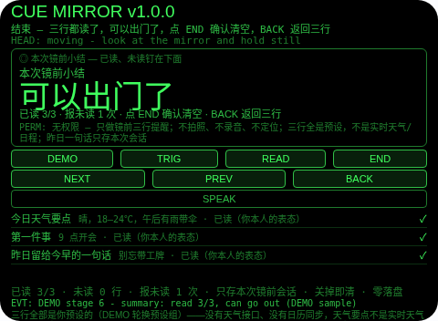

# Cue Mirror（镜前提示）

**Studio 导入地址**（复制到 Global AIUI Studio 的 Import Project 输入框）：

```
https://github.com/sakai55/rokid/tree/agent-cue-mirror
```

注意力外挂系列 P05（CUE 提示型，本组收官，系列第 35 个）。早上出门前最慌乱：天气、第一件事、别忘的东西全挤在镜前十秒。本 Agent 把镜前确认外包出去：看向镜子停稳才亮三行——今日天气要点、第一件事、昨日留给今早的一句话——逐行确认已读，三行都读了说「可以出门了」，提前结束当场点名未读行（提醒，不是拦门），小结照实记已读/未读。

## 解决的问题

镜前十秒不是没时间，是三件事挤在一起没个顺序：天气要不要带伞、第一件事是几点、昨天睡前想着今早要带的东西——全凭临场想起，走到门口才发现工牌没带。本 Agent 管五件事：看向镜子停稳才亮三行（不是一打开就弹，弹的时机就是你站在镜子前的那一刻），三行一眼走完（天气要点、第一件事、昨日一句话各一行，不翻页），逐行确认已读（每行都要你本人点一下，含糊不得），提前结束报未读（点名还没读哪几行，镜前 glance 不拦门，报完仍可结束），小结钉住已读/未读（走出门也知道刚才哪行没读）。

## 注意力外挂设计（CUE 提示型）

- **提前结束报未读，提醒不是拦门**：TRIG 只在待机态、且头部停稳时亮三行（真机上由头部停稳判定）；READ 确认当前行已读；清单里的 END 是结束——第一次 END 有未读行时横幅与一次 TTS 点名未读行，计报未读 1 次，留在清单里；再点 END 才真正结束，小结照实记未读。这一点与 cue-door 故意相反：镜前 glance 是提醒，不是门，假装拦住你才是误导。
- **三行全部是你预设的**：没有天气接口、没有日历同步——天气要点不是实时天气，第一件事不是日程读取。PLAN 原文的「预设/语音登记」按「预设」分支实现，不做语音登记（语音登记需 ASR 路径，本任务不引入）。三行按预设组轮换：每次全新触发换到下一预设组（A 组：晴 18–24℃午后有雨带伞 / 9 点开会 / 别忘带工牌；B 组：阴 12–16℃早晚凉加外套 / 10 点见客户 / 记得带伞）；清单页返回待机再触发恢复同一组，不轮换。
- **昨日一句话只存本次会话**：「昨日留给今早的一句话」按单会话实现——留言只存在于本次打开的会话内，关掉即清。想昨天留、今天看，需要跨日留存，由 GO 另行决定是否破例（与 R01 day-lookback、R04 route-replay 同款处理）；本 Agent 不擅自调用任何存储 API。
- **看向镜子不是镜面识别**：触发只是看向你登记的镜子方向停稳——Agent 没有镜面识别，也不知道镜子在哪；它只在你头部停稳的那一刻亮三行。预览中触发由 DEMO 演示，真机上由头部停稳判定。
- **确认已读只是表态**：Agent 没有任何已读传感器——READ 记录的是你本人说「读了」。UI 与本 README 如实写明这一点。
- **纠错便宜，销毁需确认**：小结页返回键回到三行（不删东西，小结重建）；清单页返回键回到待机（已读保留，再触发恢复同一组三行）；确认（小结页点 END 或头稳点头）才清空本轮三行；没有 DEL 键。
- **只记本轮镜前，关掉即清**：三行、已读、报未读次数、小结只存会话内存，关掉 Agent 即清——上一轮的已读对下一轮镜前没有任何意义，存下来才是误导。
- **为什么胸前设备做不了**：触发的线索是「你正站在镜子前看向镜子」——胸前设备不知道你的视线朝向，也就分不出「站在镜前要出门」和「路过镜子」；三行确认也必须贴在视线里一眼走完（低头翻手机等于又一次离场，刚回来就断了）。两条都只有头戴设备成立。

## 与邻近 Agent 的分工

- 注意力系列 `cue-door`（P01）：看向大门触发的出门清单凝视确认门——未全过不放行，缺项时 END 喊停并拦住。本 Agent 不是门：提前结束只报未读并记录，从不拦你结束。
- 注意力系列 `cue-desk`（P03）：看向书桌亮今日三件事 + 起身时按未完成项给续接句。本 Agent 不是书桌续接：它的触发是看向镜子，三行是天气要点 + 第一件事 + 昨日一句话，收尾是已读/未读小结，没有起身续接句。
- 注意力系列 `cue-fridge`（P02）：看向冰箱触发的待拿清单 + 缺货标记 + 关门前报漏拿（提醒不是拦门）。本 Agent 与它同形不同事：触发是看向镜子，收尾是三行已读 verdict，不是漏拿报告。
- 注意力系列 `attention-diary`（R05）：注意力账单——触发按分类计数，收尾是一句「偷走最多」。本 Agent 没有分类、没有账单：它的单位是镜前三行，收尾是已读 verdict。
- 注意力系列 `day-lookback`（R01）：全天凝视登记时间线。本 Agent 不是时间线：它只亮出门前镜前三行，不登记全天凝视。

## 功能流程

1. **触发（TRIG）**：看向镜子停稳，TRIG 亮三行（待机时头不稳点 TRIG 会拒绝并说明先停稳）；三行打开在第 1 行，3 行全列在下面（每行带预设内容：天气要点 / 第一件事 / 昨日一句话）。
2. **逐行确认已读（READ / NEXT / PREV）**：READ 确认当前行已读（已读过的再点会拒绝）；NEXT/PREV 走行，点行也可聚焦；大字显示已读几行，小字钉住还没读哪几行。
3. **提前结束报未读（END）**：第一次 END 有未读行时横幅与一次 TTS 点名未读行，计报未读 1 次，留在清单里；再点 END 才真正结束，小结照实记未读；三行都读了 END 直接出「可以出门了」小结，不出声。
4. **结束与小结（END）**：小结列出已读几行、未读是哪几行、报未读几次；返回键回到三行（不删东西），小结页点 END 或头稳点头确认后清空本轮三行；下一次全新触发轮换到下一预设组。
5. **演示（DEMO）**：六段演示——亮三行（0/3）→ 读天气要点 → 读第一件事 → END 报未读（昨日一句话）→ 读昨日一句话（3/3）→ END 出小结（已读 3/3，可以出门了）；已有用户已读或用户三行进行时 DEMO 拒绝，绝不覆盖。

## 手势映射

| 手势/按键 | 动作 |
|---|---|
| 点按（Enter） | 待机：亮三行（需头稳）；清单：确认当前行已读；小结页：确认并清空 |
| 双击（Backspace） | 小结页：回到三行；清单页：回到待机（已读保留）；待机页：无动作并说明 |
| 上滑（ArrowUp） | 清单/小结：下一行 |
| 下滑（ArrowDown） | 清单/小结：上一行 |
| 头稳 + 点头 | 待机：亮三行；清单：确认当前行已读；小结页：确认并清空；不稳的点头不计入 1.2 秒锁；点头从不切换焦点 |
| 屏上按钮 | DEMO 演示 / TRIG 亮三行 / READ 确认当前行已读 / END 结束（第一次报未读、第二次出小结；小结页点 END 即确认清空）/ NEXT 下一行 / PREV 上一行 / BACK 返回 / SPEAK 朗读当前状态 |

## 权限说明

- 不申请任何权限（app.json 的 `permissions` 为 `[]`，静态校验明确断言这一点）：看向触发 + 镜前三行提醒不需要相机、麦克风、定位。
- 不申请 `CAMERA`（没有任何拍照环节）、不申请 `RECORD_AUDIO`（没有任何收听环节：没有 ASR 路径，没有 onASRResult 处理——语音登记不在本任务内）、不申请 `GEOLOCATION`（Agent 从不知道你在哪）。

## 打包与预览命令

```bash
~/tools/bin/aix pack . -o ../dist/cue-mirror.aix
~/tools/bin/aix preview . --html-out artifacts/preview.html
```

本地预览截图管线见 `~/workspace/custom-skills/rokid-preview-screenshots/SKILL.md`（本地 Ink + puppeteer，480×352；本 Agent 的探针脚本在 `~/workspace/preview-tools/shot-cuemirror.js`，核定序列见该脚本头注，逐态探测、逐张目视）。

## 真机测试信息表

| 项目 | 内容 |
|---|---|
| Studio 名称 | （导入后回填） |
| Version / Build | 1.0.0 / （导入后回填） |
| App Category | （导入后回填） |
| Intent Description | （导入后回填） |
| Agent ID | （导入后回填） |
| 状态 | 未导入（本地全流程完成，待 GO 在 Global Studio 导入 + 真机测试） |

## 预览截图







## 提审资料 (Review Submission)

### Feature Description

早上出门前最慌乱：天气、第一件事、别忘的东西全挤在镜前十秒。本 Agent 把镜前确认外包：看向镜子停稳才亮三行（今日天气要点、第一件事、昨日留给今早的一句话），逐行确认已读，三行都读了说「可以出门了」，提前结束当场点名未读行（提醒，不是拦门），小结照实记已读/未读。诚实边界：三行全是预设，不是实时天气/日程；昨日一句话只存本次会话；看向镜子不是镜面识别；确认已读只是表态；只存本次镜前会话，关掉即清；权限为空。

### Opening Message

**出门前站在镜子前，三行自己亮出来——天气要点、第一件事、昨日留给你的一句话，逐行确认已读，三行都读了再出门。**

- 触发：看向镜子停稳，TRIG 亮三行（头不稳会拒绝）
- 确认：READ 确认当前行已读，NEXT/PREV 走行，点行也可聚焦
- 结束：第一次 END 报未读并计次，第二次出小结；三行都读了直接出「可以出门了」
- 演示：DEMO 走六段——亮三行、读天气要点、读第一件事、报未读、读昨日一句话、结束小结
- 诚实边界：三行全是预设，昨日一句话只存本次会话；权限为空

### Preview Media

- 预览图片 5 张（见上方「预览截图」节，本地 480×352 预览管线逐张目视核对）
- 预览视频：待真机录制后补齐（提审需 3–5 个文件，含至少 1 张图片 + 1 段 ≤60 秒视频）

### Change Log

#### Build 1.0.0

- Features added：看向镜子停稳亮三行（天气要点 / 第一件事 / 昨日一句话，预设组轮换）；逐行确认已读（3 行预设）；提前结束报未读（点名未读行 + 一次 TTS + 计次，提醒不是拦门）；三行都读了「可以出门了」小结；小结（已读/未读/报未读次数）；六段 DEMO 演示
- Improvements：无（首个版本）
- Fixes：无（首个版本）
