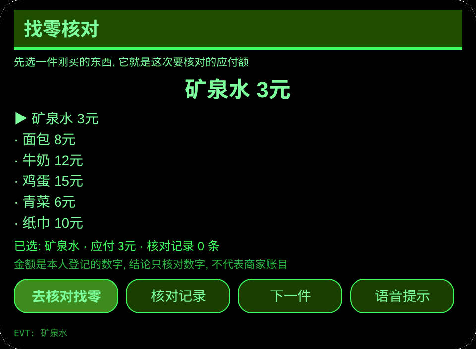
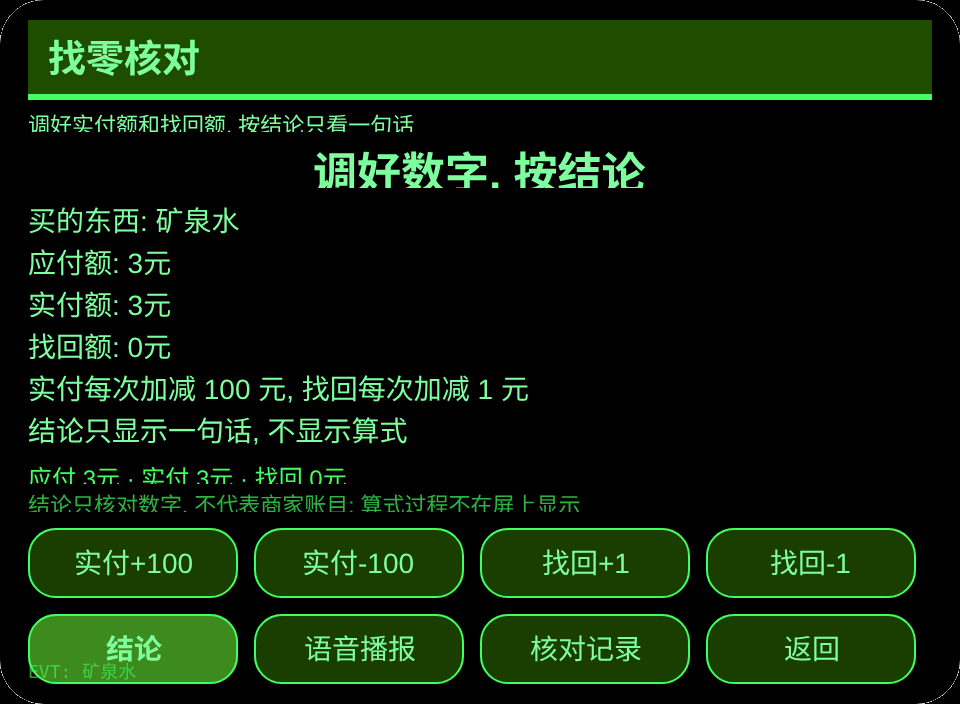
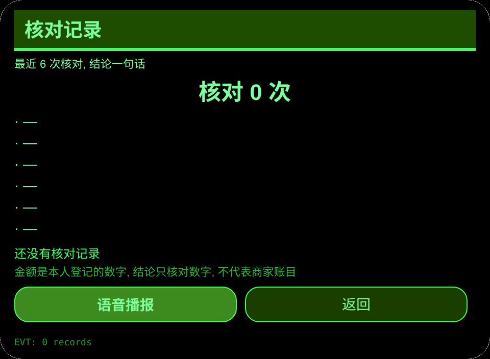
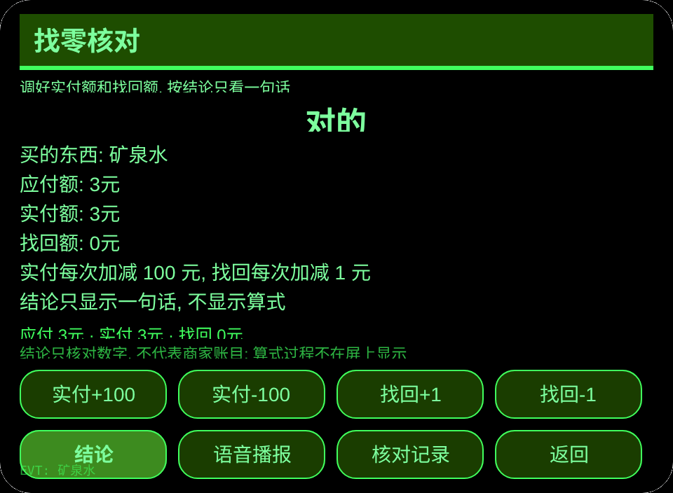

# 找零核对

**Studio 导入地址**（复制到 Global AIUI Studio 的 Import Project 输入框）：

```
https://github.com/sakai55/rokid/tree/agent-change-check
```

**AIX 直接下载**（最新版）：[change-check.aix](https://raw.githubusercontent.com/sakai55/rokid/main/aix/change-check.aix)

编号 CC19，方向构成：路缘坡。一句话场景：算不清找零的人付款后只看一句结论「对的」或「少了 X 元」，当场核对不吃亏。

## 预览截图






## 方向构成

- 本 Agent 的方向构成：路缘坡。场景核心是算不清找零的人在付款当场不吃亏，购物清单选应付额、找零核对只给一句结论、核对记录三环都服务于这一环，不是功能拼盘。
- 一句话场景：算不清找零的人付款后只看一句结论「对的」或「少了 X 元」，当场核对不吃亏。

## 结构与功能

3 页：`pages/index/` 购物清单（6 件：矿泉水 3 元、面包 8 元、牛奶 12 元、鸡蛋 15 元、青菜 6 元、纸巾 10 元，选中一件即成为当前应付额）；`pages/check/` 找零核对（显示当前应付额；实付额用 +/−100 元按钮调，默认等于应付额；找回额用 +/−1 元按钮调，默认 0；按「结论」内部比较后只显示一句话「对的」或「少了 X 元」/「多了 X 元」，同时语音播报该句，屏上不显示算式步骤；结论一出即保存一条记录）；`pages/record/` 核对记录（最近 6 条 + 累计总数）。

内容集的数：购物 6 件，应付额 6 个；核对记录按实际条数计。闭环：选一件商品 → 调实付额与找回额 → 按结论只看一句话 → 记录自动保存，下次付款可反复用。跨会话持久化：存储键 `changeCheckV1`（选中商品、核对记录数组、`lastError`）。

## 手势映射

| 手势（镜腿触控板） | 按键事件 | 本 Agent 中的作用 |
|---|---|---|
| 单指点按 | Enter | 主确认（各页主按钮：核对页为「结论」） |
| 上滑/下滑 | ArrowUp / ArrowDown | 切换商品 |
| 点头（头部静止时） | `onHeadGesture('nod')` | 主确认，与 Enter 等价 |
| 双指点按 | Backspace | 返回上一页（子页） |

## 权限

无。TTS 用宿主固定音色，永不设置 utterance 的 `lang`；不调用相机与定位。

## 诚实边界

- **金额是本人登记/输入的，结论只核对数字，不代表商家账目。** 屏上结论只回答找回的钱对不对，不证明商家收银无误。
- 结论只显示一句话，不显示算式步骤；算不清的人不需要再算一遍。
- 本 Agent 是生活辅助，不作财务与消费建议。

## 错误码

失败时在镜片画面显示裸码，TTS 只读码本身，最近一次错误写入持久数据的 `lastError`（含码、本机 slug、版本、原文）。本机可能出现的码：

- `E5001` 记录保存失败（存储写入异常）
- `E5002` 记录读取失败（读取/解析异常）
- `E3005` 朗读失败（TTS speak 异常）
- `E8001` 页面跳转失败（navigateTo/navigateBack 异常）

## 设备测试信息

| 项目 | 内容 |
|---|---|
| Studio 名称 | 未填写 |
| Version | 1.0.0 |
| App Category | 未填写 |
| Intent Description | 未填写 |
| Agent ID | 未填写 |
| 状态 | 未导入 / 未真机验证 |

## 提审资料 (Review Submission)

- Feature Description: 找零核对：算不清找零的人的付款帮手。6 件购物选应付额，实付额与找回额用大步长按钮调好，按结论只看一句话「对的」或「少了 X 元」，当场核对不吃亏，记录跨会话保存。
- Opening Message: 付款后别急着走。选一件商品、调好实付和找回，按一下结论，只看一句话就知道找零对不对。
- Preview Media: 预览截图见上（截图在开发流程后补齐，正式提审需 3–5 个媒体文件，其中视频 ≥1 个、≤60 秒）。
- Change Log (Build 1.0.0):
  - Features added: 初版；6 件购物清单、找零核对一句结论、核对记录最近 6 条与总数、跨会话持久化。
  - Improvements: 无（初版）。
  - Fixes: 无（初版）。
