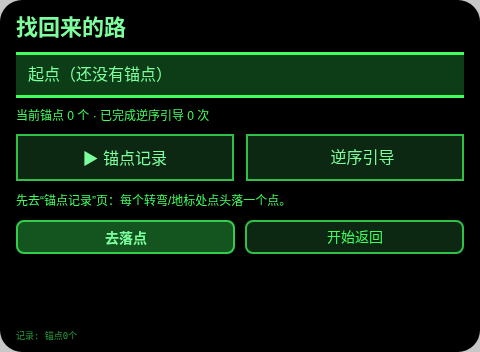
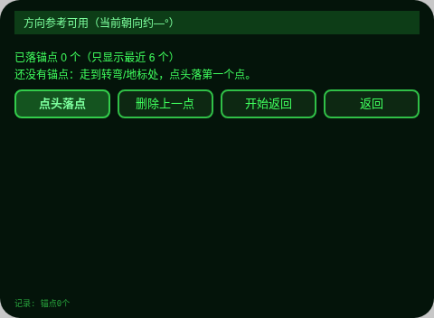
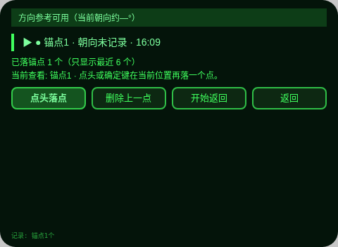
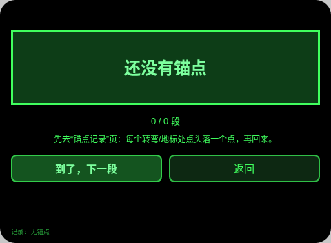
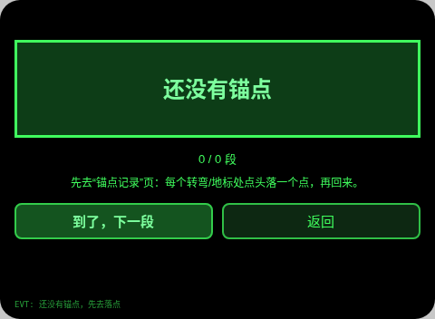

# 找回来的路 Retrace Steps

**Studio 导入地址**（复制到 Global AIUI Studio 的 Import Project 输入框）：

```
https://github.com/sakai55/rokid/tree/agent-retrace-steps
```

**AIX 直接下载**（最新版）：[retrace-steps.aix](https://raw.githubusercontent.com/sakai55/rokid/main/aix/retrace-steps.aix)

一句话场景：失智/认知障碍者在小区、商场、医院走着走着忘了来路，用自身轨迹逆序返回，不读地图。

## 方向构成

- 路缘坡（PLAN CC12 原案）：失智/认知障碍者先行——不读地图、不认路牌，只靠自己走过的轨迹逆序返回；障碍不为大众收益稀释。
- 厚度来源：多步流程（落点→逆序→逐段确认→完成记录）＋跨会话持久化（轨迹锚点与引导记录）。

## 预览截图







## 结构与功能

3 页：

- `pages/index/` 轨迹总览：横向面包屑带（起点→锚点→现在）、当前锚点数与已完成引导次数，两子页选择列（onShow 时选中项复位为第 1 项：Enter 打开锚点页，按一次 ArrowDown 再 Enter 打开引导页）。
- `pages/anchors/` 锚点记录：点头落点（记录顺序号、相对朝向 yaw、时刻），列表显示最近 6 个，可删除上一点。
- `pages/guide/` 逆序引导：一次只给一段大字（回到锚点 N＋落点时朝向），走到锚点点头确认再给下一段，最后一段确认后播报完成并写入引导记录。

内容集计数：锚点为用户落点生成、无固定条目（列表显示最近 6 个）；引导段数 = 锚点数，逐段可数。跨会话持久化：存储键 `retraceStepsV1`（锚点数组 `anchors`、引导记录数组 `guides`）。

## 手势映射

| 位置 | 镜腿/按键 | 动作 |
| --- | --- | --- |
| 总览 | ArrowUp/ArrowDown | 上/下一子页 |
| 总览 | Enter / 点头 | 打开选中子页 |
| 锚点 | ArrowUp/ArrowDown | 上/下一锚点（查看） |
| 锚点 | Enter / 点头 | 在当前位置落一个锚点 |
| 锚点 | 按钮 | 删除上一点 / 开始返回 |
| 锚点 | Backspace / 返回按钮 | wx.navigateBack 回首页 |
| 引导 | ArrowUp/ArrowDown | 上/下一段 |
| 引导 | Enter / 点头 | 确认到达本段锚点，给下一段 |
| 引导 | Backspace / 返回按钮 | wx.navigateBack 回首页 |

## 权限

无。无定位权限是刻意选择：只用自身轨迹，不依赖地图。

## 诚实边界

- 不用地图、不用定位 API：轨迹只是佩戴者自己在转弯/地标处点头落下的顺序点，不是定位轨迹。
- 方向传感器（AbsoluteOrientationSensor）缺失时，锚点仍可落（朝向记为空），页面如实显示“方向参考不可用，仍可用手动顺序引导”，引导退回纯顺序，不假装有朝向。
- 锚点朝向只是落点瞬间的相对朝向参考，不是导航指令；是否到达以佩戴者认出地标并点头确认为准，Agent 不自动判定到达。
- 轨迹与引导记录只存在本机，不上传、不共享位置。

## 设备测试信息

| 项目 | 内容 |
| --- | --- |
| Studio 名 | 待回填 |
| Version | 1.0.0 |
| App Category | 待回填 |
| Intent Description | 待回填 |
| Agent ID | 待回填 |
| 状态 | 未真机验证 |

## 提审资料 (Review Submission)

Feature Description: 给容易迷路的人的“找回来的路”：转弯处点头落锚点，返回时按来路逆序一次只给一段大字指引，逐段点头确认，全程不用地图、不用定位，轨迹与完成记录都留在本机。

Opening Message: 别急，我们按你走过的路一步一步往回走。先在每个转弯处点头落个点，回来时我一次只告诉你一段。

Preview Media: 预览截图 5 张（见上「预览截图」节；视频待 GO 真机录制后补）。

Change Log — Build 1.0.0:

- Features added: 点头落锚点（顺序＋朝向＋时刻）；逆序逐段引导与完成记录；轨迹与引导记录跨会话持久化。
- Improvements: 无（首版）。
- Fixes: 无（首版）。
