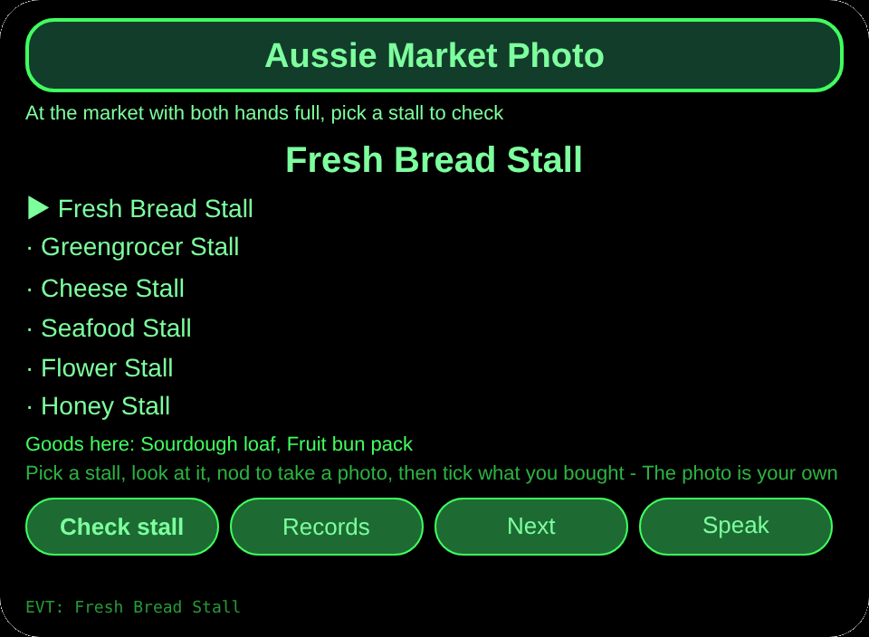
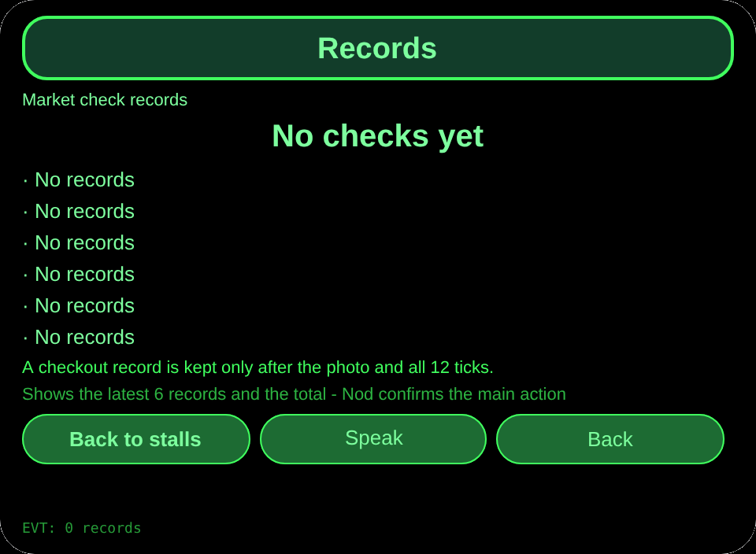
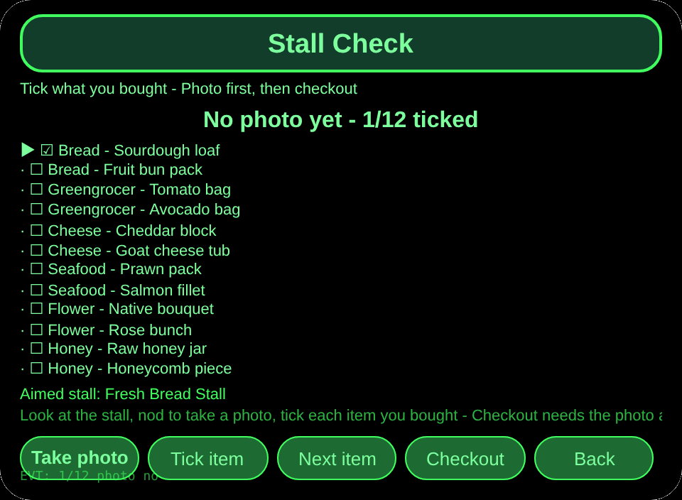

# Aussie Market Photo

**Studio import address** (copy into the Import Project box in Global AIUI Studio):

```
https://github.com/sakai55/rokid/tree/agent-aussie-market-photo
```

**Latest AIX download:** [aussie-market-photo.aix](https://raw.githubusercontent.com/sakai55/rokid/main/aix/aussie-market-photo.aix)

## Overview

A shopper at an Australian farmers market with both hands full of bags looks at a stall, nods to take a photo as a check, ticks what was bought, and may check out only after the photo and all ticks. Version 1.0.0, 3 pages, country: Australia.

## Scene

A shopper carrying bags at a farmers market wants to leave no stall good unbought. At each stall the shopper looks at the goods, nods for a photo, ticks the bought items, and gets a missing-item reminder before checkout.

## Direction mix

Australia local scene x directional (look-to-aim photo check) x attention. The market stall scene is the core, the look-aimed photo is the directional mechanism, and the tick-and-remind check is the attention mechanism. All three must meet for a checkout record to exist.

## Glasses-exclusive capability

- Hands-free first-person instant capture: the camera sits where the eyes look, so looking at the stall aims the photo, and a nod fires it while both hands hold bags. Taking the phone out would miss the moment and occupy a hand.
- The photo is a mandatory link in the loop, not decoration: checkout refuses without a photo, and refuses with a reminder while any item is unticked. Removing the photo step breaks checkout entirely.

Photo wiring evidence: pages/check/index.ink photoTap runs getUserMedia plus new ImageCapture(track).takePhoto with mode wide, converts the Blob with arrayBuffer plus chunked btoa into a data URL held in memory only, and persists only the photo timestamp and byte count under aussieMarketPhotoV1. Checkout gating is pages/check/index.ink checkoutTap.

## Privacy note

The photo is only the shopper's own check evidence. It does not identify goods automatically, it does not recognise any other person's face, and it claims no automatic goods recognition. Ticking is confirmed by the shopper; the photo backs the ticks.

## Pages

| Page | Role |
|---|---|
| pages/index | 6 stalls, each with its 2 goods, go to check or records |
| pages/check | 12 goods to tick, nod to take a photo, checkout gate with missing-item reminder |
| pages/record | Latest 6 checkout records and the total |

## Content set

6 stalls x 12 goods: Fresh Bread Stall (Sourdough loaf, Fruit bun pack), Greengrocer Stall (Tomato bag, Avocado bag), Cheese Stall (Cheddar block, Goat cheese tub), Seafood Stall (Prawn pack, Salmon fillet), Flower Stall (Native bouquet, Rose bunch), Honey Stall (Raw honey jar, Honeycomb piece). Checkout records are counted by their real number.

## Persistence

Cross-session storage key `aussieMarketPhotoV1`. It stores the selected stall, tick states, photo timestamp and byte count, the checkout records array, and lastError. The photo bytes themselves are never persisted.

## Permissions

`CAMERA` only. TTS needs no manifest permission and location is never used.

## Gestures

Single tap (Enter) or nod takes a photo on the check page, swipe up/down changes item, double tap goes back. Ticking and checkout run from their on-screen buttons.

## Error codes

- `E8004` Camera interface missing (no camera host on this device)
- `E2001` Photo capture failed
- `E2013` Photo encoding failed (Blob to data URL conversion)
- `E5001` Storage write failed
- `E5002` Storage read failed
- `E3005` Speech failed
- `E8001` Navigation failed

Failures always show the bare code on screen, and lastError keeps the code plus slug, version, and original text. A failed photo never pretends a check happened.

## Preview screenshots

Preview screenshots are taken in the batch closing step. Their slots are:






## Review submission

### Feature Description

A farmers market shopping check. Look at a stall, nod to take a photo as your own evidence, tick the 12 goods you bought, and check out only after the photo and all ticks, with a missing-item reminder before checkout. The photo never auto-identifies goods or faces.

### Opening Message

Let us check the market shop. Pick a stall, nod for a photo, and tick everything you bought before checkout.

### Preview Media

3 images (one per page) plus 1 video, backfilled at the device stage.

### Change Log

- 1.0.0: Features added - 6 stalls with 12 goods, look-aimed nod photo, tick check, photo-gated checkout with missing-item reminder, checkout records.

## Device test info

| Item | Value |
|---|---|
| Studio name | Not entered |
| Version | 1.0.0 |
| Category | Not entered |
| Intent description | Not entered |
| Agent ID | Not entered |
| Status | Not submitted |
