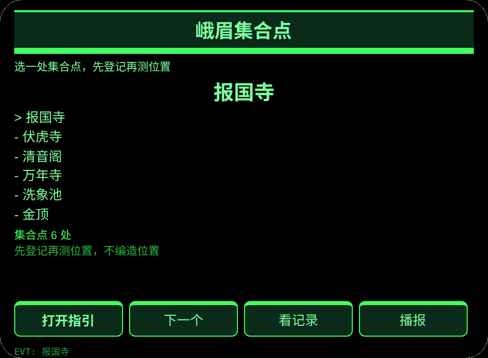
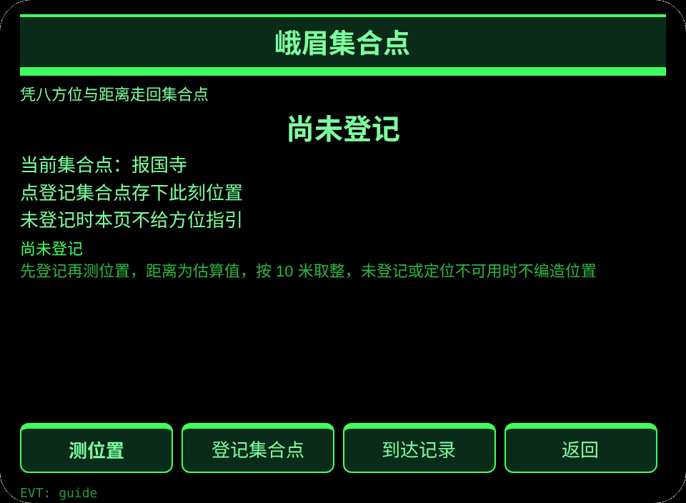
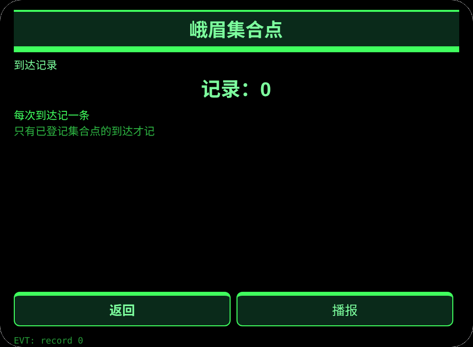

# 峨眉集合点

**Studio 导入地址**（复制到 Global AIUI Studio 的 Import Project 输入框）：

```
https://github.com/sakai55/rokid/tree/agent-china-emei-meet
```

[china-emei-meet.aix](https://raw.githubusercontent.com/sakai55/rokid/main/aix/china-emei-meet.aix)

## 功能

中国峨眉山景区游客双手扶栏不用掏手机，凭 GPS 方位距离回到登记的集合点，到达记录跨会话保存。

## 场景

中国峨眉山景区游客双手扶栏不用掏手机，凭 GPS 方位距离回到登记的集合点。

## 方向构成

中国在地 × 指向性 GPS × 路缘坡（登山游客返程集合）。指向性承载 GPS 八方位＋距离案内；路缘坡承载登山走散后双手扶栏返程的无障碍场景。

## 眼镜独占能力

GPS 方位锚定：登记集合点时存下此刻 GPS 位置，测位置时换算八方位（北/东北/东/东南/南/西南/西/西北）与 haversine 距离（10 米取整）。接线：app.json 声明 GEOLOCATION＋navigator.geolocation.getCurrentPosition（存在性守卫）＋_calc 八方位换算；拒绝报 E7003，其他定位失败报 E7002；未登记或定位不可用时不编造位置。

## 页面

| 页面 | 页面 |
|---|---|
| pages/index | 6 处峨眉山集合点与已选点 |
| pages/guide | 登记集合点、测位置、到达记录 |
| pages/record | 到达记录 |

## 内容集

集合点 6 处（网上核实为真实峨眉山地点：报国寺、伏虎寺、清音阁、万年寺、洗象池、金顶；登山路线见维基导游《峨眉山国家公园》，长线自报国寺经清音阁、洗象池至金顶）。与同山岳的 china-mountain-meet（黄山点：迎客松、光明顶、天都峰、莲花峰、西海大峡谷、玉屏楼）与 china-huashan-meet（华山点）0 重叠；与其他中国集合点无同名集合点。

## 跨会话持久化

存储键 `chinaEmeiMeetV1`（已选集合点、已登记集合点、到达记录、lastError）。

## 权限

GEOLOCATION（定位：登记集合点与测位置）。语音播报不需要清单权限，相机不用。

## 手势映射

| 单指点按 | Enter | 主确认 |
| 上滑／下滑 | ArrowUp / ArrowDown | 切换选项 |
| 点头 | onHeadGesture('nod') | 等同主确认 |
| 双击 | Backspace | 返回上一页 |

## 错误码

- `E5001` 存储写入失败
- `E5002` 存储读取失败
- `E3005` 语音播报失败
- `E8001` 页面跳转失败
- `E7002` 定位失败
- `E7003` 定位权限未给

## 判定说明

峨眉集合点与 china-mountain-meet（黄山）、china-huashan-meet（华山）机制相同（GPS 返程集合），地点不同，6 个集合点无逐字重复，按泰山／丽江等多地 meet 共存先例建。


## 诚实边界

- 距离为估算值，按 10 米取整；屋内或 GPS 弱区如实显示测不到，不编造位置。
- 未登记集合点时不给方位指引。
- 集合点位置只在登记时由 GPS 实测存下，不写死经纬度。

## 预览截图





预览截图按 3 张交付：guide-s2（已登记后测位置）与 record-s2 在预览中不可达——预览无 GPS，无法登记集合点，不硬造（hangang-cycle 前例）。

## 提审资料

### Feature Description

中国峨眉山景区游客双手扶栏不用掏手机，凭 GPS 方位距离回到登记的集合点，到达记录跨会话保存。

### Opening Message

峨眉集合点已备好！选一处集合点登记，凭方位与距离走回去。

### Preview Media

[preview-china-emei-meet-video.mp4](https://raw.githubusercontent.com/sakai55/rokid/main/screenshots/china-emei-meet/preview-china-emei-meet-video.mp4)


### Change Log

- Features：首版功能见上文页面表。
- Improvements：无。
- Fixes：无.

## 设备测试信息

| Studio 名称 | 待填 |
|---|---|
| Studio 名称 | 待填 |
| Version / Build | 待填 |
| App Category | 待填 |
| Intent Description | 待填 |
| Agent ID | 待填 |
| 状态 | 待填 |
