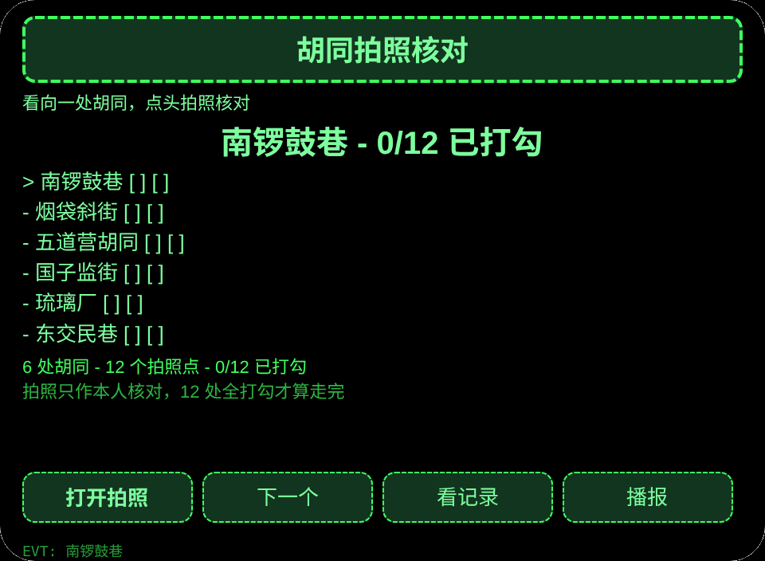
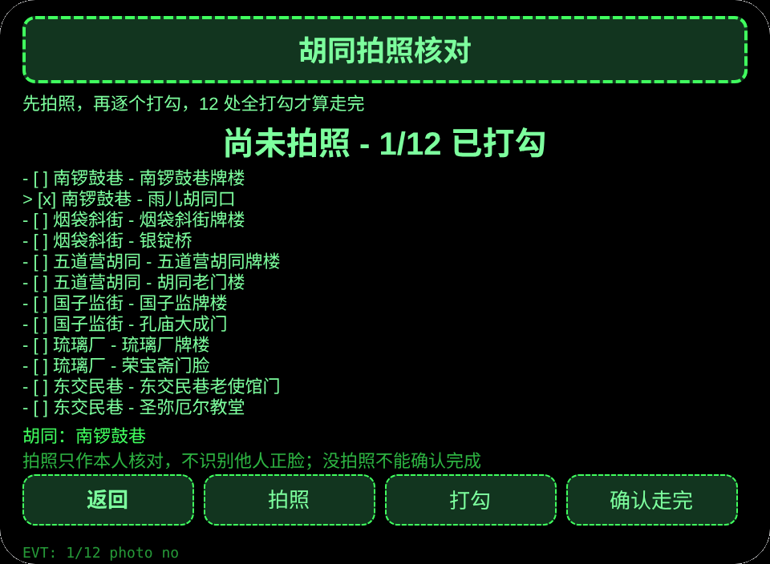
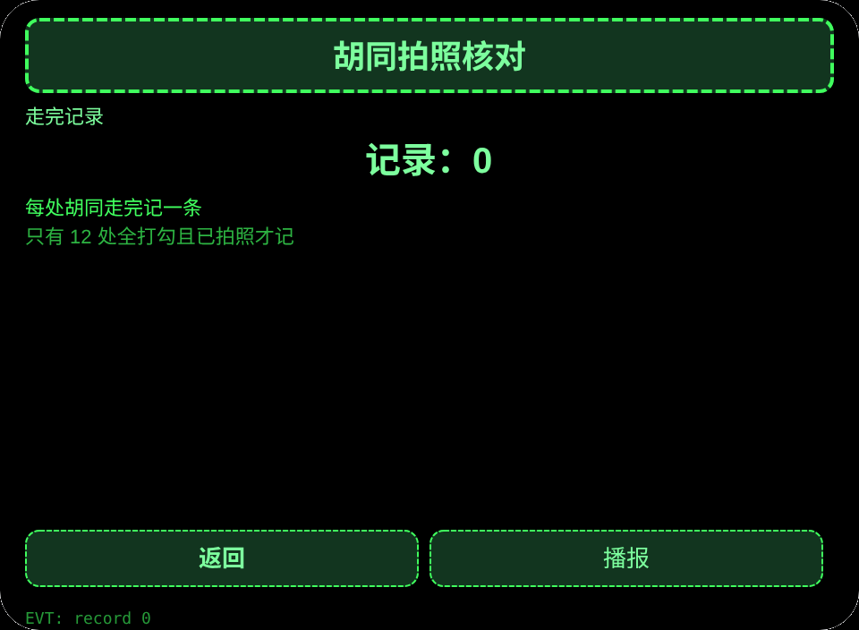

# 胡同拍照核对

**Studio 导入地址**（复制到 Global AIUI Studio 的 Import Project 输入框）：

```
https://github.com/sakai55/rokid/tree/agent-china-hutong-photo
```

[china-hutong-photo.aix](https://raw.githubusercontent.com/sakai55/rokid/main/aix/china-hutong-photo.aix)

## 功能

北京胡同参观者双手拿导览册，看向胡同、点头触发拍照核对 12 个拍照点，差一处不算走完。

## 场景

北京胡同参观者双手拿导览册，看向胡同、点头触发拍照核对 12 个拍照点。

## 方向构成

中国在地 × 指向性（视线拍照核对）× 注意力。

## 眼镜独占能力

解放双手的第一视角即时捕获：双手拿导览册，看向胡同、点头触发拍照，拍照是走完放行的必经步。接线：app.json 声明 CAMERA，photo 页 photoTap（getUserMedia＋ImageCapture.takePhoto），Blob 转 data URL 用 arrayBuffer＋分块 btoa，FileReader＝0；没拍照不能确认走完。

## 页面

| 页面 | 页面 |
|---|---|
| pages/index | 6 处胡同 |
| pages/photo | 12 个拍照点核对 |
| pages/record | 走完记录 |

## 内容集

胡同 6 处×拍照点 12 个：南锣鼓巷（南锣鼓巷牌楼／雨儿胡同口）、烟袋斜街（烟袋斜街牌楼／银锭桥）、五道营胡同（五道营胡同牌楼／胡同老门楼）、国子监街（国子监牌楼／孔庙大成门）、琉璃厂（琉璃厂牌楼／荣宝斋门脸）、东交民巷（东交民巷老使馆门／圣弥厄尔教堂）。

## 跨会话持久化

存储键 `chinaHutongPhotoV1`（已选胡同、已打勾拍照点、拍照时间与字节数、走完记录、lastError）。照片本身只在会话内保留，不持久化。

## 权限

声明 CAMERA（拍照核对用）。定位与媒体权限不用。

## 手势映射

| 单指点按 | Enter | 主确认 |
| 上滑／下滑 | ArrowUp / ArrowDown | 切换选项 |
| 点头 | onHeadGesture('nod') | 等同主确认 |
| 双击 | Backspace | 返回上一页 |

## 错误码

- `E5001` 存储写入失败
- `E5002` 存储读取失败
- `E3005` 语音播报失败
- `E8001` 页面跳转失败
- `E7001` 头部传感器不可用或读数失败
- `E8004` 拍照接口缺失（相机接口不存在）
- `E2001` 拍照失败（takePhoto 抛错）
- `E2013` 照片编码失败（arrayBuffer／分块 btoa 转码抛错）

- 照片只作本人核对，不识别他人正脸，不声称自动识别景点。
- 没拍照不能确认走完，未打勾的拍照点只提醒，不写记录。
- 预览无相机时拍照如实失败，绝不伪造成成功。

## 预览截图






## 提审资料

### Feature Description

北京胡同参观者双手拿导览册，看向胡同、点头触发拍照核对 12 个拍照点，差一处不算走完。

### Opening Message

导览册拿好，看向胡同、点头拍照，12 处拍完才算走完。

### Preview Media

[preview-china-hutong-photo-video.mp4](https://raw.githubusercontent.com/sakai55/rokid/main/screenshots/china-hutong-photo/preview-china-hutong-photo-video.mp4)


### Change Log

- Features：首版功能见上文页面表。
- Improvements：无。
- Fixes：无.

## 设备测试信息

| Studio 名称 | 待填 |
|---|---|
| Studio 名称 | 待填 |
| Version / Build | 待填 |
| App Category | 待填 |
| Intent Description | 待填 |
| Agent ID | 待填 |
| 状态 | 待填 |
