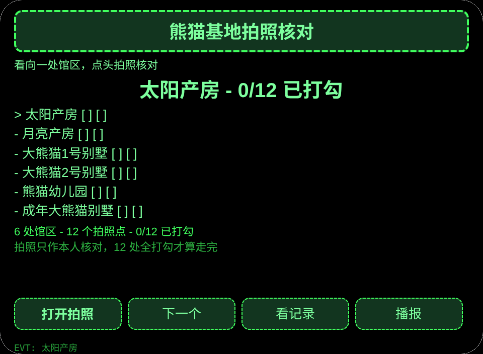
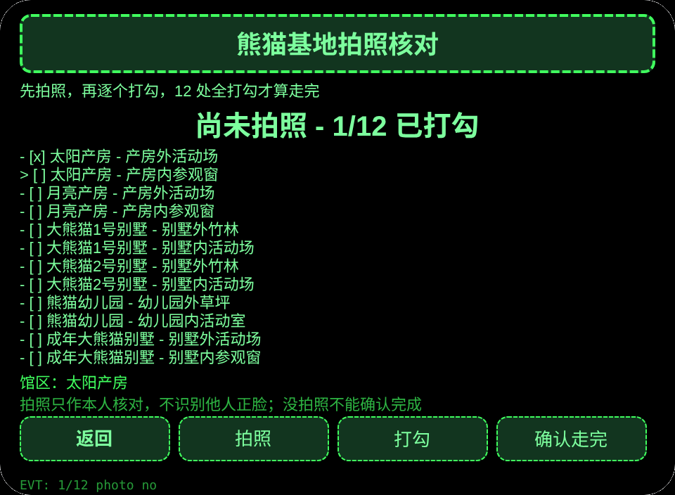
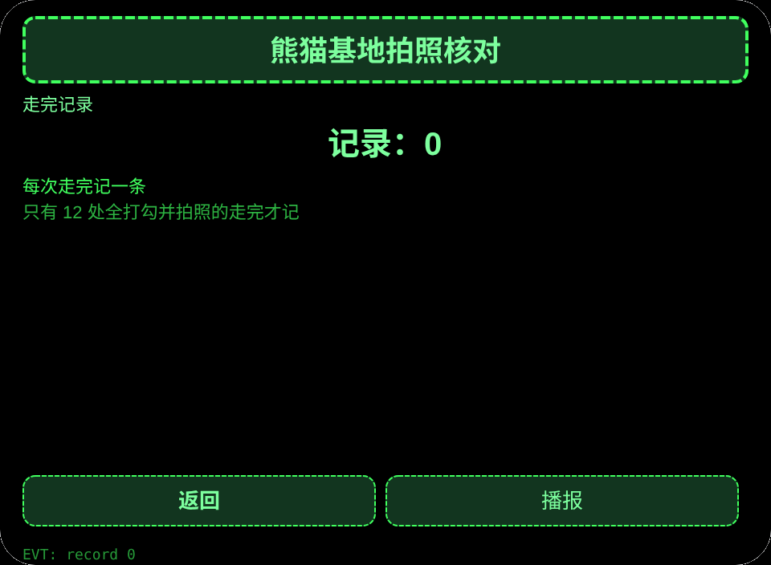

# 熊猫基地拍照核对

**Studio 导入地址**（复制到 Global AIUI Studio 的 Import Project 输入框）：

```
https://github.com/sakai55/rokid/tree/agent-china-panda-photo
```

[china-panda-photo.aix](https://raw.githubusercontent.com/sakai55/rokid/main/aix/china-panda-photo.aix)

## 功能

成都大熊猫繁育研究基地参观者双手拿导览册，看向馆区、点头触发拍照核对 12 个拍照点，差一处不算走完。

## 场景

成都大熊猫繁育研究基地参观者双手拿导览册，看向馆区、点头触发拍照核对 12 个拍照点。

## 方向构成

中国在地 × 指向性（视线拍照核对）× 注意力。

## 眼镜独占能力

解放双手的第一视角即时捕获：双手拿导览册时无法掏手机，看向馆区、点头即拍照，拍照是走完放行的必经步。接线：app.json 声明 CAMERA，pages/photo/index.ink photoTap（getUserMedia＋ImageCapture.takePhoto），Blob 转 data URL 用 arrayBuffer＋分块 btoa。

## 页面

| 页面 | 页面 |
|---|---|
| pages/index | 6 处馆区 |
| pages/photo | 拍照＋12 个拍照点打勾 |
| pages/record | 走完记录 |

## 内容集

馆区 6 处×拍照点 12 个：太阳产房（产房外活动场／产房内参观窗）、月亮产房（产房外活动场／产房内参观窗）、大熊猫1号别墅（别墅外竹林／别墅内活动场）、大熊猫2号别墅（别墅外竹林／别墅内活动场）、熊猫幼儿园（幼儿园外草坪／幼儿园内活动室）、成年大熊猫别墅（别墅外活动场／别墅内参观窗）。

## 跨会话持久化

存储键 `chinaPandaPhotoV1`（已选馆区、已打勾拍照点、拍照时间与字节数、走完记录、lastError）。照片本身只在会话内保留，不持久化。

## 权限

声明 CAMERA。定位与媒体权限不用。

## 手势映射

| 单指点按 | Enter | 主确认 |
| 上滑／下滑 | ArrowUp / ArrowDown | 切换选项 |
| 点头 | onHeadGesture('nod') | 等同主确认 |
| 双击 | Backspace | 返回上一页 |

## 错误码

- `E5001` 存储写入失败
- `E5002` 存储读取失败
- `E3005` 语音播报失败
- `E8001` 页面跳转失败
- `E7001` 头部传感器不可用或读数失败
- `E8004` 相机接口缺失
- `E2001` 拍照失败
- `E2013` 照片编码失败

- 照片只作本人核对，不识别他人正脸，不声称自动识别景点。
- 没拍照不能确认走完，未打勾的拍照点只提醒，不写记录。
- 预览无相机时拍照如实失败，绝不伪造成成功。

## 预览截图






## 提审资料

### Feature Description

成都大熊猫繁育研究基地参观者双手拿导览册，看向馆区、点头触发拍照核对 12 个拍照点，差一处不算走完。

### Opening Message

成都大熊猫繁育研究基地参观者双手拿导览册，看向馆区、点头触发拍照核对 12 个拍照点，差一处不算走完。

### Preview Media

[preview-china-panda-photo-video.mp4](https://raw.githubusercontent.com/sakai55/rokid/main/screenshots/china-panda-photo/preview-china-panda-photo-video.mp4)


### Change Log

- Features：首版功能见上文页面表。
- Improvements：无。
- Fixes：无.

## 设备测试信息

| Studio 名称 | 待填 |
|---|---|
| Studio 名称 | 待填 |
| Version / Build | 待填 |
| App Category | 待填 |
| Intent Description | 待填 |
| Agent ID | 待填 |
| 状态 | 待填 |
