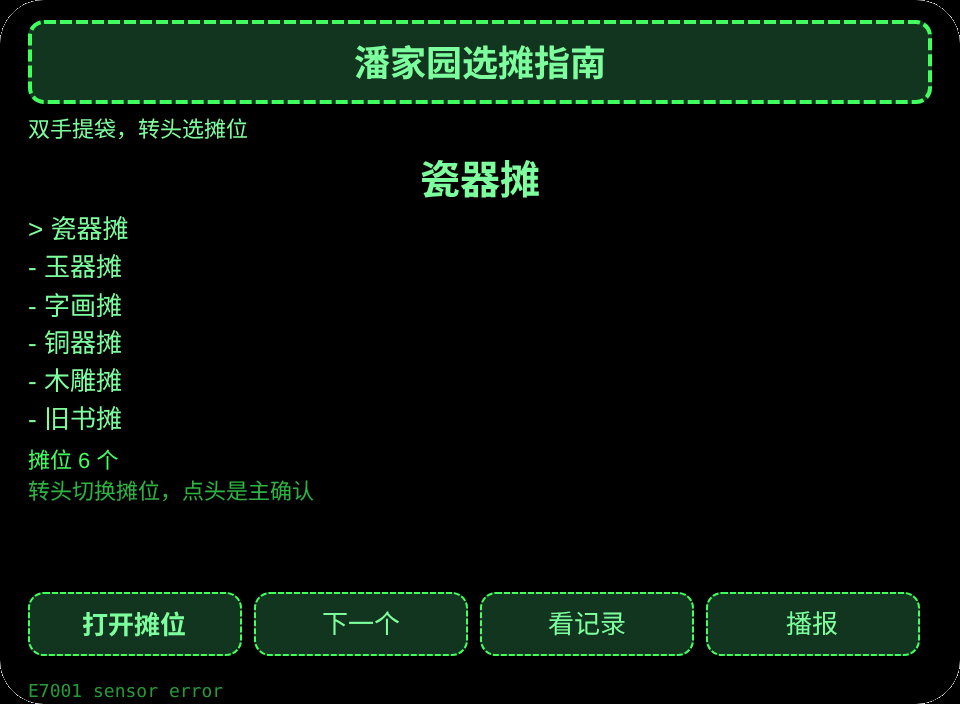
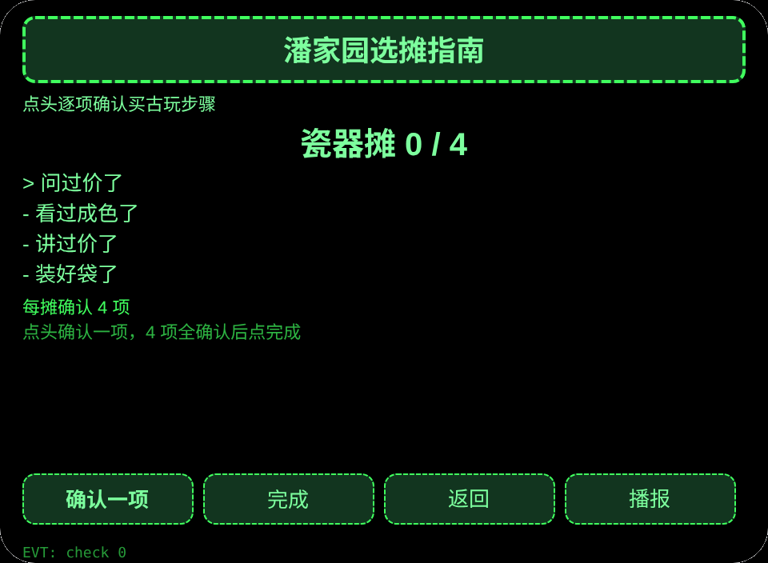
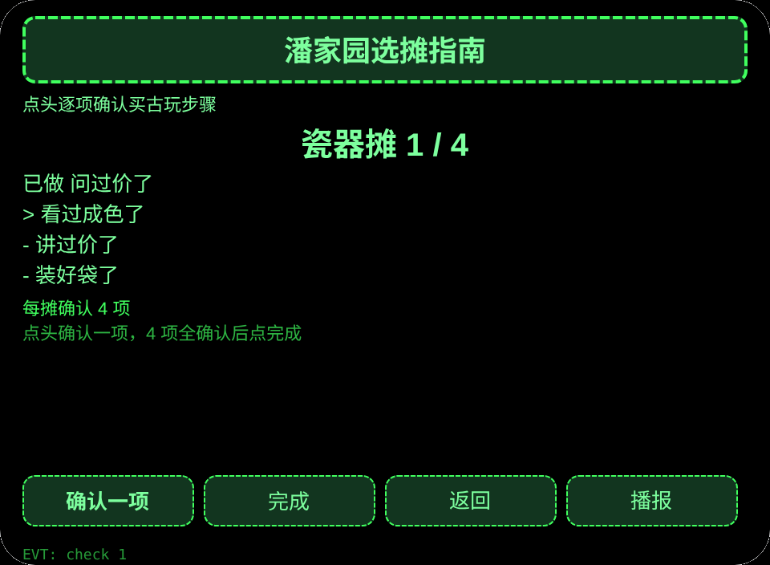
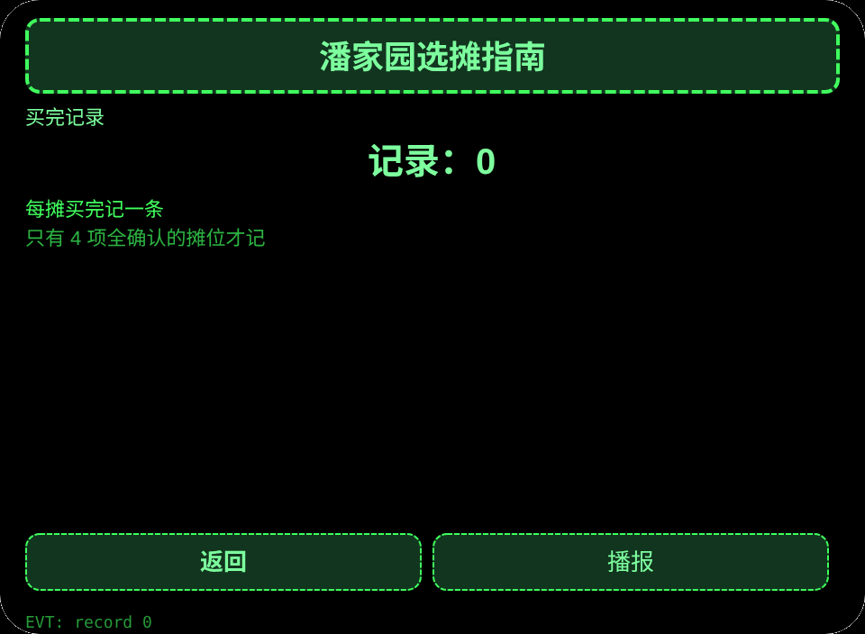

# 潘家园选摊指南

**Studio 导入地址**（复制到 Global AIUI Studio 的 Import Project 输入框）：

```
https://github.com/sakai55/rokid/tree/agent-china-panjiayuan-market
```

[china-panjiayuan-market.aix](https://raw.githubusercontent.com/sakai55/rokid/main/aix/china-panjiayuan-market.aix)

## 功能

潘家园古玩市场买古玩的人双手提袋、不用掏手机，靠转头选摊、点头逐项确认 4 项，买完记一次。

## 场景

潘家园古玩市场买古玩的人双手提袋，靠转头选摊、点头逐项确认，买完记一次。

## 方向构成

中国在地 × 指向性（转头选摊）× 注意力（逐项确认）。

## 眼镜独占能力

视线与头部方向协调：双手提袋时无法掏手机，转头到哪个摊位就选哪个摊位，点头即确认。接线：pages/index/index.ink 的 _startSensor＋_onYaw，点头触发 primaryTap。

## 页面

| 页面 | 页面 |
|---|---|
| pages/index | 6 个摊位 |
| pages/detail | 每摊确认 4 项 |
| pages/record | 买完记录 |

## 内容集

摊位 6 个×确认项 4 项＝24 个确认项：瓷器摊、玉器摊、字画摊、铜器摊、木雕摊、旧书摊；每摊确认问过价了、看过成色了、讲过价了、装好袋了。

## 跨会话持久化

存储键 `chinaPanjiayuanMarketV1`（已选摊位、买完记录、lastError）。

## 权限

无清单权限。语音播报不需要清单权限，相机与定位不用。

## 手势映射

| 单指点按 | Enter | 主确认 |
| 上滑／下滑 | ArrowUp / ArrowDown | 切换选项 |
| 点头 | onHeadGesture('nod') | 等同主确认 |
| 双击 | Backspace | 返回上一页 |

## 错误码

- `E5001` 存储写入失败
- `E5002` 存储读取失败
- `E3005` 语音播报失败
- `E8001` 页面跳转失败
- `E7001` 头部传感器不可用或读数失败

- 价格与真伪以现场摊位与行家为准，不声称鉴定。
- 无传感器时可用按钮选摊位。

## 预览截图






## 提审资料

### Feature Description

潘家园古玩市场买古玩的人双手提袋、不用掏手机，靠转头选摊、点头逐项确认 4 项，买完记一次。

### Opening Message

潘家园古玩市场买古玩的人双手提袋、不用掏手机，靠转头选摊、点头逐项确认 4 项，买完记一次。

### Preview Media

[preview-china-panjiayuan-market-video.mp4](https://raw.githubusercontent.com/sakai55/rokid/main/screenshots/china-panjiayuan-market/preview-china-panjiayuan-market-video.mp4)


### Change Log

- Features：首版功能见上文页面表。
- Improvements：无。
- Fixes：无.

## 设备测试信息

| Studio 名称 | 待填 |
|---|---|
| Studio 名称 | 待填 |
| Version / Build | 待填 |
| App Category | 待填 |
| Intent Description | 待填 |
| Agent ID | 待填 |
| 状态 | 待填 |
