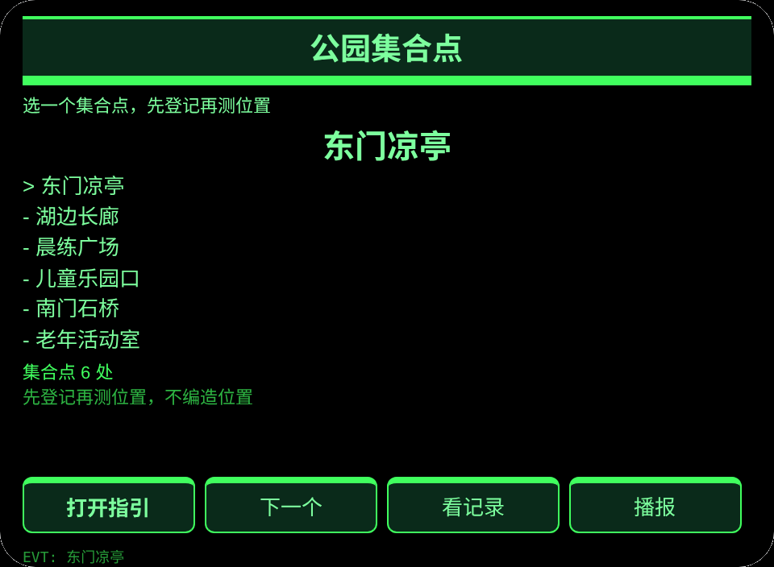
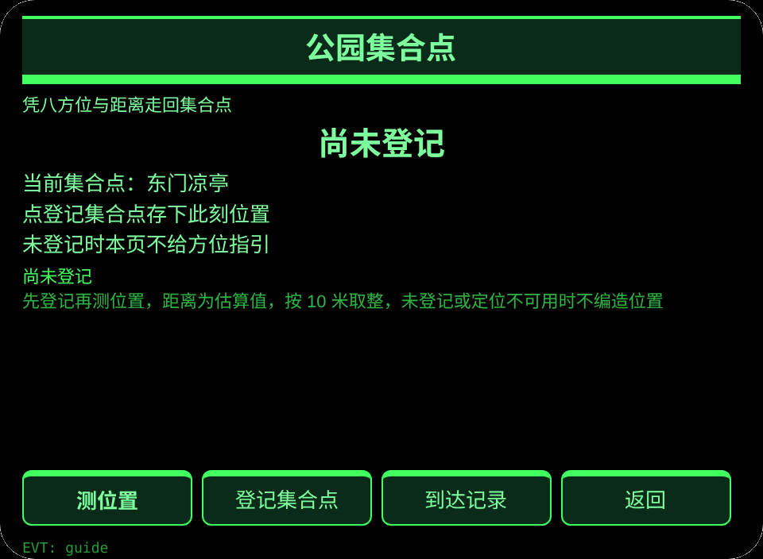
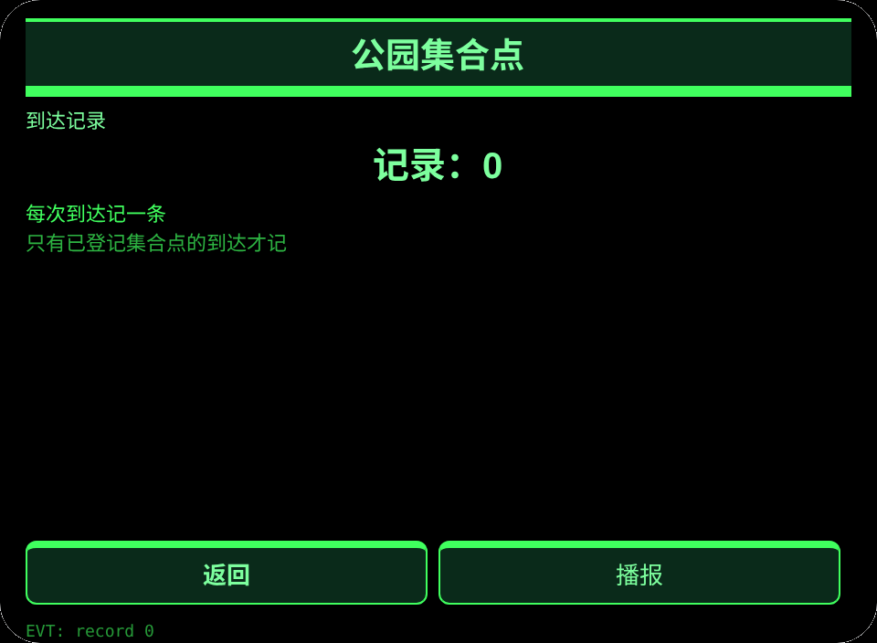

# 公园集合点

**Studio 导入地址**（复制到 Global AIUI Studio 的 Import Project 输入框）：

```
https://github.com/sakai55/rokid/tree/agent-china-park-meet
```

[china-park-meet.aix](https://raw.githubusercontent.com/sakai55/rokid/main/aix/china-park-meet.aix)

## 功能

公园里走散的年长游客与家人不用掏手机，凭 GPS 方位距离回到登记的集合点，到达记一次。

## 场景

公园里走散的年长游客与家人不用掏手机，凭 GPS 方位距离回到登记的集合点。

## 方向构成

中国在地 × 指向性 GPS × 路缘坡（年长游客）。

## 眼镜独占能力

锚定地点的方向：GPS cardinal 方位＋距离的返程指引，手机放口袋里看不到眼前指引。接线：app.json 声明 GEOLOCATION，guide 页 getCurrentPosition，_calc 八方位换算与 haversine 距离。

## 页面

| 页面 | 页面 |
|---|---|
| pages/index | 6 个集合点 |
| pages/guide | GPS 登记＋八方位＋距离 |
| pages/record | 到达记录 |

## 内容集

集合点 6 处：东门凉亭、湖边长廊、晨练广场、儿童乐园口、南门石桥、老年活动室。

## 跨会话持久化

存储键 `chinaParkMeetV1`（已选集合点、已登记集合点、到达记录、lastError）。

## 权限

声明 GEOLOCATION。相机与媒体权限不用。

## 手势映射

| 单指点按 | Enter | 主确认 |
| 上滑／下滑 | ArrowUp / ArrowDown | 切换选项 |
| 点头 | onHeadGesture('nod') | 等同主确认 |
| 双击 | Backspace | 返回上一页 |

## 错误码

- `E5001` 存储写入失败
- `E5002` 存储读取失败
- `E3005` 语音播报失败
- `E8001` 页面跳转失败
- `E7002` 定位不可用
- `E7003` 定位被拒绝

- 距离为估算值，按 10 米取整；屋内或 GPS 弱区如实显示测不到，不编造位置。
- 未登记集合点时不给方位指引。

## 预览截图





## 提审资料

### Feature Description

公园里走散的年长游客与家人不用掏手机，凭 GPS 方位距离回到登记的集合点，到达记一次。

### Opening Message

公园里走散的年长游客与家人不用掏手机，凭 GPS 方位距离回到登记的集合点，到达记一次。

### Preview Media

[preview-china-park-meet-video.mp4](https://raw.githubusercontent.com/sakai55/rokid/main/screenshots/china-park-meet/preview-china-park-meet-video.mp4)


### Change Log

- Features：首版功能见上文页面表。
- Improvements：无。
- Fixes：无.

## 设备测试信息

| Studio 名称 | 待填 |
|---|---|
| Studio 名称 | 待填 |
| Version / Build | 待填 |
| App Category | 待填 |
| Intent Description | 待填 |
| Agent ID | 待填 |
| 状态 | 待填 |
