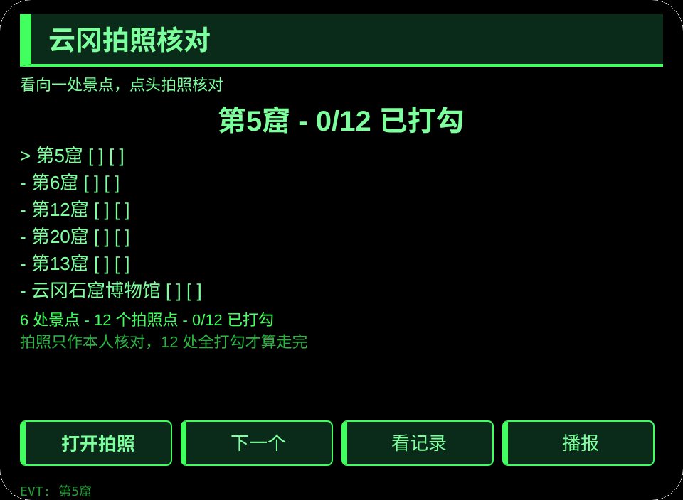
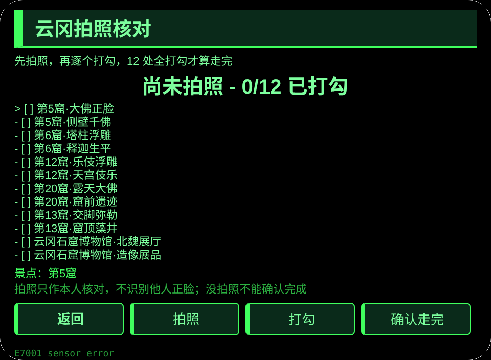
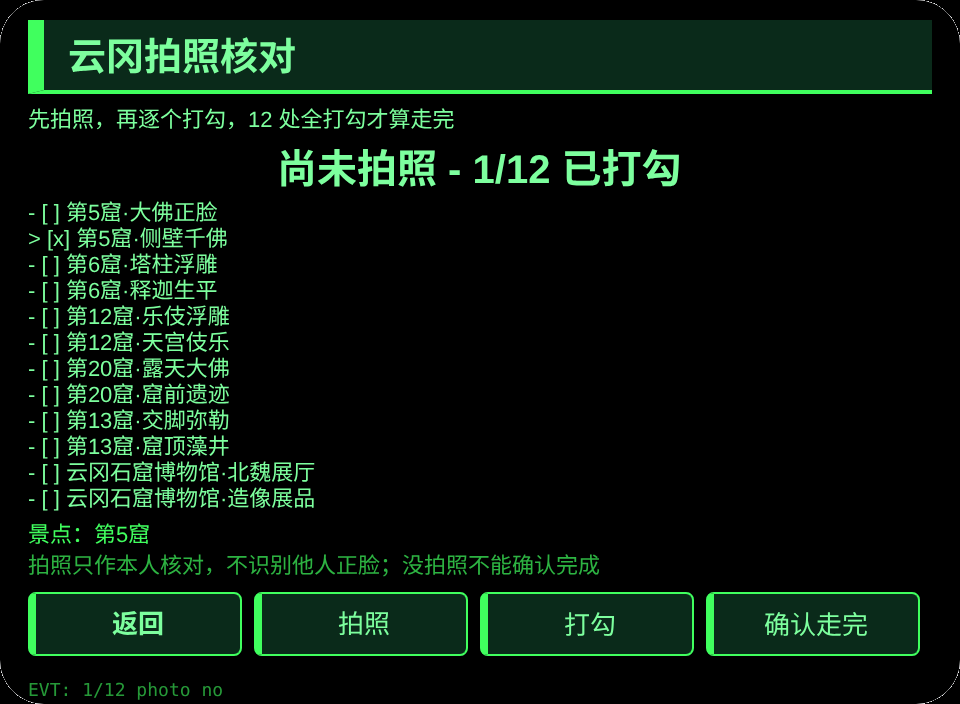
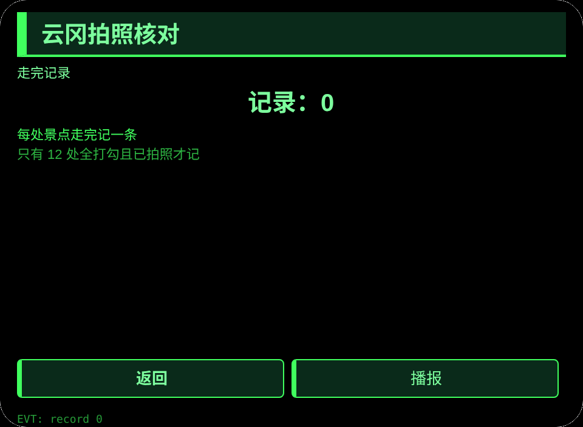

# 云冈拍照核对

**Studio 导入地址**（复制到 Global AIUI Studio 的 Import Project 输入框）：

```
https://github.com/sakai55/rokid/tree/agent-china-yungang-photo
```

[china-yungang-photo.aix](https://raw.githubusercontent.com/sakai55/rokid/main/aix/china-yungang-photo.aix)

## 功能

云冈石窟参观者双手拿导览册，看向石窟、点头触发拍照核对 12 个拍照点，差一处不算走完。

## 场景

云冈石窟参观者双手拿导览册，看向石窟、点头触发拍照核对 12 个拍照点，差一处不算走完。

## 方向构成

中国在地 × 指向性（视线拍照核对）× 注意力。指向性承载看向锁定与点头拍照；注意力承载 12 处逐点打勾与差点提醒。

## 眼镜独占能力

解放双手的第一视角即时捕获，拍照为走完放行必经步（confirmTap 以 this._photo 为放行门）。接线：app.json 声明 CAMERA＋photoTap（navigator.mediaDevices.getUserMedia＋ImageCapture.takePhoto）＋blob.arrayBuffer()＋分块 btoa 转 data URL，FileReader＝0；没拍照不能确认走完。

## 页面

| 页面 | 页面 |
|---|---|
| pages/index | 6 处石窟与已打勾拍照点 |
| pages/photo | 看向锁定、点头拍照、逐点打勾 |
| pages/record | 走完记录 |

## 内容集

石窟 6 处×拍照点 12 个：第5窟（大佛正脸／侧壁千佛）、第6窟（塔柱浮雕／释迦生平）、第12窟（乐伎浮雕／天宫伎乐）、第20窟（露天大佛／窟前遗迹）、第13窟（交脚弥勒／窟顶藻井）、云冈石窟博物馆（北魏展厅／造像展品）。地点均网上核实为真实云冈地点（第5、6、12、13、20窟与云冈石窟博物馆；第20窟为昙曜五窟中最著名的露天大佛）。12 个拍照点名与 china-dunhuang-photo 的 12 个点名无逐字重复（本台用「·」分隔，敦煌台用「 - 」分隔，措辞亦不同）。

## 跨会话持久化

存储键 `chinaYungangPhotoV1`（已选石窟、已打勾拍照点、拍照时间与字节数、走完记录、lastError）。

## 权限

CAMERA（拍照：核对拍照点）。语音播报不需要清单权限，定位不用。

## 手势映射

| 单指点按 | Enter | 主确认 |
| 上滑／下滑 | ArrowUp / ArrowDown | 切换选项 |
| 点头 | onHeadGesture('nod') | 等同主确认 |
| 双击 | Backspace | 返回上一页 |

## 错误码

- `E5001` 存储写入失败
- `E5002` 存储读取失败
- `E3005` 语音播报失败
- `E8001` 页面跳转失败
- `E7001` 头部传感器不可用或读数失败
- `E8004` 拍照接口缺失（相机接口不存在）
- `E2001` 拍照失败（takePhoto 抛错）
- `E2013` 照片编码失败（arrayBuffer／分块 btoa 转码抛错）

## 判定说明

云冈拍照核对与 china-dunhuang-photo 机制相同（视线拍照核对 12 处），地点不同（大同云冈 vs 敦煌莫高窟），6 处地点与 12 个拍照点无逐字重复。第20窟不与昙曜五窟并列为两处（第20窟即昙曜五窟之一）；计划草拟的「万佛洞」一名未能核实为云冈石窟名称，改用已核实的第13窟。


## 诚实边界

- 照片只作本人核对，不识别他人正脸，不声称自动识别景点。
- 没拍照不能确认走完，未打勾的拍照点只提醒，不写记录。
- 预览无相机时拍照如实失败，绝不伪造成成功。

## 预览截图






预览截图按 4 张交付：photo-s2 为真实打勾状态（拍照按钮在预览中如实失败、不伪造；1 处打勾为真实点按状态——连续点按三次在两处之间切换后剩 1 处）。

## 提审资料

### Feature Description

云冈石窟参观者双手拿导览册，看向石窟、点头触发拍照核对 12 个拍照点，差一处不算走完。

### Opening Message

云冈拍照核对开始！看向一处石窟、点头拍照，12 处全打勾才算走完。

### Preview Media

[preview-china-yungang-photo-video.mp4](https://raw.githubusercontent.com/sakai55/rokid/main/screenshots/china-yungang-photo/preview-china-yungang-photo-video.mp4)


### Change Log

- Features：首版功能见上文页面表。
- Improvements：无。
- Fixes：无.

## 设备测试信息

| Studio 名称 | 待填 |
|---|---|
| Studio 名称 | 待填 |
| Version / Build | 待填 |
| App Category | 待填 |
| Intent Description | 待填 |
| Agent ID | 待填 |
| 状态 | 待填 |
