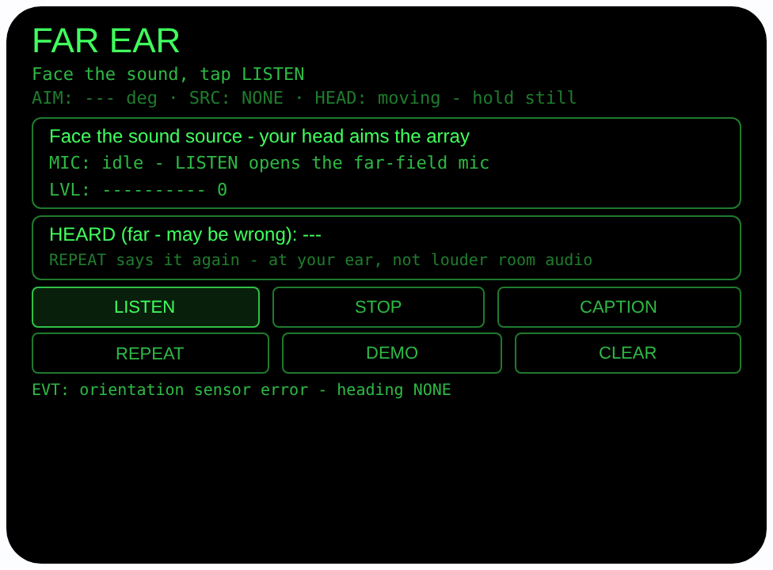

# far-ear — 远听助手（Rokid 眼镜 AIUI Agent）

**Studio 导入地址**（复制到 Global AIUI Studio 的 Import Project 输入框）：

```
https://github.com/sakai55/rokid/tree/agent-far-ear
```


50 个「指向性生活问题」Agent 的第 Z17 个。看得见说话的人，
却听不清他说什么 — 会议室前排的发言、隔着客厅的电视、
另一个房间喊你的话。本 Agent 的解法不是放大房间声音
（运行时没有这种能力，见下方诚实说明），而是四步：脸朝向
声源让 4 麦阵列以远场模式拾音、电平条帮你把头对准、把
听到的转成带「可能听错」标注的文字、最后由贴在你耳边的
眼镜扬声器用 TTS 把那句话清楚地再说一遍。注意拾音与
识别是两条管线：远场模式只作用于拾音电平，识别由宿主
识别器用其自身麦克风完成（详见下方「管线如实拆分」）。

## 预览截图

截图统一存放于仓库根目录 `screenshots/far-ear/`。



![DEMO 完成态（合成电平停在 78、朝向 DEMO 85°、样例字幕明确标注 [DEMO]「请大家看第三页」、提示可点 REPEAT 在耳边重播）](../../screenshots/far-ear/preview-far-ear-demo.png)

## 解决的问题

听不清远处人声时，人的本能是把头转向声源、侧耳去听 —
但距离和混响不会因为你侧耳就消失，听漏的关键一句还是
漏了。手机更帮不上忙：它不在你头上，不知道你面朝哪儿，
拾音也不冲着你看的方向。眼镜同时有朝向感知的 4 麦阵列
和贴耳的扬声器，于是可以把「侧耳听」变成一条链路：先
瞄准拾音，再把内容固定成文字，最后在耳边重播 — 漏掉的
那句有了第二次机会。

## 指向性设计（为什么必须用眼镜）

- **头部就是阵列的瞄准器（GAZE/HEAD）**：界面常驻显示
  `AbsoluteOrientationSensor` 的头部朝向与来源标注
  （SENSOR / DEMO / NONE），并明示「脸朝向声源 — 你的
  头决定阵列朝哪儿收音」。朝向只作显示与引导，不编造、
  不参与伪造任何方向结论。
- **远场麦克风模式（MIC4）**：LISTEN 用 `getUserMedia`
  的 `captureSource: 'microphone'` + `microphoneMode:
  'far-field'` + `echoCancellation: true` 开麦 — 4 麦
  阵列的远场模式去收远处的声音，而不是默认 wearer
  模式那样优先收佩戴者自己的声音；开麦后读回
  `track.getSettings()` 如实显示设备实际选中的模式。
  模式被设备拒绝（OverconstrainedError）时回退默认
  麦克风并如实提示，不假装模式生效。
- **电平引导瞄准**：远场流接 Web Audio `AnalyserNode`
  （只接分析器不接输出，防啸叫），每 100ms 算一次 RMS
  显示电平条。脸对准声源时电平升高 — 转头找到电平
  最高的位置，就是把阵列瞄准了声源，不用任何按钮确认。
- **近耳重播（本 Agent 的核心把戏）**：CAPTION 用基准
  Agent 的 `SpeechRecognition` 模式（zh-CN）把听到的
  内容转成一行文字；REPEAT 把这行文字用 TTS 朗读。
  眼镜扬声器就贴在耳边 — 房间那头半听半猜的一句，
  在耳边完整再说一遍。头部稳定时点头 = REPEAT，
  开会时不用腾手、不用低头点按钮。
- **管线如实拆分（重要）**：CAPTION 的识别由宿主
  SpeechRecognition 用它自己的麦克风完成，far-field
  模式只作用于 LISTEN 的电平流（getUserMedia），
  不作用于识别。LISTEN 的远场流只喂 `AnalyserNode`
  算电平帮你瞄准，从不喂给识别器 — 两条管线在界面
  与文档里分开标注（电平行标 far-field、字幕行标
  host ASR），不假装识别也跑在远场模式下。

## 功能流程

1. 待机：界面显示头部朝向与来源、电平条、MIC 状态；
   页脚常驻一行「no live amplification」如实说明
2. LISTEN：点 LISTEN（或 Enter）→ 查麦克风与 Web
   Audio，不可用 FAIL 写明 → 远场模式开麦，脸朝向
   声源，转头看电平条找最高点；STOP 立即停麦
3. CAPTION：点 CAPTION 由宿主 `SpeechRecognition`
   做一次识别尝试（识别器用它自己的麦克风 — 与
   LISTEN 的远场电平流是两条独立管线，远场模式不
   作用于识别）；结果行永远带前缀「HEARD (far -
   may be wrong):」；识别不可用显示 SKIP 并写明原因
4. REPEAT：朗读最近一条字幕（点头亦可）；没有字幕时
   朗读引导句。CLEAR 清空字幕与电平
5. DEMO：合成约 3 秒起伏的假电平，随后给出一条明确
   标注 [DEMO] 的样例字幕「请大家看第三页」，REPEAT
   可直接朗读它 — 无麦克风无传感器也能完整演示

> 诚实说明：本 Agent **不放大直播音频**。AIUI 运行时没有
> 文档化的音频透传 / 监听（passthrough/monitoring）API，
> 它绝不声称把房间声音放大送进耳朵。它的价值只有四件
> 事：远场拾音、电平引导瞄准、字幕转写、近耳 TTS
> 重播。其中字幕的识别由宿主 SpeechRecognition 用它
> 自己的麦克风完成，far-field 模式只作用于 LISTEN 的
> 电平流（getUserMedia），不作用于识别。另外，识别
> 远处语音本来就容易出错 — 距离越远、
> 混响越大、口音越重，错得越多；字幕行每次都带
> 「may be wrong」标注，只能当「大概听到了什么」的
> 参考，重要场合请走近确认，不要拿字幕当记录凭证。

## 权限

| 权限 | 用途 |
|---|---|
| RECORD_AUDIO | LISTEN 时以远场模式开麦：`getUserMedia` 远场拾音 + `AnalyserNode` 实时算 RMS 电平（远场模式只作用于这条电平流）；CAPTION 时宿主 `SpeechRecognition` 用其自身麦克风识别。只算电平数值、只留最近一条字幕在内存，不录音、不保存、不上传 |

朝向传感器在 AIUI 里不需要单独的权限声明。

## 打包与预览

```bash
cd ~/workspace/rokid/far-ear
~/tools/bin/aix pack . -o ../dist/far-ear.aix
~/tools/bin/aix preview . --html-out artifacts/preview.html
```

本地预览截图走 `~/workspace/preview-tools/` 的本地 Ink + puppeteer 路线
（`shot-far.js`；DEMO 截图的点击序列为 canvas 内 DEMO (240, 227)
点 1 次后等约 5 秒待合成电平走完、样例字幕落屏：注意
artifacts/preview.html 需先把 importmap 的 jspm 地址换成本地
`/ink/index.js` 再复制到 preview-tools/www/）。

## 真机测试（海外版 · 云端下发 · Path 1）

1. 推到 GitHub 后，Global AIUI Studio（aiui-global.rokid.com，en-US）用
   分支导入：`https://github.com/sakai55/rokid/tree/agent-far-ear`
   （该分支根目录即本 Agent 文件）
2. Studio 的 **Device Debug** 页签填 Basic Information，在 AIX Packaging
   点 **Repackage and Save**，确认顶部出现绿色
   **● Debug version ready — Ready for device debugging**
3. **Hi Rokid**（海外版 `com.rokid.sprite.global.aiapp`，不是国内版
   Rokid Ai App）→ 设置 → 开发者选项 → AIUI → 更新眼镜资源包，
   等「智能体资源包下载成功」
4. 对眼镜说「乐奇，打开 far-ear」，站在客厅一端让另一人在
   另一端正常音量说话：点 LISTEN 转头看电平条是否在正对
   对方时最高，点 CAPTION 看字幕与原话差多少，点 REPEAT
   听耳边重播是否更清楚；会议场景再重复一次

## 真机测试信息（Global AIUI Studio · Device Debug）

| 项目 | 值 |
|---|---|
| Agent Name（Studio） | 待导入后回填 |
| Version（Build） | 1.0.1（待导入后回填） |
| App Category | 待导入后回填 |
| Intent Description | 待导入后回填 |
| Agent ID | 待导入后回填 |
| AIX Package Size | 约 16.5 KB（本地打包 `dist/far-ear.aix`，分次打包有 ±0.01 KB 级抖动） |
| 状态 | 本地完成，待导入 Studio |
| Studio | aiui-global.rokid.com（en-US） |
| 下发方式 | 云端下发 → Hi Rokid（海外版）更新眼镜资源包 |

## 验证情况

**已验证**

- 静态检查：app.json / package.json JSON 解析通过；`<script def>` JSON
  解析通过；`<script setup>` 与 app.js 提取后 `node --check` 语法通过；
  全目录 grep 无 `Page(` / `App(` / `Widget(` / `workers:` 残留；
  6 个 bindtap 处理函数（listenTap / stopTap / captionTap /
  repeatTap / demoTap / clearTap）全部有定义。
- 逻辑验算：把页面对象以 wx 打桩方式加载进 Node 实测 —
  `_levelBar` 输出正确（0 → 全空、0.78 → 8 格、>1 钳制）；
  `_yawDeg` 四元数换算正确（单位四元数 → 0°、绕 z ±90°
  → 90°/270°、空/短输入 → null）；DEMO 全流程模拟跑通：
  约 3.1 秒后字幕落为「请大家看第三页」且 DEMO 标记为真，
  电平冻结在 78，朝向行显示「AIM: 85 deg · SRC: DEMO」，
  与预览渲染逐字一致。
- 打包：`aix pack` 成功；`aix list` 核对包内含 README.md、AGENTS.md、
  app.js、app.json、package.json、pages/index/index.ink
  （artifacts/ 已被 .aixignore 排除）。
- 预览渲染：aix preview + 本地 Ink + puppeteer 截图两张（见
  Preview Media）：首页待机态完整渲染（朝向 SRC NONE 如实
  标注 — 预览主机方向传感器报错，页脚如实显示，不编造
  朝向；「不放大直播音频」说明常驻）；点 DEMO 后合成
  电平动画走完并进入完成态：电平 78、字幕行
  「HEARD (far - may be wrong) [DEMO]: 请大家看第三页」、
  页脚提示 REPEAT 可朗读。预览主机无麦克风、无
  SpeechRecognition，LISTEN 的 FAIL 路径与 CAPTION 的
  SKIP 路径为代码完备、未在此环境触发截图。

**未验证**

- 真机 4 麦 `far-field` 模式是否被接受、远场拾音的实际
  距离与电平动态范围；模式回退路径未在真机触发过。
- 真机上宿主 `SpeechRecognition` 识别远处语音的实际
  错误率（距离、混响、口音的影响程度）— 这是本 Agent
  最大的未知数，只能真机多场景实测。
- 真机 AbsoluteOrientationSensor 朝向读数的精度与
  零点参考；头部稳定检测、点头 REPEAT、TTS 近耳
  重播的实际清晰度。

---

## 提审资料（Review Submission）

> Global AIUI Studio → Submit 页签的 Review Information 逐项对应下面四段，
> 提交时整段复制。每次提交前重新确认 Preview Media。

### Feature Description

Far Ear helps you catch speech from across the room - a meeting speaker, the TV, someone calling from the kitchen. Face the source and tap LISTEN: the far-field mic mode drives a live level bar (LISTEN's own stream) so your head can aim the 4-mic array at the source. Tap CAPTION and the host speech recognizer - on its own microphone; the far-field mode does not feed recognition - writes it as text, always labelled may-be-wrong. REPEAT then plays it back through the speaker at your ear.

### Opening Message

Hi, I'm **Far Ear** - I help you hear far-away speech a second time.

Face the person or the TV and tap **LISTEN**: the far-field mic opens for the level meter, and the bar rises when your aim is on the source. Tap **CAPTION** and the built-in recognizer turns the speech into text - far speech is often misheard, so it is always marked *may be wrong*. Tap **REPEAT** (or nod) and I say it again at your ear. No live amplification - caption plus near-ear repeat. Try **DEMO** with no mic.

### Preview Media

提交要求：3–5 个 JPG/PNG 图片或 MP4 视频，至少含 1 张图和 1 个视频，每次提交前重新确认。

- Image 1：`artifacts/preview-far-ear-index.png`（aix preview 首页待机态：朝向 SRC NONE 如实标注、MIC idle、字幕 may be wrong 前缀与不放大说明，本地文件，提交时从本地上传）
- Image 2：`artifacts/preview-far-ear-demo.png`（DEMO 完成态：合成电平 78、[DEMO] 样例字幕「请大家看第三页」、REPEAT 待触发，本地文件）
- Video：待真机补 — 真机录制「客厅一端 LISTEN 转头对准 → CAPTION 出字幕 → REPEAT 耳边重播」全过程（MP4），录好后放 `artifacts/` 并更新此处
- 状态：未齐（已有 2 张图；还需至少 1 个视频，总数补到 3–5 个后才可提交）

### Change Log

#### Build 1.0.1

**Features added**

- None (honesty/disclosure fix only).

**Improvements**

- None.

**Fixes**

- Pipeline disclosure added (capability-boundary audit 2026-10-24): the docs and UI previously narrated LISTEN → CAPTION as one far-field pipeline. In fact the far-field mode applies only to LISTEN's getUserMedia level stream (AnalyserNode meter); CAPTION's recognition is done by the host SpeechRecognition on its own microphone and is not far-field. README, AGENTS.md, the submission copy and the caption-state UI labels now state this split explicitly.

#### Build 1.0.0

**Features added**

- Head-aimed far-field listening: LISTEN opens the microphone with the documented far-field mode (with a labeled fallback to the default microphone when the device rejects that mode), feeds a Web Audio AnalyserNode, and shows a live RMS level bar every 100 ms so turning your head to the highest level aims the 4-mic array at the source; the mode the device actually selected is read back from the track settings and shown.
- Far-speech captions: CAPTION runs one attempt of the host SpeechRecognition (zh-CN), which listens on the recognizer's own microphone path - the far-field mode applies only to LISTEN's level stream, not to recognition; the result line always carries the prefix "HEARD (far - may be wrong)" because recognizing speech from across a room is error-prone, and an unavailable recognizer produces an honest SKIP line instead of a fake caption.
- Near-ear repeat: REPEAT speaks the latest caption through the glasses' own speaker beside your ear - a sentence half-heard across the room gets a second, clear hearing; a nod while your head is steady triggers the same repeat. The app never claims live amplification: the runtime documents no audio passthrough, and the UI footer says so permanently.
- DEMO synthetic run: about three seconds of wandering fake level followed by a clearly tagged [DEMO] sample caption, exercising the full level → caption → repeat flow with no microphone or sensor.
- Privacy by design: levels are computed live and no audio is recorded, stored or uploaded; only the latest caption line is kept in memory; microphone tracks are stopped and the AudioContext is closed on STOP, page hide and unload.

**Improvements**

- None (initial release).

**Fixes**

- None (initial release).
