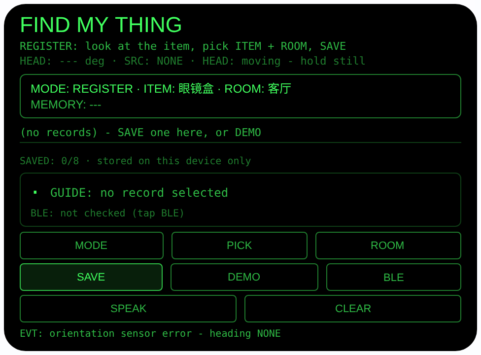
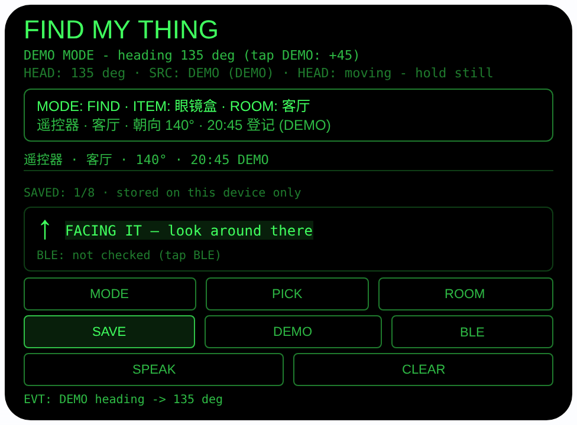

# find-my-thing — 寻物方位（Rokid 眼镜 AIUI Agent）

**Studio 导入地址**（复制到 Global AIUI Studio 的 Import Project 输入框）：

```
https://github.com/sakai55/rokid/tree/agent-find-my-thing
```


50 个「指向性生活问题」Agent 的第 DI07 个。眼镜盒、钥匙、遥控器、钱包
放下就忘在哪：放下时看着它登记一下，眼镜记下「物品 + 房间 +
你当时的头部朝向 + 时间」；找的时候选中物品慢慢转头，转到你现在的
朝向和当时登记的朝向对上，就是你当时站在那看它的方向。

## 预览截图

截图统一存放于仓库根目录 `screenshots/find-my-thing/`。





## 解决的问题

东西随手一放，转身就想不起来放哪了：钥匙在玄关还是书房？遥控器
刚才明明在手边。手机备忘只能记文字，而「放哪了」本质上是一个
方位记忆问题 — 你放下它时正站在哪、面朝哪。本 Agent 把登记动作
挂在视线上：看着物品登记，找时用转头复现当时的朝向。

## 指向性设计（为什么必须用眼镜）

- **登记 = 把物品绑在你的朝向上（HEAD）**：SAVE 时记录的不只是
  物品名和房间，还有那一刻 `AbsoluteOrientationSensor` 读到的
  头部朝向角（yaw）和时间 — 你「面朝哪放下它」本身就是最强的
  位置线索，手机拿在手里测不到这个朝向。
- **寻物 = 转头对齐朝向**：相对角 = 登记朝向 − 当前朝向，归一化
  到 −180°…180°，视线内显示 8 向大箭头与
  「TURN: LEFT-FRONT 40°」式提示；|相对角| ≤ 15° 时高亮
  「FACING IT — look around there」— 你正对着当时看它的方向，
  在那附近找即可。不报东南西北，只报相对你头部的方向。
- **朝向来源如实标注**：界面全程标 SENSOR / DEMO / NONE；没有
  传感器读数时 SAVE 直接拒绝并说明，绝不编造一个朝向存进去。
- **头部稳定 + 点头登记**：`enableWorldAwareness()` 后头部稳定
  （HEAD STEADY）时点头 = SAVE（FIND 模式下点头 = SPEAK），
  放东西时双手往往正忙，点头比腾手点按钮顺手。
- **耳朵收记忆**：SPEAK 用中文朗读记忆行 + 相对方向，如
  「遥控器在客厅，你当时面朝140度，20点45分登记。向你右前方
  转40度，就对着当时看它的方向。」

## 功能流程

1. REGISTER（默认）：看着要放下的物品，ITEM 轮换物品
   （眼镜盒 / 钥匙 / 遥控器 / 钱包 / 药瓶 / 耳机），ROOM 轮换房间
   （客厅 / 卧室 / 书房 / 厨房 / 玄关）
2. 点 SAVE，或头部稳定时点头 → 存 {物品， 房间， 朝向°,
   时间 HH:MM} 到 wx 同步存储（key `findMyThing`，最多 8 条，
   同一物品重新登记覆盖旧记录）；已登记列表常驻显示
   「物品 · 房间 · 朝向 · 时间」，关掉重开还在（onLoad 读取、
   onUnload 落盘）；CLEAR 清空全部
3. FIND：点 MODE 切换，PICK 轮换已登记物品 → 记忆行显示
   「遥控器 · 客厅 · 朝向 140° · 14:20 登记」，慢慢转头看箭头，
   转到 FACING IT 高亮就在那附近找；SPEAK 朗读记忆 + 方向
4. BLE（可选）：只查蓝牙可用性（`getAvailability`），提示可另行
   配对追踪器；不测距、不报信号强度
5. DEMO：登记一条标注 DEMO 的样例（遥控器 · 客厅 · 140°）并
   自动切到 FIND；之后每点一次 DEMO 朝向 +45°，箭头随之旋转，
   转到 135° 时相对角 5° 进入 FACING IT — 预览可完整演示

> 诚实说明：这是「方位记忆」，不是物品追踪。眼镜记住的是你当时
> 看向哪，不是物品现在在哪；物品被别人移动过，指引到的仍是你
> 上次看见它的地方。已文档化的蓝牙 API 没有距离/RSSI，本 Agent
> 不假装有接近感应。

## 权限

无 — 本 Agent 不申请任何权限：朝向传感器与蓝牙可用性检查在
AIUI 里都不需要单独的权限声明。记录只存本机 wx 同步存储，
不上传、不联网。

## 打包与预览

```bash
cd ~/workspace/rokid/find-my-thing
~/tools/bin/aix pack . -o ../dist/find-my-thing.aix
~/tools/bin/aix preview . --html-out artifacts/preview.html
```

本地预览截图走 `~/workspace/preview-tools/` 的本地 Ink + puppeteer 路线
（`shot-find.js`；FIND 截图的点击序列为 canvas 内 DEMO (240, 279) 连点
4 次：登记样例并切到 FIND，再步进朝向 45°/90°/135° 到 FACING IT；
注意 artifacts/preview.html 需先把 importmap 的 jspm 地址换成本地
`/ink/index.js` 再复制到 preview-tools/www/）。

## 真机测试（海外版 · 云端下发 · Path 1）

1. 推到 GitHub 后，Global AIUI Studio（aiui-global.rokid.com，en-US）用
   分支导入：`https://github.com/sakai55/rokid/tree/agent-find-my-thing`
   （该分支根目录即本 Agent 文件）
2. Studio 的 **Device Debug** 页签填 Basic Information，在 AIX Packaging
   点 **Repackage and Save**，确认顶部出现绿色
   **● Debug version ready — Ready for device debugging**
3. **Hi Rokid**（海外版 `com.rokid.sprite.global.aiapp`，不是国内版
   Rokid Ai App）→ 设置 → 开发者选项 → AIUI → 更新眼镜资源包，
   等「智能体资源包下载成功」
4. 对眼镜说「乐奇，打开 find-my-thing」，把遥控器放到客厅、面朝它
   SAVE 登记，再到 FIND 模式转头验证箭头与 FACING IT

## 真机测试信息（Global AIUI Studio · Device Debug）

| 项目 | 值 |
|---|---|
| Agent Name（Studio） | 待导入后回填 |
| Version（Build） | 1.0.0（待导入后回填） |
| App Category | 待导入后回填 |
| Intent Description | 待导入后回填 |
| Agent ID | 待导入后回填 |
| AIX Package Size | 14.41 KB（本地打包 `dist/find-my-thing.aix`） |
| 状态 | 本地完成，待导入 Studio |
| Studio | aiui-global.rokid.com（en-US） |
| 下发方式 | 云端下发 → Hi Rokid（海外版）更新眼镜资源包 |

## 验证情况

**已验证**

- 静态检查：app.json / package.json JSON 解析通过；`<script def>` JSON
  解析通过；`<script setup>` 与 app.js 提取后 `node --check` 语法通过；
  全目录 grep 无 `Page(` / `App(` / `Widget(` / `workers:` 残留。
- 打包：`aix pack` 成功；`aix list` 核对包内含 README.md、AGENTS.md、
  app.js、app.json、package.json、pages/index/index.ink
  （artifacts/ 已被 .aixignore 排除）。app.json 未写 permissions
  字段（本 Agent 不需要任何权限），打包正常。
- 预览渲染：aix preview + 本地 Ink + puppeteer 截图两张（见
  Preview Media）：首页 REGISTER 态完整渲染（物品 眼镜盒 / 房间
  客厅已选、无记录、朝向 SRC NONE 如实标注 — 预览主机方向传感器
  报错，代码按 NONE 路径处理，不编造朝向）；DEMO 连点 4 次后
  切到 FIND：样例记录「遥控器 · 客厅 · 140° · 登记时间 DEMO」入列
  （SAVED 1/8），朝向步进到 135°，相对角 5°，箭头 ↑ 且
  「FACING IT — look around there」高亮，记忆行完整显示。

**未验证**

- 真机 AbsoluteOrientationSensor 朝向读数的精度与零点参考
  （朝向是机身/头部相对方位，真机待测；本 Agent 只用登记与
  寻物两次读数的相对关系，零点漂移会影响指引准确度，已在
  设计上如实说明）。
- 真机头部稳定检测、点头手势、TTS 朗读记忆行的效果。
- 真机蓝牙可用性检查返回值（预览主机未点 BLE 做实测，
  代码按 SKIP/不可用如实显示路径处理）。
- **这不是物品追踪**：眼镜不定位物品本身，只复现你登记时的
  朝向；物品被移动后指引到的是上次看见它的地方。这是已知的
  产品边界，不是待补的验证项。

---

## 提审资料（Review Submission）

> Global AIUI Studio → Submit 页签的 Review Information 逐项对应下面四段，
> 提交时整段复制。每次提交前重新确认 Preview Media。

### Feature Description

Find My Thing turns your head into a place memory. When you put something down - glasses case, keys, remote, wallet - look at it and register it: the agent stores the item, the room, your head heading at that moment, and the time. Later, pick the item and turn slowly: a big arrow and a spoken direction guide you until you face the exact heading you had when you last saw it. It remembers where you looked - on-device only, no tracking tags needed.

### Opening Message

Hi, I'm **Find My Thing** - I remember where you last saw your things.

Putting something down? Look at it, tap **ITEM** and **ROOM**, then **SAVE** (or nod while your head is steady) - I note the item, the room, your heading and the time. Looking for it later? Switch to **FIND**, pick the item, and turn until I say **FACING IT** - you are facing the way you faced when you last saw it. Tap **SPEAK** to hear the memory, or **DEMO** to try it now.

### Preview Media

提交要求：3–5 个 JPG/PNG 图片或 MP4 视频，至少含 1 张图和 1 个视频，每次提交前重新确认。

- Image 1：`artifacts/preview-find-my-thing-index.png`（aix preview 首页 REGISTER 态：物品/房间已选、无记录、朝向 SRC NONE 如实标注，本地文件，提交时从本地上传）
- Image 2：`artifacts/preview-find-my-thing-find.png`（DEMO 登记样例并步进朝向到 135° 后的 FIND 指引态：记忆行、记录列表、大箭头 ↑ 与 FACING IT 高亮，本地文件）
- Video：待真机补 — 真机录制「放下遥控器看着它登记 → 换个房间 → FIND 转头对齐朝向找到它」全过程（MP4），录好后放 `artifacts/` 并更新此处
- 状态：未齐（已有 2 张图；还需至少 1 个视频，总数补到 3–5 个后才可提交）

### Change Log

#### Build 1.0.0

**Features added**

- Heading-bound place memory: registering an item stores the item, the room, your AbsoluteOrientationSensor head heading and the time in wx sync storage (key findMyThing, up to 8 records, re-registering an item replaces its old record), loaded on open and saved on close.
- Find-by-turning guidance: relative angle (stored heading minus current heading) drives an 8-way big arrow and TURN text, with a FACING IT highlight within 15 degrees; a memory line shows item, room, stored heading and registration time.
- Honest heading sources: the UI labels heading as SENSOR, DEMO or NONE at all times, and SAVE refuses to register when no heading exists instead of inventing one; head-stability plus nod saves in REGISTER mode and speaks in FIND mode.
- SPEAK reads the memory line plus the live relative direction in Chinese; BLE button performs a documented-API availability check only and states plainly that no distance or RSSI is available.
- DEMO registers a labeled sample record (remote, living room, 140 degrees), switches to FIND, and steps the simulated heading by 45 degrees per tap so the arrow rotation and the FACING IT state are fully previewable.

**Improvements**

- None (initial release).

**Fixes**

- None (initial release).
