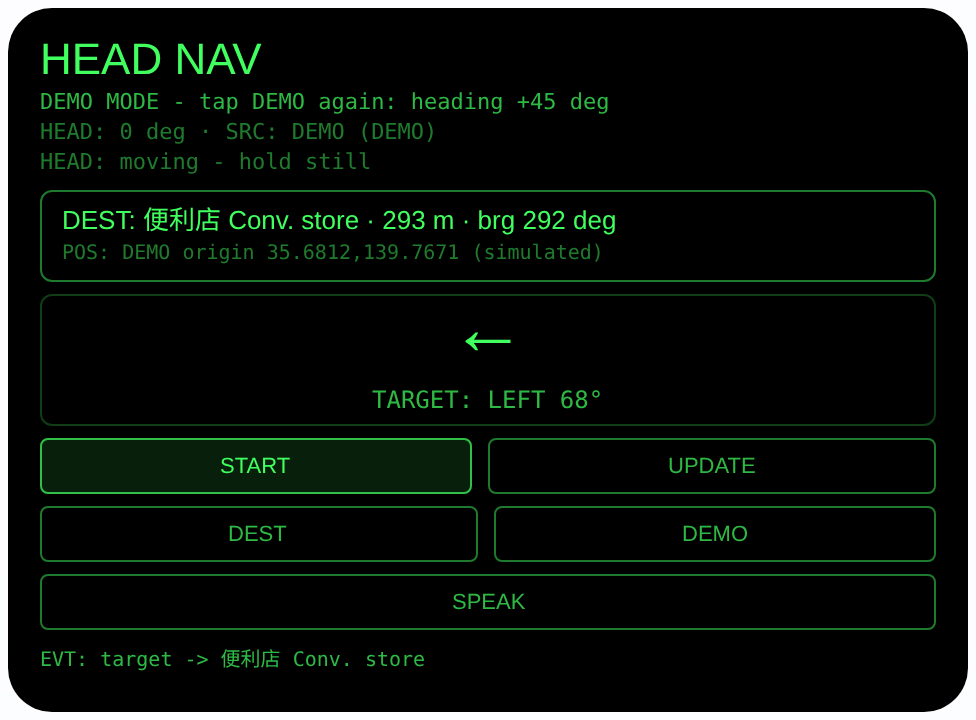
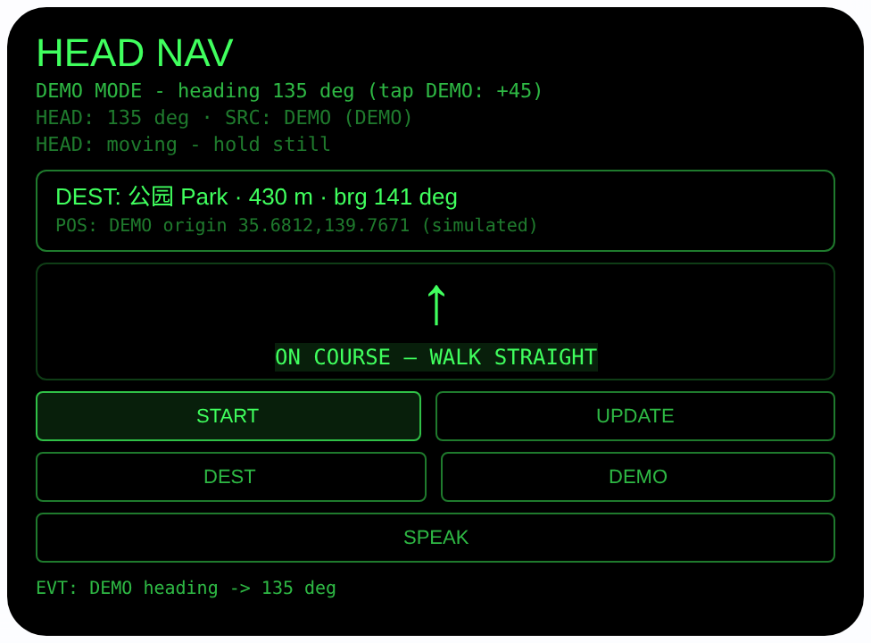

# head-nav — 头向导航（Rokid 眼镜 AIUI Agent）

**Studio 导入地址**（复制到 Global AIUI Studio 的 Import Project 输入框）：

```
https://github.com/sakai55/rokid/tree/agent-head-nav
```


50 个「指向性生活问题」Agent 的第 Z06 个。看手机导航要低头走路，
东南西北又分不清——本 Agent 把目标方向换算成相对你头部朝向的方向：
视线里一个大箭头加「左前方 35°」，转头让箭头朝上就能往前走，
语音也只报相对方位，眼睛始终看着路。

## 预览截图

截图统一存放于仓库根目录 `screenshots/head-nav/`。





## 解决的问题

手机导航要低头看屏幕，走路危险；语音导航报「向东北方向」，
多数人当场分不清哪边是东北。本 Agent 只报相对方向——
「在你左前方 35 度」——转头/转身把箭头转到正上方，方向就对了。

## 指向性设计（为什么必须用眼镜）

- **头部朝向即罗盘（HEAD）**：`AbsoluteOrientationSensor`（约 5Hz）
  读四元数 `[x, y, z, w]`，由 yaw 公式算出头部朝向角；界面如实标注
  来源 `SENSOR / DEMO / NONE`，传感器不可用就不编造朝向。
- **目标方位 → 相对方位（核心）**：定位后用 Haversine 公式算目标
  距离、初始方位角公式算目标方位角，再算相对角
  = 目标方位角 − 头部朝向（归一化 −180°…180°）。显示 8 向大箭头
  （↑ ↗ → ↘ ↓ ↙ ← ↖）与方向词（FRONT / LEFT-FRONT / … + 度数）；
  |相对角| ≤ 15° 时高亮 **ON COURSE — WALK STRAIGHT**。
  **全程不出现东南西北。**
- **耳朵收指引**：SPEAK 用 TTS 念相对方位中文句，如「公园在你
  左前方 35 度，约 430 米」，由实时计算值生成；ON COURSE 时
  念「公园就在你正前方，一直往前走」。
- **凝视确认**：`enableWorldAwareness()` 开启后显示头部稳定状态
  （HEAD STEADY）；点头 = 重新定位并重算。

## 功能流程

1. 点 START（或 UPDATE / 点头 / 按 Enter）→ `navigator.geolocation`
   单次定位，失败显示 FAIL 与错误码（如 PERMISSION_DENIED）
2. 目标点位：车站 / 便利店 / 公园 / 家，以「相对当前定位的经纬度
   小偏移」内置（+0.004,+0.002 等），所以在任何地点打开都能算出
   方位与距离；DEST 按钮或 ArrowUp / ArrowDown 切换目标
3. 转头看箭头：箭头朝上 + ON COURSE 高亮 = 方向对了，往前走
4. 走一段点 UPDATE 重新定位重算；点 SPEAK 听相对方位播报
5. DEMO 仿真：原点固定在标注了 DEMO 的演示坐标
   （35.6812, 139.7671），朝向从 0° 起、每点一次 DEMO +45°，
   箭头随之旋转——预览/无 GPS 环境也能完整演示到 ON COURSE

> 诚实说明：这是**方向罗盘，不是逐向道路导航**。运行时没有地图 /
> 路径规划服务，目标是内置演示偏移点，不能给真实路口转弯提示；
> 它解决的是「目标在我哪个方向、还有多远、我转对了没有」。

## 权限

| 权限 | 用途 |
|---|---|
| GEOLOCATION | 单次定位，计算目标相对方位与距离 |

仅此一项。定位只在用户触发时请求；朝向传感器不需要额外权限声明。

## 打包与预览

```bash
cd ~/workspace/rokid/head-nav
~/tools/bin/aix pack . -o ../dist/head-nav.aix
~/tools/bin/aix preview . --html-out artifacts/preview.html
```

本地预览截图走 `~/workspace/preview-tools/` 的本地 Ink + puppeteer 路线
（`shot-nav.js`；SEQ_A = DEMO→DEST 到便利店态，SEQ_B = DEST→公园
再 DEMO×3 转到 135° 的 ON COURSE 态；按钮 canvas 坐标
DEST (120,255)、DEMO (352,255)）。

## 真机测试（海外版 · 云端下发 · Path 1）

1. 推到 GitHub 后，Global AIUI Studio（aiui-global.rokid.com，en-US）用
   分支导入：`https://github.com/sakai55/rokid/tree/agent-head-nav`
   （该分支根目录即本 Agent 文件）
2. Studio 的 **Device Debug** 页签填 Basic Information，在 AIX Packaging
   点 **Repackage and Save**，确认顶部出现绿色
   **● Debug version ready — Ready for device debugging**
3. **Hi Rokid**（海外版 `com.rokid.sprite.global.aiapp`，不是国内版
   Rokid Ai App）→ 设置 → 开发者选项 → AIUI → 更新眼镜资源包，
   等「智能体资源包下载成功」
4. 对眼镜说「乐奇，打开 head-nav」，走到户外点 START，转头对箭头

## 真机测试信息（Global AIUI Studio · Device Debug）

| 项目 | 值 |
|---|---|
| Agent Name（Studio） | 待导入后回填 |
| Version（Build） | 1.0.0（待导入后回填） |
| App Category | 待导入后回填 |
| Intent Description | 待导入后回填 |
| Agent ID | 待导入后回填 |
| AIX Package Size | 13.10 KB（本地打包 `dist/head-nav.aix`） |
| 状态 | 本地完成，待导入 Studio |
| Studio | aiui-global.rokid.com（en-US） |
| 下发方式 | 云端下发 → Hi Rokid（海外版）更新眼镜资源包 |

## 验证情况

**已验证**

- 静态检查：app.json / package.json JSON 解析通过；`<script def>` JSON
  解析通过；`<script setup>` 与 app.js 提取后 `node --check` 语法通过；
  全目录 grep 无 `Page(` / `App(` / `Widget(` / `workers:` 残留。
- 方位数学：用 Node 对同一套 Haversine / 方位角公式独立核算——演示
  原点下车站方位 22.1° / 480 m、便利店 292.3° / 293 m、公园
  140.9° / 430 m、家 219.1° / 287 m，与界面显示一致；朝向 135°
  时对公园相对角 5.9°，正确进入 ON COURSE。
- 打包：`aix pack` 成功，`dist/head-nav.aix` 13.10 KB；`aix list`
  核对包内含 AGENTS.md、app.js、app.json、package.json、README.md、
  pages/index/index.ink（artifacts/ 已被 .aixignore 排除）。
- 预览渲染：aix preview + 本地 Ink + puppeteer 截图两张（见下方
  Preview Media）：DEMO 态完整渲染——便利店 293 m、方位 292°、
  箭头 ←、「TARGET: LEFT 68°」；继续转到朝向 135° 后箭头转 ↑ 并
  高亮「ON COURSE — WALK STRAIGHT」。
  预览主机无方向传感器，初始态如实显示 `SRC: NONE` 并给出传感器
  错误行（已处理，不崩溃）。

**未验证**

- 真机 AbsoluteOrientationSensor 的朝向精度与零点参考（宿主定义）、
  真机 GEOLOCATION 定位精度与授权流程——预览主机都没有，未测。
- 真机头部稳定检测、点头重新定位、TTS 相对方位播报的效果。
- 目标为内置演示偏移点（非真实地点数据库），运行时无地图/路径
  规划服务；本 Agent 是方向罗盘，不提供逐向道路导航。

---

## 提审资料（Review Submission）

> Global AIUI Studio → Submit 页签的 Review Information 逐项对应下面四段，
> 提交时整段复制。每次提交前重新确认 Preview Media。

### Feature Description

Head Nav turns walking directions into something your body understands. Instead of cardinal points, it converts the target bearing into a direction relative to where your head points: a big arrow plus words like LEFT-FRONT 35 degrees in your line of sight, and spoken relative guidance. Turn until the arrow points up and ON COURSE lights up, then walk. Built-in demo destinations and a simulation mode let anyone try the compass anywhere.

### Opening Message

Hi, I'm **Head Nav** — directions relative to your head, never north or south.

Tap **START** to fix your position. I'll show a big arrow to your destination: turn your head and body until the arrow points **up** and you see **ON COURSE**, then walk straight. Switch targets with **DEST** (station / store / park / home), nod anytime to re-fix, and tap **SPEAK** to hear it: "the park is at your left-front, about 430 metres." No GPS? Tap **DEMO** to simulate the full compass.

### Preview Media

提交要求：3–5 个 JPG/PNG 图片或 MP4 视频，至少含 1 张图和 1 个视频，每次提交前重新确认。

- Image 1：`artifacts/preview-head-nav-index.png`（aix preview DEMO 态：目标便利店 293 m、相对方向 LEFT 68°、箭头 ←，本地文件，提交时从本地上传）
- Image 2：`artifacts/preview-head-nav-course.png`（转头至朝向 135° 后的 ON COURSE 态：箭头 ↑ + 高亮「ON COURSE — WALK STRAIGHT」，本地文件）
- Video：待真机补 — 真机录制「点 START 定位 → 转头对箭头 → ON COURSE」全过程（MP4），录好后放 `artifacts/` 并更新此处
- 状态：未齐（已有 2 张图；还需至少 1 个视频，总数补到 3–5 个后才可提交）

### Change Log

#### Build 1.0.0

**Features added**

- Head-relative direction compass: GPS fix plus AbsoluteOrientationSensor heading, target bearing converted into a head-relative angle shown as an 8-way arrow and direction words (FRONT / LEFT-FRONT / ... plus degrees); ON COURSE highlight within 15 degrees. Cardinal points are never used.
- Four built-in demo destinations （车站 / 便利店 / 公园 / 家） expressed as small lat/lon offsets around your fix, so guidance works anywhere; DEST button or arrow keys switch targets.
- Spoken relative guidance in Chinese via SPEAK, generated from live values; nod re-fixes position; DEMO simulation mode with a labeled fixed origin and +45-degree heading steps.

**Improvements**

- None (initial release).

**Fixes**

- None (initial release).
