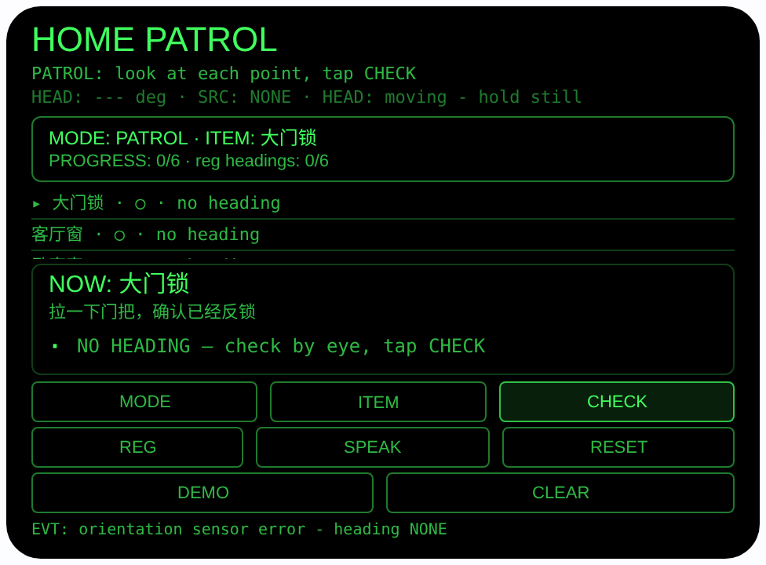
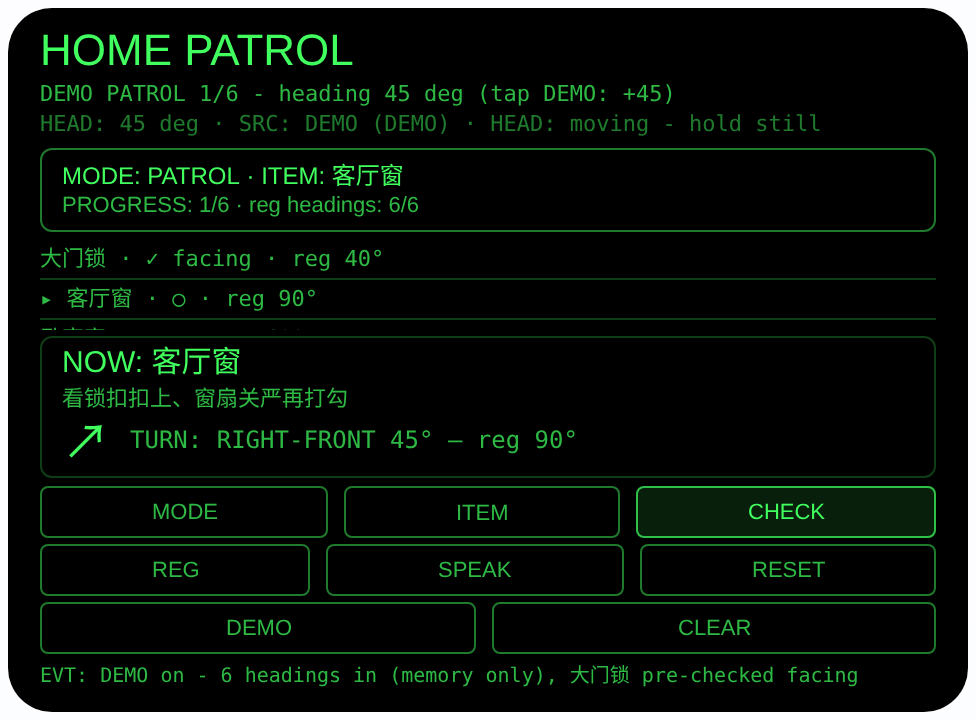

# home-patrol — 出门巡检（Rokid 眼镜 AIUI Agent）

**Studio 导入地址**（复制到 Global AIUI Studio 的 Import Project 输入框）：

```
https://github.com/sakai55/rokid/tree/agent-home-patrol
```


50 个「指向性生活问题」Agent 的第 DI28 个。出门前总有一组问题在
脑子里盘旋：门锁了吗？窗户关了吗？燃气阀拧了吗？水龙头还滴
吗？——锁了门走出去一百米，又开始怀疑。本 Agent 把巡检拆成
固定的六个检查点摆在你眼前，逐个领你走到跟前、看清楚、打勾；
登记过朝向的检查点，还会告诉你往哪边转、什么时候正对着它。
全六项打完勾，它才朗读「可以出门」。

> ⚠️ **诚实定位（先读）**：本 Agent 确认的是**「你逐项看过」**，
> 不是「阀门真的关好了」。它没有能力判断燃气阀是否关到位、
> 窗锁是否扣紧——检查的是你的眼睛，它只负责一个都不漏，并
> 如实记下每项是怎么打的勾。燃气阀的手柄方向含义因阀门类型
> 而异，请以自家阀门的标识为准；闻到燃气味时请直接关阀开窗、
> 联系燃气公司，不要对着眼镜慢慢核对。

## 预览截图

截图统一存放于仓库根目录 `screenshots/home-patrol/`。





## 解决的问题

出门焦虑的根源不是记性差，而是没有一份「走完的清单」：检查
动作做了，但没有顺序、没有确认、没有收尾，出了门自然要怀疑。
手机清单要点开 App、低头看屏幕，还不认识你家。本 Agent 利用
眼镜独有的能力：你站在哪、看向哪，本身就是信息——检查点可以
绑在你的头部朝向上，巡检时眼镜用相对方向把你领回每一个点
跟前，眼睛看、手打勾，全程不掏手机。

## 指向性设计（为什么必须用眼镜）

- **检查点 = 绑在头部朝向上的清单（核心）**：SETUP 模式站在
  你巡检时会站的位置，看着检查点点 REG，`AbsoluteOrientationSensor`
  的 yaw 朝向就和这个点绑在一起存下来（wx 同步存储
  `homePatrolPoints`）。六个点（大门锁 / 客厅窗 / 卧室窗 /
  燃气阀 / 水龙头 / 空调电源）各带一句亲眼核对的具体线索。
- **巡检 = 相对当前朝向逐项指引**：PATROL 对当前检查点算
  相对角 = 登记朝向 − 当前头部朝向（归一化 −180°…180°），
  显示 8 向箭头与「TURN: RIGHT-FRONT 45° — reg 90°」；
  |相对角| ≤ 20° 时高亮 **FACING IT — look carefully, then
  CHECK**。永远不报东南西北，只报相对你的方向。
- **打勾方式如实入账**：正对着登记朝向打的勾记 `✓ facing`，
  其余（未登记朝向、没对上、手动点按）记 `✓ by tap`，列表
  逐项可见。朝向是引导，不是假门禁——CHECK 点按永远可用，
  你可以对着清单诚实巡检，它不会假装验证了什么。
- **耳朵收收尾**：6/6 打完勾，大字 **ALL CLEAR — 可以出门**
  并自动 TTS 朗读「全部检查完，可以出门了」；SPEAK 随时
  朗读进度「还剩 X 项。当前一项：……」。
- **不编朝向（诚实边界）**：朝向来源如实标注
  `SENSOR / DEMO / NONE`；无传感器时 SETUP 登记直接拒绝
  （同 DI07 的规则）。朝向只对你登记时站的位置成立——巡检时
  站回登记位置附近，FACING 才有意义。

## 功能流程

1. （可选，一次性）SETUP 登记：MODE 切到 SETUP，ITEM 选检查点，
   站到巡检站位、看着它点 REG（或头部稳定时点头、Enter）→
   绑定朝向；六个点逐个登记。没登记的点也能巡检，只是没有
   转向指引
2. 出门巡检：PATROL 按顺序逐项走——看当前点的大字与线索，
   有朝向的按箭头转头对上，亲眼核对后点 CHECK（或正对 /
   未登记时头部稳定点头）→ 记下 ✓ facing 或 ✓ by tap，
   自动跳下一项；PROGRESS 实时显示 x/6
3. 全绿：6/6 后大字 ALL CLEAR + 自动朗读「可以出门」；
   RESET 开新一轮（清打勾、保留登记）
4. DEMO 仿真：点 DEMO 在内存里给 6 个点绑上演示朝向
   40° / 90° / 160° / 230° / 300° / 340°（不写存储、不覆盖
   真实登记），朝向从 45° 起步——离大门锁（40°）只差 −5°，
   处于 FACING 并预打勾，落在 1/6、当前项客厅窗
   （TURN: RIGHT-FRONT 45°）；之后每点一次 DEMO 朝向 +45°。
   DEMO 中点 CLEAR 退出演示并恢复真实登记

## 权限

| 权限 | 用途 |
|---|---|
| （无） | 本 Agent 不声明任何权限：不用相机、不用麦克风、不用定位 |

app.json 无 `permissions` 字段（同 DI07 / DI15）；头部朝向传感器
在 AIUI 里不需要单独的权限声明。

## 打包与预览

```bash
cd ~/workspace/rokid/home-patrol
~/tools/bin/aix pack . -o ../dist/home-patrol.aix
~/tools/bin/aix preview . --html-out artifacts/preview.html
```

本地预览截图走 `~/workspace/preview-tools/` 的本地 Ink + puppeteer 路线
（`shot-patrol.js`；Shot A = 初始 PATROL 态无点击；Shot B = 点
DEMO 一次（canvas 坐标 125,303）落到 DEMO 巡检 1/6 态）。

## 真机测试（海外版 · 云端下发 · Path 1）

1. 推到 GitHub 后，Global AIUI Studio（aiui-global.rokid.com，en-US）用
   分支导入：`https://github.com/sakai55/rokid/tree/agent-home-patrol`
   （该分支根目录即本 Agent 文件）
2. Studio 的 **Device Debug** 页签填 Basic Information，在 AIX Packaging
   点 **Repackage and Save**，确认顶部出现绿色
   **● Debug version ready — Ready for device debugging**
3. **Hi Rokid**（海外版 `com.rokid.sprite.global.aiapp`，不是国内版
   Rokid Ai App）→ 设置 → 开发者选项 → AIUI → 更新眼镜资源包，
   等「智能体资源包下载成功」
4. 对眼镜说「乐奇，打开 home-patrol」，先在 SETUP 里逐个登记
   六个检查点的朝向，再走一轮完整巡检，故意漏看一项看它
   是否拦在未完成状态，最后听全绿播报

## 真机测试信息（Global AIUI Studio · Device Debug）

| 项目 | 值 |
|---|---|
| Agent Name（Studio） | 待导入后回填 |
| Version（Build） | 1.0.0（待导入后回填） |
| App Category | 待导入后回填 |
| Intent Description | 待导入后回填 |
| Agent ID | 待导入后回填 |
| AIX Package Size | 约 16.9 KB（本地打包 `dist/home-patrol.aix`，含本 README） |
| 状态 | 本地完成，待导入 Studio |
| Studio | aiui-global.rokid.com（en-US） |
| 下发方式 | 云端下发 → Hi Rokid（海外版）更新眼镜资源包 |

## 验证情况

**已验证**

- 静态检查：app.json / package.json JSON 解析通过；`<script def>` JSON
  解析通过；`<script setup>` 与 app.js 提取后 `node --check` 语法通过；
  全目录 grep 无 `Page(` / `App(` / `Widget(` / `workers:` 残留；
  app.json 无 `permissions` 字段（零权限，与设计一致）。
- 状态/朝向数学：用 Node 加载页面对象（wx 打桩）跑 40 条断言全过——
  相对角公式（含跨 0° 缠绕 ±20°/∓180°）、8 向命名、FACING 阈值
  边界（|相对角| = 20° 为 facing、21° 为 away）、无朝向时 REG
  如实拒绝且不落盘、正对打勾记 `facing` / 未登记打勾记 `tap`、
  打勾自动推进、6/6 进入 ALL CLEAR、RESET 清打勾且保留登记、
  登记的存储往返（按检查点名对齐）。
- DEMO 确定性：同一套断言验证 DEMO 落点——演示朝向
  40/90/160/230/300/340、起始朝向 45°、第 1 项以 facing 预打勾、
  进度 1/6、当前项客厅窗指引文案恰为
  「TURN: RIGHT-FRONT 45° — reg 90°」、再点 DEMO 步进到 90°
  时第 2 项进入 FACING；且演示朝向从不写入 wx 存储（落盘被
  DEMO 守卫拦住），CLEAR 退出演示后恢复真实登记。
- 打包：`aix pack` 成功（大小见上表）；`aix list` 核对包内含
  AGENTS.md、app.js、app.json、package.json、README.md、
  pages/index/index.ink（artifacts/ 已被 .aixignore 排除）。
- 预览渲染：aix preview + 本地 Ink + puppeteer 截图两张（见下方
  Preview Media）：初始 PATROL 态完整渲染（六项未打勾、当前项
  大门锁 + 线索、NO HEADING 提示；预览主机无可用方向传感器，
  初始态如实显示 `SRC: NONE`，传感器错误事件被处理、不崩溃）；
  DEMO 态渲染出 1/6 进度、第 1 项 `✓ facing · reg 40°` 行与
  客厅窗的 TURN 指引 + ↗ 箭头，与 Node 断言的落点一致。

**未验证**

- 真机 AbsoluteOrientationSensor 朝向精度/零点、头部稳定与
  点头触发——预览主机都没有，未测；尤其巡检站位与登记站位
  不一致时 FACING 的实际可用范围，要在真机上走一轮才知道。
- 真机上「SETUP 逐项登记 → 完整巡检 → 全绿播报」的全流程，
  以及登记在眼镜重启后经 wx 存储恢复的情况——未实测。
- TTS 中文播报（进度朗读与全绿播报）在真机上的效果。
- 本 Agent 不验证任何检查点的真实状态（阀门/锁扣/水龙头），
  这是设计定位而非缺陷：核对永远由佩戴者的眼睛完成。

---

## 提审资料（Review Submission）

> Global AIUI Studio → Submit 页签的 Review Information 逐项对应下面四段，
> 提交时整段复制。每次提交前重新确认 Preview Media。

### Feature Description

Home Patrol is a leave-home checklist on your glasses: six checkpoints — door lock, living-room window, bedroom window, gas valve, tap, air-con power. In SETUP you can bind each point to a head heading; on patrol the list walks you point to point with turn guidance, you look at each one and check it off — the list honestly records whether you were facing it or tapped — and only at 6/6 does it say ALL CLEAR and speak your send-off.

### Opening Message

Hi, I'm **Home Patrol** — let's check the flat before you leave.

I walk you through **six checkpoints**: door lock, two windows, gas valve, tap, air-con power. **Look** at each point, read its cue, and tap **CHECK** (or nod when facing it). Registered a heading in **SETUP**? My **arrow** turns you toward each point. Only when all six are ticked do I say **ALL CLEAR — you can head out**. I log that you looked — your eyes do the verifying.

### Preview Media

提交要求：3–5 个 JPG/PNG 图片或 MP4 视频，至少含 1 张图和 1 个视频，每次提交前重新确认。

- Image 1：`artifacts/preview-home-patrol-index.png`（aix preview 初始 PATROL 态：六项未打勾、当前项大门锁与核对线索、NO HEADING 提示，本地文件，提交时从本地上传）
- Image 2：`artifacts/preview-home-patrol-patrol.png`（DEMO 巡检态：进度 1/6，大门锁 ✓ facing · reg 40°，当前项客厅窗 TURN: RIGHT-FRONT 45° 指引与 ↗ 箭头，本地文件）
- Video：待真机补 — 真机录制「SETUP 逐项登记朝向 → 完整巡检六项 → ALL CLEAR 播报」全过程（MP4），录好后放 `artifacts/` 并更新此处
- 状态：未齐（已有 2 张图；还需至少 1 个视频，总数补到 3–5 个后才可提交）

### Change Log

#### Build 1.0.0

**Features added**

- Fixed six-point leave-home patrol (door lock, living-room window, bedroom window, gas valve, tap, air-con power), each with a concrete look-and-verify cue; PATROL mode walks the list in order with a big current-point display, progress x/6, and per-point spoken progress via SPEAK.
- Optional heading binding per checkpoint (SETUP mode): stand at your patrol spot, look at the point and REG — the head heading (orientation-sensor yaw, source honestly labeled SENSOR / DEMO / NONE; REG refuses when no heading exists instead of inventing one) is persisted on-device in wx storage (key homePatrolPoints). On patrol, registered points get an 8-way arrow and TURN guidance, with a FACING IT highlight within 20 degrees.
- Honest check-off accounting: every tick records how it was made — facing the registered heading, or by tap — shown per row in the list; the checklist completes only at 6/6, which shows ALL CLEAR and auto-speaks the send-off in Chinese; RESET starts a new patrol keeping registrations, CLEAR removes them; DEMO binds six simulated headings in memory only (never overwriting real registrations), pre-checks the first point as facing, and steps the simulated heading +45 degrees per tap.

**Improvements**

- None (initial release).

**Fixes**

- None (initial release).
