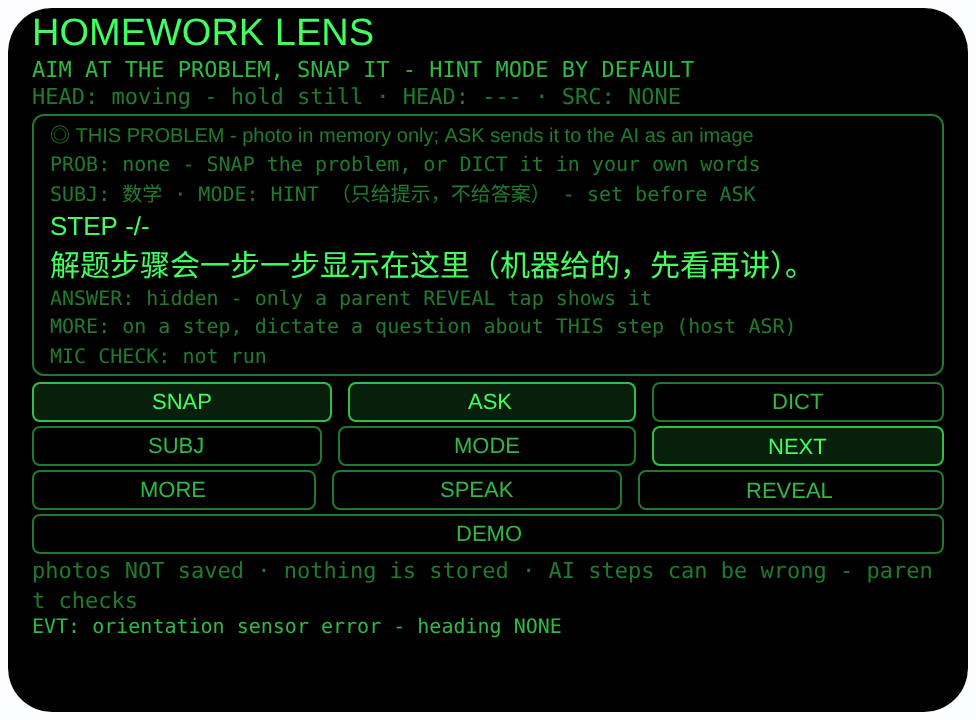
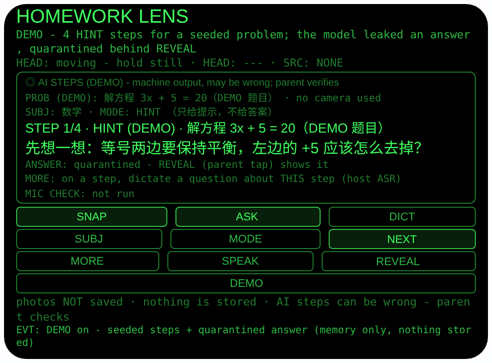
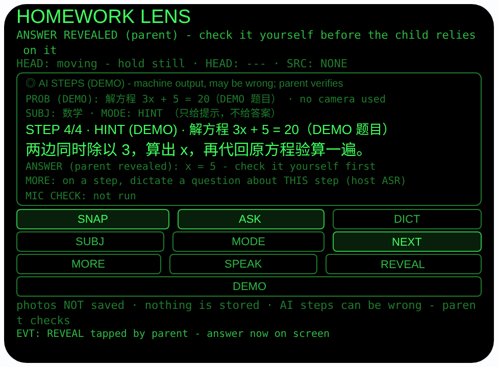

# homework-lens — 作业辅导（Rokid 眼镜 AIUI Agent）

**Studio 导入地址**（复制到 Global AIUI Studio 的 Import Project 输入框）：

```
https://github.com/sakai55/rokid/tree/agent-homework-lens
```

**AIX 直接下载**（最新版）：[homework-lens.aix](https://raw.githubusercontent.com/sakai55/rokid/main/aix/homework-lens.aix)


50 个「指向性生活问题」Agent 的第 DI40 个，H 组（学习记忆）第四个。
孩子题目不会，家长常常不是不会做，而是讲不清步骤——一上来
报答案，孩子没学会；从头推导，又不知从哪一台阶开始。本 Agent
让你看向题目拍一张长焦照片，眼镜把照片作为图片发给主机大模
型，按事先选好的模式生成分步辅导：默认「只给提示」模式只有
台阶、没有答案；一步一步陪孩子走，卡在哪一步就问哪一步。

## 预览截图

截图统一存放于仓库根目录 `screenshots/homework-lens/`。







## 解决的问题

辅导作业的难点在「台阶」：成人一眼看到答案，孩子卡在中间某
一级。手机搜题 App 是答案机——拍一下全解出来，孩子抄完毫无
收获；家长自己硬讲，又容易跳过孩子真正卡住的那一步。本
Agent 把节奏握在家长手里：照片变成分步提示，一次只放一级
台阶，家长陪着走；孩子在哪一步皱眉，就对着那一步追问；答
案锁在家长的显式点击后面，默认的 HINT 模式里屏幕上根本不
存在答案。

## 指向性设计（为什么必须用眼镜）

- **看向即取景（GAZE 长焦）**：题目在本子上、常常字小行
密，SNAP 用 `ImageCapture.takePhoto({mode:'telephoto'})`
长焦取景——你看向哪道题，拍的就是哪道，头朝向同时记进
这次会话（`AbsoluteOrientationSensor` 四元数算 yaw；无传
感器时如实记 `---`）。家长的手始终空着，可以指着本子讲。
- **读题走官方路径（telephoto + LLM 图片输入）**：运行时
没有 OCR API（档案 §4.3）。照片 Blob 经
`FileReader.readAsDataURL` 编码为 data: URL，作为 user 消
息的 `{type:'image_url'}` 内容连同文字指令发给主机
`LanguageModel`——这是档案 §2.9 / §4.3 给出的官方读字路
径，DI39 板书捕获已先行落地，本 Agent 复用同一套通路与失
败围栏。提示词要求先一行复述题目（读不清就明说、不许编
造），再按模式给编号步骤。
- **模式先行（答案纪律是产品核心）**：ASK 之前选好科目
与模式。HINT（默认）模式下提示词明令：每步只能是提示或
引导问题、不许算出题、不许出现最终答案；FULL 模式步骤
带推导，最终答案只许出现在末尾 ANSWER 行。解析层再兜
一道：任何 `ANSWER:` / `答案：` 行——包括 HINT 模式下模
型违规漏出的、追问回答里夹带的——都被整行剥离进隔离区，
不进步骤流、不会被朗读，只有家长点 REVEAL 才显示。
- **看哪步问哪步（追问带上下文）**：停在某一步点 MORE，
口述你的问题（原样显示），追问以纯文字发给模型，上下文
在提示词里重述——题目复述 + 当前步原文 + 模式规则。回
答标注「LLM, may be wrong - parent checks」，至多三句。
- **什么都不存（诚实边界常驻界面）**：作业是一次性的，
本 Agent 不写任何存储；照片只活在内存里，界面常驻行写
明「photos NOT saved · nothing is stored」。

## 功能流程

1. SUBJ / MODE：ASK 之前选科目（数学/语文/英语/科学/其
他）与模式（HINT 只给提示 / FULL 讲清步骤）；ASK 后再
改只对下一道题生效，界面明说
2. SNAP：看向题目拍长焦照片（记录朝向 + 时间；照片只在
内存，无相机主机如实 FAIL 并提示改走 DICT）；或 DICT：
口述题目（wearer 麦克风可用性检查后宿主识别，原文显示
核对），ASK 时走纯文字通路
3. ASK：照片 → data: URL → 主机大模型图片输入（或口述
题目的纯文字请求），返回题目复述 + 编号步骤；模型不可
用 / 转换不可用 / 模型报错 / 返回无步骤，全部如实落到
对应状态：图片失败转 DICT，模型失败给 3 条**内置**教练
提示（标注 BUILT-IN、明说 not AI）
4. NEXT / 点头（头部稳定时）：一次推进一步；SPEAK 朗
读当前步；最后一步后 NEXT 停住并提示 MORE / REVEAL
5. MORE：对当前步口述追问（检查结果单独一行
`MIC CHECK:`，聆听标注 `(host ASR)`），带上下文问模
型，回答标注来源与「may be wrong」；HINT 模式下追问回
答夹带的答案行同样被隔离
6. REVEAL（家长显式点击）：显示隔离中的答案并提示家长
先核对；没有存下答案时如实显示「none stored」，绝不编造
7. DEMO：内存播入一道标注 DEMO 的方程题与 4 步 HINT 步
骤，并故意播入一条模型漏出的答案演示隔离——答案藏在
REVEAL 后；再点 DEMO 退出

> 诚实边界：**没有 OCR**，读题靠「照片 → 大模型图片输
> 入」这条官方路径，而宿主真机是否真的接受 image_url /
> data: URL、FileReader 是否可用，**都未经真机验证**（见
> 「未验证」第一条）——所以失败路径条条有出路：图片通路
> 不通就口述题目，模型不通就用内置教练提示。大模型的步
> 骤是机器输出，会读错题、会算错步，家长先核对再讲，是
> 本 Agent 的设计前提，不是免责话术。

## 权限

| 权限 | 用途 |
|---|---|
| CAMERA | SNAP 长焦拍题目（照片只在内存中转、供 ASK 转 data: URL，从不落盘保存） |
| RECORD_AUDIO | DICT 口述题目 / MORE 口述追问前的佩戴者模式麦克风可用性检查（getUserMedia，检查流立即停轨）+ 宿主 SpeechRecognition 一次性识别（zh-CN） |

相机/麦克风只在用户点 SNAP / DICT / MORE 时启动，用完立
即停掉全部媒体轨道。不录音；照片不写入任何存储，只随
ASK 的那一次请求经宿主通道发给大模型。本 Agent 不写任何
wx 存储。

## 打包与预览

```bash
cd ~/workspace/rokid/homework-lens
~/tools/bin/aix pack. -o../dist/homework-lens.aix
~/tools/bin/aix preview. --html-out artifacts/preview.html
```

本地预览截图走 `~/workspace/preview-tools/` 的本地 Ink + puppeteer 路线
（`shot-homework.js`，独立页面副本 `preview-homework.html`；点击
序列为 canvas 内坐标 DEMO (240, 263) → NEXT (385, 226) ×3 →
REVEAL (385, 253)，坐标经视觉定位与试点击确认）。

## 真机测试（海外版 · 云端下发 · Path 1）

1. 推到 GitHub 后，Global AIUI Studio（aiui-global.rokid.com，en-US）用
分支导入：`https://github.com/sakai55/rokid/tree/agent-homework-lens`
（该分支根目录即本 Agent 文件）
2. Studio 的 **Device Debug** 页签填 Basic Information，在 AIX Packaging
点 **Repackage and Save**，确认顶部出现绿色
**● Debug version ready — Ready for device debugging**
3. **Hi Rokid**（海外版 `com.rokid.sprite.global.aiapp`，不是国内版
Rokid Ai App）→ 设置 → 开发者选项 → AIUI → 更新眼镜资源包，
等「智能体资源包下载成功」
4. 对眼镜说「乐奇，打开 homework-lens」，拿一本真实作业实测：
**第一优先验证 ASK 的图片通路**——SNAP 一道印刷体数学题，
ASK（HINT）是否真的返回分步提示（验证宿主接受 image_url /
data: URL、FileReader 可用）、步骤是否只有提示没有答案、
模型偶尔漏出答案时是否被隔离在 REVEAL 后；再测 FULL 模式
答案隔离、MORE 追问对当前步的针对性、DICT 口述题目的识别
率、长焦拍手写题的清晰度

## 真机测试信息（Global AIUI Studio · Device Debug）

| 项目 | 值 |
|---|---|
| Agent Name（Studio） | 待导入后回填 |
| Version（Build） | 1.0.1（待导入后回填） |
| App Category | 待导入后回填 |
| Intent Description | 待导入后回填 |
| Agent ID | 待导入后回填 |
| AIX Package Size | 约 26.2 KB（本地打包 `dist/homework-lens.aix`） |
| 状态 | 本地完成，待导入 Studio |
| Studio | aiui-global.rokid.com（en-US） |
| 下发方式 | 云端下发 → Hi Rokid（海外版）更新眼镜资源包 |

## 验证情况

**已验证**

- 静态检查：app.json / package.json JSON 解析通过；`<script def>` JSON
解析通过；`<script setup>` 与 app.js 提取后 `node --check` 语法通过；
全目录 grep 无 `Page(` / `App(` / `Widget(` / `workers:` 残留。
- 辅导逻辑（Node 实测）：把页面对象以 wx / LanguageModel /
FileReader / SpeechRecognition / speechSynthesis /
ImageCapture 全部打桩加载进 Node，共 **93 条断言全过**——
含提示词组装（图片请求 content 恰两段、HINT 文案含
hints-only 规则与「不许给出最终答案」、格式段不要求
ANSWER 行，FULL 才要求答案只出现在末尾 ANSWER 行；
image_url 段携带 data: 前缀 URL、科目写进上下文；纯文字
请求带口述题目原文与模式规则）；Blob → data: URL 转换成功
与 FileReader 缺失 / 结果非 data: 时如实拒绝；回复解析与
答案隔离（干净 HINT 回复 3 步无答案、HINT 漏出 ANSWER
行被整行剥离且任何一步都不含答案、中文「答案：」行同
样隔离、FULL 回复步骤与答案分离、无步骤回复返回 null、
步骤封顶 8 条）；SNAP（长焦 Blob 只存内存、状态行明示
字节数与 NOT saved、拍完轨道全停）；ASK 图片通路（步
骤就绪、题头 1/3 · HINT、system 只经 initialPrompts、
prompt 后 session 被 destroy、科目/模式冻结进会话）；
REVEAL 纪律（漏出答案在 REVEAL 前任何步骤文本与任何一
次 SPEAK 中都不出现、家长点击后答案显示且最后一步的
SPEAK 才可带答案、没有存下答案时 REVEAL 如实为空、点
头不稳不推进/稳时只推进一步/永不 REVEAL、NEXT 到最后
一步停住并提示）；MORE 追问（问题原文进提示词、上下
文含题目复述 + 当前步原文 + 模式规则、回答标注 LLM 显
示、追问夹带答案被隔离进 REVEAL、检查流轨道在识别开始
前已全部停掉、`MIC CHECK:` 独立成行、无步骤时 MORE
被拒、模型报错时如实失败行）；DICT 通路（口述原文
verbatim 成为题目、其后 ASK 走纯文字请求并带原文）；
兜底全覆盖（无大模型 / 不可用 / 抛错 / 空回复 / 无步骤
五种失败全部落到内置教练态、状态明说 not AI、NEXT 轮
换 3 条内置提示、SPEAK 朗读内置提示、wx 回退照片无
Blob 时 ASK 如实 n/a 并转 DICT、无待处理内容时 ASK 被
拒）；DEMO（4 步种子步骤、故意漏出的答案被隔离且藏在
REVEAL 后、再点退出清场）；全局纪律（TTS 从不设置
utterance.lang；**本 Agent 从不写任何 wx 存储**）。
- 打包：`aix pack` 成功（见真机测试信息表）；`aix list` 核对包内含
README.md、AGENTS.md、app.js、app.json、package.json、
pages/index/index.ink（artifacts/ 已被 .aixignore 排除）。
- 预览渲染：aix preview + 本地 Ink + puppeteer 截图三张（见下方
Preview Media）：首页初始态完整渲染（当前题目框含 PROB/
SUBJ·MODE/STEP/ANSWER/MORE/MIC CHECK 六行、SNAP/ASK/DICT
与 SUBJ/MODE/NEXT、MORE/SPEAK/REVEAL、DEMO 按钮及
「nothing is stored」常驻诚实行）；点 DEMO 到达第 1 步态：
STEP 1/4 · HINT (DEMO)、引导问题大字显示、答案行明示
「quarantined - REVEAL (parent tap) shows it」；NEXT ×3 到
第 4 步再点 REVEAL：答案以「ANSWER (parent revealed):
x = 5」显示，状态行提示家长先核对，EVT 明示
「REVEAL tapped by parent」。

**未验证**

- **真机 ASK 图片通路**：宿主 `LanguageModel` 是否真的
接受 user 消息里的 `{type:'image_url'}` content、data:
URL 是否被接受、Blob → `FileReader.readAsDataURL` 在眼
镜运行时里是否可用——档案 §2.9 只保证文档层面成立，三
者都要真机实测。若图片通路在真机不通，ASK 会如实落到
失败状态，本 Agent 靠 DICT 口述题目 + 内置教练仍可使
用，但「拍照分步」这个核心卖点要等真机结论。
- 真机大模型分步质量：读印刷体/手写题的准确率、HINT 模
式「只给提示」在真机模型上的遵从度（提示词 + 解析隔离
是双保险，但隔离只能拦整行答案、拦不住把答案揉进提示
句里的情况）、步骤粒度是否适合孩子、格式跑偏时解析
salvage 的分段准确性、MORE 追问的针对性。
- 真机长焦拍作业本的清晰度与成功率（手写字迹、反光纸
面、弱光台灯）；wx 回退照片在真机上的形态（回退照片没
有 Blob，ASK 对它是如实 n/a、只能 DICT——真机上回退
触发频率待测）。
- 真机 DICT / MORE 识别率（孩子在旁说话的环境噪声下宿
主识别器听题目/追问的准确度，wearer 检查流不参与识
别）；头部朝向读数的精度与零点参考（宿主定义）；点头
NEXT 在辅导场景的误触率。

---

## 提审资料（Review Submission）

> Global AIUI Studio → Submit 页签的 Review Information 逐项对应下面四段，
> 提交时整段复制。每次提交前重新确认 Preview Media。

### Feature Description

Homework Lens turns a stuck homework problem into steps a parent can coach. SNAP photographs it (telephoto, memory only, never saved); ASK sends the photo to the host AI as an image and gets numbered steps back in the mode you picked first: HINT - hints and guiding questions only, no final answer - or FULL worked steps. One step at a time, nod or NEXT to advance, MORE lets you ask about the step you are on. Any answer stays quarantined behind a parent REVEAL tap.

（467 字符）

### Opening Message

Hi, I'm **Homework Lens** - steps, not answers.

**SNAP** the problem (or **DICT** it aloud). Pick a subject and a mode, then **ASK**: in **HINT** mode you get hints only - no final answer on screen; in **FULL** mode, worked steps with the answer locked away. Walk one step at a time with **NEXT** or a nod; **SPEAK** reads the step; **MORE** answers a spoken question about the step you're on. The answer appears only when a parent taps **REVEAL**. AI steps can be wrong - check first.

（486 字符）

### Preview Media

提交要求：3–5 个 JPG/PNG 图片或 MP4 视频，至少含 1 张图和 1 个视频，每次提交前重新确认。

- Image 1：`artifacts/preview-homework-lens-index.png`（aix preview 首页：HOMEWORK LENS 初始态，含当前题目框、SUBJ/MODE 行、SNAP/ASK/DICT 与 SUBJ/MODE/NEXT、MORE/SPEAK/REVEAL、DEMO 按钮及「nothing is stored」常驻诚实行，本地文件，提交时从本地上传）
- Image 2：`artifacts/preview-homework-lens-hint.png`（DEMO 态第 1 步：HINT 模式引导问题大字显示，答案行明示 quarantined/REVEAL 后才出现，本地文件）
- Image 3：`artifacts/preview-homework-lens-reveal.png`（DEMO 态第 4 步 + REVEAL 后：答案显示并提示家长先核对，本地文件）
- Video：待真机补 — 真机录制「看向题目 SNAP → 选 HINT 模式 ASK → 一步步 NEXT 陪孩子走 → 卡住时 MORE 追问 → 家长最后 REVEAL 核对答案」全过程（MP4），录好后放 `artifacts/` 并更新此处
- 状态：未齐（已有 3 张图；还需至少 1 个视频，总数保持在 3–5 个后才可提交）

### Change Log

#### Build 1.0.0

**Features added**

- Telephoto problem capture with the official read-text path: SNAP photographs the problem with ImageCapture in telephoto mode (wx camera-context fallback), records the head heading and a single-snapshot timestamp, and holds the photo Blob in memory only - photos are never written to any storage, and this agent writes no storage at all (homework is session-only). ASK encodes the Blob to a data: URL and sends it to the host LanguageModel as an image_url part of one user message (multimodal content in the user role only, system prompt via initialPrompts, availability checked first, session destroyed after), asking for a one-line problem restatement plus numbered steps in the mode chosen beforehand.
- Mode-first tutoring with a hard answer quarantine: SUBJ picks the subject (written into the prompt context) and MODE picks HINT (default - every step is a hint or a guiding question, the prompt forbids working the problem out or stating the final answer) or FULL (worked reasoning, the final answer allowed only on a trailing ANSWER line). A parse-level guard strips any ANSWER / 答案 line - including answers a model leaks in HINT mode or smuggles into a follow-up reply - out of the step flow entirely: it is never displayed as a step and never spoken, and only a parent's explicit REVEAL tap shows it; REVEAL with nothing stored honestly says so. Steps show one at a time; NEXT or a steady-head nod advances (a nod never snaps, asks or reveals).
- MORE follow-ups about the current step: a wearer-mode microphone availability check first (stream opened, settings read back, tracks stopped at once - the check does not feed or shape recognition), then the host SpeechRecognition (zh-CN) on its own microphone hears the question verbatim; the follow-up goes to the model as text with the context restated in the prompt (problem summary, current step text, mode rule), and the reply is shown labelled as machine text that may be wrong. DICT is the always-available alternate input - dictate the problem verbatim and ASK runs text-only - and every failure lands somewhere honest: image-path failures point at DICT, and a missing/unavailable/erroring/empty/step-less model falls back to three built-in coaching prompts, labelled built-in and never dressed up as AI.
- DEMO seeds a labelled equation problem with four HINT steps and a deliberately leaked model answer, so the preview demonstrates the quarantine itself: the answer sits behind REVEAL, and leaving DEMO clears the session.

**Improvements**

- None (initial release).

**Fixes**

- None (initial release).

#### Build 1.0.1

**Features added**

- None.

**Improvements**

- None.

**Fixes**

- Removed FileReader (absent from the Ink runtime; would fail on device): question photo Blob→dataURL now uses the documented `blob.arrayBuffer()` + chunked `btoa` path, and the failure surfaces fleet error code E2005 in the conversion-unavailable state.
