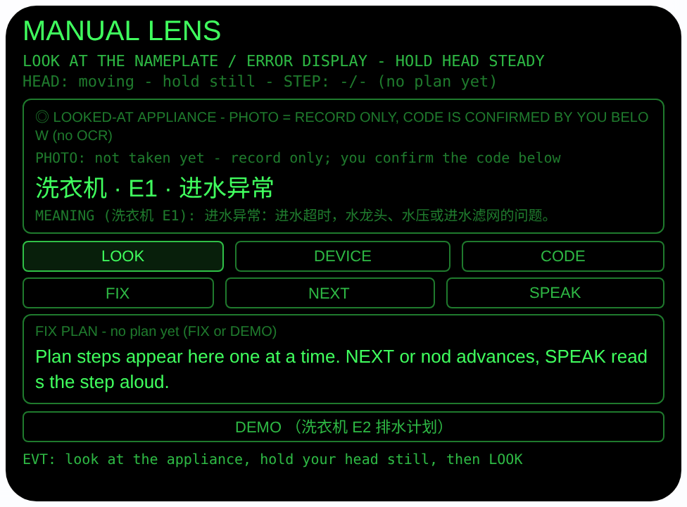
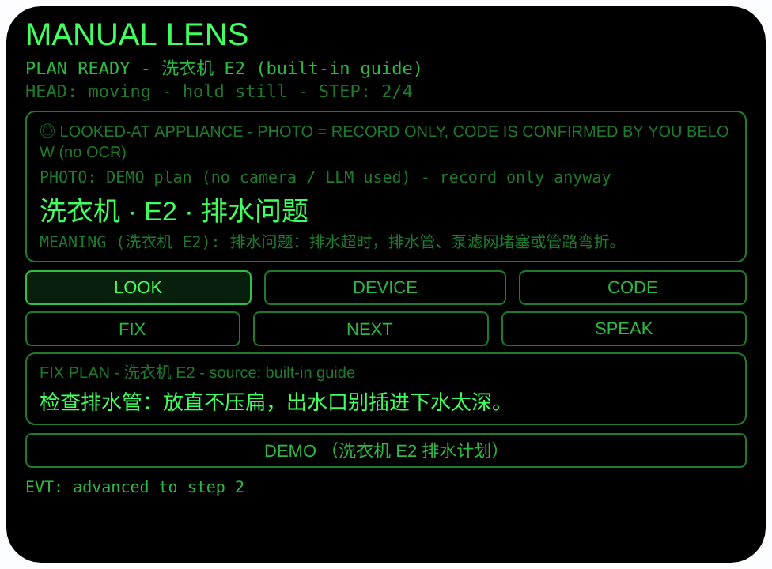

# manual-lens — 说明书眼（Rokid 眼镜 AIUI Agent）

**Studio 导入地址**（复制到 Global AIUI Studio 的 Import Project 输入框）：

```
https://github.com/sakai55/rokid/tree/agent-manual-lens
```


50 个「指向性生活问题」Agent 的第 DI05 个。家电跳出一个故障代码，
说明书早就丢了，你一只手还扶着机器、另一只手根本腾不出来翻
手机：看着铭牌/显示屏用长焦拍一张（只作记录），亲手把电器和
代码选对，眼镜就在你眼前一步一步给排查计划，语音念一步你做
一步，点头进下一步，双手全程留在机器上。

## 预览截图

截图统一存放于仓库根目录 `screenshots/manual-lens/`。





## 解决的问题

家电报错时最难受的不是不会修，是「查」的姿势不对：蹲在洗衣机
前一手扶机身一手举手机搜代码，网页还对不上型号。本 Agent 把
排查挂在视线上：你蹲在哪台机器前、看着哪个代码，就查哪台、
查哪个；计划一条条显示在眼前、念在耳边，扶机器的手不用松。

## 指向性设计（为什么必须用眼镜）

- **凝视即指向（GAZE）+ 长焦（telephoto）**：铭牌常在机器背面、
  侧面或底部，字小位置刁。看着铭牌/显示屏点 LOOK，用
  `ImageCapture.takePhoto({mode:'telephoto'})` 拍下留档——你
  看着的那台就是要修的那台，不用报型号、不用翻相册。
- **头部稳定 = 凝视确认**：`enableWorldAwareness()` 开启世界
  感知后，`onOrientationStabilityChange` 报告头部稳定时才进入
  可用状态（HEAD STEADY）；点头（`onHeadGesture` 的 `nod`）：
  没有计划时触发 LOOK 拍照，计划进行中则推进一步——手扶着
  机器时用点头代替腾手点按钮。
- **代码由你看着显示屏确认（诚实边界）**：AIUI 运行时没有可用
  的 OCR 链路把照片变成代码，所以照片只作记录，故障代码由你
  亲眼看显示屏后用 DEVICE / CODE 选择器确认（5 类家电 × 每类
  3-4 个常见代码，带简短含义）。界面全程标注
  「photo = record only, code confirmed by you (no OCR)」，
  绝不声称从照片读出了 code。
- **计划在视线内、步骤在耳朵里**：当前步骤大字显示在眼前，
  SPEAK 用 `speechSynthesis.speak` 念出当前步；修完一步点
  头进下一步，一只手扶机器、一只手干活，流程不断。

## 功能流程

1. 看着铭牌/故障显示屏，稳住头 → 状态变 `HEAD STEADY`
2. 点头，或点 LOOK，或按 Enter / GlobalHook → telephoto 拍照
   （只作记录），显示照片字节数
3. 选电器和代码：DEVICE 在 5 类家电间切换（洗衣机 / 空调 /
   热水器 / 洗碗机 / 烤箱），CODE 在该类电器的常见代码间切换
   （如洗衣机 E1 进水 / E2 排水 / E3 门锁 / E4 不平衡）；切换
   电器会把代码重置为该类第一个；ArrowUp / ArrowDown 切换
   当前聚焦的选择器（点过 DEVICE 就调电器，点过 CODE 就调
   代码）
4. 点 FIX 出计划：优先 LanguageModel 按电器 + 代码生成（原因
   一行 + 编号步骤，解析出 ≥3 步才采用，并要求第 1 步为安全
   动作）；否则内置常见原因表（每代码：含义一句 + 4 个具体
   步骤）
5. NEXT 或点头逐步推进；最后一步后显示收尾语（如
   「DONE - still showing E2? Book a technician - quote code
   E2 (洗衣机).」）；SPEAK 朗读当前步（无计划时朗读所选代码
   的含义）
6. DEMO 按钮：直接载入「洗衣机 + E2（排水问题）」的内置计划
   进入步骤视图，预览即可看到计划运行态（不依赖相机/大模型）

> 安全说明：内置表中凡涉水/涉电的电器，每个代码的第 1 步都是
> 安全动作——先断电，洗衣机/热水器/洗碗机还要关进水阀；热水器
> E4（漏电）明确要求保持断电、不要自行复位。本 Agent 给的是
> 常见原因排查指引，不是维修结论，不替代专业维修；**燃气类
> 器具（燃气热水器、燃气灶等）不在范围内**，燃气相关故障请
> 关阀通风并联系燃气公司/专业人员。

## 权限

| 权限 | 用途 |
|---|---|
| CAMERA | 取流并以 telephoto 模式拍摄所看电器的铭牌/故障显示屏（只作影像记录，不参与识别，代码由用户确认） |

相机只在用户触发时启动：拍完立即停掉全部媒体轨道；
大模型会话用完即 destroy。

## 打包与预览

```bash
cd ~/workspace/rokid/manual-lens
~/tools/bin/aix pack . -o ../dist/manual-lens.aix
~/tools/bin/aix preview . --html-out artifacts/preview.html
```

本地预览截图走 `~/workspace/preview-tools/` 的本地 Ink + puppeteer 路线
（`shot-manual.js`；计划截图的点击序列为 canvas 内 DEMO (240, 300) → NEXT (240, 205)）。

## 真机测试（海外版 · 云端下发 · Path 1）

1. 推到 GitHub 后，Global AIUI Studio（aiui-global.rokid.com，en-US）用
   分支导入：`https://github.com/sakai55/rokid/tree/agent-manual-lens`
   （该分支根目录即本 Agent 文件）
2. Studio 的 **Device Debug** 页签填 Basic Information，在 AIX Packaging
   点 **Repackage and Save**，确认顶部出现绿色
   **● Debug version ready — Ready for device debugging**
3. **Hi Rokid**（海外版 `com.rokid.sprite.global.aiapp`，不是国内版
   Rokid Ai App）→ 设置 → 开发者选项 → AIUI → 更新眼镜资源包，
   等「智能体资源包下载成功」
4. 对眼镜说「乐奇，打开 manual-lens」，蹲到报错的家电前看着显示屏
   稳住头、点头拍照，DEVICE/CODE 选对电器和代码，跟着语音一步步排查

## 真机测试信息（Global AIUI Studio · Device Debug）

| 项目 | 值 |
|---|---|
| Agent Name（Studio） | 待导入后回填 |
| Version（Build） | 1.0.0（待导入后回填） |
| App Category | 待导入后回填 |
| Intent Description | 待导入后回填 |
| Agent ID | 待导入后回填 |
| AIX Package Size | 17.64 KB（本地打包 `dist/manual-lens.aix`） |
| 状态 | 本地完成，待导入 Studio |
| Studio | aiui-global.rokid.com（en-US） |
| 下发方式 | 云端下发 → Hi Rokid（海外版）更新眼镜资源包 |

## 验证情况

**已验证**

- 静态检查：app.json / package.json JSON 解析通过；`<script def>` JSON
  解析通过；`<script setup>` 与 app.js 提取后 `node --check` 语法通过；
  全目录 grep 无 `Page(` / `App(` / `Widget(` / `workers:` 残留。
- 打包：`aix pack` 成功；`aix list` 核对包内含 README.md、AGENTS.md、
  app.js、app.json、package.json、pages/index/index.ink
  （artifacts/ 已被 .aixignore 排除）。
- 预览渲染：aix preview + 本地 Ink + puppeteer 截图两张（见下方
  Preview Media）：首页初始态完整渲染（所看电器框：电器「洗衣机」
  与代码「E1 · 进水异常」大字、含义行、LOOK/DEVICE/CODE 与
  FIX/NEXT/SPEAK 按钮、空计划框）；点 DEMO 后载入内置「洗衣机
  E2」计划，代码含义行可见，再点 NEXT 推进到 STEP 2/4，来源
  标注 built-in guide。

**未验证**

- 真机相机取流与 telephoto 模式拍铭牌/显示屏的效果（预览主机无
  相机，LOOK 的 FAIL 路径已如实写明原因，真机待测）。
- 真机 LanguageModel 生成排查计划的质量与解析成功率（预览走
  内置常见原因表路径，真机待测）。
- 真机头部稳定检测、点头推进步骤、TTS 朗读当前步的效果。
- **识别方式的产品边界**：本 Agent 不做 OCR——故障代码由用户
  看显示屏后用选择器确认，照片只作记录；这是已知边界，不是
  待补的验证项。
- **代码表的覆盖边界**：内置表只覆盖 5 类家电的常见代码与常见
  原因，给出的是常识级排查指引，不替代专业维修；燃气类器具
  不在范围内。

---

## 提审资料（Review Submission）

> Global AIUI Studio → Submit 页签的 Review Information 逐项对应下面四段，
> 提交时整段复制。每次提交前重新确认 Preview Media。

### Feature Description

Manual Lens helps when an appliance shows an error code and the manual is long gone. Look at the nameplate or display and take a telephoto record photo, then confirm the appliance and the code you see — washer, air conditioner, water heater, dishwasher or oven. The agent walks you through a step-by-step fix plan in your line of sight, read aloud with nod-to-advance, so both hands stay on the machine. Safety actions come first.

### Opening Message

Hi, I'm **Manual Lens** — your hands-free fix guide for mystery error codes.

Look at the appliance, hold your head steady, then nod or tap **LOOK** for a telephoto record photo. Tap **DEVICE** and **CODE** to confirm the appliance and the code on the display, then **FIX**: I'll show a fix plan one step at a time — **NEXT** or nod to advance, **SPEAK** to hear a step. I give common-cause guidance, not a repair verdict, and gas appliances are out of scope.

### Preview Media

提交要求：3–5 个 JPG/PNG 图片或 MP4 视频，至少含 1 张图和 1 个视频，每次提交前重新确认。

- Image 1：`artifacts/preview-manual-lens-index.png`（aix preview 首页：MANUAL LENS 初始态，含所看电器框（电器「洗衣机」+ 代码「E1 · 进水异常」大字、含义行）、LOOK/DEVICE/CODE 与 FIX/NEXT/SPEAK 按钮及空计划框，本地文件，提交时从本地上传）
- Image 2：`artifacts/preview-manual-lens-plan.png`（DEMO 载入内置「洗衣机 E2 排水问题」计划并推进到 STEP 2/4 的运行态：代码含义行 + 第 2 步内容 + 来源标注 built-in guide，本地文件）
- Video：待真机补 — 真机录制「看显示屏 → 点头拍照 → 选电器/代码 → 出计划 → 点头推进 + 朗读排查」全过程（MP4），录好后放 `artifacts/` 并更新此处
- 状态：未齐（已有 2 张图；还需至少 1 个视频，总数补到 3–5 个后才可提交）

### Change Log

#### Build 1.0.0

**Features added**

- Gaze-directed appliance troubleshooting: head-stability gaze confirmation (HEAD STEADY), nod to photograph the nameplate/error display in telephoto mode (record only) and nod to advance plan steps, ImageCapture with wx camera fallback.
- User-confirmed error codes for 5 appliance types (washer, air conditioner, water heater, dishwasher, oven), 3-4 common codes each with a short meaning, cycled by DEVICE/CODE buttons or arrow keys on the focused selector: FIX tries the on-device LanguageModel first (labeled LLM) and falls back to a built-in common-cause table — meaning plus 4 concrete steps per code (labeled built-in guide). The code is confirmed by the user from the display, never claimed to be OCR-read from the photo.
- Safety-first plans: step 1 of every built-in entry for water/electric appliances is a safety action (unplug; close the water valve where relevant), and closings route unresolved codes to a technician with the code quoted.
- DEMO loads the built-in washer E2 drainage plan straight into the step view so the running plan is visible without camera or LLM.

**Improvements**

- None (initial release).

**Fixes**

- None (initial release).
