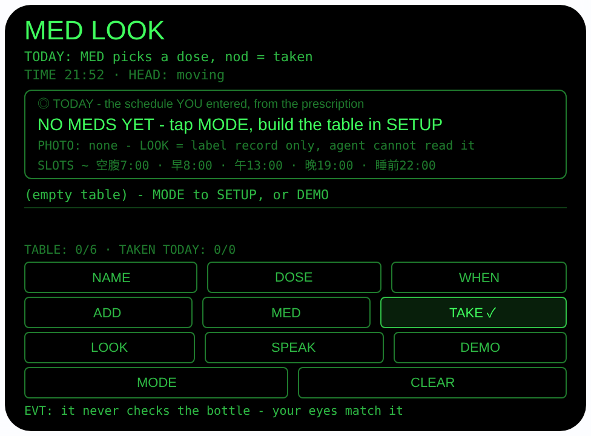
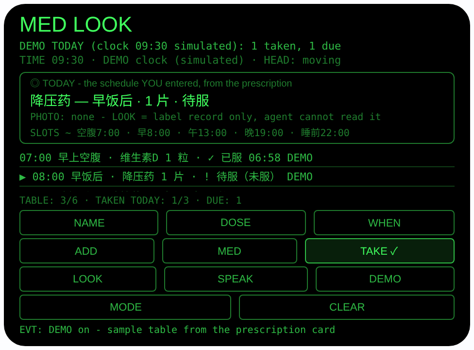

# med-look — 看药助手（Rokid 眼镜 AIUI Agent）

**Studio 导入地址**（复制到 Global AIUI Studio 的 Import Project 输入框）：

```
https://github.com/sakai55/rokid/tree/agent-med-look
```

**AIX 直接下载**（最新版）：[med-look.aix](https://raw.githubusercontent.com/sakai55/rokid/main/aix/med-look.aix)


50 个「指向性生活问题」Agent 的第 DI31 个（G 组健康安全开篇）。
老人药瓶上的字小得看不清，多瓶药的吃法又容易记混 — 这瓶是
早饭后吃还是睡前吃、吃 1 片还是 2 片，到点了全靠猜。本 Agent
把服药表预先照着处方建好，到了服药的时候你只要拿起一瓶药，
眼镜就把这一瓶的规则用大字摆出来、用声音念出来 —
「降压药，早饭后，1 片」— 你亲眼把瓶子和条目对上，点一下
头就登记已服。今天服了几样、还差哪样待服，一眼一耳都清楚。

## 预览截图

截图统一存放于仓库根目录 `screenshots/med-look/`。





## 解决的问题

吃错药、重复吃、漏吃，是多瓶药家庭最常见的三个事故，而它们
都发生在同一个瞬间：人站在药柜前，手里拿着一瓶字看不清的
药，脑子里记的是另一瓶的吃法。本 Agent 不试图「看懂」药瓶
（做不到的事不假装，见诚实说明），它做的是把「记」这件事
从人脑里搬出来：处方上的吃法一次性建成表，之后每次服药，
规则跟着你正对着的这瓶药一起出现，服没服当场打勾，重复
登记会被拦下。

## 指向性设计（为什么用眼镜）

- **看向哪瓶，规则就是哪瓶的（GAZE）**：手里拿着哪瓶药，
  就用 `ImageCapture.takePhoto({mode:'telephoto'})` 长焦
  对着它的标签拍一张留档，再用 MED 选到这条条目 — 规则
  行永远对应你正对着、正拿着的那一瓶，不是在手机里翻
  一张总表自己对号。
- **点头登记（HEAD）**：开启世界感知
  （`enableWorldAwareness()`）后，头部稳定时点头
  （`onHeadGesture` nod）= 登记当前条目已服；双手正扶着
  药瓶和水杯时不用腾手。头部没稳住的点头会被忽略并如实
  提示。Enter / GlobalHook 同样确认，ArrowUp / ArrowDown
  在 TODAY 轮换条目、在 SETUP 轮换时段。
- **说药名建表（MIC4）**：SETUP 里 NAME 先按文档方式用
  `getUserMedia` 做佩戴者（wearer）模式麦克风检查 — 4 麦
  阵列优先收你自己的声音，厨房、客厅的杂音压下去 — 再
  一次性识别药名，听到的名字**原样**显示在屏幕上等你
  核对后才 ADD（同 DI21 的逐字纪律：ASR 最容易听错的
  恰恰是名字）。
- **耳朵复核**：SPEAK 用中文念出今天还没服的清单和每条
  的时段、剂量，眼睛看不清小字的时候，耳朵再确认一遍。

## 功能流程

1. 建表（SETUP 模式，MODE 切换进入）：NAME 说出药名 →
   屏幕逐字显示、核对无误 → DOSE 轮换剂量
   （1 片 / 2 片 / 1 粒 / 半片）→ WHEN 轮换时段
   （早上空腹 / 早饭后 / 午饭后 / 晚饭后 / 睡前）→
   ADD 或点头存入 wx 同步存储（key `medTable`，最多
   6 条；同名 + 同时段拒绝重复添加；一种药一天两次
   就建两条不同时段的条目）。主机没有语音识别时 NAME
   如实显示 SKIP，改为轮换四个通用类别名预置
   （降压药 / 降糖药 / 钙片 / 维生素D — 类别称呼，
   不是真实药品品牌）。
2. 今日清单（TODAY 模式，默认）：服药表按时段排序逐条
   列出，每条带状态 — 已登记的显示「✓ 已服 + 实际
   时间」；时段已过未登记的标「! 待服（未服）」；没到
   时段的显示「未到时间」。时段时刻是界面上声明的
   近似锚点（空腹 ~7:00 / 早饭后 ~8:00 / 午饭后
   ~13:00 / 晚饭后 ~19:00 / 睡前 ~22:00），页面开着
   时每 30 秒重算一次状态。
3. 服药：拿起一瓶 → LOOK 长焦拍标签留档（照片只存
   记录，Agent 不读它）→ MED 选到这瓶的条目 → 大字行
   显示「降压药 — 早饭后 · 1 片 · 待服」→ TAKE 或
   点头登记，{药名， 时段， 日期， 时间} 追加进已服
   日志（key `medTaken`，最多 60 条）。同一条目今天
   已登记过，TAKE 拒绝并报出上次时间；时段没到提前
   服了，照实登记并标注「提前」。
4. SPEAK 朗读今天还没服的清单；CLEAR 在 SETUP 清空
   整张表、在 TODAY 只清今天的已服记录（历史保留）。
5. DEMO：从一次 Date 快照取当天日期（纯字符串，
   演示期间「今天」就锚在这份快照上），播入 3 条演示
   表 + 一条今晨已服记录（维生素D 06:58），演示时钟
   定在 09:30 并在屏幕标注「DEMO clock (simulated)」—
   于是早饭后（8:00）的降压药正好时段已过、未登记，
   一条「待服」当场亮出且被选中（见截图 2）；重入
   DEMO 先清旧演示行再播。

> 诚实说明（医疗安全边界，不可协商）：
> - **它从不核对你手里的瓶子对不对。** AIUI 运行时没有
>   OCR，长焦照片只是记录，永远不会被读取。「这瓶是
>   降压药」只能由你自己的眼睛（或家人）判断 — 拿错
>   瓶子登记，它发现不了。
> - **它从不给用药建议。** 剂量与时段全部来自你建表时
>   输入的信息；服药表必须来自处方（或医生、药师的
>   说明），不要照着预置的类别名猜着建表。
> - **漏服只显示「未服」，绝不建议补服、更不建议
>   加倍。** 错过时段就如实挂着「待服」；补不补、
>   怎么补，问医生或药师。
> - 这是记忆与记录工具，不是医疗器械，没有任何医疗
>   认证；不能替代药盒分装、家人提醒或医嘱本身。
> - 时段时刻是吃饭节奏的近似锚点，不是医学上的服药
>   时刻建议。时间来自本机时钟，设备时钟不对，待服
>   判断就会跟着不对。

## 权限

| 权限 | 用途 |
|---|---|
| CAMERA | LOOK 长焦拍药瓶标签留作照片记录（仅用户点按时启动，用完立即停轨；照片从不被读取） |
| RECORD_AUDIO | SETUP 里 NAME 一次性识别药名（佩戴者模式麦克风检查 + 识别；仅用户点按时启动） |

记录只存本机 wx 同步存储（`medTable` / `medTaken`），不上传、不联网；不用大模型。

## 打包与预览

```bash
cd ~/workspace/rokid/med-look
~/tools/bin/aix pack . -o ../dist/med-look.aix
~/tools/bin/aix preview . --html-out artifacts/preview.html
```

本地预览截图走 `~/workspace/preview-tools/` 的本地 Ink + puppeteer 路线
（`shot-med.js`；TODAY 演示截图的点击序列为 canvas 内 DEMO (391, 283)
点 1 次 — 坐标经视觉定位核准；artifacts/preview.html 需先把 importmap
的 jspm 地址换成本地 `/ink/index.js` 再复制到 preview-tools/www/）。

## 真机测试（海外版 · 云端下发 · Path 1）

1. 推到 GitHub 后，Global AIUI Studio（aiui-global.rokid.com，en-US）用
   分支导入：`https://github.com/sakai55/rokid/tree/agent-med-look`
   （该分支根目录即本 Agent 文件）
2. Studio 的 **Device Debug** 页签填 Basic Information，在 AIX Packaging
   点 **Repackage and Save**，确认顶部出现绿色
   **● Debug version ready — Ready for device debugging**
3. **Hi Rokid**（海外版 `com.rokid.sprite.global.aiapp`，不是国内版
   Rokid Ai App）→ 设置 → 开发者选项 → AIUI → 更新眼镜资源包，
   等「智能体资源包下载成功」
4. 对眼镜说「乐奇，打开 med-look」，先与家人一起照处方在 SETUP 建好
   表；到服药时拿起一瓶药 LOOK 拍标签、MED 选条目听规则、点头登记，
   再让家人核对清单里的 ✓ 与待服是否和实际一致

## 真机测试信息（Global AIUI Studio · Device Debug）

| 项目 | 值 |
|---|---|
| Agent Name（Studio） | 待导入后回填 |
| Version（Build） | 1.0.0（待导入后回填） |
| App Category | 待导入后回填 |
| Intent Description | 待导入后回填 |
| Agent ID | 待导入后回填 |
| AIX Package Size | 约 20.6 KB（本地打包 `dist/med-look.aix`） |
| 状态 | 本地完成，待导入 Studio |
| Studio | aiui-global.rokid.com（en-US） |
| 下发方式 | 云端下发 → Hi Rokid（海外版）更新眼镜资源包 |

## 验证情况

**已验证**

- 静态检查：app.json / package.json JSON 解析通过；`<script def>` JSON
  解析通过；`<script setup>` 与 app.js 提取后 `node --check` 语法通过；
  全目录 grep 无 `Page(` / `App(` / `Widget(` / `workers:` 残留；
  11 个 bindtap 处理函数全部有定义。
- 排班逻辑：把页面对象本体加载进 Node（wx 打桩）用同一份代码跑
  39 条断言全过 — 五个时段的近似时刻映射正确；07:00 时早饭后
  条目「未到」、08:00 起「待服」、登记后变「已服」且时间取自
  日志；昨天的已服记录不算今天；**同药双时段**（降压药早饭后 +
  睡前建成两条）时早上登记只命中早上那条，睡前条目 21:00
  仍「未到」、23:00 转「待服」；建表校验会丢弃剂量非法的
  条目；DEMO 播种后恰好一服已登记（06:58）、一条待服、
  一条未到，选中落在待服条目上，大字行与计数行
  （DUE: 1）一致；TAKE 在演示时钟下登记 09:30、第二次
  TAKE 被拒并报出已登记时间；ADD 对空名、同名同时段
  重复均拒绝，同名不同时段放行；重入 DEMO 不堆积。
- 预览渲染：aix preview + 本地 Ink + puppeteer 截图两张（见
  Preview Media）：首页初始态完整渲染（空表、时段锚点与
  「agent cannot read it」标注齐全）；点 DEMO 后今日态 —
  维生素D「✓ 已服 06:58」、降压药「! 待服（未服）」并被
  选中、大字行显示其规则、计数「TAKEN TODAY: 1/3 ·
  DUE: 1」，演示时钟在屏幕上如实标注 simulated。首轮截图
  曾暴露预览宿主虚拟时钟跨样本漂移导致日期对不上（已服
  未被识别）— 已按「演示日期锚定一次 Date 快照」的纪律
  修复并复拍确认。

**未验证**

- 真机上 SpeechRecognition 对老人语速/口音下药名识别的准确率，
  以及佩戴者模式在厨房等噪声环境里的实际效果（药名听错是
  本 Agent 最大的真实风险，界面逐字核对 + ADD 前确认为
  缓解手段，真机需重点试）。
- 真机长焦拍药瓶标签的成像质量（照片只作记录，不影响
  登记逻辑，但标签小字能否拍清需真机确认）。
- 真机头部稳定检测与点头登记的灵敏度（服药时的小幅点头
  会不会被判成晃动）。
- 真机 TTS 朗读剩余清单的效果；wx 同步存储在眼镜重启后
  对 `medTable` / `medTaken` 的持久性。

---

## 提审资料（Review Submission）

> Global AIUI Studio → Submit 页签的 Review Information 逐项对应下面四段，
> 提交时整段复制。每次提交前重新确认 Preview Media。

### Feature Description

Med Look is a medication memory aid for people juggling bottles with tiny print. The schedule is entered once, from the prescription: each medicine's name (spoken, kept verbatim), dose and slot. The glasses then show the day's checklist - doses logged taken with real times, doses past their slot flagged still to take. Hold a bottle, photograph its label, pick its entry, hear its rule - after breakfast, 1 tablet - then nod to log it. It never reads the label and never gives dosage advice.

### Opening Message

Hi, I'm **Med Look** - I keep your medication schedule in view.

Build the table once in **SETUP**, from the prescription: **NAME** speaks each name, **DOSE** and **WHEN** set dose and slot, **ADD** saves it. In **TODAY**, pick up a bottle, tap **LOOK** to photograph its label as a record, cycle **MED** to its entry - I'll show and say its rule - then tap **TAKE** or nod to log it taken. I never read labels myself; a missed dose just stays flagged - ask your doctor or pharmacist about those.

### Preview Media

提交要求：3–5 个 JPG/PNG 图片或 MP4 视频，至少含 1 张图和 1 个视频，每次提交前重新确认。

- Image 1：`artifacts/preview-med-look-index.png`（aix preview 首页初始态：TODAY 模式、空服药表、时段近似时刻与诚实边界标注完整渲染，本地文件，提交时从本地上传）
- Image 2：`artifacts/preview-med-look-today.png`（DEMO 今日态：演示时钟 09:30，一条已服 ✓ 06:58、一条待服被选中且大字行显示其规则、计数 DUE: 1，本地文件）
- Video：待真机补 — 真机录制「照处方建表 → 拿起药瓶 LOOK 拍标签 → MED 选条目听规则 → 点头登记已服 → SPEAK 朗读剩余清单」全过程（MP4），录好后放 `artifacts/` 并更新此处
- 状态：未齐（已有 2 张图；还需至少 1 个视频，总数补到 3–5 个后才可提交）

### Change Log

#### Build 1.0.0

**Features added**

- Prescription schedule table (SETUP mode): NAME captures each medicine's name by one-shot speech recognition after a wearer-mode microphone check and keeps it verbatim on screen for checking (honest SKIP to generic category presets - blood-pressure medicine, glucose medicine, calcium, vitamin D - where no recogniser exists); DOSE cycles 1 tablet / 2 tablets / 1 capsule / half tablet, WHEN cycles five meal-time slots, and ADD stores up to 6 entries in wx sync storage (key medTable), refusing duplicates of the same name and slot - a twice-a-day medicine is two entries.
- Today's checklist (TODAY mode): entries sorted by slot with declared approximate slot times shown on screen (fasting ~07:00, after breakfast ~08:00, after lunch ~13:00, after dinner ~19:00, bedtime ~22:00); each dose shows taken with its logged time, due and still to take once its slot has passed, or not yet time; states recompute every 30 seconds while the page is open.
- Look-and-log taking flow: LOOK takes a telephoto photo of the bottle label in hand as a record only (the agent cannot read it - matching the bottle to its entry is the wearer's own eyes); MED cycles to that bottle's entry and the rule is displayed big; TAKE, Enter, or a nod while the head is steady logs it into wx storage (key medTaken, up to 60 entries) - and logging the same dose twice is refused with the first logged time, because double-dosing is the accident this agent exists to prevent.
- Chinese TTS readout of today's remaining doses via SPEAK, and a DEMO that seeds a 3-medicine table plus one dose taken this morning from a single Date snapshot, with the simulated 09:30 clock labeled on screen, landing on the one dose that is due.
- Safety framing throughout: the table must come from the prescription, a missed dose is only ever flagged as not taken (the agent never suggests catching up or doubling a dose), and the agent is a memory and logging aid - not a medical device.

**Improvements**

- None (initial release).

**Fixes**

- None (initial release).
