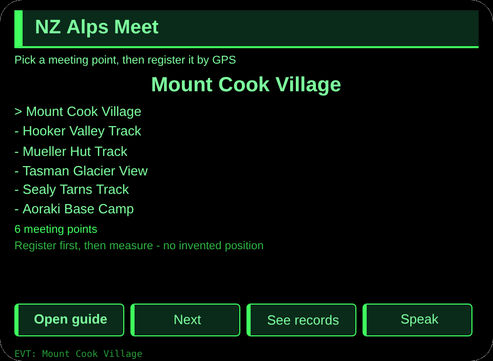
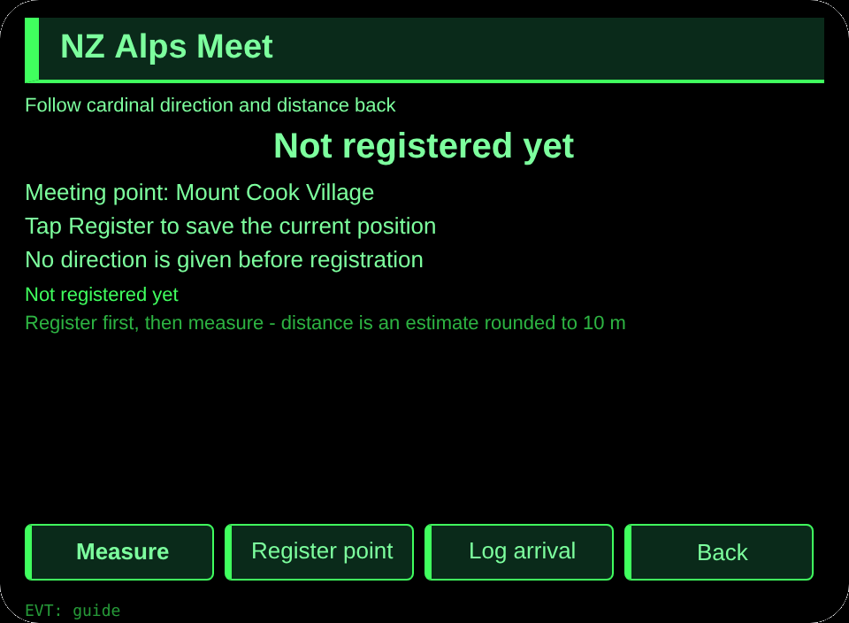
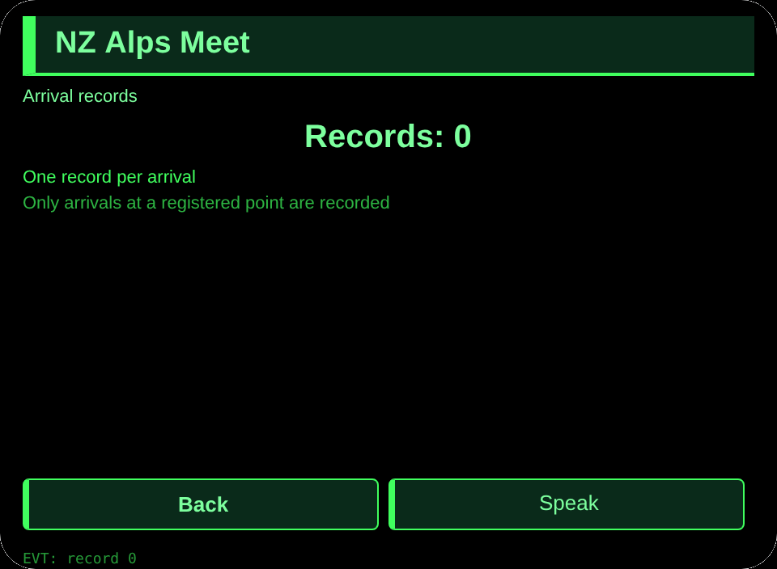

# NZ Alps Meet

**Studio import address** (copy into the Global AIUI Studio Import Project box):

```
https://github.com/sakai55/rokid/tree/agent-nz-alps-meet
```

[nz-alps-meet.aix](https://raw.githubusercontent.com/sakai55/rokid/main/aix/nz-alps-meet.aix)

## Features

A Southern Alps walker separated from friends registers a meeting point by GPS, then follows cardinal direction and distance back to it, and logs arrival.

## Scene

A Southern Alps walker, separated from friends with both hands full of bags, follows GPS cardinal direction and distance back to the registered meeting point.

## Direction composition

New Zealand local scene x directional (GPS-anchored) x curb-cut (hands-full walker separated from friends).

## Glasses-only capability

GPS-anchored direction: cardinal direction plus distance to a registered point, which a phone in a pocket cannot show in view. Wiring: app.json GEOLOCATION, guide page getCurrentPosition, _calc bearing to 8 cardinals and haversine distance.

## Pages

| Pages | Pages |
|---|---|
| pages/index | 6 meeting points |
| pages/guide | GPS register + cardinal + distance |
| pages/record | Arrival records |

## Content set

6 meeting points (Mount Cook Village, Hooker Valley Track, Mueller Hut Track, Tasman Glacier View, Sealy Tarns Track, Aoraki Base Camp).

## Cross-session storage

Storage key `nzAlpsMeetV1` (picked point, registered point, arrival records, lastError).

## Permissions

GEOLOCATION declared. No camera or media permission is used.

## Gesture map

| Single tap | Enter | Main confirm |
| Swipe up / down | ArrowUp / ArrowDown | Change selection |
| Nod | onHeadGesture('nod') | Same as main confirm |
| Double tap | Backspace | Back |

## Error codes

- `E5001` Storage write failed
- `E5002` Storage read failed
- `E3005` Speech failed
- `E8001` Navigation failed
- `E7002` Location unavailable
- `E7003` Location permission denied

- Distance is an estimate, rounded to 10 metres; indoors or in weak GPS areas the page says so and invents no position.
- No position is given before a point is registered.

## Preview screenshots





## Review Submission

### Feature Description

A Southern Alps walker separated from friends registers a meeting point by GPS, then follows cardinal direction and distance back to it, and logs arrival.

### Opening Message

A Southern Alps walker separated from friends registers a meeting point by GPS, then follows cardinal direction and distance back to it, and logs arrival.

### Preview Media

[preview-nz-alps-meet-video.mp4](https://raw.githubusercontent.com/sakai55/rokid/main/screenshots/nz-alps-meet/preview-nz-alps-meet-video.mp4)


### Change Log

- Features：First release features as above.
- Improvements：None.
- Fixes：None.

## Device test info

| Studio name | To be filled |
|---|---|
| Studio name | To be filled |
| Version / Build | To be filled |
| App Category | To be filled |
| Intent Description | To be filled |
| Agent ID | To be filled |
| Status | To be filled |
