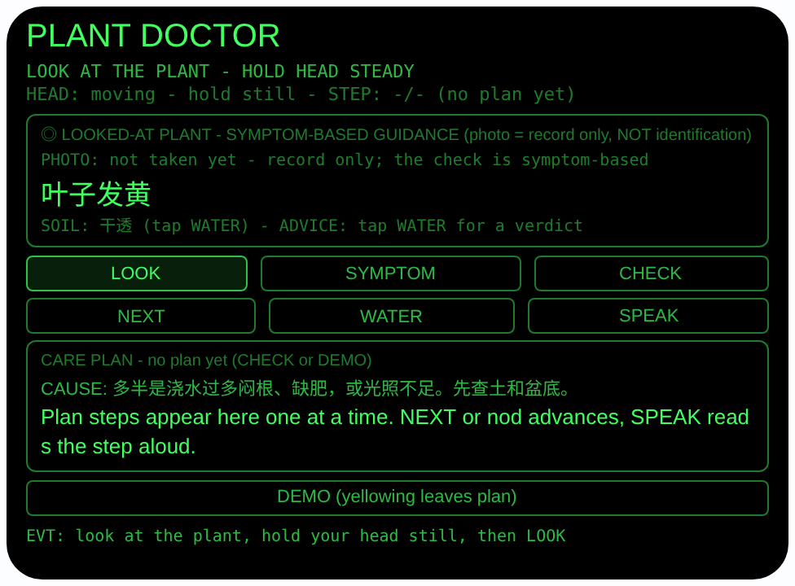
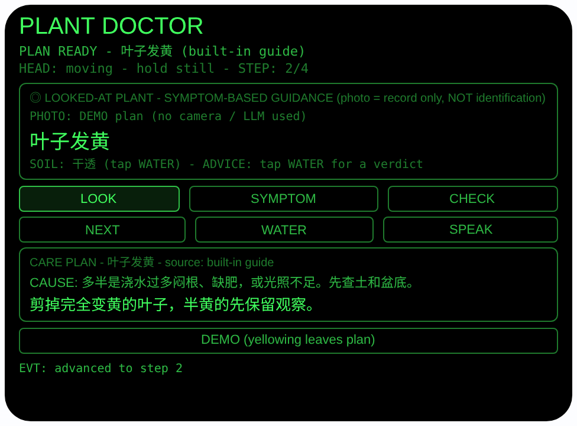

# plant-doctor — 植物医生（Rokid 眼镜 AIUI Agent）

**Studio 导入地址**（复制到 Global AIUI Studio 的 Import Project 输入框）：

```
https://github.com/sakai55/rokid/tree/agent-plant-doctor
```


50 个「指向性生活问题」Agent 的第 Z04 个。盆栽蔫了、黄了、生虫了，
你不知道出了什么问题、也不知道该不该浇水：看着植物拍一张（只作
记录），把你眼睛看到的症状选出来，眼镜按症状给出最可能的原因和
一步一步的护理计划，语音念一步你做一步，点头进下一步，双手全程
不用停。

## 预览截图

截图统一存放于仓库根目录 `screenshots/plant-doctor/`。





## 解决的问题

植物出问题时，手机查资料要放下水壶和剪刀、打字描述症状、翻半天
还对不上号。本 Agent 把诊断挂在视线上：你看哪盆、就是查哪盆；
症状是你亲眼看到的（黄叶/蔫垂/斑点/有虫/不开花），选好就出计划；
计划一条条显示在眼前、念在耳边，浇水修剪的手不用停下来点屏幕。

## 指向性设计（为什么必须用眼镜）

- **凝视即指向（GAZE）**：看着植物点 LOOK，用
  `ImageCapture.takePhoto({mode:'default'})` 拍下眼前的这盆 —
  你看着的那盆就是要查的那盆，不用先拍照再从相册里翻。
- **头部稳定 = 凝视确认**：`enableWorldAwareness()` 开启世界感知后，
  `onOrientationStabilityChange` 报告头部稳定时才进入可用状态
  （HEAD STEADY）；点头（`onHeadGesture` 的 `nod`）：没有计划时
  触发 LOOK 拍照，计划进行中则推进一步 — 浇水时用点头代替腾手
  点按钮。
- **症状由你亲眼选（诚实边界）**：本 Agent 按症状问诊、不把照片
  送模型（产品选择）；平台其实支持把现拍照片编码为 data: URL
  以 `image_url` 图片输入送入大模型，本 Agent 不用这条路径。
  所以照片只作记录，诊断按你选的可见症状走：
  CHECK 先试 LanguageModel 生成计划（标注 LLM），不可用时用
  内置专家表（标注 built-in guide），界面全程标注
  「symptom-based guidance, NOT identification」，
  绝不声称从照片认出了植物或病害。
- **计划在视线内、步骤在耳朵里**：当前步骤大字显示在眼前，
  SPEAK 用 `speechSynthesis.speak` 念出当前步；WATER 速判
  土壤状态（干透/微潮/很湿）给浇/等/禁浇建议。

## 功能流程

1. 看着植物，稳住头 → 状态变 `HEAD STEADY`
2. 点头，或点 LOOK，或按 Enter / GlobalHook → default 模式拍照
   （只作记录），显示照片字节数
3. 选症状：SYMPTOM 按钮或 ArrowUp / ArrowDown 在 5 个可见症状间
   切换（叶子发黄 / 叶子蔫垂 / 叶面斑点 / 有虫 / 只长叶不开花），
   切换症状会结束上一个计划
4. 点 CHECK 出计划：优先 LanguageModel 生成（原因一行 + 编号
   步骤，解析出 ≥3 步才采用）；否则内置专家表（每症状：可能
   原因一句 + 4 个具体步骤 + 复查收尾语）
5. NEXT 或点头逐步推进；最后一步后显示收尾语（如
   「DONE - check again in 3 days…」）；SPEAK 朗读当前步
6. WATER 轮换土壤状态（干透 → 微潮 → 很湿）并显示浇水建议
7. DEMO 按钮：直接载入「叶子发黄」的内置计划进入步骤视图，
   预览即可看到计划运行态（不依赖相机/大模型）

> 诚实说明：本 Agent 给的是「按症状的护理建议」，不是照片识别
> 诊断；植物持续恶化请咨询专业园艺师，本 Agent 不替代专业判断。

## 权限

| 权限 | 用途 |
|---|---|
| CAMERA | 取流并以 default 模式拍摄所看的植物（只作影像记录，不参与诊断） |

相机只在用户触发时启动：拍完立即停掉全部媒体轨道；
大模型会话用完即 destroy。

## 打包与预览

```bash
cd ~/workspace/rokid/plant-doctor
~/tools/bin/aix pack . -o ../dist/plant-doctor.aix
~/tools/bin/aix preview . --html-out artifacts/preview.html
```

本地预览截图走 `~/workspace/preview-tools/` 的本地 Ink + puppeteer 路线
（`shot-plant.js`；计划截图的点击序列为 canvas 内 DEMO (240, 298) → NEXT (84, 195)）。

## 真机测试（海外版 · 云端下发 · Path 1）

1. 推到 GitHub 后，Global AIUI Studio（aiui-global.rokid.com，en-US）用
   分支导入：`https://github.com/sakai55/rokid/tree/agent-plant-doctor`
   （该分支根目录即本 Agent 文件）
2. Studio 的 **Device Debug** 页签填 Basic Information，在 AIX Packaging
   点 **Repackage and Save**，确认顶部出现绿色
   **● Debug version ready — Ready for device debugging**
3. **Hi Rokid**（海外版 `com.rokid.sprite.global.aiapp`，不是国内版
   Rokid Ai App）→ 设置 → 开发者选项 → AIUI → 更新眼镜资源包，
   等「智能体资源包下载成功」
4. 对眼镜说「乐奇，打开 plant-doctor」，站在花盆前看着植物稳住头、
   点头拍照，选症状出计划，跟着语音一步步护理

## 真机测试信息（Global AIUI Studio · Device Debug）

| 项目 | 值 |
|---|---|
| Agent Name（Studio） | 待导入后回填 |
| Version（Build） | 1.0.1（待导入后回填） |
| App Category | 待导入后回填 |
| Intent Description | 待导入后回填 |
| Agent ID | 待导入后回填 |
| AIX Package Size | 约 15.2 KB（本地打包 `dist/plant-doctor.aix`） |
| 状态 | 本地完成，待导入 Studio |
| Studio | aiui-global.rokid.com（en-US） |
| 下发方式 | 云端下发 → Hi Rokid（海外版）更新眼镜资源包 |

## 验证情况

**已验证**

- 静态检查：app.json / package.json JSON 解析通过；`<script def>` JSON
  解析通过；`<script setup>` 与 app.js 提取后 `node --check` 语法通过；
  全目录 grep 无 `Page(` / `App(` / `Widget(` / `workers:` 残留。
- 打包：`aix pack` 成功；`aix list` 核对包内含 README.md、AGENTS.md、
  app.js、app.json、package.json、pages/index/index.ink
  （artifacts/ 已被 .aixignore 排除）。
- 预览渲染：aix preview + 本地 Ink + puppeteer 截图两张（见下方
  Preview Media）：首页初始态完整渲染（症状「叶子发黄」大字、
  土壤速判行、LOOK/SYMPTOM/CHECK 与 NEXT/WATER/SPEAK 按钮、空计划框）；
  点 DEMO 后载入内置「叶子发黄」计划，再点 NEXT 推进到 STEP 2/4，
  原因行与第 2 步内容（剪黄叶）正确显示，来源标注 built-in guide。

**未验证**

- 真机相机取流与 default 模式拍照的效果（预览主机无相机，
  LOOK 的 FAIL 路径已如实写明原因，真机待测）。
- 真机 LanguageModel 生成护理计划的质量与解析成功率（预览走
  内置专家表路径，真机待测）。
- 真机头部稳定检测、点头推进步骤、TTS 朗读当前步的效果。
- **诊断方式的产品边界**：本 Agent 的诊断是「按用户所选症状给
  护理建议」，不是照片识别 — 这是产品选择：平台支持把现拍照片
  以 data: URL 图片输入送入大模型，本 Agent 不用这条路径，所以
  不做、也不声称做照片认种/认病；这是已定的设计取舍，不是
  待补的验证项。

---

## 提审资料（Review Submission）

> Global AIUI Studio → Submit 页签的 Review Information 逐项对应下面四段，
> 提交时整段复制。每次提交前重新确认 Preview Media。

### Feature Description

Plant Doctor helps when a houseplant wilts and you don't know why. Look at the plant, take a record photo, and pick the symptom you can see — yellowing, drooping, spots, pests or no flowers. The agent gives the likely cause and a step-by-step care plan, shown one step at a time and read aloud, with nod-to-advance so your hands stay free for watering and trimming. A soil check adds a water-or-wait verdict.

### Opening Message

Hi, I'm **Plant Doctor** — tell me what you see, and I'll walk you through the fix, hands free.

Look at your plant, hold your head steady, then nod or tap **LOOK** for a record photo. Tap **SYMPTOM** (or arrow keys) to pick what you see, then **CHECK**: I'll show the likely cause and a care plan one step at a time — **NEXT** or nod to advance, **SPEAK** to hear a step, **WATER** for a water-or-wait verdict. Guidance follows the symptom you pick; I don't identify plants from photos.

### Preview Media

提交要求：3–5 个 JPG/PNG 图片或 MP4 视频，至少含 1 张图和 1 个视频，每次提交前重新确认。

- Image 1：`artifacts/preview-plant-doctor-index.png`（aix preview 首页：PLANT DOCTOR 初始态，含所看植物框（症状大字「叶子发黄」、土壤速判行）、LOOK/SYMPTOM/CHECK 与 NEXT/WATER/SPEAK 按钮及空计划框，本地文件，提交时从本地上传）
- Image 2：`artifacts/preview-plant-doctor-plan.png`（DEMO 载入内置「叶子发黄」计划并推进到 STEP 2/4 的运行态：可能原因行 + 第 2 步内容 + 来源标注 built-in guide，本地文件）
- Video：待真机补 — 真机录制「看植物 → 点头拍照 → 选症状 → 出计划 → 点头推进 + 朗读护理」全过程（MP4），录好后放 `artifacts/` 并更新此处
- 状态：未齐（已有 2 张图；还需至少 1 个视频，总数补到 3–5 个后才可提交）

### Change Log

#### Build 1.0.1

**Features added**

- None (documentation-accuracy fix only).

**Improvements**

- None.

**Fixes**

- Corrected the documented reason photos are not sent to the model: earlier text claimed the runtime's model image input accepts URLs only and a freshly captured photo could not be submitted. The platform in fact accepts a captured photo as a data: URL `image_url` input; this agent's symptom-based, text-only design is a product choice, and the docs (README + AGENTS.md) now say so (capability-boundary audit 2026-10-24).

#### Build 1.0.0

**Features added**

- Gaze-directed plant check: head-stability gaze confirmation (HEAD STEADY), nod to photograph (default mode, record only) and nod to advance plan steps, ImageCapture with wx camera fallback.
- Symptom-driven care plans for 5 visible symptoms (yellowing, drooping, leaf spots, pests, leaves-but-no-flowers), cycled by button or arrow keys: CHECK tries the on-device LanguageModel first (labeled LLM) and falls back to a built-in expert table — likely cause plus 4 concrete steps and a recheck closing line per symptom (labeled built-in guide).
- Step-by-step hands-free care: one large step at a time, NEXT or nod advances, SPEAK reads the current step aloud; WATER cycles soil state （干透/微潮/很湿） with a water / wait / do-not-water verdict.
- DEMO loads the built-in yellowing-leaves plan straight into the step view so the running plan is visible without camera or LLM.

**Improvements**

- None (initial release).

**Fixes**

- None (initial release).
