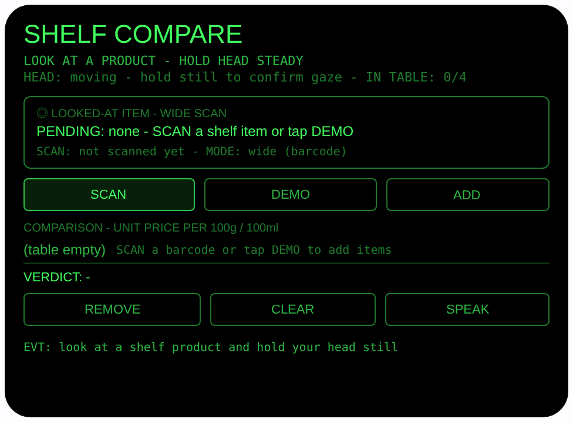
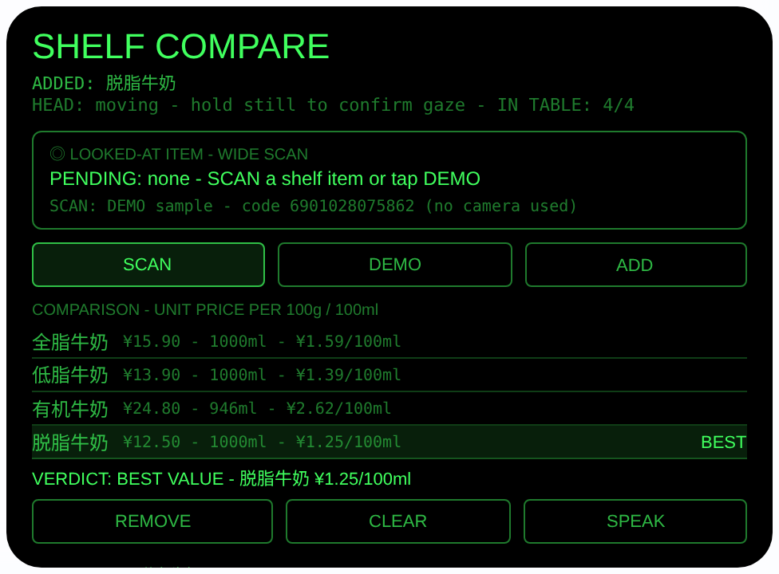

# shelf-compare — 看货比价（Rokid 眼镜 AIUI Agent）

**Studio 导入地址**（复制到 Global AIUI Studio 的 Import Project 输入框）：

```
https://github.com/sakai55/rokid/tree/agent-shelf-compare
```

**AIX 直接下载**（最新版）：[shelf-compare.aix](https://raw.githubusercontent.com/sakai55/rokid/main/aix/shelf-compare.aix)


50 个「指向性生活问题」Agent 的第 DI02 个。在超市里同类商品看花眼、价格和
规格记不住没法比时：看着货架上的商品扫一下条码，一个个加进眼镜里的
对比表，单位价自动算好、最划算的一件标出来，并朗读给你听。

## 预览截图

截图统一存放于仓库根目录 `screenshots/shelf-compare/`。





## 解决的问题

超市里同类商品摆满一整面货架：价格、净含量各不相同，单位价要心算，
看完第三件就忘了第一件。手机比价要一件件拿起来扫、再切应用记录，
手推购物车根本腾不出手。本 Agent 让「看向哪件、就扫哪件」：视线即
选择器，对比表就在视线里，结论用耳朵收。

## 指向性设计（为什么必须用眼镜）

- **凝视即指向（GAZE）+ 宽幅扫码**：看着商品，用
  `ImageCapture.takePhoto({mode:'wide'})` 拍条码（media 文档注明 wide
  模式用于条码扫描），再用 `BarcodeDetector.detect` 解码 — 看哪件，
  扫哪件，不用把商品拿下来对手机。
- **头部稳定 = 凝视确认**：`enableWorldAwareness()` 开启世界感知后，
  `onOrientationStabilityChange` 报告头部稳定时才进入可扫状态
  （HEAD STEADY）；点头（`onHeadGesture` 的 `nod`）在无待确认项时
  触发扫码、有待确认项时确认加入对比表 — 用点头代替腾手点按钮；
  清空表格用 CLEAR 按钮。
- **对比表在视线内**：最多 4 件商品的价格、规格、单位价
  （每 100g / 100ml）同屏对照，单位价最低的一行高亮标 BEST，
  一行结论（VERDICT）始终可见。
- **耳朵收结论**：SPEAK 用 `speechSynthesis.speak` 朗读
  「Best value: …」，眼睛不用离开货架。

## 功能流程

1. 看着商品，稳住头 → 状态变 `HEAD STEADY`
2. 点头，或点 SCAN，或按 Enter / GlobalHook → wide 拍照 +
   BarcodeDetector 解码，显示格式与码值
3. 码值查内置演示目录：命中 → 显示名称/价格/规格/单位价；
   未命中 → 以「Unknown item + 原始码值」待确认（如实标注，
   无价格不参与单位价比较）
4. 点头或点 ADD 确认加入对比表（最多 4 件，重复码会提示已在表中）
5. 表格自动重算单位价并标 BEST、更新结论；REMOVE 删最后一行，
   CLEAR 清空
6. 点 SPEAK 朗读结论
7. DEMO 按钮：依次取内置四种牛奶作为待确认项，预览即可看到
   装满的对比表

> 诚实说明：内置目录是演示数据（约 10 件常见商品，价格/规格为
> 示例值），不是实时商超数据；条码解码只在真机链路生效，预览主机
> 没有相机，SCAN 会如实显示 FAIL 并写明原因，绝不假装扫到。

## 权限

| 权限 | 用途 |
|---|---|
| CAMERA | 取流并用 wide 模式拍摄所看商品的条码 |

仅此一项。相机只在用户触发时启动，拍完立即停掉全部媒体轨道。

## 打包与预览

```bash
cd ~/workspace/rokid/shelf-compare
~/tools/bin/aix pack . -o ../dist/shelf-compare.aix
~/tools/bin/aix preview . --html-out artifacts/preview.html
```

本地预览截图走 `~/workspace/preview-tools/` 的本地 Ink + puppeteer 路线
（`shot-shelf.js`；填表截图的点击序列为 canvas 内 DEMO (240, 154) 与
ADD (390, 154) 交替各 4 次）。

## 真机测试（海外版 · 云端下发 · Path 1）

1. 推到 GitHub 后，Global AIUI Studio（aiui-global.rokid.com，en-US）用
   分支导入：`https://github.com/sakai55/rokid/tree/agent-shelf-compare`
   （该分支根目录即本 Agent 文件）
2. Studio 的 **Device Debug** 页签填 Basic Information，在 AIX Packaging
   点 **Repackage and Save**，确认顶部出现绿色
   **● Debug version ready — Ready for device debugging**
3. **Hi Rokid**（海外版 `com.rokid.sprite.global.aiapp`，不是国内版
   Rokid Ai App）→ 设置 → 开发者选项 → AIUI → 更新眼镜资源包，
   等「智能体资源包下载成功」
4. 对眼镜说「乐奇，打开 shelf-compare」，在超市看着商品稳住头、点头扫码

## 真机测试信息（Global AIUI Studio · Device Debug）

| 项目 | 值 |
|---|---|
| Agent Name（Studio） | 待导入后回填 |
| Version（Build） | 1.0.1（待导入后回填） |
| App Category | 待导入后回填 |
| Intent Description | 待导入后回填 |
| Agent ID | 待导入后回填 |
| AIX Package Size | 12.84 KB（本地打包 `dist/shelf-compare.aix`） |
| 状态 | 本地完成，待导入 Studio |
| Studio | aiui-global.rokid.com（en-US） |
| 下发方式 | 云端下发 → Hi Rokid（海外版）更新眼镜资源包 |

## 验证情况

**已验证**

- 静态检查：app.json / package.json JSON 解析通过；`<script def>` JSON
  解析通过；`<script setup>` 与 app.js 提取后 `node --check` 语法通过；
  全目录 grep 无 `Page(` / `App(` / `Widget(` / `workers:` 残留。
- 打包：`aix pack` 成功，`dist/shelf-compare.aix` 12.84 KB；`aix list`
  核对包内含 AGENTS.md、app.js、app.json、package.json、
  pages/index/index.ink（artifacts/ 已被 .aixignore 排除）。
- 预览渲染：aix preview + 本地 Ink + puppeteer 截图两张（见下方
  Preview Media）：首页初始态完整渲染；DEMO→ADD 交替 4 次后对比表
  装满 4 种牛奶，单位价 ¥1.59 / ¥1.39 / ¥2.62 / ¥1.25 每 100ml
  计算正确，最低的脱脂牛奶行高亮标 BEST，结论行显示
  「VERDICT: BEST VALUE - 脱脂牛奶 ¥1.25/100ml」。

**未验证**

- 真机相机取流、wide 模式拍照与 BarcodeDetector 条码解码
  （预览主机无相机，SCAN 的 FAIL 路径已如实写明原因，真机待测）。
- 真机头部稳定检测、点头手势、TTS 朗读结论的效果。
- 内置目录为演示数据（约 10 件商品的示例价格/规格），未接任何
  实时商超数据源；未知条码只能以 Unknown item 加入、无单位价。

---

## 提审资料（Review Submission）

> Global AIUI Studio → Submit 页签的 Review Information 逐项对应下面四段，
> 提交时整段复制。每次提交前重新确认 Preview Media。

### Feature Description

Shelf Compare turns your gaze into a price-comparison tool. Look at a product on the shelf and scan its barcode with the wide camera: each scanned item joins a comparison table of up to four products, with unit prices per 100g or 100ml computed automatically and the best value flagged. Nod to confirm each item, and hear the verdict read aloud. A built-in sample catalog covers common products for the prototype.

### Opening Message

Hi, I'm **Shelf Compare** — look, scan, and buy the best value.

Aim at a product on the shelf, hold your head steady, then nod or tap **SCAN** to read its barcode. Nod again (or tap **ADD**) to put it in the table — up to 4 items, unit prices compared automatically, the best one flagged **BEST**. Tap **SPEAK** to hear the verdict, **REMOVE** to drop the last item, **CLEAR** to start over, or **DEMO** to try sample products.

### Preview Media

提交要求：3–5 个 JPG/PNG 图片或 MP4 视频，至少含 1 张图和 1 个视频，每次提交前重新确认。

- Image 1：`artifacts/preview-shelf-compare-index.png`（aix preview 首页：SHELF COMPARE 初始态，含待确认框、SCAN/DEMO/ADD 按钮与空对比表，本地文件，提交时从本地上传）
- Image 2：`artifacts/preview-shelf-compare-table.png`（DEMO 填表后的结果态：4 种牛奶单位价对照、脱脂牛奶标 BEST、结论行，本地文件）
- Video：待真机补 — 真机录制「看商品 → 点头扫码 → 加入对比表 → 朗读结论」全过程（MP4），录好后放 `artifacts/` 并更新此处
- 状态：未齐（已有 2 张图；还需至少 1 个视频，总数补到 3–5 个后才可提交）

### Change Log

#### Build 1.0.1

**Features added**

- None.

**Improvements**

- None.

**Fixes**

- Removed the undocumented 'shake' head-gesture branch; head gestures use the documented 'nod' only (capability-boundary audit 2026-10-24).

#### Build 1.0.0

**Features added**

- Gaze-directed barcode comparison: head-stability gaze confirmation (HEAD STEADY), nod to scan and nod to confirm, ImageCapture wide-mode photo plus BarcodeDetector decoding, with wx camera fallback (wx photo bytes wrapped with mimeType before detection).
- Comparison table for up to 4 items with automatic unit prices per 100g/100ml, BEST flag on the lowest unit price and a one-line verdict; unknown barcodes join honestly as Unknown item and are excluded from unit-price comparison.
- Built-in sample catalog of about 10 common products keyed by EAN-13; DEMO cycles four milks into the pending slot; SPEAK reads the verdict aloud; REMOVE/CLEAR manage the table.

**Improvements**

- None (initial release).

**Fixes**

- None (initial release).
