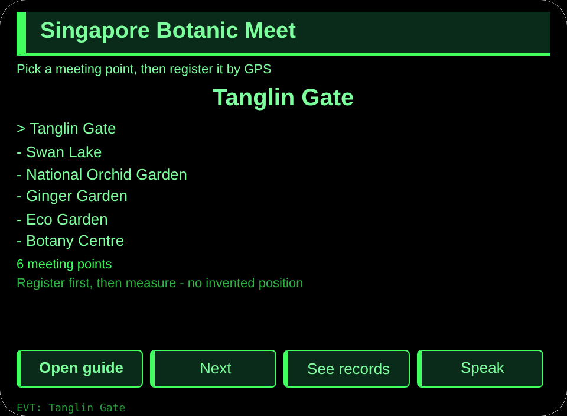
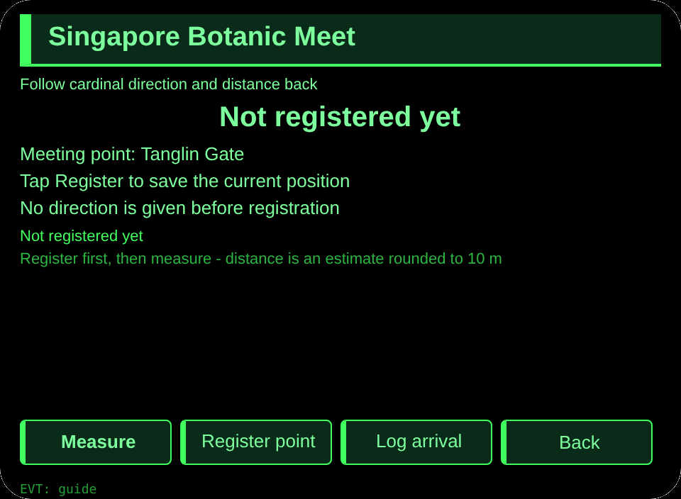
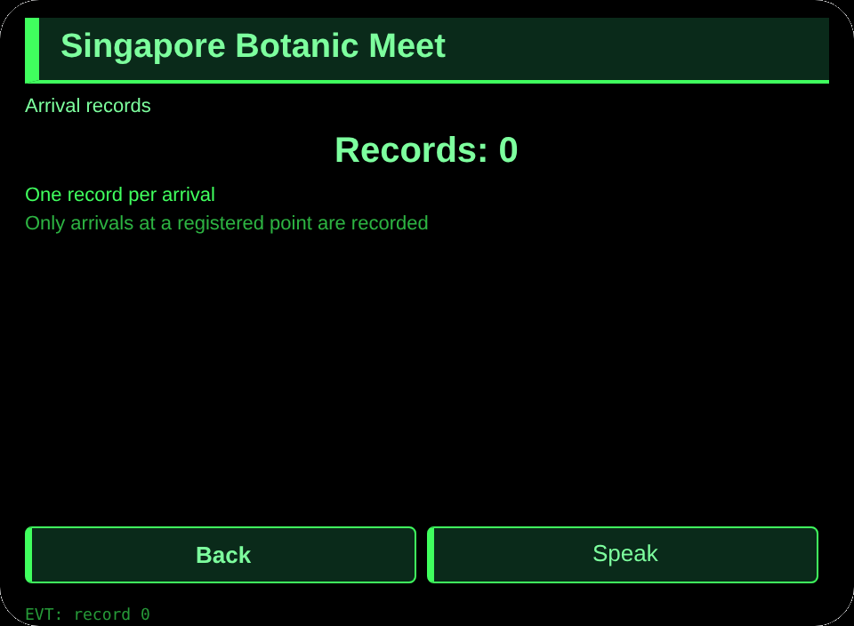

# Singapore Botanic Meet

**Studio import address** (copy into the Global AIUI Studio Import Project box):

```
https://github.com/sakai55/rokid/tree/agent-singapore-botanic-meet
```

[singapore-botanic-meet.aix](https://raw.githubusercontent.com/sakai55/rokid/main/aix/singapore-botanic-meet.aix)

## Features

Singapore Botanic Gardens walkers separated from companions, both hands full of bags, follow GPS cardinal direction and distance back to the registered meeting point, and log arrival.

## Scene

Singapore Botanic Gardens walkers separated from companions, both hands full of bags, follow GPS cardinal direction and distance back to the registered meeting point without taking out a phone.

## Direction composition

Singapore local scene x directional (GPS-anchored) x curb-cut (hands-full walkers separated from companions). Three gates: scene (walkers separated in the gardens, hands full of bags, need to get back to the meeting point); loop (pick a point, register it by GPS, follow cardinal direction and distance, log arrival); thickness (6 real meeting points + multi-step flow + cross-session records). Directional carries the GPS-anchored guidance; curb-cut carries the hands-full, no-phone-in-hand use.

## Glasses-only capability

GPS-anchored direction: cardinal direction plus distance to a registered point, which a phone in a pocket cannot show in view. Wiring: app.json GEOLOCATION, guide page getCurrentPosition with existence guard, _calc bearing to 8 cardinals and haversine distance.

## Pages

| Pages | Pages |
|---|---|
| pages/index | 6 meeting points |
| pages/guide | GPS register + cardinal + distance |
| pages/record | Arrival records |

## Content set

6 meeting points (Tanglin Gate, Swan Lake, National Orchid Garden, Ginger Garden, Eco Garden, Botany Centre).

## Cross-session storage

Storage key `singaporeBotanicMeetV1` (picked point, registered point, arrival records, lastError).

## Permissions

GEOLOCATION declared. No camera or media permission is used.

## Gesture map

| Single tap | Enter | Main confirm |
| Swipe up / down | ArrowUp / ArrowDown | Change selection |
| Nod | onHeadGesture('nod') | Same as main confirm |
| Double tap | Backspace | Back |

## Error codes

- `E5001` Storage write failed
- `E5002` Storage read failed
- `E3005` Speech failed
- `E8001` Navigation failed
- `E7002` Location unavailable
- `E7003` Location permission denied

- Distance is an estimate, rounded to 10 metres; indoors or in weak GPS areas the page says so and invents no position.
- No position is given before a point is registered.
- Preview cannot present live GPS: the review video shows only the register-and-measure flow the preview can show, with no position invented.

## Preview screenshots





## Review Submission

### Feature Description

Singapore Botanic Gardens walkers separated from companions, both hands full of bags, follow GPS cardinal direction and distance back to the registered meeting point, and log arrival.

### Opening Message

Singapore Botanic Gardens walkers separated from companions, both hands full of bags, follow GPS cardinal direction and distance back to the registered meeting point, and log arrival.

### Preview Media

[preview-singapore-botanic-meet-video.mp4](https://raw.githubusercontent.com/sakai55/rokid/main/screenshots/singapore-botanic-meet/preview-singapore-botanic-meet-video.mp4)


### Change Log

- Features：First release features as above.
- Improvements：None.
- Fixes：None.

## Device test info

| Studio name | To be filled |
|---|---|
| Studio name | To be filled |
| Version / Build | To be filled |
| App Category | To be filled |
| Intent Description | To be filled |
| Agent ID | To be filled |
| Status | To be filled |
