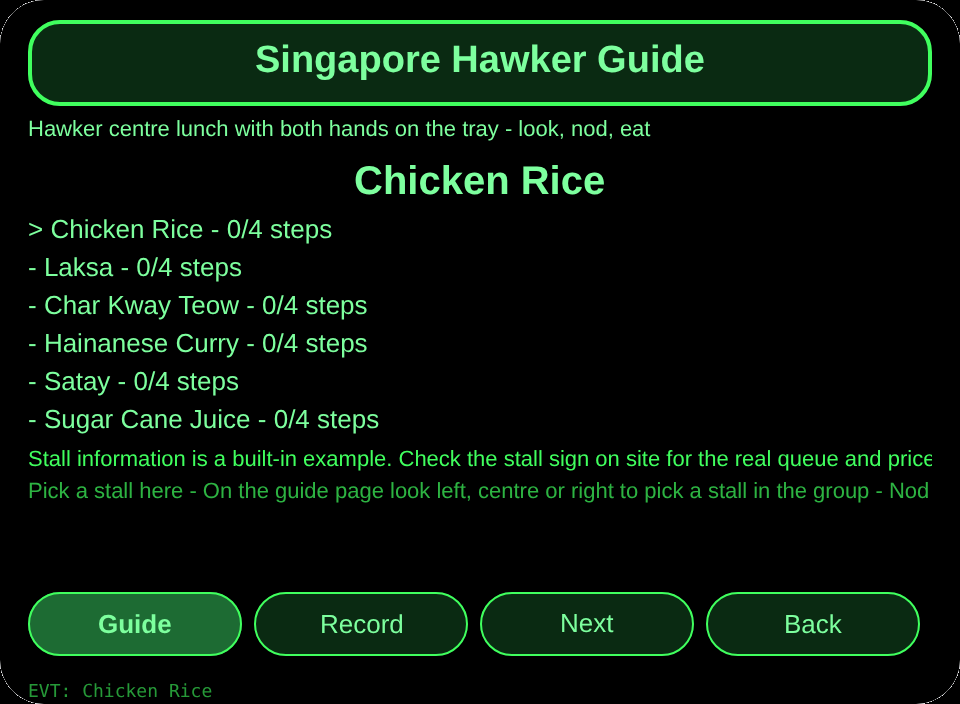
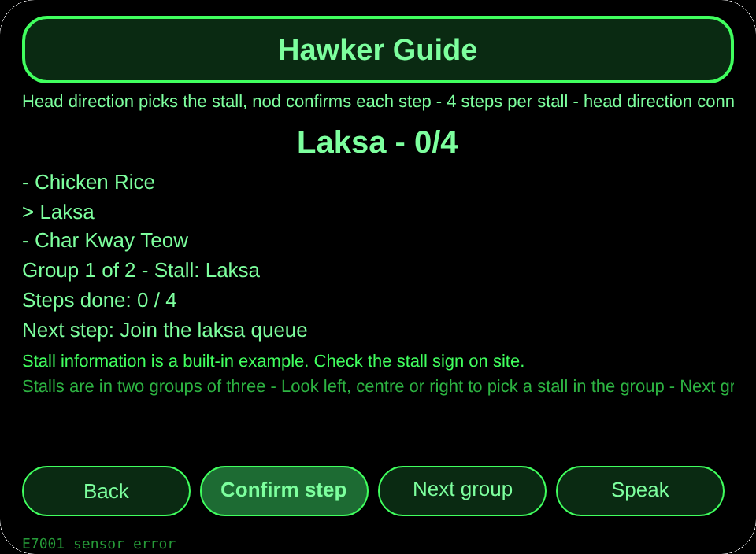
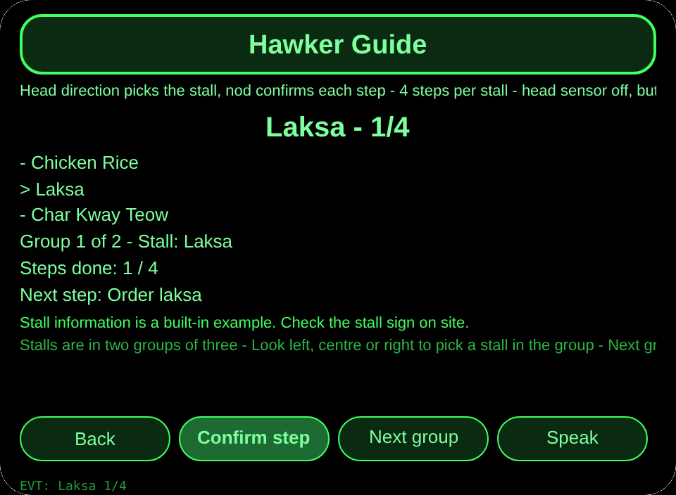
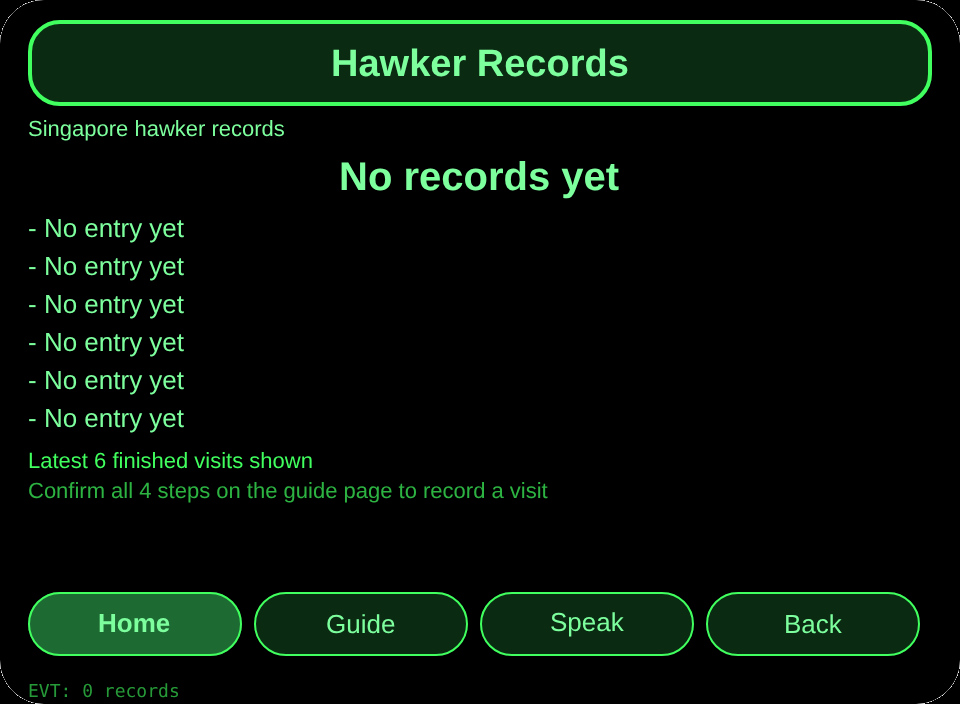

# Singapore Hawker Guide

**Studio import address** (copy into the Import Project box in Global AIUI Studio):

```
https://github.com/sakai55/rokid/tree/agent-singapore-hawker-guide
```

**Latest AIX download:** [singapore-hawker-guide.aix](https://raw.githubusercontent.com/sakai55/rokid/main/aix/singapore-hawker-guide.aix)

AIX size: 12,001 bytes.

DI57 singapore-hawker-guide - Singapore - Curb-cut x attention x directional. At a Singapore hawker centre, a diner with both hands on a tray picks a stall by head direction and nods through queue, order, collect, and tray return, then records one finished visit, without taking a phone out.

## Direction mix

Curb-cut x attention x directional

## Scene

At a Singapore hawker centre, a diner with both hands on a tray picks a stall by head direction and nods through queue, order, collect, and tray return, then records one finished visit, without taking a phone out.

## Glasses-exclusive capability

Hands-free stall picking while carrying a tray: the diner looks left, centre, or right to pick a stall in the current group and nods to confirm each step while both hands hold the tray. A phone guide needs a free hand at exactly the moment both hands are busy, so removing head picking and nod confirm breaks the loop.

Wiring evidence: pages/guide/index.ink _startSensor with a typeof guard on AbsoluteOrientationSensor maps yaw below minus 0.35, centre, and above plus 0.35 to the three stalls of the current group, with buttons as fallback and E7001 on sensor failure; primaryTap calls confirmTap, which advances the 4-step check for the picked stall and writes a record only at 4 of 4. No GPS is used: direction here is head direction, not location, and no live queue time or price is claimed.

## Pages

| Page | Role |
|---|---|
| pages/index | 6 hawker stalls with steps done per stall |
| pages/guide | Head yaw picks a stall in the current group of 3, nod confirms each of 4 steps, 4 steps write a visit record |
| pages/record | Latest 6 finished visits and total count |

## Content set

6 stalls, each with 4 confirmation steps (queue, order, collect, return tray): Chicken Rice, Laksa, Char Kway Teow, Hainanese Curry, Satay, Sugar Cane Juice. Stalls are split into two groups of three on the guide page. Finished visits are counted by their real number.

## Persistence

Cross-session storage key `singaporeHawkerGuideV1`: picked stall, current group, steps done per stall, finished-visit records array, lastError.

## Permissions

No permissions are declared. Head direction uses the device orientation sensor and spoken feedback uses the host speech path; no location or camera is used, and no live queue time or price is claimed.

## Gesture map

| Temple touchpad gesture | Key event | Role in this agent |
|---|---|---|
| Single tap | Enter | Main confirm (the main button on each page) |
| Swipe up / swipe down | ArrowUp / ArrowDown | Change the selection |
| Nod (head steady) | onHeadGesture nod | Same as main confirm |
| Double tap | Backspace | Back to the previous page |

## Error codes

- `E5001` Storage write failed
- `E5002` Storage read failed
- `E3005` Spoken feedback failed
- `E8001` Page move failed
- `E7001` Head direction sensor failed

Failures always show the bare code on screen, and lastError keeps the code plus slug, version, and original text.

## Preview screenshots






## Review submission

### Feature Description

A Singapore hawker centre guide for a diner carrying a tray: pick a stall by head direction and nod through queue, order, collect, and tray return. Six stalls in two groups of three, four steps per stall, and a visit record only when all four steps are confirmed.

### Opening Message

Pick a stall by looking at it and nod through queue, order, collect, and tray return. All four steps done means one visit recorded.

### Preview Media

- [preview-singapore-hawker-guide-video.mp4](https://raw.githubusercontent.com/sakai55/rokid/main/screenshots/singapore-hawker-guide/preview-singapore-hawker-guide-video.mp4)
- `preview-singapore-hawker-guide-index.png`
- `preview-singapore-hawker-guide-guide-s2.png`
- `preview-singapore-hawker-guide-record.png`

### Change Log

- Features added: 6 hawker stalls in two groups, head-direction stall picking, 4-step nod confirm per stall, and visit records only at 4 of 4.
- Improvements: None in this first build.
- Fixes: None in this first build.

## Device test info

| Item | Value |
|---|---|
| Studio name | Not entered |
| Version | 1.0.0 |
| Category | Not entered |
| Intent description | Not entered |
| Agent ID | Not entered |
| Status | Not imported |
